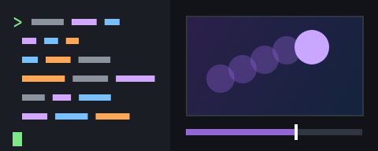

# Awesome Code Animation

**Open-source tools for making animations and music videos with code, indexed by visual style.** [中文](README.md)

    

**[🔎 Interactive version: filter by style, search, sort, see how projects relate](https://syydaniel.github.io/awesome-code-animation/)** (Chinese UI)

## What this is

Pick a look first, then a tool. Every project here draws or renders its frames in code: Manim-style math explainers, flat motion graphics, shaders, pixel art, ASCII, music visualizers, MMD dance videos, ink-wash landscapes, oscilloscope art, plotter drawings and more. A project that can do several looks appears under each of them.

## Rules

- **Frames must be drawn or rendered by code.** Projects that make their pictures with image or video generation models are left out; agent projects that render through Blender are left out too. Optional generation features are noted per project.
- **Main styles:** 1,000+ stars, or 200+ stars with a push in the last year.
- **Niche styles and the Claude / Opus section:** 50+ stars with a push in the last year.
- Archived repositories are not listed. Status: 🟢 pushed within 6 months · 🟡 within 2 years · ⚪ older.
- Stars and status refresh every Monday through GitHub Actions. Data as of 2026-11-03.

## Style index

<table>
<tr><td align="center" width="33%"> <b><a href="#math">Math Explainer</a></b> 数学讲解风 · 20 projects</td><td align="center" width="33%"> <b><a href="#mg">Motion Graphics</a></b> 扁平 MG 动效 · 82 projects</td><td align="center" width="33%"> <b><a href="#code">Code & Terminal Demo</a></b> 代码演示风 · 16 projects</td></tr>
<tr><td align="center" width="33%"> <b><a href="#type">Kinetic Type & Lyrics</a></b> 动态文字 · 歌词 · 27 projects</td><td align="center" width="33%"> <b><a href="#short">Shorts, Captions & Editing</a></b> 短视频 · 字幕 · 快剪 · 28 projects</td><td align="center" width="33%"> <b><a href="#agent">Claude & Opus Code Animation</a></b> Claude / Opus 写代码出片 · 85 projects</td></tr>
<tr><td align="center" width="33%"> <b><a href="#hand">Hand-drawn & Whiteboard</a></b> 手绘 · 白板 · 水彩 · 20 projects</td><td align="center" width="33%"> <b><a href="#gen">Generative Art</a></b> 生成艺术 · 几何 · 32 projects</td><td align="center" width="33%"> <b><a href="#shader">Shaders & Psychedelic</a></b> 着色器 · 迷幻光影 · 34 projects</td></tr>
<tr><td align="center" width="33%"> <b><a href="#live">Live Coding & VJ</a></b> Live Coding · VJ · 9 projects</td><td align="center" width="33%"> <b><a href="#audio">Music Visualization</a></b> 音乐可视化 · 25 projects</td><td align="center" width="33%"> <b><a href="#3d">3D</a></b> 3D 渲染 · 49 projects</td></tr>
<tr><td align="center" width="33%"> <b><a href="#anime">Anime, MMD & VRM</a></b> 二次元 · MMD · VRM · 9 projects</td><td align="center" width="33%"> <b><a href="#particle">Particles & Physics</a></b> 粒子 · 流体 · 物理 · 20 projects</td><td align="center" width="33%"> <b><a href="#glitch">Glitch & Post FX</a></b> 故障 · 后期特效 · 12 projects</td></tr>
<tr><td align="center" width="33%"> <b><a href="#pixel">Pixel & Retro</a></b> 像素 · 复古 · 20 projects</td><td align="center" width="33%"> <b><a href="#ascii">ASCII & Terminal</a></b> ASCII · 终端 · 21 projects</td><td align="center" width="33%"> <b><a href="#data">Data Animation</a></b> 数据可视化动画 · 26 projects</td></tr>
</table>

### Niche styles

<table>
<tr><td align="center" width="33%"> <b><a href="#ink">Ink Wash</a></b> 水墨 · 山水 · 4 projects</td><td align="center" width="33%"> <b><a href="#hanzi">Handwriting & Strokes</a></b> 汉字 · 手写笔画 · 4 projects</td><td align="center" width="33%"> <b><a href="#scope">Oscilloscope & Vector</a></b> 示波器 · 矢量光线 · 2 projects</td></tr>
<tr><td align="center" width="33%"> <b><a href="#plotter">Plotter & Line Art</a></b> 绘图仪 · 单线画 · 6 projects</td><td align="center" width="33%"> <b><a href="#dither">Dither & 1-bit</a></b> 抖动 · 1-bit · 5 projects</td><td align="center" width="33%"> <b><a href="#riso">Riso & Paper Collage</a></b> Riso · 剪纸拼贴 · 5 projects</td></tr>
<tr><td align="center" width="33%"> <b><a href="#alife">Artificial Life</a></b> 人工生命 · 元胞自动机 · 6 projects</td><td align="center" width="33%"> <b><a href="#procgen">Procedural Generation</a></b> 程序化生成 · 波函数坍缩 · 9 projects</td><td align="center" width="33%"> <b><a href="#fractal">Fractals & Math Art</a></b> 分形 · 数学艺术 · 4 projects</td></tr>
<tr><td align="center" width="33%"> <b><a href="#iso">Isometric & Voxel</a></b> 等距 · 体素 · 9 projects</td><td align="center" width="33%"> <b><a href="#scifi">Sci-fi HUD</a></b> 科幻 HUD · 赛博界面 · 4 projects</td><td align="center" width="33%"> <b><a href="#map">Map & Route</a></b> 地图 · 路线动画 · 8 projects</td></tr>
<tr><td align="center" width="33%"> <b><a href="#demoscene">Demoscene</a></b> Demoscene 演示场景 · 7 projects</td></tr>
</table>

## Main styles

### Math Explainer

> 数学讲解风 · 20 projects

| Project | Stars | Status | Description |
| --- | ---: | :---: | --- |
| [Manim (3b1b)](https://github.com/3b1b/manim) | 96.1k | 🟢 | Animation engine for explanatory math videos |
| [Manim 社区版](https://github.com/ManimCommunity/manim) | 42.2k | 🟢 | A community-maintained Python framework for creating mathematical animations. |
| [Motion Canvas](https://github.com/motion-canvas/motion-canvas) | 19.7k | 🟢 | Visualize Your Ideas With Code |
| [pywonderland](https://github.com/neozhaoliang/pywonderland) | 4.2k | 🟡 | A tour in the wonderland of math with python. |
| [Lenia](https://github.com/Chakazul/Lenia) | 3.9k | ⚪ | Lenia - Mathematical Life Forms |
| [ManimML](https://github.com/helblazer811/ManimML) | 3.5k | ⚪ | ManimML is a project focused on providing animations and visualizations of common machine learning concepts with the Manim Community Library. |
| [Mafs](https://github.com/stevenpetryk/mafs) | 3.4k | 🟢 | React components for interactive math |
| [Code2Video](https://github.com/showlab/Code2Video) | 2.2k | 🟢 | [ICML 2026] Video generation via code |
| [Animate](https://github.com/cth9191/animate) | 1.5k | 🟢 | Procedural animation in any style for Claude Code: short single-file canvas videos with story, look and storyboard check-ins. 7 built-in styles or one matched from your references, your own music (beat-mapped), real product screenshots, every format from one piece. |
| [MathBox](https://github.com/unconed/mathbox) | 1.5k | ⚪ | Presentation-quality WebGL math graphing |
| [Manim Agent Skills](https://github.com/adithya-s-k/manim_skill) | 1.3k | 🟡 | Agent skills for Manim to create 3Blue1Brown style animations. |
| [Reanimate](https://github.com/reanimate/reanimate) | 1.2k | 🟡 | Haskell library for building declarative animations based on SVG graphics |
| [Manim Slides](https://github.com/jeertmans/manim-slides) | 975 | 🟢 | Tool for live presentations using manim |
| [Generative Manim](https://github.com/marcelo-earth/generative-manim) | 937 | 🟢 | 🎨 GPT for video generation ⚡️ |
| [ranim](https://github.com/AzurIce/ranim) | 662 | 🟢 | An animation engine implemented in rust, inspired by manim and JAnim |
| [ManimCat](https://github.com/Wing900/ManimCat) | 494 | 🟢 | EN: ManimCat: AI-generated math animations from natural language. High-quality Manim rendering with LaTeX support and auto-code fixing. 中: ManimCat：AI 数学动画生成器。支持描述即视频，内置 LaTeX 与代码纠错，让数学动效触手可及。 |
| [manim-physics](https://github.com/Matheart/manim-physics) | 412 | 🟢 | Physics simulation plugin of Manim that can generate scenes in various branches of Physics. |
| [MathLens](https://github.com/shuyicc/MathLens) | 352 | 🟡 | MathLens 是一个专注于数学题目视频讲解的 Agent Skill。你只需粘贴一道数学题（图片或文字），它就能自动完成从题目分析、可视化讲解、配音脚本到 Manim 动画视频的全流程制作。单条视频1-10 分钟，成本 0.2-1 元以内。 |
| [manim-voiceover](https://github.com/ManimCommunity/manim-voiceover) | 326 | 🟢 | Manim plugin for all things voiceover |
| [manim-skill](https://github.com/Yusuke710/manim-skill) | 193 | 🟢 | SKILL.md for creating animations with Manim. |

[↑ Back to the style index](#index)

### Motion Graphics

> 扁平 MG 动效 · 82 projects

| Project | Stars | Status | Description |
| --- | ---: | :---: | --- |
| [HyperFrames](https://github.com/heygen-com/hyperframes) | 78.8k | 🟢 | Write HTML. Render video. Built for agents. |
| [anime.js](https://github.com/juliangarnier/anime) | 74.3k | 🟢 | JavaScript animation engine |
| [reveal.js](https://github.com/hakimel/reveal.js) | 72.5k | 🟢 | The HTML Presentation Framework |
| [Remotion](https://github.com/remotion-dev/remotion) | 70.7k | 🟢 | 🎥      Make videos programmatically with React |
| [React Bits](https://github.com/DavidHDev/react-bits) | 51.2k | 🟢 | The largest open-source library of animated, interactive, and customizable React & Next.js components for building standout web products and experiences. Built for humans and AI agents. |
| [PixiJS](https://github.com/pixijs/pixijs) | 48.6k | 🟢 | The HTML5 Creation Engine: Create beautiful digital content with the fastest, most flexible 2D WebGL renderer. |
| [Motion](https://github.com/motiondivision/motion) | 34.9k | 🟢 | A modern animation library for React and JavaScript |
| [Lottie](https://github.com/airbnb/lottie-web) | 32.4k | 🟡 | Render After Effects animations natively on Web, Android and iOS, and React Native. http://airbnb.io/lottie/ |
| [GSAP](https://github.com/greensock/GSAP) | 30.2k | 🟢 | GSAP (GreenSock Animation Platform), a JavaScript animation library for the modern web |
| [react-spring](https://github.com/pmndrs/react-spring) | 29.3k | 🟢 | ✌️ A spring physics based React animation library |
| [Magic UI](https://github.com/magicuidesign/magicui) | 23.1k | 🟢 | UI Library for Design Engineers. Animated components and effects you can copy and paste into your apps. Free. Open Source. |
| [brag](https://github.com/latent-spaces/brag) | 20.3k | 🟢 | You built it. Now brag. Turn the project you just created into a short, shareable launch video with one command. |
| [Motion Canvas](https://github.com/motion-canvas/motion-canvas) | 19.7k | 🟢 | Visualize Your Ideas With Code |
| [mo.js](https://github.com/mojs/mojs) | 18.9k | 🟢 | The motion graphics toolbelt for the web |
| [GSAP Skills](https://github.com/greensock/gsap-skills) | 17.9k | 🟢 | Official AI skills for GSAP. These skills teach AI coding agents how to correctly use GSAP (GreenSock Animation Platform), including best practices, common animation patterns, and plugin usage. |
| [video-shotcraft](https://github.com/Vincentwei1021/video-shotcraft) | 16.9k | 🟢 | AI video skill for Claude Code & Codex — cinematic, editable product promos with Remotion: 124 shot recipe cards, 150 motion previews, beat sync, sound design, Motion Workbench & JianYing (CapCut CN) export. |
| [Paper.js](https://github.com/paperjs/paper.js) | 15.2k | 🟢 | The Swiss Army Knife of Vector Graphics Scripting – Scriptographer ported to JavaScript and the browser, using HTML5 Canvas. Created by @lehni & @puckey |
| [Konva](https://github.com/konvajs/konva) | 14.9k | 🟢 | Konva.js is an HTML5 Canvas JavaScript framework for interactive graphics, design editors, whiteboards, and diagrams. Scene graph with events, drag and drop, transforms, animations, and export. |
| [Theatre.js](https://github.com/theatre-js/theatre) | 12.9k | ⚪ | Motion design editor for the web |
| [Lemo-Opuscar](https://github.com/lemomo-ai/lemo-opuscar) | 12.2k | 🟢 | A toolbox of film styles made in code for Claude Code: 66 ready to use, and your own. Each style is a style prompt plus a demo film made entirely in code by Claude Opus 5.5, with no video model. By Lemomo. · 一套用代码做片的风格工具箱：66 种现成风格，也能做出你自己的 |
| [SVG.js](https://github.com/svgdotjs/svg.js) | 11.9k | 🟢 | The lightweight library for manipulating and animating SVG |
| [Zdog](https://github.com/metafizzy/zdog) | 10.7k | ⚪ | Flat, round, designer-friendly pseudo-3D engine for canvas & SVG |
| [Two.js](https://github.com/jonobr1/two.js) | 8.7k | 🟢 | A renderer agnostic two-dimensional drawing api for the web |
| [EffectCraft](https://github.com/storytold/effectcraft) | 8.4k | 🟢 | EffectCraft: An open-source motion graphics and compositing tool written by scratch in pure Rust |
| [Arwes](https://github.com/arwes/arwes) | 7.6k | 🟢 | Futuristic Sci-Fi UI Web Framework. |
| [Remotion Skills](https://github.com/remotion-dev/skills) | 6.3k | 🟢 | Agent Skills |
| [PAG](https://github.com/Tencent/libpag) | 5.8k | 🟢 | The official rendering library for PAG (Portable Animated Graphics) files that renders After Effects animations natively across multiple platforms. |
| [Lottie Skill](https://github.com/diffusionstudio/lottie) | 5.7k | 🟢 | Generate production-ready Lottie animations with Claude Code or Codex |
| [html-video](https://github.com/nexu-io/html-video) | 4.8k | 🟢 | Programmatic video for coding agents — HTML to video on your laptop. Turn HTML, CSS & data into real MP4s with pluggable render engines, 21 templates, AI soundtrack. Apache-2.0, no per-render fees. An official project by the Open Design team. |
| [VAP](https://github.com/Tencent/vap) | 4.2k | 🟢 | VAP是腾讯云开发，用于播放特效动画的实现方案，已经升级为 VAP Pro SDK。具有高压缩率、硬件解码等优点。同时支持 iOS,Android,Web 平台。 |
| [Revideo](https://github.com/midrender/revideo) | 4.2k | 🟢 | Create Videos with Code |
| [onetake](https://github.com/feitangyuan/onetake) | 3.7k | 🟢 | Motion films that never cut to the next slide: every beat grows out of the one before, one continuous camera, continuity measured by an oracle. Product launch films and feature demos, made with a coding agent. |
| [hairline](https://github.com/lucasmarkes/hairline) | 3.4k | 🟢 | Isometric line figures that answer the pointer. For React and for anything with a DOM. |
| [fframes](https://github.com/dmtrKovalenko/fframes) | 3.2k | 🟢 | programmatic video rendering framework that is actually fast |
| [MG Styles 15](https://github.com/Vincentwei1021/mg-styles-15) | 3.1k | 🟢 | 15 motion design styles, each made by Claude Opus 5.5 writing code from one prompt: watch the films, copy the prompts, read the full source. |
| [anything2explainer](https://github.com/Vincentwei1021/anything2explainer) | 3k | 🟢 | Topic in, narrated explainer video out. A Claude Code / Codex skill that turns any topic into a black-canvas motion-graphics explainer video with TTS voiceover, subtitles and a chapter progress bar. Chinese or English; every frame drawn in code with Remotion. |
| [P(doom) MV](https://github.com/JohnHeibel/PDoomVideo) | 2.8k | 🟢 | Source code for the Claude Opus 5.5 music video for I'm Upping My P(doom) |
| [Motion Design Skill](https://github.com/LottieFiles/motion-design-skill) | 2.8k | 🟢 | Universal motion design principles for AI agents — timing, easing, choreography, and Disney animation principles adapted for UI |
| [Pixel2Motion](https://github.com/nolangz/pixel2motion) | 2.6k | 🟢 | AI logo animation skill: turn raster logos into smooth SVG animation, animated HTML demos, GIF/video previews, and motion QA evidence. |
| [huashu-motion](https://github.com/alchaincyf/huashu-motion) | 2.3k | 🟢 | 让你的agent一键直出商业级产品宣传片：会作曲，能指着画面改。Commercial-grade launch films by your coding agent — point at the frame to change it. |
| [Astrofox](https://github.com/astrofox-io/astrofox) | 2k | 🟢 | Astrofox is a motion graphics program that lets you turn audio into stunning visuals. |
| [Animotion](https://github.com/animotionjs/animotion) | 1.8k | 🟢 | 🪄 Create beautiful presentations with Svelte |
| [remocn](https://github.com/Remocn/remocn) | 1.7k | 🟢 | Production-ready animations, transitions, backgrounds, and scenes for Remotion |
| [Reanimate](https://github.com/reanimate/reanimate) | 1.2k | 🟡 | Haskell library for building declarative animations based on SVG graphics |
| [motion-skills](https://github.com/iart-ai/motion-skills) | 1.2k | 🟢 | 50 open-source skills that teach your AI coding agent to make motion graphics, animation & video — kinetic typography, data-viz, explainers, TikTok/Reels, WebGL, Manim. 14 installable packs. By iart.ai, the AI motion agent. |
| [frame.js](https://github.com/mrdoob/frame.js) | 1.2k | 🟡 | JavaScript Sequence Editor |
| [reanimate](https://github.com/NiazMorshed2007/reanimate) | 1.2k | 🟢 | A Claude Code skill that reverse-engineers any animation frame by frame, then proves the copy moves the same. |
| [Bang Motion](https://github.com/bangtutorial/bang-motion) | 1.1k | 🟢 | Agent skill for browser motion graphics — openers, promos, bumpers, kinetic typography, and five explainer styles that move like video, not slides. Single index.html output. Works with Claude Code, Codex, Gemini CLI, Cursor. |
| [Motion Graphics Skills](https://github.com/Barty-Bart/motion-graphics) | 1.1k | 🟢 | Motion-graphics skills for Claude Code and Codex. |
| [motion-anything](https://github.com/nexu-io/motion-anything) | 1k | 🟢 | ✨ The agentic motion layer — an open-source, chat-native motion engine. Describe the feeling; your AI ships the animation. |
| [Rive 运行时](https://github.com/rive-app/rive-wasm) | 1k | 🟢 | Wasm/JS runtime for Rive |
| [cinetic](https://github.com/Leonxlnx/cinetic) | 991 | 🟢 | Cinematic launch films and motion design from code, directed by your coding agent. |
| [dotLottie Web](https://github.com/LottieFiles/dotlottie-web) | 938 | 🟢 | High-performance Lottie & dotLottie web player powered by Rust + WASM, with React, Vue, Svelte, Solid & Web Components. |
| [归藏产品宣传片](https://github.com/op7418/guizang-product-video-skill) | 903 | 🟢 | 归藏 product video skill：复用真实产品组件和设计语言，用代码制作软件更新宣传片。包含分镜文案、原创配乐、动作音效与视频渲染，支持 Claude Code 和 Codex。 |
| [motion-web](https://github.com/feitangyuan/motion-web) | 836 | 🟢 | Build motion-first, high-touch creative websites on vanilla Three.js / Canvas 2D / WebGL / CSS. A Claude Agent Skill with real physics and automated verification. |
| [Claude Remotion Skill](https://github.com/haidrrrry/claude-remotion-skill) | 828 | 🟢 | Open-source Claude agent skill that teaches Claude Code, Claude Desktop & Claude AI to create and edit professional motion graphics videos with Remotion. AI video editing, B-roll, captions, sound design — from one prompt. |
| [Claude Motion Design](https://github.com/howseen-ai/claude-motion-design) | 766 | 🟢 | A Claude Code skill to make motion design videos in pure code: HTML + Playwright + ffmpeg. No After Effects, no Remotion license. |
| [genjutsu](https://github.com/AThevon/genjutsu) | 745 | 🟢 | Creative coding skills for Claude Code, claude.ai and Cowork. Motion, micro-interactions and design systems across Web (GSAP, Motion, Three.js, CSS), Android (Jetpack Compose) and Apple (SwiftUI). Proposes an interaction thesis you approve before it writes any code. Anti-AI-slop. |
| [Rossark Motion](https://github.com/rossark0/rossark-motion-skill) | 698 | 🟢 | Turn any SVG into a professional 60 fps animation. A Claude Code skill that brings anything drawn to life: live faces, full-body acting and whole scenes, in React Native and SwiftUI. |
| [drawsvg](https://github.com/cduck/drawsvg) | 696 | 🟢 | Programmatically generate SVG (vector) images, animations, and interactive Jupyter widgets |
| [Aora Bot](https://github.com/sam70361/aora-bot) | 619 | 🟢 | Aora Bot：代码绘制的网页角色引擎，46 个原创角色、44 种动画状态，支持 React、Web Component 与头像接口（原 Emotion Ball 表情馆） |
| [ff-tracking](https://github.com/mrsarac/ff-tracking) | 592 | 🟢 | A virtual camera films an AI agent's screen while a tracker locks onto every glyph. Two fframes passes, one SkSL shader, all sound synthesized. |
| [MotionClone](https://github.com/blixvip/MotionClone) | 588 | 🟢 | Rebuild a reference video as an editable HyperFrames project, compare the match against the original, and export an MP4. |
| [Launch Motion Skills](https://github.com/charlie947/motion-graphics-skills) | 551 | 🟢 | 13 Claude Code skills for launch-grade motion graphics. Every frame is code. No After Effects, no video generator. |
| [代码动画画风提示词](https://github.com/XiaoyeCodes/code-animation-prompts) | 522 | 🟢 | 341 种代码动画风格提示词、196 张参考静帧与离线挑选器，封装为 Claude Code / Codex Skill，支持一键导入与 HTML 视频渲染。 |
| [Kinetograph](https://github.com/0xS4N4TG/kinetograph) | 460 | 🟢 | A blazingly fast programmatic video engine, made for agents. |
| [Opus Video Skills](https://github.com/tuzhechen2005/opus-video-skills) | 438 | 🟢 | Video-making skills for Claude Opus 5.5 in Claude Code — every frame and note generated in code, one skill per style: hand-painted animation, kinetic-typography reels \| 用 Claude Opus 5.5 以代码制作视频的技能合集 |
| [Product Launch Motion](https://github.com/AbubakrChan/product-launch-motion) | 421 | 🟢 | Claude Code skill for Dribbble-level product launch videos from code. One shape that never cuts, springs, a cursor that drives every change, beat-synced SFX, 60 fps motion blur. v2: use with Claude Opus 5.5. |
| [shipvideo](https://github.com/diggerhq/shipvideo) | 378 | 🟢 | Paste a URL or a prompt, get a launch video. Opus 5.5 writes HTML, an OpenComputer serverless agent renders it. |
| [xilo-opus-video](https://github.com/Kianzzz/xilo-opus-video) | 369 | 🟢 | 用 Claude Opus 5.5 写代码做视频：先给三个方案和预览，确认后逐帧渲染成片 \| Canvas / WebGL / Three.js / Remotion / HyperFrames \| Claude Code Skill |
| [motion2code](https://github.com/lovisdotio/motion2code) | 330 | 🟢 | Skills for coding agents: rebuild a motion design video as looping SVG + GSAP code, checked frame by frame against the source |
| [video-director](https://github.com/win4r/video-director) | 320 | 🟢 | A Claude skill for directing, building and verifying code-rendered videos (HTML/Canvas → MP4): principles, gated workflow, QA scripts and evals. |
| [html-anime](https://github.com/blixvip/html-anime) | 246 | 🟢 | Turn a scene prompt into a shot sheet, then have a coding agent draw the film in HTML. No video model. |
| [What If Animation](https://github.com/kelano86/what-if-animation) | 226 | 🟢 | A free skill for Claude Code and OpenCode (runs on a free model): one topic line in, a finished 15-25 s What If animated episode out. Every frame drawn in code (SVG + Remotion); voice and sound from ElevenLabs. |
| [fy-code-animation](https://github.com/Akillll-DuoHe/fy-code-animation) | 194 | 🟢 | 把中文文案、画风提示词和声音做成前后连贯的代码动画（Remotion / Canvas / HTML）的 DeepSeek Harness 技能。341 画风库检索、语义分镜、镜头转场、角色表演、四案音乐与音效、检查返修。 |
| [RuiC Motion Reel](https://github.com/HRuiCcc/RuiC-motion-reel) | 182 | 🟢 | 一句话 brief 生成动态图形 / 动效宣传片 · Agent Skill。时长按 BPM×小节算（12–60 秒），默认 1920×1080；常规宣传片走 remotion/ 模板，特殊质感走自研引擎：2× 超采样矢量/文字、真 3D 点云、丝网印四色分色、普朗克/薄膜干涉物理配色、代码合成配乐，不用外部美术素材、不用 AE。16 张风格牌为参考库，已做过九种视觉语言（暗色科技 / riso / 纸艺 / 银盐 / 普朗克恒星 / 氰版蓝图 / 紫外光刻 / 品牌暗色 / 品牌亮色），成片见 docs/films/ |
| [Vibe 知识短片](https://github.com/xiazhuo123456789/vibe-knowledge-video) | 166 | 🟢 | Vibe知识大赏风格 AI 知识视频 Skill — 纯代码生成电影感知识短视频（无配音·双语字幕·合成BGM·历史文献再现），风格规范逆向自 8 条抖音爆款原片（1091 帧逐秒分析） |
| [YouTube Motion Graphics](https://github.com/sirioberati/YouTube-AI-Motion-Graphics) | 150 | 🟢 | AI motion graphics for YouTube explainer videos: 74 animated HTML explainer boards (charts, diagrams, Venn, timeline, heatmap) synced to your voice with Whisper, exported frame by frame with Chrome + FFmpeg. Every prompt + Claude skills. By TEIN AI. |
| [BB-Video](https://github.com/BubbleBrainBB/BB-Video) | 133 | 🟢 | An agent skill that makes videos in pure code — narrated explainers and product promos in 32 visual styles (whiteboard, ink-wash, shadow puppets, pixel art, isometric worlds, movie trailers, manga, animated maps, Swiss kinetic type, blueprints, paper collage, Bayeux tapestry, stick-figure parables, pencil tests, pen-drawn worlds…), 16:9 and 9:16. |
| [sy-style-100](https://github.com/xiaoxiong20xx-code/sy-style-100) | 65 | 🟢 | 100 条每一帧都由代码算出来的视频：20 种风格两期 + 60 条行业广告片。纯代码渲染、程序合成配乐，MIT 可商用 |
| [DeepSeek Opus Motion](https://github.com/8533502-dev/deepseek-opus-motion-skill) | 57 | 🟢 | 让 DeepSeek 用和 Claude Opus 5.5 同样的提示词做出接近的 Remotion 动效视频 · A skill for Opus-parity motion design |
| [Knowledge Explainer](https://github.com/znyupup/knowledge-explainer-skill) | 57 | 🟡 | 把一份 markdown 文稿，自动生成讲解动画视频 — Powered by Remotion + AI Agent |

[↑ Back to the style index](#index)

### Code & Terminal Demo

> 代码演示风 · 16 projects

| Project | Stars | Status | Description |
| --- | ---: | :---: | --- |
| [reveal.js](https://github.com/hakimel/reveal.js) | 72.5k | 🟢 | The HTML Presentation Framework |
| [Algorithm Visualizer](https://github.com/algorithm-visualizer/algorithm-visualizer) | 49.4k | ⚪ | :fireworks:Interactive Online Platform that Visualizes Algorithms from Code |
| [Slidev](https://github.com/slidevjs/slidev) | 49.4k | 🟢 | Presentation Slides for Developers |
| [Manim 社区版](https://github.com/ManimCommunity/manim) | 42.2k | 🟢 | A community-maintained Python framework for creating mathematical animations. |
| [VHS](https://github.com/charmbracelet/vhs) | 21.3k | 🟢 | Your CLI home video recorder 📼 |
| [Motion Canvas](https://github.com/motion-canvas/motion-canvas) | 19.7k | 🟢 | Visualize Your Ideas With Code |
| [asciinema](https://github.com/asciinema/asciinema) | 17.9k | 🟢 | Terminal session recorder, streamer and player 📹 |
| [Terminalizer](https://github.com/faressoft/terminalizer) | 16.2k | ⚪ | 🦄 Record your terminal and generate animated gif images or share a web player |
| [Gource](https://github.com/acaudwell/Gource) | 13.2k | 🟡 | software version control visualization |
| [Code Hike](https://github.com/code-hike/codehike) | 5.4k | 🟡 | Build rich content websites with Markdown and React |
| [git-sim](https://github.com/initialcommit-com/git-sim) | 4.7k | 🟢 | The visual layer for Git in your own repos: simulate, record, replay, audit, and share entire Git workflows, wherever you or your agents run them. |
| [doitlive](https://github.com/sloria/doitlive) | 3.6k | 🟢 | Because sometimes you need to do it live |
| [Animotion](https://github.com/animotionjs/animotion) | 1.8k | 🟢 | 🪄 Create beautiful presentations with Svelte |
| [Manim Slides](https://github.com/jeertmans/manim-slides) | 975 | 🟢 | Tool for live presentations using manim |
| [SeeCode](https://github.com/Aryanutkarsh/SeeCode) | 872 | 🟢 | Animated, explorable diagrams for Claude and other coding agents, from a short JSON spec. |
| [demoit](https://github.com/dgageot/demoit) | 780 | 🟢 | Live coding demos without Context Switching |

[↑ Back to the style index](#index)

### Kinetic Type & Lyrics

> 动态文字 · 歌词 · 27 projects

| Project | Stars | Status | Description |
| --- | ---: | :---: | --- |
| [HyperFrames](https://github.com/heygen-com/hyperframes) | 78.8k | 🟢 | Write HTML. Render video. Built for agents. |
| [anime.js](https://github.com/juliangarnier/anime) | 74.3k | 🟢 | JavaScript animation engine |
| [Remotion](https://github.com/remotion-dev/remotion) | 70.7k | 🟢 | 🎥      Make videos programmatically with React |
| [React Bits](https://github.com/DavidHDev/react-bits) | 51.2k | 🟢 | The largest open-source library of animated, interactive, and customizable React & Next.js components for building standout web products and experiences. Built for humans and AI agents. |
| [GSAP](https://github.com/greensock/GSAP) | 30.2k | 🟢 | GSAP (GreenSock Animation Platform), a JavaScript animation library for the modern web |
| [Magic UI](https://github.com/magicuidesign/magicui) | 23.1k | 🟢 | UI Library for Design Engineers. Animated components and effects you can copy and paste into your apps. Free. Open Source. |
| [Typed.js](https://github.com/mattboldt/typed.js) | 16.3k | 🟡 | A JavaScript Typing Animation Library |
| [Rough Notation](https://github.com/rough-stuff/rough-notation) | 9.7k | ⚪ | Create and animate hand-drawn annotations on a web page |
| [editly](https://github.com/mifi/editly) | 5.6k | 🟡 | Slick, declarative command line video editing & API |
| [Hanzi Writer](https://github.com/chanind/hanzi-writer) | 5.1k | 🟡 | Chinese character stroke order animations and practice quizzes |
| [html-video](https://github.com/nexu-io/html-video) | 4.8k | 🟢 | Programmatic video for coding agents — HTML to video on your laptop. Turn HTML, CSS & data into real MP4s with pluggable render engines, 21 templates, AI soundtrack. Apache-2.0, no per-render fees. An official project by the Open Design team. |
| [TerminalTextEffects](https://github.com/ChrisBuilds/terminaltexteffects) | 4.3k | 🟢 | TerminalTextEffects (TTE) is a terminal visual effects engine, application, and Python library. |
| [Tegaki](https://github.com/gkurt/tegaki) | 3.3k | 🟢 | Handwriting animation for the web. Supports any font or text. |
| [P(doom) MV](https://github.com/JohnHeibel/PDoomVideo) | 2.8k | 🟢 | Source code for the Claude Opus 5.5 music video for I'm Upping My P(doom) |
| [AMLL](https://github.com/amll-dev/applemusic-like-lyrics) | 2.2k | 🟢 | An Apple Music style lyric player component, with React & Vue support. 一个类 Apple Music 歌词显示组件，同时提供 React 和 Vue 绑定。 |
| [video-talkcraft](https://github.com/Vincentwei1021/video-talkcraft) | 2.1k | 🟢 | Agent skill that turns Claude Code / Codex into a motion-design studio for voiceover-driven explainer videos — word-level voiceover sync, 109 motion recipe cards, an anti-slideshow camera system, Remotion rendering. |
| [Splitting](https://github.com/shshaw/Splitting) | 1.8k | ⚪ | JavaScript microlibrary to split an element by words, characters, children and more, populated with CSS variables! |
| [VFX-JS](https://github.com/fand/vfx-js) | 1.2k | 🟢 | WebGL effects made easy. |
| [Bang Motion](https://github.com/bangtutorial/bang-motion) | 1.1k | 🟢 | Agent skill for browser motion graphics — openers, promos, bumpers, kinetic typography, and five explainer styles that move like video, not slides. Single index.html output. Works with Claude Code, Codex, Gemini CLI, Cursor. |
| [world.execute(me) 歌词 MV](https://github.com/Nyankomintsu/world-execute-me-lyric-mv) | 511 | 🟢 | world.execute(me); — an unofficial fan-made lyric MV told as a chat with Claude, rendered frame by frame from code. Prompts included; no music or lyrics. 非官方同人歌詞 MV:以程式碼逐幀渲染,附完整提示詞,不含歌曲與歌詞。 |
| [HyperFrames Motion Director](https://github.com/geekjourneyx/hyperframes-motion-director) | 477 | 🟢 | Agent Skill for Chinese-first HyperFrames motion-video production from articles, products, websites, and README files. |
| [animCJK](https://github.com/parsimonhi/animCJK) | 474 | 🟢 | Draw animated Japanese characters (Kanji and Kana), Korean characters (Hanja) and Chinese characters (Hanzi) in correct stroke order using svg, free open-source code. |
| [DrawBot](https://github.com/typemytype/drawbot) | 455 | 🟢 | 用 Python 画 2D 图形并导出 GIF/MP4，字体设计圈常用来做文字动画。 |
| [Coldtype](https://github.com/coldtype/coldtype) | 341 | 🟢 | cross-platform display typography in python |
| [Remotion TikTok 模板](https://github.com/remotion-dev/template-tiktok) | 301 | 🟢 | Generate TikTok-style captions with Whisper.cpp |
| [FredTalk](https://github.com/njrhts2kvv-star/FredTalk) | 249 | 🟢 | FredTalk：口播视频制作 Skill、可检索动效库与 Remotion 审看流程。在线视觉库：https://www.fred-fu.com/visual-library |
| [Vibe 知识短片](https://github.com/xiazhuo123456789/vibe-knowledge-video) | 166 | 🟢 | Vibe知识大赏风格 AI 知识视频 Skill — 纯代码生成电影感知识短视频（无配音·双语字幕·合成BGM·历史文献再现），风格规范逆向自 8 条抖音爆款原片（1091 帧逐秒分析） |

[↑ Back to the style index](#index)

### Shorts, Captions & Editing

> 短视频 · 字幕 · 快剪 · 28 projects

| Project | Stars | Status | Description |
| --- | ---: | :---: | --- |
| [HyperFrames](https://github.com/heygen-com/hyperframes) | 78.8k | 🟢 | Write HTML. Render video. Built for agents. |
| [Remotion](https://github.com/remotion-dev/remotion) | 70.7k | 🟢 | 🎥      Make videos programmatically with React |
| [FFmpeg](https://github.com/FFmpeg/FFmpeg) | 66.5k | 🟢 | Mirror of https://git.ffmpeg.org/ffmpeg.git |
| [video-shotcraft](https://github.com/Vincentwei1021/video-shotcraft) | 16.9k | 🟢 | AI video skill for Claude Code & Codex — cinematic, editable product promos with Remotion: 124 shot recipe cards, 150 motion previews, beat sync, sound design, Motion Workbench & JianYing (CapCut CN) export. |
| [MoviePy](https://github.com/Zulko/moviepy) | 15.1k | 🟢 | Video editing with Python |
| [editly](https://github.com/mifi/editly) | 5.6k | 🟡 | Slick, declarative command line video editing & API |
| [ffmpeg-skill](https://github.com/kajisho5/ffmpeg-skill) | 4.5k | 🟢 | Local video editor for coding agents: 42 FFmpeg tools with a machine-readable contract and an MCP server, for Claude Code, Cursor and Codex. Cut, captions, reframe, loudness, platform exports. No cloud, no API keys. |
| [Revideo](https://github.com/midrender/revideo) | 4.2k | 🟢 | Create Videos with Code |
| [fframes](https://github.com/dmtrKovalenko/fframes) | 3.2k | 🟢 | programmatic video rendering framework that is actually fast |
| [FFCreator](https://github.com/tnfe/FFCreator) | 3.2k | 🟡 | A fast video processing library based on node.js (一个基于node.js的高速视频制作库) |
| [Herk Edit Kit](https://github.com/nateherkai/herk-edit-kit) | 2.6k | 🟢 | Herk Edit Kit by Nate Herk: edit videos, reels, and YouTube Shorts with Codex or Claude Code. 15 skills, transcript-driven cuts, storytelling, 406 motion-graphics cards, and HyperFrames templates. |
| [GL Transitions](https://github.com/gl-transitions/gl-transitions) | 2.2k | 🟢 | The open collection of GL Transitions |
| [video-talkcraft](https://github.com/Vincentwei1021/video-talkcraft) | 2.1k | 🟢 | Agent skill that turns Claude Code / Codex into a motion-design studio for voiceover-driven explainer videos — word-level voiceover sync, 109 motion recipe cards, an anti-slideshow camera system, Remotion rendering. |
| [ReelMimic](https://github.com/edenfunf/reelmimic) | 1.8k | 🟢 | Show it a video you love. Get a new video in the same style. An AI crew (Claude Code or Codex) plans, builds and reviews it with you. |
| [remocn](https://github.com/Remocn/remocn) | 1.7k | 🟢 | Production-ready animations, transitions, backgrounds, and scenes for Remotion |
| [Diffusion Studio Core](https://github.com/diffusionstudio/core) | 1.3k | 🟡 | A fast, browser based video compositing engine powered by WebCodecs |
| [Etro](https://github.com/etro-js/etro) | 1.2k | 🟢 | Typescript video-editing library for the browser |
| [video-spec-builder](https://github.com/feicaiclub/video-spec-builder) | 1.1k | 🟢 | video-spec-builder —— 把我想做个视频逼成一份精确到秒的分镜脚本 video-spec.md,交给 HyperFrames 渲染。一条命令装到 Claude Code / Cursor / Codex:npx skills add feicaiclub/video-spec-builder |
| [adu-motion-video](https://github.com/adunext/adu-motion-video) | 722 | 🟢 | 阿杜的 AI 剪辑 Skill｜全系列模板已升级为 MotionGit .motion 开放格式，下载后直接发给助手即可创作。下载：https://motiongit.com/@adunext ｜精选阿杜与 Opus 5.5 制作的代码级动画模板，适合口播、知识讲解，支持多平台、多助手。 |
| [LiveCanvas 实况画布](https://github.com/pengchujin/livecanvas) | 544 | 🟢 | 一句话，做成有封面、有动画的 Live 图。Turn a sentence into a Live Photo with a designed cover and animation. |
| [Agentic Product Demo](https://github.com/Alexwtlf/agentic-product-demo) | 482 | 🟢 | Create polished product demo videos with AI coding agents and Remotion. The UI is code, not a screen recording. |
| [HyperFrames Motion Director](https://github.com/geekjourneyx/hyperframes-motion-director) | 477 | 🟢 | Agent Skill for Chinese-first HyperFrames motion-video production from articles, products, websites, and README files. |
| [Kinetograph](https://github.com/0xS4N4TG/kinetograph) | 460 | 🟢 | A blazingly fast programmatic video engine, made for agents. |
| [Remotion TikTok 模板](https://github.com/remotion-dev/template-tiktok) | 301 | 🟢 | Generate TikTok-style captions with Whisper.cpp |
| [Remotion 音频图模板](https://github.com/remotion-dev/template-audiogram) | 275 | 🟢 | A template for making podcast video clips with Remotion. |
| [FredTalk](https://github.com/njrhts2kvv-star/FredTalk) | 249 | 🟢 | FredTalk：口播视频制作 Skill、可检索动效库与 Remotion 审看流程。在线视觉库：https://www.fred-fu.com/visual-library |
| [Papercut Explainer](https://github.com/0xS4N4TG/papercut-explainer) | 119 | 🟢 | Short vertical cut-paper explainer reels, made by your coding agent. Nine Agent Skills plus a Remotion library. Works with Claude Code, OpenCode, Codex, Gemini CLI, Cursor, Copilot and more. |
| [Creator Style Kit](https://github.com/threeaus/creator-style-kit) | 54 | 🟢 | 18 套 9:16 HyperFrames 视频风格（字体/配色/动效/音效/构图），Claude Code skill |

[↑ Back to the style index](#index)

### Claude & Opus Code Animation

> Claude / Opus 写代码出片 · 85 projects

| Project | Stars | Status | Description |
| --- | ---: | :---: | --- |
| [HyperFrames](https://github.com/heygen-com/hyperframes) | 78.8k | 🟢 | Write HTML. Render video. Built for agents. |
| [brag](https://github.com/latent-spaces/brag) | 20.3k | 🟢 | You built it. Now brag. Turn the project you just created into a short, shareable launch video with one command. |
| [img2threejs](https://github.com/img2threejs/img2threejs) | 20.3k | 🟢 | Rebuild the object in a reference image as a code-only, procedural, quality-gated, animation-ready Three.js model. Token-efficient image-to-3D. |
| [GSAP Skills](https://github.com/greensock/gsap-skills) | 17.9k | 🟢 | Official AI skills for GSAP. These skills teach AI coding agents how to correctly use GSAP (GreenSock Animation Platform), including best practices, common animation patterns, and plugin usage. |
| [video-shotcraft](https://github.com/Vincentwei1021/video-shotcraft) | 16.9k | 🟢 | AI video skill for Claude Code & Codex — cinematic, editable product promos with Remotion: 124 shot recipe cards, 150 motion previews, beat sync, sound design, Motion Workbench & JianYing (CapCut CN) export. |
| [Lemo-Opuscar](https://github.com/lemomo-ai/lemo-opuscar) | 12.2k | 🟢 | A toolbox of film styles made in code for Claude Code: 66 ready to use, and your own. Each style is a style prompt plus a demo film made entirely in code by Claude Opus 5.5, with no video model. By Lemomo. · 一套用代码做片的风格工具箱：66 种现成风格，也能做出你自己的 |
| [Remotion Skills](https://github.com/remotion-dev/skills) | 6.3k | 🟢 | Agent Skills |
| [huashu-art-motion](https://github.com/alchaincyf/huashu-art-motion) | 6.2k | 🟢 | 艺术动画skill：35种艺术风格、9种解说语法，用代码让画动起来。 |
| [Lottie Skill](https://github.com/diffusionstudio/lottie) | 5.7k | 🟢 | Generate production-ready Lottie animations with Claude Code or Codex |
| [html-video](https://github.com/nexu-io/html-video) | 4.8k | 🟢 | Programmatic video for coding agents — HTML to video on your laptop. Turn HTML, CSS & data into real MP4s with pluggable render engines, 21 templates, AI soundtrack. Apache-2.0, no per-render fees. An official project by the Open Design team. |
| [pixelfx](https://github.com/patch-gg/pixelfx) | 4.7k | 🟢 | 244 pixel art effects, every one a small piece of code. Plus a Claude Code skill to make your own. |
| [ffmpeg-skill](https://github.com/kajisho5/ffmpeg-skill) | 4.5k | 🟢 | Local video editor for coding agents: 42 FFmpeg tools with a machine-readable contract and an MCP server, for Claude Code, Cursor and Codex. Cut, captions, reframe, loudness, platform exports. No cloud, no API keys. |
| [onetake](https://github.com/feitangyuan/onetake) | 3.7k | 🟢 | Motion films that never cut to the next slide: every beat grows out of the one before, one continuous camera, continuity measured by an oracle. Product launch films and feature demos, made with a coding agent. |
| [MG Styles 15](https://github.com/Vincentwei1021/mg-styles-15) | 3.1k | 🟢 | 15 motion design styles, each made by Claude Opus 5.5 writing code from one prompt: watch the films, copy the prompts, read the full source. |
| [anything2explainer](https://github.com/Vincentwei1021/anything2explainer) | 3k | 🟢 | Topic in, narrated explainer video out. A Claude Code / Codex skill that turns any topic into a black-canvas motion-graphics explainer video with TTS voiceover, subtitles and a chapter progress bar. Chinese or English; every frame drawn in code with Remotion. |
| [P(doom) MV](https://github.com/JohnHeibel/PDoomVideo) | 2.8k | 🟢 | Source code for the Claude Opus 5.5 music video for I'm Upping My P(doom) |
| [Motion Design Skill](https://github.com/LottieFiles/motion-design-skill) | 2.8k | 🟢 | Universal motion design principles for AI agents — timing, easing, choreography, and Disney animation principles adapted for UI |
| [Pixel2Motion](https://github.com/nolangz/pixel2motion) | 2.6k | 🟢 | AI logo animation skill: turn raster logos into smooth SVG animation, animated HTML demos, GIF/video previews, and motion QA evidence. |
| [Herk Edit Kit](https://github.com/nateherkai/herk-edit-kit) | 2.6k | 🟢 | Herk Edit Kit by Nate Herk: edit videos, reels, and YouTube Shorts with Codex or Claude Code. 15 skills, transcript-driven cuts, storytelling, 406 motion-graphics cards, and HyperFrames templates. |
| [huashu-motion](https://github.com/alchaincyf/huashu-motion) | 2.3k | 🟢 | 让你的agent一键直出商业级产品宣传片：会作曲，能指着画面改。Commercial-grade launch films by your coding agent — point at the frame to change it. |
| [Code2Video](https://github.com/showlab/Code2Video) | 2.2k | 🟢 | [ICML 2026] Video generation via code |
| [video-talkcraft](https://github.com/Vincentwei1021/video-talkcraft) | 2.1k | 🟢 | Agent skill that turns Claude Code / Codex into a motion-design studio for voiceover-driven explainer videos — word-level voiceover sync, 109 motion recipe cards, an anti-slideshow camera system, Remotion rendering. |
| [ReelMimic](https://github.com/edenfunf/reelmimic) | 1.8k | 🟢 | Show it a video you love. Get a new video in the same style. An AI crew (Claude Code or Codex) plans, builds and reviews it with you. |
| [Animate](https://github.com/cth9191/animate) | 1.5k | 🟢 | Procedural animation in any style for Claude Code: short single-file canvas videos with story, look and storyboard check-ins. 7 built-in styles or one matched from your references, your own music (beat-mapped), real product screenshots, every format from one piece. |
| [anidoodle](https://github.com/alexgreensh/anidoodle) | 1.3k | 🟢 | Art and animation, written as code. Illustrations, loops, interactive web art, launch-videos and scored films in dozens of styles, identical on every render. |
| [Manim Agent Skills](https://github.com/adithya-s-k/manim_skill) | 1.3k | 🟡 | Agent skills for Manim to create 3Blue1Brown style animations. |
| [motion-skills](https://github.com/iart-ai/motion-skills) | 1.2k | 🟢 | 50 open-source skills that teach your AI coding agent to make motion graphics, animation & video — kinetic typography, data-viz, explainers, TikTok/Reels, WebGL, Manim. 14 installable packs. By iart.ai, the AI motion agent. |
| [reanimate](https://github.com/NiazMorshed2007/reanimate) | 1.2k | 🟢 | A Claude Code skill that reverse-engineers any animation frame by frame, then proves the copy moves the same. |
| [video-spec-builder](https://github.com/feicaiclub/video-spec-builder) | 1.1k | 🟢 | video-spec-builder —— 把我想做个视频逼成一份精确到秒的分镜脚本 video-spec.md,交给 HyperFrames 渲染。一条命令装到 Claude Code / Cursor / Codex:npx skills add feicaiclub/video-spec-builder |
| [Bang Motion](https://github.com/bangtutorial/bang-motion) | 1.1k | 🟢 | Agent skill for browser motion graphics — openers, promos, bumpers, kinetic typography, and five explainer styles that move like video, not slides. Single index.html output. Works with Claude Code, Codex, Gemini CLI, Cursor. |
| [Motion Graphics Skills](https://github.com/Barty-Bart/motion-graphics) | 1.1k | 🟢 | Motion-graphics skills for Claude Code and Codex. |
| [motion-anything](https://github.com/nexu-io/motion-anything) | 1k | 🟢 | ✨ The agentic motion layer — an open-source, chat-native motion engine. Describe the feeling; your AI ships the animation. |
| [cinetic](https://github.com/Leonxlnx/cinetic) | 991 | 🟢 | Cinematic launch films and motion design from code, directed by your coding agent. |
| [Generative Manim](https://github.com/marcelo-earth/generative-manim) | 937 | 🟢 | 🎨 GPT for video generation ⚡️ |
| [归藏产品宣传片](https://github.com/op7418/guizang-product-video-skill) | 903 | 🟢 | 归藏 product video skill：复用真实产品组件和设计语言，用代码制作软件更新宣传片。包含分镜文案、原创配乐、动作音效与视频渲染，支持 Claude Code 和 Codex。 |
| [SeeCode](https://github.com/Aryanutkarsh/SeeCode) | 872 | 🟢 | Animated, explorable diagrams for Claude and other coding agents, from a short JSON spec. |
| [motion-web](https://github.com/feitangyuan/motion-web) | 836 | 🟢 | Build motion-first, high-touch creative websites on vanilla Three.js / Canvas 2D / WebGL / CSS. A Claude Agent Skill with real physics and automated verification. |
| [Claude Remotion Skill](https://github.com/haidrrrry/claude-remotion-skill) | 828 | 🟢 | Open-source Claude agent skill that teaches Claude Code, Claude Desktop & Claude AI to create and edit professional motion graphics videos with Remotion. AI video editing, B-roll, captions, sound design — from one prompt. |
| [Claude Motion Design](https://github.com/howseen-ai/claude-motion-design) | 766 | 🟢 | A Claude Code skill to make motion design videos in pure code: HTML + Playwright + ffmpeg. No After Effects, no Remotion license. |
| [genjutsu](https://github.com/AThevon/genjutsu) | 745 | 🟢 | Creative coding skills for Claude Code, claude.ai and Cowork. Motion, micro-interactions and design systems across Web (GSAP, Motion, Three.js, CSS), Android (Jetpack Compose) and Apple (SwiftUI). Proposes an interaction thesis you approve before it writes any code. Anti-AI-slop. |
| [adu-motion-video](https://github.com/adunext/adu-motion-video) | 722 | 🟢 | 阿杜的 AI 剪辑 Skill｜全系列模板已升级为 MotionGit .motion 开放格式，下载后直接发给助手即可创作。下载：https://motiongit.com/@adunext ｜精选阿杜与 Opus 5.5 制作的代码级动画模板，适合口播、知识讲解，支持多平台、多助手。 |
| [Rossark Motion](https://github.com/rossark0/rossark-motion-skill) | 698 | 🟢 | Turn any SVG into a professional 60 fps animation. A Claude Code skill that brings anything drawn to life: live faces, full-body acting and whole scenes, in React Native and SwiftUI. |
| [Athenaion](https://github.com/Leonxlnx/athenaion) | 680 | 🟢 | A massive ancient Greek world built entirely in code with three.js. Zero assets, made with Claude Code (Opus 5.5) |
| [ff-tracking](https://github.com/mrsarac/ff-tracking) | 592 | 🟢 | A virtual camera films an AI agent's screen while a tracker locks onto every glyph. Two fframes passes, one SkSL shader, all sound synthesized. |
| [MotionClone](https://github.com/blixvip/MotionClone) | 588 | 🟢 | Rebuild a reference video as an editable HyperFrames project, compare the match against the original, and export an MP4. |
| [Machine Skill](https://github.com/AirsupHQ/machine-skill) | 579 | 🟢 | Describe any machine in one line. Claude builds a photoreal, physics based, interactive simulation of it in one HTML file, plus the film to post it. An open source Claude Code skill. |
| [Launch Motion Skills](https://github.com/charlie947/motion-graphics-skills) | 551 | 🟢 | 13 Claude Code skills for launch-grade motion graphics. Every frame is code. No After Effects, no video generator. |
| [LiveCanvas 实况画布](https://github.com/pengchujin/livecanvas) | 544 | 🟢 | 一句话，做成有封面、有动画的 Live 图。Turn a sentence into a Live Photo with a designed cover and animation. |
| [代码动画画风提示词](https://github.com/XiaoyeCodes/code-animation-prompts) | 522 | 🟢 | 341 种代码动画风格提示词、196 张参考静帧与离线挑选器，封装为 Claude Code / Codex Skill，支持一键导入与 HTML 视频渲染。 |
| [world.execute(me) 歌词 MV](https://github.com/Nyankomintsu/world-execute-me-lyric-mv) | 511 | 🟢 | world.execute(me); — an unofficial fan-made lyric MV told as a chat with Claude, rendered frame by frame from code. Prompts included; no music or lyrics. 非官方同人歌詞 MV:以程式碼逐幀渲染,附完整提示詞,不含歌曲與歌詞。 |
| [白板老师视频](https://github.com/liangdabiao/whiteboard-teacher-video) | 497 | 🟢 | MG动画视频skill, 抖音爆款Vibe知识大赏知识短片 ，  自动配音效，一键出片。图文讲解视频 skill  —— 把讲解稿变成「手绘会动的画面」讲解视频。  图形由代码逐笔绘出、文字逐字写出、讲到哪画到哪。五套风格可选，本地 Chrome 渲染， 零生图 API 成本 ，任何改动秒级重渲。 |
| [ManimCat](https://github.com/Wing900/ManimCat) | 494 | 🟢 | EN: ManimCat: AI-generated math animations from natural language. High-quality Manim rendering with LaTeX support and auto-code fixing. 中: ManimCat：AI 数学动画生成器。支持描述即视频，内置 LaTeX 与代码纠错，让数学动效触手可及。 |
| [Agentic Product Demo](https://github.com/Alexwtlf/agentic-product-demo) | 482 | 🟢 | Create polished product demo videos with AI coding agents and Remotion. The UI is code, not a screen recording. |
| [HyperFrames Motion Director](https://github.com/geekjourneyx/hyperframes-motion-director) | 477 | 🟢 | Agent Skill for Chinese-first HyperFrames motion-video production from articles, products, websites, and README files. |
| [Kinetograph](https://github.com/0xS4N4TG/kinetograph) | 460 | 🟢 | A blazingly fast programmatic video engine, made for agents. |
| [Opus Video Skills](https://github.com/tuzhechen2005/opus-video-skills) | 438 | 🟢 | Video-making skills for Claude Opus 5.5 in Claude Code — every frame and note generated in code, one skill per style: hand-painted animation, kinetic-typography reels \| 用 Claude Opus 5.5 以代码制作视频的技能合集 |
| [Product Launch Motion](https://github.com/AbubakrChan/product-launch-motion) | 421 | 🟢 | Claude Code skill for Dribbble-level product launch videos from code. One shape that never cuts, springs, a cursor that drives every change, beat-synced SFX, 60 fps motion blur. v2: use with Claude Opus 5.5. |
| [Shader Skills](https://github.com/gokayfem/shader-skills) | 418 | 🟢 | GLSL and Shadertoy shader skills for Claude Code, Codex, Cursor, Copilot and Gemini CLI. 186 functions, SDF raymarching, procedural terrain, water, clouds and generative art, with a bundler, checker and 11 examples. |
| [shipvideo](https://github.com/diggerhq/shipvideo) | 378 | 🟢 | Paste a URL or a prompt, get a launch video. Opus 5.5 writes HTML, an OpenComputer serverless agent renders it. |
| [Claude Animation Skills](https://github.com/artemnovitckii/claude-animation-skills) | 372 | 🟢 | Six Claude Code skills that make animations for reels, no footage needed: 3D cartoon explainer, stick figure, minimal line art, 3D map route, exploded view, line graph. |
| [xilo-opus-video](https://github.com/Kianzzz/xilo-opus-video) | 369 | 🟢 | 用 Claude Opus 5.5 写代码做视频：先给三个方案和预览，确认后逐帧渲染成片 \| Canvas / WebGL / Three.js / Remotion / HyperFrames \| Claude Code Skill |
| [MathLens](https://github.com/shuyicc/MathLens) | 352 | 🟡 | MathLens 是一个专注于数学题目视频讲解的 Agent Skill。你只需粘贴一道数学题（图片或文字），它就能自动完成从题目分析、可视化讲解、配音脚本到 Manim 动画视频的全流程制作。单条视频1-10 分钟，成本 0.2-1 元以内。 |
| [motion2code](https://github.com/lovisdotio/motion2code) | 330 | 🟢 | Skills for coding agents: rebuild a motion design video as looping SVG + GSAP code, checked frame by frame against the source |
| [video-director](https://github.com/win4r/video-director) | 320 | 🟢 | A Claude skill for directing, building and verifying code-rendered videos (HTML/Canvas → MP4): principles, gated workflow, QA scripts and evals. |
| [Riso Window Seat](https://github.com/sevenevesai/riso-windowseat) | 308 | 🟢 | Procedural risograph films in single HTML files (Window Seat, Roost and more), with the Claude Code skills, docs and tools to make your own. |
| [FredTalk](https://github.com/njrhts2kvv-star/FredTalk) | 249 | 🟢 | FredTalk：口播视频制作 Skill、可检索动效库与 Remotion 审看流程。在线视觉库：https://www.fred-fu.com/visual-library |
| [html-anime](https://github.com/blixvip/html-anime) | 246 | 🟢 | Turn a scene prompt into a shot sheet, then have a coding agent draw the film in HTML. No video model. |
| [weilanx Claude Videos](https://github.com/Azure12355/weilanx-claude-videos) | 237 | 🟢 | Hand-drawn and pixel-art explainer videos written entirely in code — Remotion + React + SVG, procedural music & SFX, subtitle-driven timing |
| [What If Animation](https://github.com/kelano86/what-if-animation) | 226 | 🟢 | A free skill for Claude Code and OpenCode (runs on a free model): one topic line in, a finished 15-25 s What If animated episode out. Every frame drawn in code (SVG + Remotion); voice and sound from ElevenLabs. |
| [fy-code-animation](https://github.com/Akillll-DuoHe/fy-code-animation) | 194 | 🟢 | 把中文文案、画风提示词和声音做成前后连贯的代码动画（Remotion / Canvas / HTML）的 DeepSeek Harness 技能。341 画风库检索、语义分镜、镜头转场、角色表演、四案音乐与音效、检查返修。 |
| [manim-skill](https://github.com/Yusuke710/manim-skill) | 193 | 🟢 | SKILL.md for creating animations with Manim. |
| [RuiC Motion Reel](https://github.com/HRuiCcc/RuiC-motion-reel) | 182 | 🟢 | 一句话 brief 生成动态图形 / 动效宣传片 · Agent Skill。时长按 BPM×小节算（12–60 秒），默认 1920×1080；常规宣传片走 remotion/ 模板，特殊质感走自研引擎：2× 超采样矢量/文字、真 3D 点云、丝网印四色分色、普朗克/薄膜干涉物理配色、代码合成配乐，不用外部美术素材、不用 AE。16 张风格牌为参考库，已做过九种视觉语言（暗色科技 / riso / 纸艺 / 银盐 / 普朗克恒星 / 氰版蓝图 / 紫外光刻 / 品牌暗色 / 品牌亮色），成片见 docs/films/ |
| [dashi 画风讲解](https://github.com/chuspeeism/dashi-animationstyle) | 178 | 🟢 | 把一段中文知识口播做成 7 种画风的讲解动画（Claude Code skill）：画面由 Claude 写 HTML/Canvas 代码逐帧画出，不用生图模型 |
| [Vibe 知识短片](https://github.com/xiazhuo123456789/vibe-knowledge-video) | 166 | 🟢 | Vibe知识大赏风格 AI 知识视频 Skill — 纯代码生成电影感知识短视频（无配音·双语字幕·合成BGM·历史文献再现），风格规范逆向自 8 条抖音爆款原片（1091 帧逐秒分析） |
| [YouTube Motion Graphics](https://github.com/sirioberati/YouTube-AI-Motion-Graphics) | 150 | 🟢 | AI motion graphics for YouTube explainer videos: 74 animated HTML explainer boards (charts, diagrams, Venn, timeline, heatmap) synced to your voice with Whisper, exported frame by frame with Chrome + FFmpeg. Every prompt + Claude skills. By TEIN AI. |
| [BB-Video](https://github.com/BubbleBrainBB/BB-Video) | 133 | 🟢 | An agent skill that makes videos in pure code — narrated explainers and product promos in 32 visual styles (whiteboard, ink-wash, shadow puppets, pixel art, isometric worlds, movie trailers, manga, animated maps, Swiss kinetic type, blueprints, paper collage, Bayeux tapestry, stick-figure parables, pencil tests, pen-drawn worlds…), 16:9 and 9:16. |
| [Papercut Explainer](https://github.com/0xS4N4TG/papercut-explainer) | 119 | 🟢 | Short vertical cut-paper explainer reels, made by your coding agent. Nine Agent Skills plus a Remotion library. Works with Claude Code, OpenCode, Codex, Gemini CLI, Cursor, Copilot and more. |
| [map-motion](https://github.com/SpaceZephyr/map-motion) | 110 | 🟢 | 地图动效视频 Claude Code skill：基于高德地图真实路线/边界/卫星底图，做地球俯冲、vlog 我在这里、徒步海拔、骑行旅程、航线、行政区高亮等地图动画，12 种风格 |
| [Claude Drawing Skill](https://github.com/cloveric/claude-drawing-skill) | 101 | 🟢 | Claude paints with code: a Claude Code skill for procedural illustration in 77 styles, from ink wash (水墨), watercolour and ukiyo-e to stained glass, Roman mosaic, Art Deco, shadow puppets, X-ray, VHS tape, pastel UI, dry-brush blocks, a colour-town street, pastel vignettes, poetic Halloween. No image model: numpy + Pillow on a CPU, draw-on GIFs. |
| [sy-style-100](https://github.com/xiaoxiong20xx-code/sy-style-100) | 65 | 🟢 | 100 条每一帧都由代码算出来的视频：20 种风格两期 + 60 条行业广告片。纯代码渲染、程序合成配乐，MIT 可商用 |
| [code-poem-film](https://github.com/bangbuilds/code-poem-film) | 63 | 🟢 | Claude Code skill：说一首诗，做出一条水墨手绘风 2D 动画（代码逐帧绘制 + 朗诵逐字对位 + numpy 配乐） |
| [DeepSeek Opus Motion](https://github.com/8533502-dev/deepseek-opus-motion-skill) | 57 | 🟢 | 让 DeepSeek 用和 Claude Opus 5.5 同样的提示词做出接近的 Remotion 动效视频 · A skill for Opus-parity motion design |
| [Knowledge Explainer](https://github.com/znyupup/knowledge-explainer-skill) | 57 | 🟡 | 把一份 markdown 文稿，自动生成讲解动画视频 — Powered by Remotion + AI Agent |
| [Creator Style Kit](https://github.com/threeaus/creator-style-kit) | 54 | 🟢 | 18 套 9:16 HyperFrames 视频风格（字体/配色/动效/音效/构图），Claude Code skill |
| [gbro 拼贴信息动画](https://github.com/pyang5166/gbro-collage-info) | 54 | 🟢 | 半调纸拼贴风信息动画 Agent Skill · Halftone paper-collage info-graphic animations from voiceover scripts (HyperFrames, no image models) |

[↑ Back to the style index](#index)

### Hand-drawn & Whiteboard

> 手绘 · 白板 · 水彩 · 20 projects

| Project | Stars | Status | Description |
| --- | ---: | :---: | --- |
| [Blender](https://github.com/blender/blender) | 21.6k | 🟢 | Official mirror of Blender |
| [Rough.js](https://github.com/rough-stuff/rough) | 21.3k | ⚪ | Create graphics with a hand-drawn, sketchy, appearance |
| [Vivus](https://github.com/maxwellito/vivus) | 15.5k | ⚪ | JavaScript library to make drawing animation on SVG |
| [Lemo-Opuscar](https://github.com/lemomo-ai/lemo-opuscar) | 12.2k | 🟢 | A toolbox of film styles made in code for Claude Code: 66 ready to use, and your own. Each style is a style prompt plus a demo film made entirely in code by Claude Opus 5.5, with no video model. By Lemomo. · 一套用代码做片的风格工具箱：66 种现成风格，也能做出你自己的 |
| [Rough Notation](https://github.com/rough-stuff/rough-notation) | 9.7k | ⚪ | Create and animate hand-drawn annotations on a web page |
| [chart.xkcd](https://github.com/timqian/chart.xkcd) | 7.9k | 🟢 | xkcd styled chart lib |
| [roughViz](https://github.com/jwilber/roughViz) | 7.2k | ⚪ | Reusable JavaScript library for creating sketchy/hand-drawn styled charts in the browser. |
| [huashu-art-motion](https://github.com/alchaincyf/huashu-art-motion) | 6.2k | 🟢 | 艺术动画skill：35种艺术风格、9种解说语法，用代码让画动起来。 |
| [Tegaki](https://github.com/gkurt/tegaki) | 3.3k | 🟢 | Handwriting animation for the web. Supports any font or text. |
| [MG Styles 15](https://github.com/Vincentwei1021/mg-styles-15) | 3.1k | 🟢 | 15 motion design styles, each made by Claude Opus 5.5 writing code from one prompt: watch the films, copy the prompts, read the full source. |
| [Excalidraw Animate](https://github.com/dai-shi/excalidraw-animate) | 2.1k | 🟢 | A tool to animate Excalidraw drawings |
| [Animate](https://github.com/cth9191/animate) | 1.5k | 🟢 | Procedural animation in any style for Claude Code: short single-file canvas videos with story, look and storyboard check-ins. 7 built-in styles or one matched from your references, your own music (beat-mapped), real product screenshots, every format from one piece. |
| [anidoodle](https://github.com/alexgreensh/anidoodle) | 1.3k | 🟢 | Art and animation, written as code. Illustrations, loops, interactive web art, launch-videos and scored films in dozens of styles, identical on every render. |
| [spectral.js](https://github.com/rvanwijnen/spectral.js) | 1.3k | 🟡 | Spectral.js is a paint like color mixing library utilizing the Kubelka-Munk theory. |
| [p5.brush](https://github.com/acamposuribe/p5.brush) | 1.3k | 🟢 | Unlock custom brushes, natural fill effects and intuitive hatching in p5.js |
| [Pintr](https://github.com/javierbyte/pintr) | 837 | 🟢 | Create single line illustrations from your pictures. |
| [白板老师视频](https://github.com/liangdabiao/whiteboard-teacher-video) | 497 | 🟢 | MG动画视频skill, 抖音爆款Vibe知识大赏知识短片 ，  自动配音效，一键出片。图文讲解视频 skill  —— 把讲解稿变成「手绘会动的画面」讲解视频。  图形由代码逐笔绘出、文字逐字写出、讲到哪画到哪。五套风格可选，本地 Chrome 渲染， 零生图 API 成本 ，任何改动秒级重渲。 |
| [weilanx Claude Videos](https://github.com/Azure12355/weilanx-claude-videos) | 237 | 🟢 | Hand-drawn and pixel-art explainer videos written entirely in code — Remotion + React + SVG, procedural music & SFX, subtitle-driven timing |
| [dashi 画风讲解](https://github.com/chuspeeism/dashi-animationstyle) | 178 | 🟢 | 把一段中文知识口播做成 7 种画风的讲解动画（Claude Code skill）：画面由 Claude 写 HTML/Canvas 代码逐帧画出，不用生图模型 |
| [Claude Drawing Skill](https://github.com/cloveric/claude-drawing-skill) | 101 | 🟢 | Claude paints with code: a Claude Code skill for procedural illustration in 77 styles, from ink wash (水墨), watercolour and ukiyo-e to stained glass, Roman mosaic, Art Deco, shadow puppets, X-ray, VHS tape, pastel UI, dry-brush blocks, a colour-town street, pastel vignettes, poetic Halloween. No image model: numpy + Pillow on a CPU, draw-on GIFs. |

[↑ Back to the style index](#index)

### Generative Art

> 生成艺术 · 几何 · 32 projects

| Project | Stars | Status | Description |
| --- | ---: | :---: | --- |
| [PixiJS](https://github.com/pixijs/pixijs) | 48.6k | 🟢 | The HTML5 Creation Engine: Create beautiful digital content with the fastest, most flexible 2D WebGL renderer. |
| [raylib](https://github.com/raysan5/raylib) | 35.6k | 🟢 | A simple and easy-to-use library to enjoy videogames programming |
| [p5.js](https://github.com/processing/p5.js) | 24.3k | 🟢 | p5.js is a client-side JS platform that empowers artists, designers, students, and anyone to learn to code and express themselves creatively on the web. It is based on the core principles of Processing. Looking for p5.js 2.0? http://beta.p5js.org |
| [Paper.js](https://github.com/paperjs/paper.js) | 15.2k | 🟢 | The Swiss Army Knife of Vector Graphics Scripting – Scriptographer ported to JavaScript and the browser, using HTML5 Canvas. Created by @lehni & @puckey |
| [openFrameworks](https://github.com/openframeworks/openFrameworks) | 10.5k | 🟢 | openFrameworks is a community-developed cross platform toolkit for creative coding in C++. |
| [Two.js](https://github.com/jonobr1/two.js) | 8.7k | 🟢 | A renderer agnostic two-dimensional drawing api for the web |
| [Vanta.js](https://github.com/tengbao/vanta) | 7.3k | ⚪ | Animated 3D backgrounds for your website |
| [nannou](https://github.com/nannou-org/nannou) | 6.8k | 🟢 | A Creative Coding Framework for Rust. |
| [Shan-Shui-Inf 千里江山](https://github.com/LingDong-/shan-shui-inf) | 6.4k | ⚪ | Procedurally generated Chinese landscape painting. |
| [css-doodle](https://github.com/css-doodle/css-doodle) | 6.1k | 🟢 | A web component for visual art and creative coding |
| [Cinder](https://github.com/cinder/Cinder) | 5.5k | 🟡 | Cinder is a community-developed, free and open source library for professional-quality creative coding in C++. |
| [Pts](https://github.com/williamngan/pts) | 5.4k | 🟢 | A library for visualization and creative-coding |
| [canvas-sketch](https://github.com/mattdesl/canvas-sketch) | 5.3k | 🟢 | [beta] A framework for making generative artwork in JavaScript and the browser. |
| [Tweakpane](https://github.com/cocopon/tweakpane) | 4.6k | 🟡 | :control_knobs: Compact GUI for fine-tuning parameters and monitoring value changes |
| [thi.ng/umbrella](https://github.com/thi-ng/umbrella) | 3.8k | 🟢 | ⛱  Broadly scoped ecosystem & mono-repository of 215 TypeScript projects (and ~185 examples) for general purpose, functional, data driven development |
| [FastNoiseLite](https://github.com/Auburn/FastNoiseLite) | 3.5k | 🟢 | Fast Portable Noise Library - C# C++ C Java HLSL GLSL JavaScript Rust Go |
| [fishdraw](https://github.com/LingDong-/fishdraw) | 2.5k | ⚪ | procedurally generated fish drawings |
| [The Nature of Code](https://github.com/nature-of-code/noc-book-2) | 2k | 🟢 | The 2024 edition of The Nature of Code with p5.js. Includes Notion workflow and build system. |
| [anidoodle](https://github.com/alexgreensh/anidoodle) | 1.3k | 🟢 | Art and animation, written as code. Illustrations, loops, interactive web art, launch-videos and scored films in dozens of styles, identical on every render. |
| [p5.brush](https://github.com/acamposuribe/p5.brush) | 1.3k | 🟢 | Unlock custom brushes, natural fill effects and intuitive hatching in p5.js |
| [Generative Design 代码包](https://github.com/generative-design/Code-Package-p5.js) | 1k | 🟢 | Code package of the book: Generative Design – Creative Coding for the Web with JavaScript in p5.js |
| [OPENRNDR](https://github.com/openrndr/openrndr) | 985 | 🟢 | OPENRNDR. A Kotlin/JVM library for creative coding, real-time and interactive graphics |
| [DOjS](https://github.com/SuperIlu/DOjS) | 963 | 🟡 | A MS-DOS Creative Coding IDE/platform based on JavaScript |
| [Fragment](https://github.com/raphaelameaume/fragment) | 949 | 🟢 | [alpha] A modern toolkit for creative coding |
| [genjutsu](https://github.com/AThevon/genjutsu) | 745 | 🟢 | Creative coding skills for Claude Code, claude.ai and Cowork. Motion, micro-interactions and design systems across Web (GSAP, Motion, Three.js, CSS), Android (Jetpack Compose) and Apple (SwiftUI). Proposes an interaction thesis you approve before it writes any code. Anti-AI-slop. |
| [vsketch](https://github.com/abey79/vsketch) | 610 | 🟢 | Generative plotter art environment for Python |
| [play.core](https://github.com/ertdfgcvb/play.core) | 544 | 🟡 | ASCII Playground |
| [Processing](https://github.com/processing/processing4) | 535 | 🟢 | Source code for Processing, the software sketchbook and Java-based programming language for students, artists, designers, educators, hobbyists, and creative coders. Includes the core library, and editor (PDE) |
| [Mosaic](https://github.com/d3cod3/Mosaic) | 518 | 🟢 | Mosaic, an openFrameworks/ImGui based Visual Patching Creative-Coding Platform |
| [DrawBot](https://github.com/typemytype/drawbot) | 455 | 🟢 | 用 Python 画 2D 图形并导出 GIF/MP4，字体设计圈常用来做文字动画。 |
| [p5.riso](https://github.com/antiboredom/p5.riso) | 373 | 🟢 | A p5js library for risograph printing by Sam Lavigne and Tega Brain. |
| [Coldtype](https://github.com/coldtype/coldtype) | 341 | 🟢 | cross-platform display typography in python |

[↑ Back to the style index](#index)

### Shaders & Psychedelic

> 着色器 · 迷幻光影 · 34 projects

| Project | Stars | Status | Description |
| --- | ---: | :---: | --- |
| [three.js](https://github.com/mrdoob/three.js) | 118k | 🟢 | JavaScript 3D Library. |
| [React Bits](https://github.com/DavidHDev/react-bits) | 51.2k | 🟢 | The largest open-source library of animated, interactive, and customizable React & Next.js components for building standout web products and experiences. Built for humans and AI agents. |
| [WebGL Fluid](https://github.com/PavelDoGreat/WebGL-Fluid-Simulation) | 16.8k | 🟡 | Play with fluids in your browser (works even on mobile) |
| [The Book of Shaders](https://github.com/patriciogonzalezvivo/thebookofshaders) | 7.1k | 🟡 | Step-by-step guide through the abstract and complex universe of Fragment Shaders. |
| [Shaders](https://github.com/shader-effects-inc/shaders) | 5.8k | 🟢 | WebGPU components for React, Vue, Svelte, Solid, JS & Framer |
| [glslViewer](https://github.com/patriciogonzalezvivo/glslViewer) | 5.4k | 🟢 | Console-based GLSL Sandbox for 2D/3D shaders |
| [Canvas UI](https://github.com/DavidHDev/canvas-ui) | 5.3k | 🟢 | A library of creative canvas components. Real HTML with WebGL effects running over it. React, Vue, Svelte, vanilla. |
| [TiXL](https://github.com/tixl3d/tixl) | 5.2k | 🟢 | TiXL is an open source software to create realtime motion graphics. |
| [SHADERed](https://github.com/dfranx/SHADERed) | 4.8k | ⚪ | Lightweight, cross-platform & full-featured shader IDE |
| [projectM](https://github.com/projectM-visualizer/projectm) | 4.6k | 🟢 | projectM - Cross-platform Music Visualization Library. Open-source and Milkdrop-compatible. |
| [Paper Shaders](https://github.com/paper-design/shaders) | 3.9k | 🟢 | Zero-dependency canvas shaders that can be installed from npm or designed in Paper |
| [LYGIA](https://github.com/patriciogonzalezvivo/lygia) | 3.5k | 🟢 | LYGIA, it's a granular and multi-language (GLSL, HLSL, Metal,  WGSL,  WEGL and CUDA) shader library designed for performance and flexibility |
| [ShaderGradient](https://github.com/ruucm/shadergradient) | 3.1k | 🟢 | Create beautiful moving gradients on Framer, Figma and React |
| [gl-react](https://github.com/gre/gl-react) | 3k | 🟢 | gl-react – React library to write and compose WebGL shaders |
| [Hydra](https://github.com/hydra-synth/hydra) | 2.7k | 🟡 | Livecoding networked visuals in the browser |
| [glslCanvas](https://github.com/patriciogonzalezvivo/glslCanvas) | 2.3k | ⚪ | Simple tool to load GLSL shaders on HTML Canvas using WebGL |
| [Butterchurn](https://github.com/jberg/butterchurn) | 2k | 🟡 | Butterchurn is a WebGL implementation of the Milkdrop Visualizer |
| [Dither3D](https://github.com/runevision/Dither3D) | 1.6k | 🟡 | Surface-Stable Fractal Dithering |
| [MilkDrop 3](https://github.com/milkdrop2077/MilkDrop3) | 1.5k | 🟢 | MilkDrop 3.0, supports any audio source, double-preset (.milk2), loading presets based on beat detection and much more... |
| [Bonzomatic](https://github.com/Gargaj/Bonzomatic) | 1.5k | 🟡 | Live shader coding tool and Shader Showdown workhorse |
| [libretro GLSL Shaders](https://github.com/libretro/glsl-shaders) | 1.3k | 🟢 | This repo is for glsl shaders converted by hand from libretro's common-shaders repo, since some don't play nicely with the cg2glsl script. |
| [PixiJS Filters](https://github.com/pixijs/filters) | 1.1k | 🟡 | Collection of community-authored custom display filters for PixiJS |
| [Shader Editor](https://github.com/markusfisch/ShaderEditor) | 1.1k | 🟢 | Android app to create GLSL shaders and use them as live wallpaper |
| [twigl](https://github.com/doxas/twigl) | 1.1k | 🟡 | twigl.app is an online editor for One tweet shader, with gif generator and sound shader, and broadcast live coding. |
| [motion-anything](https://github.com/nexu-io/motion-anything) | 1k | 🟢 | ✨ The agentic motion layer — an open-source, chat-native motion engine. Describe the feeling; your AI ships the animation. |
| [Fragment](https://github.com/raphaelameaume/fragment) | 949 | 🟢 | [alpha] A modern toolkit for creative coding |
| [Shader Park](https://github.com/shader-park/shader-park-core) | 831 | 🟢 | A JavaScript library for creating real-time 2D and 3D shaders. JS -> Shader. https://shaderpark.com/  https://twitter.com/shaderpark |
| [Shader Toy for VS Code](https://github.com/stevensona/shader-toy) | 721 | 🟢 | Shadertoy-like live preview for GLSL shaders in Visual Studio Code |
| [Shader Minifier](https://github.com/laurentlb/shader-minifier) | 583 | 🟢 | Minify and obfuscate GLSL or HLSL code |
| [cables](https://github.com/cables-gl/cables) | 572 | 🟢 | cables is a tool for creating beautiful interactive content |
| [Shader Skills](https://github.com/gokayfem/shader-skills) | 418 | 🟢 | GLSL and Shadertoy shader skills for Claude Code, Codex, Cursor, Copilot and Gemini CLI. 186 functions, SDF raymarching, procedural terrain, water, clouds and generative art, with a bundler, checker and 11 examples. |
| [Ultimate Retro Shaders](https://github.com/Zorochase/ultimate-retro-shader-collection) | 343 | 🟢 | Shaders bringing 5th-gen console aesthetics to Godot 4. |
| [Dithering Shader](https://github.com/niccolofanton/dithering-shader) | 294 | 🟢 | Real-time ordered (Bayer) dithering post-processing effect for 3D scenes, built with React Three Fiber and Three.js |
| [ditherwave](https://github.com/sahilsaini5/ditherwave) | 88 | 🟡 | A tiny WebGL2 dithering primitive for React. Bayer, halftone, ASCII, error-diffusion. Under 8kb gz. |

[↑ Back to the style index](#index)

### Live Coding & VJ

> Live Coding · VJ · 9 projects

| Project | Stars | Status | Description |
| --- | ---: | :---: | --- |
| [TIC-80](https://github.com/nesbox/TIC-80) | 6.2k | 🟢 | TIC-80 is a fantasy computer for making, playing and sharing tiny games. |
| [TiXL](https://github.com/tixl3d/tixl) | 5.2k | 🟢 | TiXL is an open source software to create realtime motion graphics. |
| [Hydra](https://github.com/hydra-synth/hydra) | 2.7k | 🟡 | Livecoding networked visuals in the browser |
| [ossia score](https://github.com/ossia/score) | 2.1k | 🟢 | ossia score, an interactive sequencer for the intermedia arts |
| [Bonzomatic](https://github.com/Gargaj/Bonzomatic) | 1.5k | 🟡 | Live shader coding tool and Shader Showdown workhorse |
| [twigl](https://github.com/doxas/twigl) | 1.1k | 🟡 | twigl.app is an online editor for One tweet shader, with gif generator and sound shader, and broadcast live coding. |
| [cables](https://github.com/cables-gl/cables) | 572 | 🟢 | cables is a tool for creating beautiful interactive content |
| [Mosaic](https://github.com/d3cod3/Mosaic) | 518 | 🟢 | Mosaic, an openFrameworks/ImGui based Visual Patching Creative-Coding Platform |
| [modV](https://github.com/vcync/modV) | 497 | 🟡 | modular audio visualisation powered by JavaScript |

[↑ Back to the style index](#index)

### Music Visualization

> 音乐可视化 · 25 projects

| Project | Stars | Status | Description |
| --- | ---: | :---: | --- |
| [p5.js](https://github.com/processing/p5.js) | 24.3k | 🟢 | p5.js is a client-side JS platform that empowers artists, designers, students, and anyone to learn to code and express themselves creatively on the web. It is based on the core principles of Processing. Looking for p5.js 2.0? http://beta.p5js.org |
| [wavesurfer.js](https://github.com/katspaugh/wavesurfer.js) | 10.5k | 🟢 | Audio waveform player |
| [openFrameworks](https://github.com/openframeworks/openFrameworks) | 10.5k | 🟢 | openFrameworks is a community-developed cross platform toolkit for creative coding in C++. |
| [nannou](https://github.com/nannou-org/nannou) | 6.8k | 🟢 | A Creative Coding Framework for Rust. |
| [CAVA](https://github.com/karlstav/cava) | 6.5k | 🟢 | Cross-platform Audio Visualizer |
| [projectM](https://github.com/projectM-visualizer/projectm) | 4.6k | 🟢 | projectM - Cross-platform Music Visualization Library. Open-source and Milkdrop-compatible. |
| [AMLL](https://github.com/amll-dev/applemusic-like-lyrics) | 2.2k | 🟢 | An Apple Music style lyric player component, with React & Vue support. 一个类 Apple Music 歌词显示组件，同时提供 React 和 Vue 绑定。 |
| [Astrofox](https://github.com/astrofox-io/astrofox) | 2k | 🟢 | Astrofox is a motion graphics program that lets you turn audio into stunning visuals. |
| [Butterchurn](https://github.com/jberg/butterchurn) | 2k | 🟡 | Butterchurn is a WebGL implementation of the Milkdrop Visualizer |
| [Meyda](https://github.com/meyda/meyda) | 1.7k | ⚪ | Audio feature extraction for JavaScript. |
| [MilkDrop 3](https://github.com/milkdrop2077/MilkDrop3) | 1.5k | 🟢 | MilkDrop 3.0, supports any audio source, double-preset (.milk2), loading presets based on beat detection and much more... |
| [Musializer](https://github.com/tsoding/musializer) | 1.5k | 🟢 | Music Visualizer |
| [Fractal Sound Explorer](https://github.com/HackerPoet/FractalSoundExplorer) | 1.3k | ⚪ | Explore fractals in an audio-visual sandbox |
| [Realtime PyAudio FFT](https://github.com/aiXander/Realtime_PyAudio_FFT) | 1.1k | 🟢 | Realtime audio analysis in Python to extract audio features from streaming audio and send them over OSC to any client app. |
| [audioMotion](https://github.com/hvianna/audioMotion-analyzer) | 969 | 🟢 | High-resolution real-time graphic audio spectrum analyzer JavaScript module with no dependencies. |
| [party-mode](https://github.com/preziotte/party-mode) | 807 | 🟢 | An experimental d3.js music visualizer from 2014. Continued as vizz.fm |
| [scope-tui](https://github.com/alemidev/scope-tui) | 753 | 🟢 | oscilloscope/vectorscope/spectroscope for your terminal |
| [osci-render](https://github.com/jameshball/osci-render) | 738 | 🟢 | 〰📺🔊 Synthesiser audio plugin for making music by drawing objects on an oscilloscope using audio. |
| [Waveform for OBS](https://github.com/phandasm/waveform) | 712 | 🟢 | Audio spectral analysis plugin for OBS |
| [audioMotion 播放器](https://github.com/hvianna/audioMotion.js) | 643 | 🟢 | Media player and real-time audio spectrum analyzer written in JavaScript. |
| [modV](https://github.com/vcync/modV) | 497 | 🟡 | modular audio visualisation powered by JavaScript |
| [Open Cubic Player](https://github.com/mywave82/opencubicplayer) | 451 | 🟢 | Open Cubic Player (unix fork). Music visualizer for various tracked music formats (amiga modules, S3M, IT), chiptunes and other formats related to demoscene |
| [Opus Video Skills](https://github.com/tuzhechen2005/opus-video-skills) | 438 | 🟢 | Video-making skills for Claude Opus 5.5 in Claude Code — every frame and note generated in code, one skill per style: hand-painted animation, kinetic-typography reels \| 用 Claude Opus 5.5 以代码制作视频的技能合集 |
| [HaloFlux](https://github.com/Ryder191/haloflux) | 423 | 🟢 | Beat-driven sci-fi light-ring visualization. Pure Canvas, single HTML, zero dependencies. Noncommercial use only. RYDER CODE / Ms MAIKEBAIs CAT ｜ 节拍驱动的科幻光环数据可视化，纯原生 Canvas 单文件 HTML、零依赖，支持 Wallpaper Engine 动态壁纸。仅限非商业使用，严禁商用。 |
| [Remotion 音频图模板](https://github.com/remotion-dev/template-audiogram) | 275 | 🟢 | A template for making podcast video clips with Remotion. |

[↑ Back to the style index](#index)

### 3D

> 3D 渲染 · 49 projects

| Project | Stars | Status | Description |
| --- | ---: | :---: | --- |
| [three.js](https://github.com/mrdoob/three.js) | 118k | 🟢 | JavaScript 3D Library. |
| [Remotion](https://github.com/remotion-dev/remotion) | 70.7k | 🟢 | 🎥      Make videos programmatically with React |
| [raylib](https://github.com/raysan5/raylib) | 35.6k | 🟢 | A simple and easy-to-use library to enjoy videogames programming |
| [React Three Fiber](https://github.com/pmndrs/react-three-fiber) | 33.5k | 🟢 | 🇨🇭 A React renderer for Three.js |
| [Taichi](https://github.com/taichi-dev/taichi) | 28.5k | 🟢 | Productive, portable, and performant GPU programming in Python. |
| [Babylon.js](https://github.com/BabylonJS/Babylon.js) | 26.3k | 🟢 | Babylon.js is a powerful, beautiful, simple, and open game and rendering engine packed into a friendly JavaScript framework. |
| [Blender](https://github.com/blender/blender) | 21.6k | 🟢 | Official mirror of Blender |
| [img2threejs](https://github.com/img2threejs/img2threejs) | 20.3k | 🟢 | Rebuild the object in a reference image as a code-only, procedural, quality-gated, animation-ready Three.js model. Token-efficient image-to-3D. |
| [PlayCanvas](https://github.com/playcanvas/engine) | 17.2k | 🟢 | Powerful web graphics runtime built on WebGL, WebGPU, WebXR and glTF |
| [deck.gl](https://github.com/visgl/deck.gl) | 14.7k | 🟢 | WebGL2 powered visualization framework |
| [Theatre.js](https://github.com/theatre-js/theatre) | 12.9k | ⚪ | Motion design editor for the web |
| [Zdog](https://github.com/metafizzy/zdog) | 10.7k | ⚪ | Flat, round, designer-friendly pseudo-3D engine for canvas & SVG |
| [openFrameworks](https://github.com/openframeworks/openFrameworks) | 10.5k | 🟢 | openFrameworks is a community-developed cross platform toolkit for creative coding in C++. |
| [Vanta.js](https://github.com/tengbao/vanta) | 7.3k | ⚪ | Animated 3D backgrounds for your website |
| [ThreeUI](https://github.com/MengTo/threeui) | 7.1k | 🟢 | Open-source ThreeUI Community catalog with live interactive components and complete Community source. |
| [VoxelSpace](https://github.com/s-macke/VoxelSpace) | 6.8k | ⚪ | Terrain rendering algorithm in less than 20 lines of code |
| [Galacean Engine](https://github.com/galacean/engine) | 5.9k | 🟢 | A typescript interactive engine, support 2D, 3D, animation, physics, built on WebGL and glTF. |
| [Cinder](https://github.com/cinder/Cinder) | 5.5k | 🟡 | Cinder is a community-developed, free and open source library for professional-quality creative coding in C++. |
| [TiXL](https://github.com/tixl3d/tixl) | 5.2k | 🟢 | TiXL is an open source software to create realtime motion graphics. |
| [WFC 无限城市](https://github.com/marian42/wavefunctioncollapse) | 4.9k | ⚪ | Walk through an infinite, procedurally generated city |
| [farbrausch 工具集](https://github.com/farbrausch/fr_public) | 3.8k | ⚪ | Farbrausch demo tools 2001-2011 |
| [MG Styles 15](https://github.com/Vincentwei1021/mg-styles-15) | 3.1k | 🟢 | 15 motion design styles, each made by Claude Opus 5.5 writing code from one prompt: watch the films, copy the prompts, read the full source. |
| [postprocessing](https://github.com/pmndrs/postprocessing) | 3k | 🟢 | A post processing library for three.js. |
| [zero](https://github.com/sinclairzx81/zero) | 2.5k | 🟢 | A 3D renderer written in JavaScript and rendered to the terminal. |
| [huashu-motion](https://github.com/alchaincyf/huashu-motion) | 2.3k | 🟢 | 让你的agent一键直出商业级产品宣传片：会作曲，能指着画面改。Commercial-grade launch films by your coding agent — point at the frame to change it. |
| [three-vrm](https://github.com/pixiv/three-vrm) | 2.3k | 🟢 | Use VRM on Three.js |
| [VRM Add-on for Blender](https://github.com/saturday06/VRM-Addon-for-Blender) | 1.7k | 🟢 | VRM Importer, Exporter and Utilities for Blender 2.93 to 5.2 |
| [Dither3D](https://github.com/runevision/Dither3D) | 1.6k | 🟡 | Surface-Stable Fractal Dithering |
| [MathBox](https://github.com/unconed/mathbox) | 1.5k | ⚪ | Presentation-quality WebGL math graphing |
| [Goo Engine](https://github.com/dillongoostudios/goo-engine) | 1.5k | 🟢 | Custom build of blender with some extra NPR features. |
| [Bonsai](https://github.com/scallyw4g/bonsai) | 1.5k | 🟢 | The procedural generation voxel engine |
| [TerraForge3D](https://github.com/Jaysmito101/TerraForge3D) | 1.3k | 🟢 | Cross Platform Professional Procedural Terrain Generation & Texturing Tool |
| [three-nebula](https://github.com/creativelifeform/three-nebula) | 1.2k | 🟢 | WebGL based particle system engine for three.js |
| [three.quarks](https://github.com/Alchemist0823/three.quarks) | 1.2k | 🟢 | Three.quarks is a general purpose particle system /  VFX engine for three.js |
| [Mandelbulber](https://github.com/buddhi1980/mandelbulber2) | 1.1k | 🟢 | Official repository for Mandelbulber v2 |
| [THREE.Terrain](https://github.com/IceCreamYou/THREE.Terrain) | 919 | 🟢 | A procedural terrain generation engine for use with the Three.js 3D graphics library for the web. |
| [motion-web](https://github.com/feitangyuan/motion-web) | 836 | 🟢 | Build motion-first, high-touch creative websites on vanilla Three.js / Canvas 2D / WebGL / CSS. A Claude Agent Skill with real physics and automated verification. |
| [Shader Park](https://github.com/shader-park/shader-park-core) | 831 | 🟢 | A JavaScript library for creating real-time 2D and 3D shaders. JS -> Shader. https://shaderpark.com/  https://twitter.com/shaderpark |
| [Athenaion](https://github.com/Leonxlnx/athenaion) | 680 | 🟢 | A massive ancient Greek world built entirely in code with three.js. Zero assets, made with Claude Code (Opus 5.5) |
| [heerich](https://github.com/meodai/heerich) | 630 | 🟢 | Tiny engine for 3D voxel scenes rendered to SVG — boolean ops, oblique/perspective cameras, zero dependencies. Inspired by the geometric cardboard sculptures of Erwin Heerich. |
| [Machine Skill](https://github.com/AirsupHQ/machine-skill) | 579 | 🟢 | Describe any machine in one line. Claude builds a photoreal, physics based, interactive simulation of it in one HTML file, plus the film to post it. An open source Claude Code skill. |
| [cables](https://github.com/cables-gl/cables) | 572 | 🟢 | cables is a tool for creating beautiful interactive content |
| [Claude Animation Skills](https://github.com/artemnovitckii/claude-animation-skills) | 372 | 🟢 | Six Claude Code skills that make animations for reels, no footage needed: 3D cartoon explainer, stick figure, minimal line art, 3D map route, exploded view, line graph. |
| [xilo-opus-video](https://github.com/Kianzzz/xilo-opus-video) | 369 | 🟢 | 用 Claude Opus 5.5 写代码做视频：先给三个方案和预览，确认后逐帧渲染成片 \| Canvas / WebGL / Three.js / Remotion / HyperFrames \| Claude Code Skill |
| [Ultimate Retro Shaders](https://github.com/Zorochase/ultimate-retro-shader-collection) | 343 | 🟢 | Shaders bringing 5th-gen console aesthetics to Godot 4. |
| [Dithering Shader](https://github.com/niccolofanton/dithering-shader) | 294 | 🟢 | Real-time ordered (Bayer) dithering post-processing effect for 3D scenes, built with React Three Fiber and Three.js |
| [babylon-mmd](https://github.com/noname0310/babylon-mmd) | 261 | 🟢 | babylon.js mmd loader and runtime |
| [Krbn](https://github.com/vpalos/Krbn) | 248 | 🟢 | A web engine for pencil-style rendering of 3D scenes to SVG — exact silhouettes, hidden-line ghosting, hatching. Great for abstract and technical scenes. |
| [BB-Video](https://github.com/BubbleBrainBB/BB-Video) | 133 | 🟢 | An agent skill that makes videos in pure code — narrated explainers and product promos in 32 visual styles (whiteboard, ink-wash, shadow puppets, pixel art, isometric worlds, movie trailers, manga, animated maps, Swiss kinetic type, blueprints, paper collage, Bayeux tapestry, stick-figure parables, pencil tests, pen-drawn worlds…), 16:9 and 9:16. |

[↑ Back to the style index](#index)

### Anime, MMD & VRM

> 二次元 · MMD · VRM · 9 projects

| Project | Stars | Status | Description |
| --- | ---: | :---: | --- |
| [Kalidokit](https://github.com/yeemachine/kalidokit) | 5.7k | 🟡 | Blendshape and kinematics calculator for Mediapipe/Tensorflow.js Face, Eyes, Pose, and Finger tracking models. |
| [three-vrm](https://github.com/pixiv/three-vrm) | 2.3k | 🟢 | Use VRM on Three.js |
| [VRM Add-on for Blender](https://github.com/saturday06/VRM-Addon-for-Blender) | 1.7k | 🟢 | VRM Importer, Exporter and Utilities for Blender 2.93 to 5.2 |
| [pixi-live2d-display](https://github.com/guansss/pixi-live2d-display) | 1.5k | ⚪ | A PixiJS plugin to display Live2D models of any kind. |
| [Goo Engine](https://github.com/dillongoostudios/goo-engine) | 1.5k | 🟢 | Custom build of blender with some extra NPR features. |
| [Aora Bot](https://github.com/sam70361/aora-bot) | 619 | 🟢 | Aora Bot：代码绘制的网页角色引擎，46 个原创角色、44 种动画状态，支持 React、Web Component 与头像接口（原 Emotion Ball 表情馆） |
| [world.execute(me) 歌词 MV](https://github.com/Nyankomintsu/world-execute-me-lyric-mv) | 511 | 🟢 | world.execute(me); — an unofficial fan-made lyric MV told as a chat with Claude, rendered frame by frame from code. Prompts included; no music or lyrics. 非官方同人歌詞 MV:以程式碼逐幀渲染,附完整提示詞,不含歌曲與歌詞。 |
| [babylon-mmd](https://github.com/noname0310/babylon-mmd) | 261 | 🟢 | babylon.js mmd loader and runtime |
| [html-anime](https://github.com/blixvip/html-anime) | 246 | 🟢 | Turn a scene prompt into a shot sheet, then have a coding agent draw the film in HTML. No video model. |

[↑ Back to the style index](#index)

### Particles & Physics

> 粒子 · 流体 · 物理 · 20 projects

| Project | Stars | Status | Description |
| --- | ---: | :---: | --- |
| [three.js](https://github.com/mrdoob/three.js) | 118k | 🟢 | JavaScript 3D Library. |
| [PixiJS](https://github.com/pixijs/pixijs) | 48.6k | 🟢 | The HTML5 Creation Engine: Create beautiful digital content with the fastest, most flexible 2D WebGL renderer. |
| [particles.js](https://github.com/VincentGarreau/particles.js) | 30.2k | ⚪ | A lightweight JavaScript library for creating particles |
| [Taichi](https://github.com/taichi-dev/taichi) | 28.5k | 🟢 | Productive, portable, and performant GPU programming in Python. |
| [p5.js](https://github.com/processing/p5.js) | 24.3k | 🟢 | p5.js is a client-side JS platform that empowers artists, designers, students, and anyone to learn to code and express themselves creatively on the web. It is based on the core principles of Processing. Looking for p5.js 2.0? http://beta.p5js.org |
| [Matter.js](https://github.com/liabru/matter-js) | 18.6k | 🟢 | a 2D rigid body physics engine for the web ▲● ■ |
| [WebGL Fluid](https://github.com/PavelDoGreat/WebGL-Fluid-Simulation) | 16.8k | 🟡 | Play with fluids in your browser (works even on mobile) |
| [canvas-confetti](https://github.com/catdad/canvas-confetti) | 12.8k | 🟡 | 🎉 performant confetti animation in the browser |
| [tsParticles](https://github.com/tsparticles/tsparticles) | 9.1k | 🟢 | tsParticles - Easily create highly customizable JavaScript particles effects, confetti explosions and fireworks animations and use them as animated backgrounds for your website. Ready to use components available for React.js, Vue.js (2.x and 3.x), Angular, Svelte, jQuery, Preact, Inferno, Solid, Riot and Web Components. |
| [Galacean Engine](https://github.com/galacean/engine) | 5.9k | 🟢 | A typescript interactive engine, support 2D, 3D, animation, physics, built on WebGL and glTF. |
| [ALIEN](https://github.com/chrxh/alien) | 5.6k | 🟢 | ALIEN is a CUDA-powered artificial life simulation program. |
| [Canvas UI](https://github.com/DavidHDev/canvas-ui) | 5.3k | 🟢 | A library of creative canvas components. Real HTML with WebGL effects running over it. React, Vue, Svelte, vanilla. |
| [Particle Life](https://github.com/hunar4321/particle-life) | 3.4k | ⚪ | A simple program to simulate artificial life using attraction/reuplsion forces between many particles |
| [Proton](https://github.com/drawcall/Proton) | 2.5k | 🟡 | Javascript particle animation library |
| [The Nature of Code](https://github.com/nature-of-code/noc-book-2) | 2k | 🟢 | The 2024 edition of The Nature of Code with p5.js. Includes Notion workflow and build system. |
| [three-nebula](https://github.com/creativelifeform/three-nebula) | 1.2k | 🟢 | WebGL based particle system engine for three.js |
| [three.quarks](https://github.com/Alchemist0823/three.quarks) | 1.2k | 🟢 | Three.quarks is a general purpose particle system /  VFX engine for three.js |
| [Particle Life App](https://github.com/tom-mohr/particle-life-app) | 1k | 🟡 | 🦠 Simulator for a particle system showing life-like behaviour. |
| [manim-physics](https://github.com/Matheart/manim-physics) | 412 | 🟢 | Physics simulation plugin of Manim that can generate scenes in various branches of Physics. |
| [cbirds](https://github.com/clainstone/cbirds) | 286 | 🟢 | A flock of birds in your terminal: Craig Reynolds' boids, in braille in any terminal and as sprites in Kitty and Ghostty. One C99 program, no dependencies. Linux and macOS |

[↑ Back to the style index](#index)

### Glitch & Post FX

> 故障 · 后期特效 · 12 projects

| Project | Stars | Status | Description |
| --- | ---: | :---: | --- |
| [FFmpeg](https://github.com/FFmpeg/FFmpeg) | 66.5k | 🟢 | Mirror of https://git.ffmpeg.org/ffmpeg.git |
| [EffectCraft](https://github.com/storytold/effectcraft) | 8.4k | 🟢 | EffectCraft: An open-source motion graphics and compositing tool written by scratch in pure Rust |
| [Natron](https://github.com/NatronGitHub/Natron) | 5.6k | 🟢 | Open-source video compositing software. Node-graph based. Similar in functionalities to Adobe After Effects and Nuke by The Foundry. |
| [ShaderGlass](https://github.com/mausimus/ShaderGlass) | 4.4k | 🟢 | Overlay for running GPU shaders on top of Windows desktop and Wine |
| [postprocessing](https://github.com/pmndrs/postprocessing) | 3k | 🟢 | A post processing library for three.js. |
| [Hydra](https://github.com/hydra-synth/hydra) | 2.7k | 🟡 | Livecoding networked visuals in the browser |
| [GL Transitions](https://github.com/gl-transitions/gl-transitions) | 2.2k | 🟢 | The open collection of GL Transitions |
| [glitch-this](https://github.com/TotallyNotChase/glitch-this) | 1.8k | ⚪ | :camera: Glitchify images and GIF - with highly customizable options! |
| [VFX-JS](https://github.com/fand/vfx-js) | 1.2k | 🟢 | WebGL effects made easy. |
| [PixiJS Filters](https://github.com/pixijs/filters) | 1.1k | 🟡 | Collection of community-authored custom display filters for PixiJS |
| [pixelsort](https://github.com/satyarth/pixelsort) | 875 | 🟢 | Pixel sorting images in python. |
| [ff-tracking](https://github.com/mrsarac/ff-tracking) | 592 | 🟢 | A virtual camera films an AI agent's screen while a tracker locks onto every glyph. Two fframes passes, one SkSL shader, all sound synthesized. |

[↑ Back to the style index](#index)

### Pixel & Retro

> 像素 · 复古 · 20 projects

| Project | Stars | Status | Description |
| --- | ---: | :---: | --- |
| [raylib](https://github.com/raysan5/raylib) | 35.6k | 🟢 | A simple and easy-to-use library to enjoy videogames programming |
| [cool-retro-term](https://github.com/Swordfish90/cool-retro-term) | 26.6k | 🟢 | A good looking terminal emulator which mimics the old cathode display... |
| [WaveFunctionCollapse](https://github.com/mxgmn/WaveFunctionCollapse) | 25.5k | 🟢 | Bitmap & tilemap generation from a single example with the help of ideas from quantum mechanics |
| [Pyxel](https://github.com/kitao/pyxel) | 18.5k | 🟢 | A retro game engine for Python |
| [Lemo-Opuscar](https://github.com/lemomo-ai/lemo-opuscar) | 12.2k | 🟢 | A toolbox of film styles made in code for Claude Code: 66 ready to use, and your own. Each style is a style prompt plus a demo film made entirely in code by Claude Opus 5.5, with no video model. By Lemomo. · 一套用代码做片的风格工具箱：66 种现成风格，也能做出你自己的 |
| [LÖVE](https://github.com/love2d/love) | 8.9k | 🟢 | LÖVE is an awesome 2D game framework for Lua. |
| [MarkovJunior](https://github.com/mxgmn/MarkovJunior) | 8.5k | 🟡 | Probabilistic language based on pattern matching and constraint propagation, 153 examples |
| [VoxelSpace](https://github.com/s-macke/VoxelSpace) | 6.8k | ⚪ | Terrain rendering algorithm in less than 20 lines of code |
| [TIC-80](https://github.com/nesbox/TIC-80) | 6.2k | 🟢 | TIC-80 is a fantasy computer for making, playing and sharing tiny games. |
| [pixelfx](https://github.com/patch-gg/pixelfx) | 4.7k | 🟢 | 244 pixel art effects, every one a small piece of code. Plus a Claude Code skill to make your own. |
| [ShaderGlass](https://github.com/mausimus/ShaderGlass) | 4.4k | 🟢 | Overlay for running GPU shaders on top of Windows desktop and Wine |
| [timg](https://github.com/hzeller/timg) | 2.8k | 🟢 | A terminal image and video viewer. |
| [obelisk.js](https://github.com/nosir/obelisk.js) | 2.3k | ⚪ | Build pixel isometric graphics with HTML5 canvas |
| [WASM-4](https://github.com/aduros/wasm4) | 1.5k | 🟢 | Build retro games using WebAssembly for a fantasy console. |
| [Animate](https://github.com/cth9191/animate) | 1.5k | 🟢 | Procedural animation in any style for Claude Code: short single-file canvas videos with story, look and storyboard check-ins. 7 built-in styles or one matched from your references, your own music (beat-mapped), real product screenshots, every format from one piece. |
| [libretro GLSL Shaders](https://github.com/libretro/glsl-shaders) | 1.3k | 🟢 | This repo is for glsl shaders converted by hand from libretro's common-shaders repo, since some don't play nicely with the cg2glsl script. |
| [DOjS](https://github.com/SuperIlu/DOjS) | 963 | 🟡 | A MS-DOS Creative Coding IDE/platform based on JavaScript |
| [Ultimate Retro Shaders](https://github.com/Zorochase/ultimate-retro-shader-collection) | 343 | 🟢 | Shaders bringing 5th-gen console aesthetics to Godot 4. |
| [hitherdither](https://github.com/hbldh/hitherdither) | 260 | 🟢 | Dithering algorithms for arbitrary palettes in PIL |
| [weilanx Claude Videos](https://github.com/Azure12355/weilanx-claude-videos) | 237 | 🟢 | Hand-drawn and pixel-art explainer videos written entirely in code — Remotion + React + SVG, procedural music & SFX, subtitle-driven timing |

[↑ Back to the style index](#index)

### ASCII & Terminal

> ASCII · 终端 · 21 projects

| Project | Stars | Status | Description |
| --- | ---: | :---: | --- |
| [cool-retro-term](https://github.com/Swordfish90/cool-retro-term) | 26.6k | 🟢 | A good looking terminal emulator which mimics the old cathode display... |
| [VHS](https://github.com/charmbracelet/vhs) | 21.3k | 🟢 | Your CLI home video recorder 📼 |
| [asciinema](https://github.com/asciinema/asciinema) | 17.9k | 🟢 | Terminal session recorder, streamer and player 📹 |
| [Terminalizer](https://github.com/faressoft/terminalizer) | 16.2k | ⚪ | 🦄 Record your terminal and generate animated gif images or share a web player |
| [MapSCII](https://github.com/rastapasta/mapscii) | 9.3k | 🟡 | 🗺  MapSCII is a Braille & ASCII world map renderer for your console - enter => telnet mapscii.me <= on Mac (brew install telnet) and Linux, connect with PuTTY on Windows |
| [CAVA](https://github.com/karlstav/cava) | 6.5k | 🟢 | Cross-platform Audio Visualizer |
| [Chafa](https://github.com/hpjansson/chafa) | 5.4k | 🟢 | 📺🗿 Terminal graphics for the 21st century. |
| [CMatrix](https://github.com/abishekvashok/cmatrix) | 5.3k | ⚪ | Terminal based "The Matrix" like implementation |
| [asciimatics](https://github.com/peterbrittain/asciimatics) | 4.3k | 🟢 | A cross platform package to do curses-like operations, plus higher level APIs and widgets to create text UIs and ASCII art animations |
| [TerminalTextEffects](https://github.com/ChrisBuilds/terminaltexteffects) | 4.3k | 🟢 | TerminalTextEffects (TTE) is a terminal visual effects engine, application, and Python library. |
| [doitlive](https://github.com/sloria/doitlive) | 3.6k | 🟢 | Because sometimes you need to do it live |
| [ascii-image-converter](https://github.com/TheZoraiz/ascii-image-converter) | 3.6k | ⚪ | A cross-platform command-line tool to convert images into ascii art and print them on the console. Now supports braille art! |
| [timg](https://github.com/hzeller/timg) | 2.8k | 🟢 | A terminal image and video viewer. |
| [astroterm](https://github.com/da-luce/astroterm) | 2.5k | 🟢 | A planetarium for your terminal! Explore stars, planets, constellations, and more, all rendered right in the command line—no telescope required. ✨🪐 |
| [zero](https://github.com/sinclairzx81/zero) | 2.5k | 🟢 | A 3D renderer written in JavaScript and rendered to the terminal. |
| [video-to-ascii](https://github.com/joelibaceta/video-to-ascii) | 1.9k | 🟡 | It is a simple python package to play videos in the terminal using characters as pixels |
| [Durdraw](https://github.com/durdraw/durdraw) | 1.9k | 🟢 | Versatile ASCII and ANSI Art text editor for drawing in the Linux/Unix/macOS terminal, with animation, 256 and 16 colors, Unicode and CP437, and customizable themes |
| [scope-tui](https://github.com/alemidev/scope-tui) | 753 | 🟢 | oscilloscope/vectorscope/spectroscope for your terminal |
| [play.core](https://github.com/ertdfgcvb/play.core) | 544 | 🟡 | ASCII Playground |
| [Open Cubic Player](https://github.com/mywave82/opencubicplayer) | 451 | 🟢 | Open Cubic Player (unix fork). Music visualizer for various tracked music formats (amiga modules, S3M, IT), chiptunes and other formats related to demoscene |
| [cbirds](https://github.com/clainstone/cbirds) | 286 | 🟢 | A flock of birds in your terminal: Craig Reynolds' boids, in braille in any terminal and as sprites in Kitty and Ghostty. One C99 program, no dependencies. Linux and macOS |

[↑ Back to the style index](#index)

### Data Animation

> 数据可视化动画 · 26 projects

| Project | Stars | Status | Description |
| --- | ---: | :---: | --- |
| [D3](https://github.com/d3/d3) | 114k | 🟢 | Bring data to life with SVG, Canvas and HTML. :bar_chart::chart_with_upwards_trend::tada: |
| [Manim (3b1b)](https://github.com/3b1b/manim) | 96.1k | 🟢 | Animation engine for explanatory math videos |
| [Apache ECharts](https://github.com/apache/echarts) | 67.7k | 🟢 | Apache ECharts is a powerful, interactive charting and data visualization library for browser |
| [Algorithm Visualizer](https://github.com/algorithm-visualizer/algorithm-visualizer) | 49.4k | ⚪ | :fireworks:Interactive Online Platform that Visualizes Algorithms from Code |
| [Manim 社区版](https://github.com/ManimCommunity/manim) | 42.2k | 🟢 | A community-maintained Python framework for creating mathematical animations. |
| [Matplotlib](https://github.com/matplotlib/matplotlib) | 23.4k | 🟢 | matplotlib: plotting with Python |
| [Plotly](https://github.com/plotly/plotly.py) | 18.9k | 🟢 | The interactive graphing library for Python :sparkles: |
| [deck.gl](https://github.com/visgl/deck.gl) | 14.7k | 🟢 | WebGL2 powered visualization framework |
| [Gource](https://github.com/acaudwell/Gource) | 13.2k | 🟡 | software version control visualization |
| [AntV G2](https://github.com/antvis/G2) | 12.7k | 🟢 | 📊 The concise and progressive visualization grammar. |
| [chart.xkcd](https://github.com/timqian/chart.xkcd) | 7.9k | 🟢 | xkcd styled chart lib |
| [roughViz](https://github.com/jwilber/roughViz) | 7.2k | ⚪ | Reusable JavaScript library for creating sketchy/hand-drawn styled charts in the browser. |
| [Pts](https://github.com/williamngan/pts) | 5.4k | 🟢 | A library for visualization and creative-coding |
| [git-sim](https://github.com/initialcommit-com/git-sim) | 4.7k | 🟢 | The visual layer for Git in your own repos: simulate, record, replay, audit, and share entire Git workflows, wherever you or your agents run them. |
| [AntV L7](https://github.com/antvis/L7) | 4.1k | 🟢 | 🌎 Large-scale WebGL-powered Geospatial Data Visualization analysis engine. |
| [thi.ng/umbrella](https://github.com/thi-ng/umbrella) | 3.8k | 🟢 | ⛱  Broadly scoped ecosystem & mono-repository of 215 TypeScript projects (and ~185 examples) for general purpose, functional, data driven development |
| [ManimML](https://github.com/helblazer811/ManimML) | 3.5k | ⚪ | ManimML is a project focused on providing animations and visualizations of common machine learning concepts with the Manim Community Library. |
| [anything2explainer](https://github.com/Vincentwei1021/anything2explainer) | 3k | 🟢 | Topic in, narrated explainer video out. A Claude Code / Codex skill that turns any topic into a black-canvas motion-graphics explainer video with TTS voiceover, subtitles and a chapter progress bar. Chinese or English; every frame drawn in code with Remotion. |
| [Vizzu](https://github.com/vizzuhq/vizzu-lib) | 2k | 🟡 | Library for animated data visualizations and data stories. |
| [gganimate](https://github.com/thomasp85/gganimate) | 2k | 🟡 | A Grammar of Animated Graphics |
| [Logstalgia](https://github.com/acaudwell/Logstalgia) | 1.8k | 🟡 | replay or stream website access logs as a retro arcade game |
| [bar_chart_race](https://github.com/dexplo/bar_chart_race) | 1.5k | ⚪ | Create animated bar chart races in Python with matplotlib |
| [audioMotion](https://github.com/hvianna/audioMotion-analyzer) | 969 | 🟢 | High-resolution real-time graphic audio spectrum analyzer JavaScript module with no dependencies. |
| [party-mode](https://github.com/preziotte/party-mode) | 807 | 🟢 | An experimental d3.js music visualizer from 2014. Continued as vizz.fm |
| [drawsvg](https://github.com/cduck/drawsvg) | 696 | 🟢 | Programmatically generate SVG (vector) images, animations, and interactive Jupyter widgets |
| [YouTube Motion Graphics](https://github.com/sirioberati/YouTube-AI-Motion-Graphics) | 150 | 🟢 | AI motion graphics for YouTube explainer videos: 74 animated HTML explainer boards (charts, diagrams, Venn, timeline, heatmap) synced to your voice with Whisper, exported frame by frame with Chrome + FFmpeg. Every prompt + Claude skills. By TEIN AI. |

[↑ Back to the style index](#index)

## Niche styles

### Ink Wash

> 水墨 · 山水 · 4 projects

| Project | Stars | Status | Description |
| --- | ---: | :---: | --- |
| [Shan-Shui-Inf 千里江山](https://github.com/LingDong-/shan-shui-inf) | 6.4k | ⚪ | Procedurally generated Chinese landscape painting. |
| [huashu-art-motion](https://github.com/alchaincyf/huashu-art-motion) | 6.2k | 🟢 | 艺术动画skill：35种艺术风格、9种解说语法，用代码让画动起来。 |
| [Claude Drawing Skill](https://github.com/cloveric/claude-drawing-skill) | 101 | 🟢 | Claude paints with code: a Claude Code skill for procedural illustration in 77 styles, from ink wash (水墨), watercolour and ukiyo-e to stained glass, Roman mosaic, Art Deco, shadow puppets, X-ray, VHS tape, pastel UI, dry-brush blocks, a colour-town street, pastel vignettes, poetic Halloween. No image model: numpy + Pillow on a CPU, draw-on GIFs. |
| [code-poem-film](https://github.com/bangbuilds/code-poem-film) | 63 | 🟢 | Claude Code skill：说一首诗，做出一条水墨手绘风 2D 动画（代码逐帧绘制 + 朗诵逐字对位 + numpy 配乐） |

[↑ Back to the style index](#index)

### Handwriting & Strokes

> 汉字 · 手写笔画 · 4 projects

| Project | Stars | Status | Description |
| --- | ---: | :---: | --- |
| [Hanzi Writer](https://github.com/chanind/hanzi-writer) | 5.1k | 🟡 | Chinese character stroke order animations and practice quizzes |
| [Tegaki](https://github.com/gkurt/tegaki) | 3.3k | 🟢 | Handwriting animation for the web. Supports any font or text. |
| [Make Me a Hanzi](https://github.com/skishore/makemeahanzi) | 2.7k | 🟡 | Free, open-source Chinese character data |
| [animCJK](https://github.com/parsimonhi/animCJK) | 474 | 🟢 | Draw animated Japanese characters (Kanji and Kana), Korean characters (Hanja) and Chinese characters (Hanzi) in correct stroke order using svg, free open-source code. |

[↑ Back to the style index](#index)

### Oscilloscope & Vector

> 示波器 · 矢量光线 · 2 projects

| Project | Stars | Status | Description |
| --- | ---: | :---: | --- |
| [scope-tui](https://github.com/alemidev/scope-tui) | 753 | 🟢 | oscilloscope/vectorscope/spectroscope for your terminal |
| [osci-render](https://github.com/jameshball/osci-render) | 738 | 🟢 | 〰📺🔊 Synthesiser audio plugin for making music by drawing objects on an oscilloscope using audio. |

[↑ Back to the style index](#index)

### Plotter & Line Art

> 绘图仪 · 单线画 · 6 projects

| Project | Stars | Status | Description |
| --- | ---: | :---: | --- |
| [fishdraw](https://github.com/LingDong-/fishdraw) | 2.5k | ⚪ | procedurally generated fish drawings |
| [vpype](https://github.com/abey79/vpype) | 981 | 🟢 | The Swiss-Army-knife command-line tool for plotter vector graphics. |
| [Pintr](https://github.com/javierbyte/pintr) | 837 | 🟢 | Create single line illustrations from your pictures. |
| [vsketch](https://github.com/abey79/vsketch) | 610 | 🟢 | Generative plotter art environment for Python |
| [Krbn](https://github.com/vpalos/Krbn) | 248 | 🟢 | A web engine for pencil-style rendering of 3D scenes to SVG — exact silhouettes, hidden-line ghosting, hatching. Great for abstract and technical scenes. |
| [p5.plotSvg](https://github.com/golanlevin/p5.plotSvg) | 217 | 🟢 | A p5.js library for exporting SVG files tailored for pen plotting. |

[↑ Back to the style index](#index)

### Dither & 1-bit

> 抖动 · 1-bit · 5 projects

| Project | Stars | Status | Description |
| --- | ---: | :---: | --- |
| [Dither3D](https://github.com/runevision/Dither3D) | 1.6k | 🟡 | Surface-Stable Fractal Dithering |
| [Dithering Shader](https://github.com/niccolofanton/dithering-shader) | 294 | 🟢 | Real-time ordered (Bayer) dithering post-processing effect for 3D scenes, built with React Three Fiber and Three.js |
| [hitherdither](https://github.com/hbldh/hitherdither) | 260 | 🟢 | Dithering algorithms for arbitrary palettes in PIL |
| [ditherwave](https://github.com/sahilsaini5/ditherwave) | 88 | 🟡 | A tiny WebGL2 dithering primitive for React. Bayer, halftone, ASCII, error-diffusion. Under 8kb gz. |
| [gbro 拼贴信息动画](https://github.com/pyang5166/gbro-collage-info) | 54 | 🟢 | 半调纸拼贴风信息动画 Agent Skill · Halftone paper-collage info-graphic animations from voiceover scripts (HyperFrames, no image models) |

[↑ Back to the style index](#index)

### Riso & Paper Collage

> Riso · 剪纸拼贴 · 5 projects

| Project | Stars | Status | Description |
| --- | ---: | :---: | --- |
| [Animate](https://github.com/cth9191/animate) | 1.5k | 🟢 | Procedural animation in any style for Claude Code: short single-file canvas videos with story, look and storyboard check-ins. 7 built-in styles or one matched from your references, your own music (beat-mapped), real product screenshots, every format from one piece. |
| [p5.riso](https://github.com/antiboredom/p5.riso) | 373 | 🟢 | A p5js library for risograph printing by Sam Lavigne and Tega Brain. |
| [Riso Window Seat](https://github.com/sevenevesai/riso-windowseat) | 308 | 🟢 | Procedural risograph films in single HTML files (Window Seat, Roost and more), with the Claude Code skills, docs and tools to make your own. |
| [Papercut Explainer](https://github.com/0xS4N4TG/papercut-explainer) | 119 | 🟢 | Short vertical cut-paper explainer reels, made by your coding agent. Nine Agent Skills plus a Remotion library. Works with Claude Code, OpenCode, Codex, Gemini CLI, Cursor, Copilot and more. |
| [gbro 拼贴信息动画](https://github.com/pyang5166/gbro-collage-info) | 54 | 🟢 | 半调纸拼贴风信息动画 Agent Skill · Halftone paper-collage info-graphic animations from voiceover scripts (HyperFrames, no image models) |

[↑ Back to the style index](#index)

### Artificial Life

> 人工生命 · 元胞自动机 · 6 projects

| Project | Stars | Status | Description |
| --- | ---: | :---: | --- |
| [ALIEN](https://github.com/chrxh/alien) | 5.6k | 🟢 | ALIEN is a CUDA-powered artificial life simulation program. |
| [Lenia](https://github.com/Chakazul/Lenia) | 3.9k | ⚪ | Lenia - Mathematical Life Forms |
| [Particle Life](https://github.com/hunar4321/particle-life) | 3.4k | ⚪ | A simple program to simulate artificial life using attraction/reuplsion forces between many particles |
| [The Nature of Code](https://github.com/nature-of-code/noc-book-2) | 2k | 🟢 | The 2024 edition of The Nature of Code with p5.js. Includes Notion workflow and build system. |
| [Particle Life App](https://github.com/tom-mohr/particle-life-app) | 1k | 🟡 | 🦠 Simulator for a particle system showing life-like behaviour. |
| [algovivo](https://github.com/juniorrojas/algovivo) | 388 | 🟢 | An energy-based formulation for soft-bodied virtual creatures |

[↑ Back to the style index](#index)

### Procedural Generation

> 程序化生成 · 波函数坍缩 · 9 projects

| Project | Stars | Status | Description |
| --- | ---: | :---: | --- |
| [WaveFunctionCollapse](https://github.com/mxgmn/WaveFunctionCollapse) | 25.5k | 🟢 | Bitmap & tilemap generation from a single example with the help of ideas from quantum mechanics |
| [MarkovJunior](https://github.com/mxgmn/MarkovJunior) | 8.5k | 🟡 | Probabilistic language based on pattern matching and constraint propagation, 153 examples |
| [Fantasy Map Generator](https://github.com/Azgaar/Fantasy-Map-Generator) | 6.2k | 🟢 | Web application generating interactive and highly customizable maps |
| [WFC 无限城市](https://github.com/marian42/wavefunctioncollapse) | 4.9k | ⚪ | Walk through an infinite, procedurally generated city |
| [FastNoiseLite](https://github.com/Auburn/FastNoiseLite) | 3.5k | 🟢 | Fast Portable Noise Library - C# C++ C Java HLSL GLSL JavaScript Rust Go |
| [Bonsai](https://github.com/scallyw4g/bonsai) | 1.5k | 🟢 | The procedural generation voxel engine |
| [TerraForge3D](https://github.com/Jaysmito101/TerraForge3D) | 1.3k | 🟢 | Cross Platform Professional Procedural Terrain Generation & Texturing Tool |
| [mapgen4](https://github.com/redblobgames/mapgen4) | 948 | 🟡 | Mapgen4 procedural wilderness map generator |
| [THREE.Terrain](https://github.com/IceCreamYou/THREE.Terrain) | 919 | 🟢 | A procedural terrain generation engine for use with the Three.js 3D graphics library for the web. |

[↑ Back to the style index](#index)

### Fractals & Math Art

> 分形 · 数学艺术 · 4 projects

| Project | Stars | Status | Description |
| --- | ---: | :---: | --- |
| [pywonderland](https://github.com/neozhaoliang/pywonderland) | 4.2k | 🟡 | A tour in the wonderland of math with python. |
| [Fractal Sound Explorer](https://github.com/HackerPoet/FractalSoundExplorer) | 1.3k | ⚪ | Explore fractals in an audio-visual sandbox |
| [Mandelbulber](https://github.com/buddhi1980/mandelbulber2) | 1.1k | 🟢 | Official repository for Mandelbulber v2 |
| [XaoS](https://github.com/xaos-project/XaoS) | 627 | 🟢 | Real-time interactive fractal zoomer |

[↑ Back to the style index](#index)

### Isometric & Voxel

> 等距 · 体素 · 9 projects

| Project | Stars | Status | Description |
| --- | ---: | :---: | --- |
| [Zdog](https://github.com/metafizzy/zdog) | 10.7k | ⚪ | Flat, round, designer-friendly pseudo-3D engine for canvas & SVG |
| [MarkovJunior](https://github.com/mxgmn/MarkovJunior) | 8.5k | 🟡 | Probabilistic language based on pattern matching and constraint propagation, 153 examples |
| [VoxelSpace](https://github.com/s-macke/VoxelSpace) | 6.8k | ⚪ | Terrain rendering algorithm in less than 20 lines of code |
| [hairline](https://github.com/lucasmarkes/hairline) | 3.4k | 🟢 | Isometric line figures that answer the pointer. For React and for anything with a DOM. |
| [Isomer](https://github.com/jdan/isomer) | 2.9k | ⚪ | Simple isometric graphics library for HTML5 canvas |
| [obelisk.js](https://github.com/nosir/obelisk.js) | 2.3k | ⚪ | Build pixel isometric graphics with HTML5 canvas |
| [Bonsai](https://github.com/scallyw4g/bonsai) | 1.5k | 🟢 | The procedural generation voxel engine |
| [SeeCode](https://github.com/Aryanutkarsh/SeeCode) | 872 | 🟢 | Animated, explorable diagrams for Claude and other coding agents, from a short JSON spec. |
| [heerich](https://github.com/meodai/heerich) | 630 | 🟢 | Tiny engine for 3D voxel scenes rendered to SVG — boolean ops, oblique/perspective cameras, zero dependencies. Inspired by the geometric cardboard sculptures of Erwin Heerich. |

[↑ Back to the style index](#index)

### Sci-fi HUD

> 科幻 HUD · 赛博界面 · 4 projects

| Project | Stars | Status | Description |
| --- | ---: | :---: | --- |
| [Arwes](https://github.com/arwes/arwes) | 7.6k | 🟢 | Futuristic Sci-Fi UI Web Framework. |
| [augmented-ui](https://github.com/propjockey/augmented-ui) | 1.4k | ⚪ | Cyberpunk-inspired web UI made easy. Get augmented. |
| [Cosmic UI](https://github.com/rizznme/cosmic-ui) | 762 | 🟢 | A collection of Sci-Fi themed components and futuristic design elements for modern web applications. |
| [HaloFlux](https://github.com/Ryder191/haloflux) | 423 | 🟢 | Beat-driven sci-fi light-ring visualization. Pure Canvas, single HTML, zero dependencies. Noncommercial use only. RYDER CODE / Ms MAIKEBAIs CAT ｜ 节拍驱动的科幻光环数据可视化，纯原生 Canvas 单文件 HTML、零依赖，支持 Wallpaper Engine 动态壁纸。仅限非商业使用，严禁商用。 |

[↑ Back to the style index](#index)

### Map & Route

> 地图 · 路线动画 · 8 projects

| Project | Stars | Status | Description |
| --- | ---: | :---: | --- |
| [deck.gl](https://github.com/visgl/deck.gl) | 14.7k | 🟢 | WebGL2 powered visualization framework |
| [MapSCII](https://github.com/rastapasta/mapscii) | 9.3k | 🟡 | 🗺  MapSCII is a Braille & ASCII world map renderer for your console - enter => telnet mapscii.me <= on Mac (brew install telnet) and Linux, connect with PuTTY on Windows |
| [Fantasy Map Generator](https://github.com/Azgaar/Fantasy-Map-Generator) | 6.2k | 🟢 | Web application generating interactive and highly customizable maps |
| [AntV L7](https://github.com/antvis/L7) | 4.1k | 🟢 | 🌎 Large-scale WebGL-powered Geospatial Data Visualization analysis engine. |
| [mapgen4](https://github.com/redblobgames/mapgen4) | 948 | 🟡 | Mapgen4 procedural wilderness map generator |
| [Trail](https://github.com/amalChandran/trail-android) | 516 | 🟢 | 🚕 Simple, smooth animation for route / polylines on google maps using projections. |
| [Claude Animation Skills](https://github.com/artemnovitckii/claude-animation-skills) | 372 | 🟢 | Six Claude Code skills that make animations for reels, no footage needed: 3D cartoon explainer, stick figure, minimal line art, 3D map route, exploded view, line graph. |
| [map-motion](https://github.com/SpaceZephyr/map-motion) | 110 | 🟢 | 地图动效视频 Claude Code skill：基于高德地图真实路线/边界/卫星底图，做地球俯冲、vlog 我在这里、徒步海拔、骑行旅程、航线、行政区高亮等地图动画，12 种风格 |

[↑ Back to the style index](#index)

### Demoscene

> Demoscene 演示场景 · 7 projects

| Project | Stars | Status | Description |
| --- | ---: | :---: | --- |
| [TIC-80](https://github.com/nesbox/TIC-80) | 6.2k | 🟢 | TIC-80 is a fantasy computer for making, playing and sharing tiny games. |
| [farbrausch 工具集](https://github.com/farbrausch/fr_public) | 3.8k | ⚪ | Farbrausch demo tools 2001-2011 |
| [14 天入门 Demoscene](https://github.com/psenough/teach_yourself_demoscene_in_14_days) | 2.3k | ⚪ | A guide to learn and become active in the demoscene within a couple of weeks |
| [Bonzomatic](https://github.com/Gargaj/Bonzomatic) | 1.5k | 🟡 | Live shader coding tool and Shader Showdown workhorse |
| [frame.js](https://github.com/mrdoob/frame.js) | 1.2k | 🟡 | JavaScript Sequence Editor |
| [Shader Minifier](https://github.com/laurentlb/shader-minifier) | 583 | 🟢 | Minify and obfuscate GLSL or HLSL code |
| [Open Cubic Player](https://github.com/mywave82/opencubicplayer) | 451 | 🟢 | Open Cubic Player (unix fork). Music visualizer for various tracked music formats (amiga modules, S3M, IT), chiptunes and other formats related to demoscene |

[↑ Back to the style index](#index)

## How projects relate

| Project | Relation | Project |
| --- | :---: | --- |
| [Manim 社区版](https://github.com/ManimCommunity/manim) | forked from | [Manim (3b1b)](https://github.com/3b1b/manim) |
| [Revideo](https://github.com/midrender/revideo) | forked from | [Motion Canvas](https://github.com/motion-canvas/motion-canvas) |
| [tsParticles](https://github.com/tsparticles/tsparticles) | alternative to | [particles.js](https://github.com/VincentGarreau/particles.js) |
| [React Three Fiber](https://github.com/pmndrs/react-three-fiber) | built on | [three.js](https://github.com/mrdoob/three.js) |
| [three-vrm](https://github.com/pixiv/three-vrm) | plugin for | [three.js](https://github.com/mrdoob/three.js) |
| [postprocessing](https://github.com/pmndrs/postprocessing) | plugin for | [three.js](https://github.com/mrdoob/three.js) |
| [three.quarks](https://github.com/Alchemist0823/three.quarks) | plugin for | [three.js](https://github.com/mrdoob/three.js) |
| [three-nebula](https://github.com/creativelifeform/three-nebula) | plugin for | [three.js](https://github.com/mrdoob/three.js) |
| [Vanta.js](https://github.com/tengbao/vanta) | built on | [three.js](https://github.com/mrdoob/three.js) |
| [ShaderGradient](https://github.com/ruucm/shadergradient) | built on | [React Three Fiber](https://github.com/pmndrs/react-three-fiber) |
| [Dithering Shader](https://github.com/niccolofanton/dithering-shader) | built on | [React Three Fiber](https://github.com/pmndrs/react-three-fiber) |
| [Theatre.js](https://github.com/theatre-js/theatre) | pairs with | [three.js](https://github.com/mrdoob/three.js) |
| [frame.js](https://github.com/mrdoob/frame.js) | same author as | [three.js](https://github.com/mrdoob/three.js) |
| [Babylon.js](https://github.com/BabylonJS/Babylon.js) | alternative to | [three.js](https://github.com/mrdoob/three.js) |
| [PlayCanvas](https://github.com/playcanvas/engine) | alternative to | [three.js](https://github.com/mrdoob/three.js) |
| [babylon-mmd](https://github.com/noname0310/babylon-mmd) | plugin for | [Babylon.js](https://github.com/BabylonJS/Babylon.js) |
| [pixi-live2d-display](https://github.com/guansss/pixi-live2d-display) | plugin for | [PixiJS](https://github.com/pixijs/pixijs) |
| [PixiJS Filters](https://github.com/pixijs/filters) | plugin for | [PixiJS](https://github.com/pixijs/pixijs) |
| [Konva](https://github.com/konvajs/konva) | alternative to | [PixiJS](https://github.com/pixijs/pixijs) |
| [Two.js](https://github.com/jonobr1/two.js) | alternative to | [Paper.js](https://github.com/paperjs/paper.js) |
| [p5.brush](https://github.com/acamposuribe/p5.brush) | plugin for | [p5.js](https://github.com/processing/p5.js) |
| [p5.riso](https://github.com/antiboredom/p5.riso) | plugin for | [p5.js](https://github.com/processing/p5.js) |
| [p5.plotSvg](https://github.com/golanlevin/p5.plotSvg) | plugin for | [p5.js](https://github.com/processing/p5.js) |
| [Generative Design 代码包](https://github.com/generative-design/Code-Package-p5.js) | built on | [p5.js](https://github.com/processing/p5.js) |
| [The Nature of Code](https://github.com/nature-of-code/noc-book-2) | built on | [p5.js](https://github.com/processing/p5.js) |
| [p5.js](https://github.com/processing/p5.js) | same author as | [Processing](https://github.com/processing/processing4) |
| [DOjS](https://github.com/SuperIlu/DOjS) | alternative to | [p5.js](https://github.com/processing/p5.js) |
| [canvas-sketch](https://github.com/mattdesl/canvas-sketch) | alternative to | [Fragment](https://github.com/raphaelameaume/fragment) |
| [nannou](https://github.com/nannou-org/nannou) | alternative to | [openFrameworks](https://github.com/openframeworks/openFrameworks) |
| [Cinder](https://github.com/cinder/Cinder) | alternative to | [openFrameworks](https://github.com/openframeworks/openFrameworks) |
| [OPENRNDR](https://github.com/openrndr/openrndr) | alternative to | [openFrameworks](https://github.com/openframeworks/openFrameworks) |
| [Manim Slides](https://github.com/jeertmans/manim-slides) | plugin for | [Manim 社区版](https://github.com/ManimCommunity/manim) |
| [manim-voiceover](https://github.com/ManimCommunity/manim-voiceover) | plugin for | [Manim 社区版](https://github.com/ManimCommunity/manim) |
| [ManimML](https://github.com/helblazer811/ManimML) | plugin for | [Manim 社区版](https://github.com/ManimCommunity/manim) |
| [manim-physics](https://github.com/Matheart/manim-physics) | plugin for | [Manim 社区版](https://github.com/ManimCommunity/manim) |
| [git-sim](https://github.com/initialcommit-com/git-sim) | built on | [Manim 社区版](https://github.com/ManimCommunity/manim) |
| [Code2Video](https://github.com/showlab/Code2Video) | renders with | [Manim 社区版](https://github.com/ManimCommunity/manim) |
| [Generative Manim](https://github.com/marcelo-earth/generative-manim) | renders with | [Manim 社区版](https://github.com/ManimCommunity/manim) |
| [MathLens](https://github.com/shuyicc/MathLens) | renders with | [Manim 社区版](https://github.com/ManimCommunity/manim) |
| [manim-skill](https://github.com/Yusuke710/manim-skill) | renders with | [Manim 社区版](https://github.com/ManimCommunity/manim) |
| [Manim Agent Skills](https://github.com/adithya-s-k/manim_skill) | renders with | [Manim 社区版](https://github.com/ManimCommunity/manim) |
| [Motion Canvas](https://github.com/motion-canvas/motion-canvas) | alternative to | [Manim 社区版](https://github.com/ManimCommunity/manim) |
| [Mafs](https://github.com/stevenpetryk/mafs) | alternative to | [MathBox](https://github.com/unconed/mathbox) |
| [Remotion TikTok 模板](https://github.com/remotion-dev/template-tiktok) | official add-on for | [Remotion](https://github.com/remotion-dev/remotion) |
| [Remotion 音频图模板](https://github.com/remotion-dev/template-audiogram) | official add-on for | [Remotion](https://github.com/remotion-dev/remotion) |
| [Remotion Skills](https://github.com/remotion-dev/skills) | official add-on for | [Remotion](https://github.com/remotion-dev/remotion) |
| [remocn](https://github.com/Remocn/remocn) | plugin for | [Remotion](https://github.com/remotion-dev/remotion) |
| [Code Hike](https://github.com/code-hike/codehike) | pairs with | [Remotion](https://github.com/remotion-dev/remotion) |
| [video-shotcraft](https://github.com/Vincentwei1021/video-shotcraft) | renders with | [Remotion](https://github.com/remotion-dev/remotion) |
| [video-talkcraft](https://github.com/Vincentwei1021/video-talkcraft) | renders with | [Remotion](https://github.com/remotion-dev/remotion) |
| [anything2explainer](https://github.com/Vincentwei1021/anything2explainer) | renders with | [Remotion](https://github.com/remotion-dev/remotion) |
| [Claude Remotion Skill](https://github.com/haidrrrry/claude-remotion-skill) | renders with | [Remotion](https://github.com/remotion-dev/remotion) |
| [weilanx Claude Videos](https://github.com/Azure12355/weilanx-claude-videos) | renders with | [Remotion](https://github.com/remotion-dev/remotion) |
| [Papercut Explainer](https://github.com/0xS4N4TG/papercut-explainer) | renders with | [Remotion](https://github.com/remotion-dev/remotion) |
| [cinetic](https://github.com/Leonxlnx/cinetic) | renders with | [Remotion](https://github.com/remotion-dev/remotion) |
| [FredTalk](https://github.com/njrhts2kvv-star/FredTalk) | renders with | [Remotion](https://github.com/remotion-dev/remotion) |
| [RuiC Motion Reel](https://github.com/HRuiCcc/RuiC-motion-reel) | renders with | [Remotion](https://github.com/remotion-dev/remotion) |
| [Knowledge Explainer](https://github.com/znyupup/knowledge-explainer-skill) | renders with | [Remotion](https://github.com/remotion-dev/remotion) |
| [DeepSeek Opus Motion](https://github.com/8533502-dev/deepseek-opus-motion-skill) | renders with | [Remotion](https://github.com/remotion-dev/remotion) |
| [What If Animation](https://github.com/kelano86/what-if-animation) | renders with | [Remotion](https://github.com/remotion-dev/remotion) |
| [fy-code-animation](https://github.com/Akillll-DuoHe/fy-code-animation) | renders with | [Remotion](https://github.com/remotion-dev/remotion) |
| [HyperFrames](https://github.com/heygen-com/hyperframes) | alternative to | [Remotion](https://github.com/remotion-dev/remotion) |
| [Motion Canvas](https://github.com/motion-canvas/motion-canvas) | alternative to | [Remotion](https://github.com/remotion-dev/remotion) |
| [fframes](https://github.com/dmtrKovalenko/fframes) | alternative to | [Remotion](https://github.com/remotion-dev/remotion) |
| [HyperFrames](https://github.com/heygen-com/hyperframes) | renders with | [GSAP](https://github.com/greensock/GSAP) |
| [html-video](https://github.com/nexu-io/html-video) | renders with | [HyperFrames](https://github.com/heygen-com/hyperframes) |
| [brag](https://github.com/latent-spaces/brag) | renders with | [HyperFrames](https://github.com/heygen-com/hyperframes) |
| [Creator Style Kit](https://github.com/threeaus/creator-style-kit) | renders with | [HyperFrames](https://github.com/heygen-com/hyperframes) |
| [MotionClone](https://github.com/blixvip/MotionClone) | renders with | [HyperFrames](https://github.com/heygen-com/hyperframes) |
| [html-anime](https://github.com/blixvip/html-anime) | renders with | [HyperFrames](https://github.com/heygen-com/hyperframes) |
| [Claude Animation Skills](https://github.com/artemnovitckii/claude-animation-skills) | renders with | [HyperFrames](https://github.com/heygen-com/hyperframes) |
| [GSAP Skills](https://github.com/greensock/gsap-skills) | official add-on for | [GSAP](https://github.com/greensock/GSAP) |
| [motion2code](https://github.com/lovisdotio/motion2code) | renders with | [GSAP](https://github.com/greensock/GSAP) |
| [anime.js](https://github.com/juliangarnier/anime) | alternative to | [GSAP](https://github.com/greensock/GSAP) |
| [Motion](https://github.com/motiondivision/motion) | alternative to | [GSAP](https://github.com/greensock/GSAP) |
| [react-spring](https://github.com/pmndrs/react-spring) | alternative to | [Motion](https://github.com/motiondivision/motion) |
| [dotLottie Web](https://github.com/LottieFiles/dotlottie-web) | alternative to | [Lottie](https://github.com/airbnb/lottie-web) |
| [Lottie Skill](https://github.com/diffusionstudio/lottie) | pairs with | [Lottie](https://github.com/airbnb/lottie-web) |
| [PAG](https://github.com/Tencent/libpag) | alternative to | [Lottie](https://github.com/airbnb/lottie-web) |
| [Rive 运行时](https://github.com/rive-app/rive-wasm) | alternative to | [Lottie](https://github.com/airbnb/lottie-web) |
| [VAP](https://github.com/Tencent/vap) | same author as | [PAG](https://github.com/Tencent/libpag) |
| [Motion Design Skill](https://github.com/LottieFiles/motion-design-skill) | same author as | [dotLottie Web](https://github.com/LottieFiles/dotlottie-web) |
| [Lottie Skill](https://github.com/diffusionstudio/lottie) | same author as | [Diffusion Studio Core](https://github.com/diffusionstudio/core) |
| [editly](https://github.com/mifi/editly) | renders with | [FFmpeg](https://github.com/FFmpeg/FFmpeg) |
| [editly](https://github.com/mifi/editly) | renders with | [GL Transitions](https://github.com/gl-transitions/gl-transitions) |
| [MoviePy](https://github.com/Zulko/moviepy) | renders with | [FFmpeg](https://github.com/FFmpeg/FFmpeg) |
| [FFCreator](https://github.com/tnfe/FFCreator) | renders with | [FFmpeg](https://github.com/FFmpeg/FFmpeg) |
| [ffmpeg-skill](https://github.com/kajisho5/ffmpeg-skill) | renders with | [FFmpeg](https://github.com/FFmpeg/FFmpeg) |
| [MoviePy](https://github.com/Zulko/moviepy) | alternative to | [editly](https://github.com/mifi/editly) |
| [Butterchurn](https://github.com/jberg/butterchurn) | alternative to | [projectM](https://github.com/projectM-visualizer/projectm) |
| [MilkDrop 3](https://github.com/milkdrop2077/MilkDrop3) | alternative to | [projectM](https://github.com/projectM-visualizer/projectm) |
| [LYGIA](https://github.com/patriciogonzalezvivo/lygia) | same author as | [glslViewer](https://github.com/patriciogonzalezvivo/glslViewer) |
| [glslCanvas](https://github.com/patriciogonzalezvivo/glslCanvas) | same author as | [The Book of Shaders](https://github.com/patriciogonzalezvivo/thebookofshaders) |
| [glslViewer](https://github.com/patriciogonzalezvivo/glslViewer) | same author as | [The Book of Shaders](https://github.com/patriciogonzalezvivo/thebookofshaders) |
| [ShaderGlass](https://github.com/mausimus/ShaderGlass) | renders with | [libretro GLSL Shaders](https://github.com/libretro/glsl-shaders) |
| [cool-retro-term](https://github.com/Swordfish90/cool-retro-term) | alternative to | [ShaderGlass](https://github.com/mausimus/ShaderGlass) |
| [Hydra](https://github.com/hydra-synth/hydra) | alternative to | [cables](https://github.com/cables-gl/cables) |
| [TiXL](https://github.com/tixl3d/tixl) | alternative to | [cables](https://github.com/cables-gl/cables) |
| [Bonzomatic](https://github.com/Gargaj/Bonzomatic) | pairs with | [TIC-80](https://github.com/nesbox/TIC-80) |
| [Dither3D](https://github.com/runevision/Dither3D) | alternative to | [Dithering Shader](https://github.com/niccolofanton/dithering-shader) |
| [Rough Notation](https://github.com/rough-stuff/rough-notation) | same author as | [Rough.js](https://github.com/rough-stuff/rough) |
| [roughViz](https://github.com/jwilber/roughViz) | built on | [Rough.js](https://github.com/rough-stuff/rough) |
| [Excalidraw Animate](https://github.com/dai-shi/excalidraw-animate) | pairs with | [Rough.js](https://github.com/rough-stuff/rough) |
| [chart.xkcd](https://github.com/timqian/chart.xkcd) | alternative to | [roughViz](https://github.com/jwilber/roughViz) |
| [Hanzi Writer](https://github.com/chanind/hanzi-writer) | uses data from | [Make Me a Hanzi](https://github.com/skishore/makemeahanzi) |
| [Tegaki](https://github.com/gkurt/tegaki) | alternative to | [Hanzi Writer](https://github.com/chanind/hanzi-writer) |
| [fishdraw](https://github.com/LingDong-/fishdraw) | same author as | [Shan-Shui-Inf 千里江山](https://github.com/LingDong-/shan-shui-inf) |
| [vsketch](https://github.com/abey79/vsketch) | built on | [vpype](https://github.com/abey79/vpype) |
| [osci-render](https://github.com/jameshball/osci-render) | alternative to | [scope-tui](https://github.com/alemidev/scope-tui) |
| [MarkovJunior](https://github.com/mxgmn/MarkovJunior) | same author as | [WaveFunctionCollapse](https://github.com/mxgmn/WaveFunctionCollapse) |
| [WFC 无限城市](https://github.com/marian42/wavefunctioncollapse) | built on | [WaveFunctionCollapse](https://github.com/mxgmn/WaveFunctionCollapse) |
| [Particle Life App](https://github.com/tom-mohr/particle-life-app) | alternative to | [Particle Life](https://github.com/hunar4321/particle-life) |
| [ALIEN](https://github.com/chrxh/alien) | alternative to | [Lenia](https://github.com/Chakazul/Lenia) |
| [Mandelbulber](https://github.com/buddhi1980/mandelbulber2) | alternative to | [XaoS](https://github.com/xaos-project/XaoS) |
| [Zdog](https://github.com/metafizzy/zdog) | alternative to | [Isomer](https://github.com/jdan/isomer) |
| [obelisk.js](https://github.com/nosir/obelisk.js) | alternative to | [Isomer](https://github.com/jdan/isomer) |
| [Arwes](https://github.com/arwes/arwes) | alternative to | [Cosmic UI](https://github.com/rizznme/cosmic-ui) |
| [augmented-ui](https://github.com/propjockey/augmented-ui) | alternative to | [Arwes](https://github.com/arwes/arwes) |
| [AntV L7](https://github.com/antvis/L7) | alternative to | [deck.gl](https://github.com/visgl/deck.gl) |
| [AntV L7](https://github.com/antvis/L7) | same author as | [AntV G2](https://github.com/antvis/G2) |
| [AntV G2](https://github.com/antvis/G2) | alternative to | [Apache ECharts](https://github.com/apache/echarts) |
| [Vizzu](https://github.com/vizzuhq/vizzu-lib) | alternative to | [bar_chart_race](https://github.com/dexplo/bar_chart_race) |
| [bar_chart_race](https://github.com/dexplo/bar_chart_race) | built on | [Matplotlib](https://github.com/matplotlib/matplotlib) |
| [Logstalgia](https://github.com/acaudwell/Logstalgia) | same author as | [Gource](https://github.com/acaudwell/Gource) |
| [Pyxel](https://github.com/kitao/pyxel) | alternative to | [TIC-80](https://github.com/nesbox/TIC-80) |
| [WASM-4](https://github.com/aduros/wasm4) | alternative to | [TIC-80](https://github.com/nesbox/TIC-80) |
| [LÖVE](https://github.com/love2d/love) | alternative to | [raylib](https://github.com/raysan5/raylib) |
| [Proton](https://github.com/drawcall/Proton) | alternative to | [tsParticles](https://github.com/tsparticles/tsparticles) |
| [three.quarks](https://github.com/Alchemist0823/three.quarks) | alternative to | [three-nebula](https://github.com/creativelifeform/three-nebula) |
| [VHS](https://github.com/charmbracelet/vhs) | alternative to | [asciinema](https://github.com/asciinema/asciinema) |
| [Terminalizer](https://github.com/faressoft/terminalizer) | alternative to | [asciinema](https://github.com/asciinema/asciinema) |
| [TerminalTextEffects](https://github.com/ChrisBuilds/terminaltexteffects) | alternative to | [asciimatics](https://github.com/peterbrittain/asciimatics) |
| [ascii-image-converter](https://github.com/TheZoraiz/ascii-image-converter) | alternative to | [Chafa](https://github.com/hpjansson/chafa) |
| [Slidev](https://github.com/slidevjs/slidev) | alternative to | [reveal.js](https://github.com/hakimel/reveal.js) |
| [Animotion](https://github.com/animotionjs/animotion) | alternative to | [Slidev](https://github.com/slidevjs/slidev) |
| [Kalidokit](https://github.com/yeemachine/kalidokit) | pairs with | [three-vrm](https://github.com/pixiv/three-vrm) |
| [Kalidokit](https://github.com/yeemachine/kalidokit) | pairs with | [pixi-live2d-display](https://github.com/guansss/pixi-live2d-display) |
| [VRM Add-on for Blender](https://github.com/saturday06/VRM-Addon-for-Blender) | pairs with | [three-vrm](https://github.com/pixiv/three-vrm) |
| [Goo Engine](https://github.com/dillongoostudios/goo-engine) | forked from | [Blender](https://github.com/blender/blender) |
| [VRM Add-on for Blender](https://github.com/saturday06/VRM-Addon-for-Blender) | plugin for | [Blender](https://github.com/blender/blender) |
| [EffectCraft](https://github.com/storytold/effectcraft) | alternative to | [Natron](https://github.com/NatronGitHub/Natron) |
| [video-talkcraft](https://github.com/Vincentwei1021/video-talkcraft) | same author as | [video-shotcraft](https://github.com/Vincentwei1021/video-shotcraft) |
| [anything2explainer](https://github.com/Vincentwei1021/anything2explainer) | same author as | [video-shotcraft](https://github.com/Vincentwei1021/video-shotcraft) |
| [MG Styles 15](https://github.com/Vincentwei1021/mg-styles-15) | same author as | [video-shotcraft](https://github.com/Vincentwei1021/video-shotcraft) |
| [huashu-art-motion](https://github.com/alchaincyf/huashu-art-motion) | same author as | [huashu-motion](https://github.com/alchaincyf/huashu-motion) |
| [motion-web](https://github.com/feitangyuan/motion-web) | same author as | [onetake](https://github.com/feitangyuan/onetake) |
| [Athenaion](https://github.com/Leonxlnx/athenaion) | same author as | [cinetic](https://github.com/Leonxlnx/cinetic) |
| [MotionClone](https://github.com/blixvip/MotionClone) | same author as | [html-anime](https://github.com/blixvip/html-anime) |
| [Canvas UI](https://github.com/DavidHDev/canvas-ui) | same author as | [React Bits](https://github.com/DavidHDev/react-bits) |
| [Animate](https://github.com/cth9191/animate) | alternative to | [Lemo-Opuscar](https://github.com/lemomo-ai/lemo-opuscar) |
| [Claude Drawing Skill](https://github.com/cloveric/claude-drawing-skill) | alternative to | [huashu-art-motion](https://github.com/alchaincyf/huashu-art-motion) |
| [代码动画画风提示词](https://github.com/XiaoyeCodes/code-animation-prompts) | pairs with | [Lemo-Opuscar](https://github.com/lemomo-ai/lemo-opuscar) |
| [reanimate](https://github.com/NiazMorshed2007/reanimate) | alternative to | [motion2code](https://github.com/lovisdotio/motion2code) |
| [MotionClone](https://github.com/blixvip/MotionClone) | alternative to | [reanimate](https://github.com/NiazMorshed2007/reanimate) |
| [audioMotion 播放器](https://github.com/hvianna/audioMotion.js) | same author as | [audioMotion](https://github.com/hvianna/audioMotion-analyzer) |
| [ranim](https://github.com/AzurIce/ranim) | alternative to | [Manim 社区版](https://github.com/ManimCommunity/manim) |
| [animCJK](https://github.com/parsimonhi/animCJK) | alternative to | [Hanzi Writer](https://github.com/chanind/hanzi-writer) |
| [heerich](https://github.com/meodai/heerich) | alternative to | [Isomer](https://github.com/jdan/isomer) |
| [THREE.Terrain](https://github.com/IceCreamYou/THREE.Terrain) | plugin for | [three.js](https://github.com/mrdoob/three.js) |
| [mapgen4](https://github.com/redblobgames/mapgen4) | alternative to | [Fantasy Map Generator](https://github.com/Azgaar/Fantasy-Map-Generator) |
| [ff-tracking](https://github.com/mrsarac/ff-tracking) | renders with | [fframes](https://github.com/dmtrKovalenko/fframes) |
| [demoit](https://github.com/dgageot/demoit) | alternative to | [doitlive](https://github.com/sloria/doitlive) |
| [doitlive](https://github.com/sloria/doitlive) | alternative to | [VHS](https://github.com/charmbracelet/vhs) |
| [timg](https://github.com/hzeller/timg) | alternative to | [video-to-ascii](https://github.com/joelibaceta/video-to-ascii) |
| [Realtime PyAudio FFT](https://github.com/aiXander/Realtime_PyAudio_FFT) | alternative to | [Meyda](https://github.com/meyda/meyda) |
| [party-mode](https://github.com/preziotte/party-mode) | built on | [D3](https://github.com/d3/d3) |
| [HyperFrames Motion Director](https://github.com/geekjourneyx/hyperframes-motion-director) | renders with | [HyperFrames](https://github.com/heygen-com/hyperframes) |
| [video-spec-builder](https://github.com/feicaiclub/video-spec-builder) | renders with | [HyperFrames](https://github.com/heygen-com/hyperframes) |
| [ReelMimic](https://github.com/edenfunf/reelmimic) | renders with | [HyperFrames](https://github.com/heygen-com/hyperframes) |
| [LiveCanvas 实况画布](https://github.com/pengchujin/livecanvas) | renders with | [Remotion](https://github.com/remotion-dev/remotion) |
| [Agentic Product Demo](https://github.com/Alexwtlf/agentic-product-demo) | renders with | [Remotion](https://github.com/remotion-dev/remotion) |
| [Kinetograph](https://github.com/0xS4N4TG/kinetograph) | same author as | [Papercut Explainer](https://github.com/0xS4N4TG/papercut-explainer) |
| [Mosaic](https://github.com/d3cod3/Mosaic) | built on | [openFrameworks](https://github.com/openframeworks/openFrameworks) |
| [ManimCat](https://github.com/Wing900/ManimCat) | alternative to | [Generative Manim](https://github.com/marcelo-earth/generative-manim) |
| [Shader Editor](https://github.com/markusfisch/ShaderEditor) | alternative to | [Shader Toy for VS Code](https://github.com/stevensona/shader-toy) |
| [Shader Minifier](https://github.com/laurentlb/shader-minifier) | pairs with | [Bonzomatic](https://github.com/Gargaj/Bonzomatic) |
| [FastNoiseLite](https://github.com/Auburn/FastNoiseLite) | pairs with | [WaveFunctionCollapse](https://github.com/mxgmn/WaveFunctionCollapse) |

## Contributing

Suggest a project through [an issue](https://github.com/syydaniel/awesome-code-animation/issues/new/choose) or edit [`data/projects.json`](data/projects.json) and open a pull request. The READMEs and the web page are generated by `python scripts/build.py`; please don't edit them by hand.

## License

The curation is released under [CC0 1.0](LICENSE). Each project keeps its own license.
