

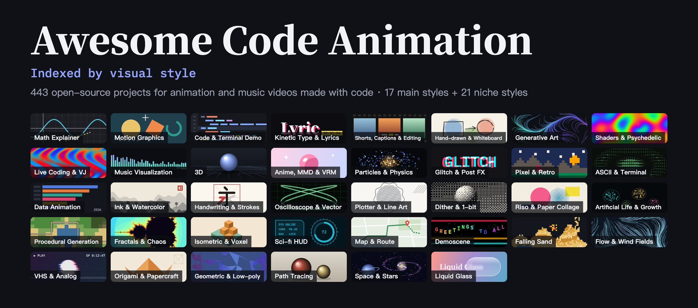

# Awesome Code Animation

**Open-source tools for making animations and music videos with code, indexed by visual style.** [中文](README.md)

    

**[🌐 Web version](https://syydaniel.github.io/awesome-code-animation/?lang=en)** (filter by style, search, sort, switch languages) · **[🕸️ Relationship graph](https://syydaniel.github.io/awesome-code-animation/?lang=en#graph-sec)** (drag, zoom, family trees) · **[🎨 Style index](#index)**

[Style index](#index) · [Niche styles](#niche) · [Relationships](#relations) · [Rules](#rules) · [All projects](#all) · [Suggest a project](https://github.com/syydaniel/awesome-code-animation/issues/new/choose)

## 🎬 Showcase

[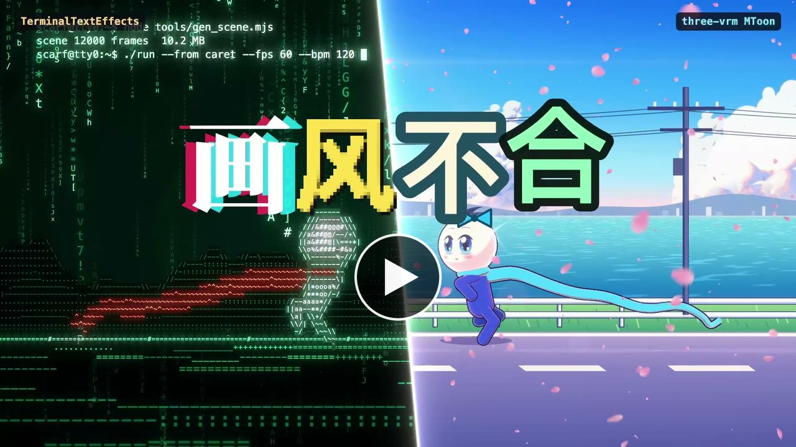](https://syydaniel.github.io/awesome-code-animation/?lang=en#showcase)

**画风不合 (Clashing Styles)** · by [syydaniel](https://github.com/syydaniel)

[▶ Watch the full film, with sound](https://syydaniel.github.io/awesome-code-animation/?lang=en#showcase) · [Watch on Bilibili](https://www.bilibili.com/video/BV1DNxU6WEqv/)

The promo film for this list. He lives in a line of code, she sits on a sheet of watercolor paper, and they keep switching styles to reach each other, always one frame apart. The film moves through 18 styles and 28 looks. All of it is rendered by code, with no AI-generated video, and each shot names its tools in the corner.

The song's lyrics, music and vocals are AI-made: Claude Code wrote the lyrics, and ACE-Step 1.5 composed and sang. Claude Code also wrote the code. Edited in DaVinci Resolve.

The 159 and 18 at the end were the numbers when the film was made. The list has grown since, and the 18th style, AI-written code, no longer has its own category. Shiki and Claude Code are not in this list. Every other tool is. The song is sung in Chinese.

Built with: [Manim Community](https://github.com/ManimCommunity/manim) · [MathBox](https://github.com/unconed/mathbox) · [GSAP](https://github.com/greensock/GSAP) · [anime.js](https://github.com/juliangarnier/anime) · [mo.js](https://github.com/mojs/mojs) · [Zdog](https://github.com/metafizzy/zdog) · [PixiJS](https://github.com/pixijs/pixijs) · [Shiki](https://github.com/shikijs/shiki) · [Splitting](https://github.com/shshaw/Splitting) · [Claude Code](https://github.com/anthropics/claude-code) · [p5.brush](https://github.com/acamposuribe/p5.brush) · [Rough.js](https://github.com/rough-stuff/rough) · [p5.js](https://github.com/processing/p5.js) · [Paper.js](https://github.com/paperjs/paper.js) · [LYGIA](https://github.com/patriciogonzalezvivo/lygia) · [Paper Shaders](https://github.com/paper-design/shaders) · [Hydra](https://github.com/hydra-synth/hydra) · [Butterchurn](https://github.com/jberg/butterchurn) · [three.js](https://github.com/mrdoob/three.js) · [postprocessing](https://github.com/pmndrs/postprocessing) · [Vanta.js](https://github.com/tengbao/vanta) · [three-vrm](https://github.com/pixiv/three-vrm) · [WebGL Fluid](https://github.com/PavelDoGreat/WebGL-Fluid-Simulation) · [Matter.js](https://github.com/liabru/matter-js) · [Taichi](https://github.com/taichi-dev/taichi) · [pixelsort](https://github.com/satyarth/pixelsort) · [libretro GLSL Shaders](https://github.com/libretro/glsl-shaders) · [TerminalTextEffects](https://github.com/ChrisBuilds/terminaltexteffects) · [D3](https://github.com/d3/d3) · [Apache ECharts](https://github.com/apache/echarts) · [Gource](https://github.com/acaudwell/Gource) · [deck.gl](https://github.com/visgl/deck.gl) · [GL Transitions](https://github.com/gl-transitions/gl-transitions)

Which tools made each of the 18 styles and 28 looks

| Style | Tools | At | How it's used |
| --- | --- | --- | --- |
| [Math Explainer](#math) | [Manim Community](https://github.com/ManimCommunity/manim) | [00:10](https://www.bilibili.com/video/BV1DNxU6WEqv/?t=10) | Every frame is rendered by Manim Community, then played back on the beat |
|  | [MathBox](https://github.com/unconed/mathbox) | [01:13](https://www.bilibili.com/video/BV1DNxU6WEqv/?t=73) | A 3D surface that folds into a heart-shaped level set on the beat, with the equation beside it |
| [Motion Graphics](#mg) | [GSAP](https://github.com/greensock/GSAP) · [anime.js](https://github.com/juliangarnier/anime) · [mo.js](https://github.com/mojs/mojs) | [00:52](https://www.bilibili.com/video/BV1DNxU6WEqv/?t=52) | GSAP and anime.js timelines, with bursts and streaks from mo.js |
|  | [Zdog](https://github.com/metafizzy/zdog) | [02:40](https://www.bilibili.com/video/BV1DNxU6WEqv/?t=160) | A toy box where the characters and every prop are Zdog shapes |
|  | [PixiJS](https://github.com/pixijs/pixijs) | [02:41](https://www.bilibili.com/video/BV1DNxU6WEqv/?t=161) | A neon night street, with wet reflections, glow and shockwaves from pixi-filters |
| [Code & Terminal Demo](#code) | [Shiki](https://github.com/shikijs/shiki) | [00:11](https://www.bilibili.com/video/BV1DNxU6WEqv/?t=11) | The editor shows this film's own script, highlighted by Shiki |
| [Kinetic Type & Lyrics](#type) | [Splitting](https://github.com/shshaw/Splitting) · [GSAP](https://github.com/greensock/GSAP) | [00:49](https://www.bilibili.com/video/BV1DNxU6WEqv/?t=49) | Splitting breaks up the glyphs and GSAP drives each one |
| [Shorts, Captions & Editing](#short) | [GSAP](https://github.com/greensock/GSAP) | [01:37](https://www.bilibili.com/video/BV1DNxU6WEqv/?t=97) | Phones slide past while captions bounce in one word at a time |
| AI-written code | [Claude Code](https://github.com/anthropics/claude-code) | [00:08](https://www.bilibili.com/video/BV1DNxU6WEqv/?t=8) | A terminal prints this film's file names, commands and source next to a preview window |
| [Hand-drawn & Whiteboard](#hand) | [p5.brush](https://github.com/acamposuribe/p5.brush) · [Rough.js](https://github.com/rough-stuff/rough) | [00:23](https://www.bilibili.com/video/BV1DNxU6WEqv/?t=23) | p5.brush paints the watercolor and Rough.js draws the pencil lines |
| [Generative Art](#gen) | [p5.js](https://github.com/processing/p5.js) | [01:11](https://www.bilibili.com/video/BV1DNxU6WEqv/?t=71) | A flow-field print whose lines bend around the character, leaving it as negative space |
|  | [Paper.js](https://github.com/paperjs/paper.js) | [00:34](https://www.bilibili.com/video/BV1DNxU6WEqv/?t=34) | A liquid Bauhaus poster of vector paths that morph on the beat |
| [Shaders & Psychedelic](#shader) | [LYGIA](https://github.com/patriciogonzalezvivo/lygia) · [Paper Shaders](https://github.com/paper-design/shaders) | [01:18](https://www.bilibili.com/video/BV1DNxU6WEqv/?t=78) | Color fields from LYGIA's GLSL functions, with a vein layer from Paper Shaders' neuro-noise |
| [Live Coding & VJ](#live) | [Hydra](https://github.com/hydra-synth/hydra) | [01:22](https://www.bilibili.com/video/BV1DNxU6WEqv/?t=82) | The code on screen is the code running: each finished line changes the picture |
| [Music Visualization](#audio) | [Butterchurn](https://github.com/jberg/butterchurn) | [01:23](https://www.bilibili.com/video/BV1DNxU6WEqv/?t=83) | Butterchurn is fed the song's own audio, over a real spectrum on the ground line |
| [3D](#3d) | [three.js](https://github.com/mrdoob/three.js) · [postprocessing](https://github.com/pmndrs/postprocessing) | [00:54](https://www.bilibili.com/video/BV1DNxU6WEqv/?t=54) | A PBR character, mirror floor and glowing grid, with bloom and depth of field |
|  | [Vanta.js](https://github.com/tengbao/vanta) | [00:50](https://www.bilibili.com/video/BV1DNxU6WEqv/?t=50) | Vanta.js birds flock around the character and sometimes form a heart |
| [Anime, MMD & VRM](#anime) | [three-vrm](https://github.com/pixiv/three-vrm) | [02:32](https://www.bilibili.com/video/BV1DNxU6WEqv/?t=152) | The same model as the 3D world, restyled with MToon toon shading |
| [Particles & Physics](#particle) | [WebGL Fluid](https://github.com/PavelDoGreat/WebGL-Fluid-Simulation) | [01:24](https://www.bilibili.com/video/BV1DNxU6WEqv/?t=84) | A GPU fluid solver, with the scarf pouring ink into the flow |
|  | [Matter.js](https://github.com/liabru/matter-js) | [00:46](https://www.bilibili.com/video/BV1DNxU6WEqv/?t=46) | The title's glyphs and black blocks rain down and land on the beat |
|  | [Taichi](https://github.com/taichi-dev/taichi) | [01:45](https://www.bilibili.com/video/BV1DNxU6WEqv/?t=105) | 104,000 MLS-MPM particles, baked ahead of time to an image sequence |
| [Glitch & Post FX](#glitch) | [postprocessing](https://github.com/pmndrs/postprocessing) · [pixelsort](https://github.com/satyarth/pixelsort) | [01:26](https://www.bilibili.com/video/BV1DNxU6WEqv/?t=86) | Plates sorted by pixelsort, with glitch and chromatic aberration from postprocessing |
| [Pixel & Retro](#pixel) | [libretro GLSL Shaders](https://github.com/libretro/glsl-shaders) | [00:56](https://www.bilibili.com/video/BV1DNxU6WEqv/?t=56) | A 320×180 8-bit platformer, through the crt-lottes CRT shader |
| [ASCII & Terminal](#ascii) | [TerminalTextEffects](https://github.com/ChrisBuilds/terminaltexteffects) | [00:15](https://www.bilibili.com/video/BV1DNxU6WEqv/?t=15) | Boot text from TerminalTextEffects, with the scene turned into characters by brightness |
| [Data Animation](#data) | [D3](https://github.com/d3/d3) | [00:37](https://www.bilibili.com/video/BV1DNxU6WEqv/?t=37) | A dark dashboard charting the GitHub stars of projects in this list |
|  | [Apache ECharts](https://github.com/apache/echarts) | [02:43](https://www.bilibili.com/video/BV1DNxU6WEqv/?t=163) | A constellation of all 159 projects the list had at the time |
|  | [Gource](https://github.com/acaudwell/Gource) | [01:44](https://www.bilibili.com/video/BV1DNxU6WEqv/?t=104) | The real commit history of three.js growing into a tree of light |
|  | [deck.gl](https://github.com/visgl/deck.gl) | [01:45](https://www.bilibili.com/video/BV1DNxU6WEqv/?t=105) | 160,000 points aggregated into an isometric data city |
| Transitions | [GL Transitions](https://github.com/gl-transitions/gl-transitions) | Throughout | 42 kinds of transition across 108 shots |

## What this is

When you want to make a music video, an explainer or an intro with code, the first question is usually which tool makes the look you have in mind. This list sorts open-source animation and video projects on GitHub by **visual style**: 3Blue1Brown-style math, flat motion graphics, psychedelic shaders, pixel art, ASCII, music visualizers, anime dance videos and more. Pick a style first, then pick a tool. One project often does several styles, so it can appear under several.

Beyond the 17 main styles, the [niche section](#niche) covers ink-wash landscapes, Chinese stroke-order animation, oscilloscope art, plotters, artificial life and others. 89 entries are skills and films where AI coding agents like Claude or Opus write the code, and they're filed by style like everything else. The [relationship graph](#relations) links related projects, so you can see what grew out of what and what can replace what.

## What gets listed

- **Frames must be drawn or rendered by code.** Projects that make their pictures with video or image generation models aren't listed, and neither are ones that render through Blender or other 3D apps. A few projects have an optional generation feature or Blender option, which is noted on the entry.
- **Main styles:** 1,000+ GitHub stars, or 200+ stars with a push in the last year.
- **Niche styles:** 20+ stars with a push in the last year, so small and interesting projects get seen too.
- **Skills and films where AI coding agents like Claude or Opus write the code:** filed by style as usual, with 50+ stars and a push in the last year.
- **Archived (read-only) repositories aren't listed.** Projects we looked at and left out are recorded in [`data/excluded.json`](data/excluded.json), with reasons in Chinese.
- Status follows the latest push: 🟢 Active (within 6 months) · 🟡 Slowing (within 2 years) · ⚪ Dormant (older; most still work, they just don't get new features).
- Stars and status refresh every Monday through GitHub Actions, and new candidates are collected into a weekly issue. Data as of 2026-11-03.

## Start from your goal

| Goal | Start with |
| --- | --- |
| Explainer videos | [Manim Community](https://github.com/ManimCommunity/manim) · [Motion Canvas](https://github.com/motion-canvas/motion-canvas) · [Animate](https://github.com/cth9191/animate) |
| Music videos and batch-made shorts | [Remotion](https://github.com/remotion-dev/remotion) · [HyperFrames](https://github.com/heygen-com/hyperframes) · [three.js](https://github.com/mrdoob/three.js) |
| Have Claude / Opus code your video | [Lemo-Opuscar](https://github.com/lemomo-ai/lemo-opuscar) · [Remotion Skills](https://github.com/remotion-dev/skills) · [Code Animation Style Prompts](https://github.com/XiaoyeCodes/code-animation-prompts) |
| Chinese style: ink wash, characters, poetry | [Shan-Shui-Inf](https://github.com/LingDong-/shan-shui-inf) · [Hanzi Writer](https://github.com/chanind/hanzi-writer) · [code-poem-film](https://github.com/bangbuilds/code-poem-film) |
| Live VJ sets and psychedelic visuals | [Hydra](https://github.com/hydra-synth/hydra) · [TiXL](https://github.com/tixl3d/tixl) · [cables](https://github.com/cables-gl/cables) |
| Music visualization | [Butterchurn](https://github.com/jberg/butterchurn) · [projectM](https://github.com/projectM-visualizer/projectm) · [Astrofox](https://github.com/astrofox-io/astrofox) |
| Tech explainers for programmers | [Slidev](https://github.com/slidevjs/slidev) · [VHS](https://github.com/charmbracelet/vhs) · [Gource](https://github.com/acaudwell/Gource) |
| Explore niche styles | [osci-render](https://github.com/jameshball/osci-render) · [Lenia](https://github.com/Chakazul/Lenia) · [WaveFunctionCollapse](https://github.com/mxgmn/WaveFunctionCollapse) |

## Style index

Click a picture to jump to that style's table. Every thumbnail is drawn with code, and the code is in [`site/template.html`](site/template.html).

<table>
<tr><td align="center" width="33%"><a href="#math">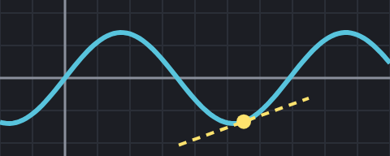</a> <b><a href="#math">Math Explainer</a></b> 21 projects</td><td align="center" width="33%"><a href="#mg">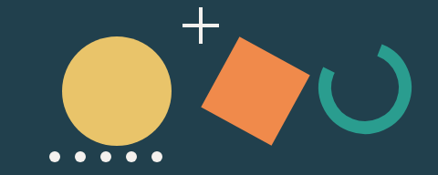</a> <b><a href="#mg">Motion Graphics</a></b> 87 projects</td><td align="center" width="33%"><a href="#code">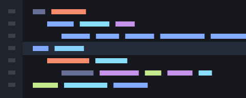</a> <b><a href="#code">Code & Terminal Demo</a></b> 16 projects</td></tr>
<tr><td align="center" width="33%"><a href="#type">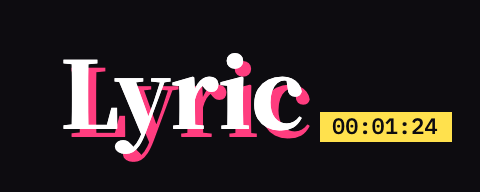</a> <b><a href="#type">Kinetic Type & Lyrics</a></b> 29 projects</td><td align="center" width="33%"><a href="#short">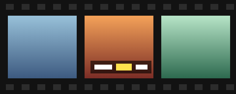</a> <b><a href="#short">Shorts, Captions & Editing</a></b> 29 projects</td><td align="center" width="33%"><a href="#hand">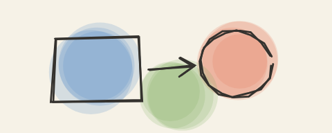</a> <b><a href="#hand">Hand-drawn & Whiteboard</a></b> 23 projects</td></tr>
<tr><td align="center" width="33%"><a href="#gen">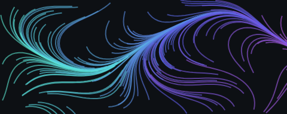</a> <b><a href="#gen">Generative Art</a></b> 40 projects</td><td align="center" width="33%"><a href="#shader">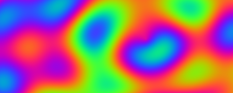</a> <b><a href="#shader">Shaders & Psychedelic</a></b> 96 projects</td><td align="center" width="33%"><a href="#live">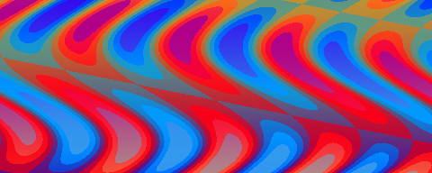</a> <b><a href="#live">Live Coding & VJ</a></b> 13 projects</td></tr>
<tr><td align="center" width="33%"><a href="#audio">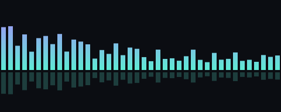</a> <b><a href="#audio">Music Visualization</a></b> 26 projects</td><td align="center" width="33%"><a href="#3d">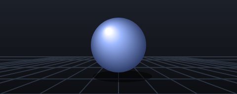</a> <b><a href="#3d">3D</a></b> 74 projects</td><td align="center" width="33%"> <b><a href="#anime">Anime, MMD & VRM</a></b> 15 projects</td></tr>
<tr><td align="center" width="33%"><a href="#particle">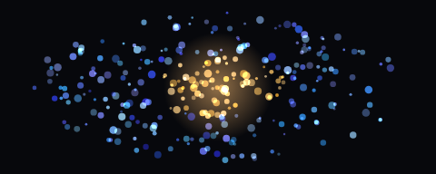</a> <b><a href="#particle">Particles & Physics</a></b> 26 projects</td><td align="center" width="33%"><a href="#glitch">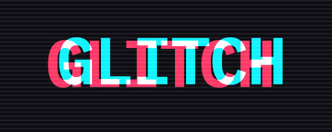</a> <b><a href="#glitch">Glitch & Post FX</a></b> 17 projects</td><td align="center" width="33%"><a href="#pixel">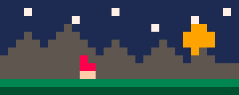</a> <b><a href="#pixel">Pixel & Retro</a></b> 28 projects</td></tr>
<tr><td align="center" width="33%"><a href="#ascii">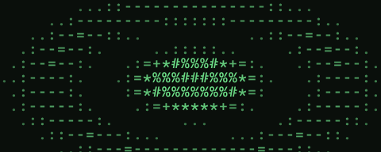</a> <b><a href="#ascii">ASCII & Terminal</a></b> 25 projects</td><td align="center" width="33%"><a href="#data">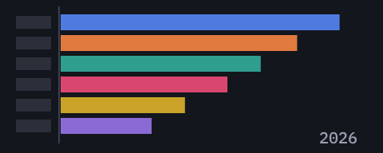</a> <b><a href="#data">Data Animation</a></b> 27 projects</td></tr>
</table>

### Niche styles

<table>
<tr><td align="center" width="33%"> <b><a href="#ink">Ink & Watercolor</a></b> 8 projects</td><td align="center" width="33%"><a href="#hanzi">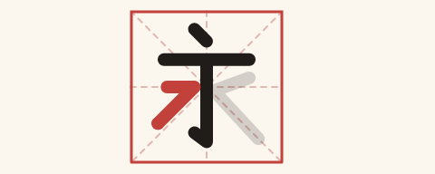</a> <b><a href="#hanzi">Handwriting & Strokes</a></b> 4 projects</td><td align="center" width="33%"><a href="#scope">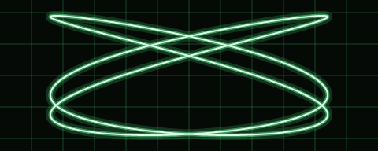</a> <b><a href="#scope">Oscilloscope & Vector</a></b> 2 projects</td></tr>
<tr><td align="center" width="33%"><a href="#plotter">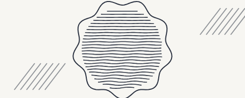</a> <b><a href="#plotter">Plotter & Line Art</a></b> 7 projects</td><td align="center" width="33%"><a href="#dither">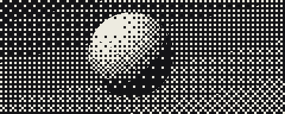</a> <b><a href="#dither">Dither & 1-bit</a></b> 5 projects</td><td align="center" width="33%"><a href="#riso">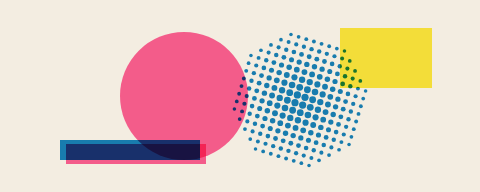</a> <b><a href="#riso">Riso & Paper Collage</a></b> 6 projects</td></tr>
<tr><td align="center" width="33%"><a href="#alife">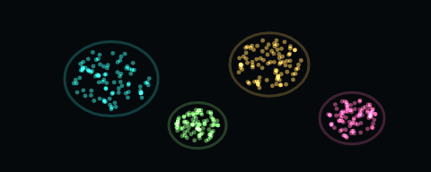</a> <b><a href="#alife">Artificial Life & Growth</a></b> 8 projects</td><td align="center" width="33%"><a href="#procgen">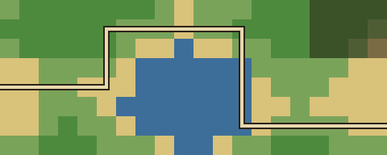</a> <b><a href="#procgen">Procedural Generation</a></b> 12 projects</td><td align="center" width="33%"><a href="#fractal">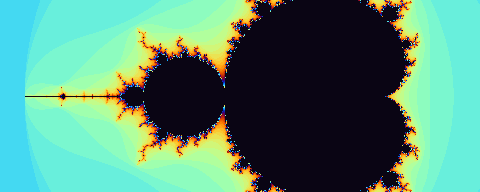</a> <b><a href="#fractal">Fractals & Chaos</a></b> 8 projects</td></tr>
<tr><td align="center" width="33%"><a href="#iso">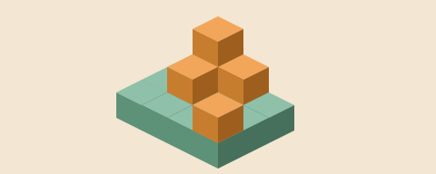</a> <b><a href="#iso">Isometric & Voxel</a></b> 9 projects</td><td align="center" width="33%"><a href="#scifi">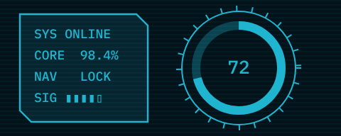</a> <b><a href="#scifi">Sci-fi HUD</a></b> 4 projects</td><td align="center" width="33%"><a href="#map">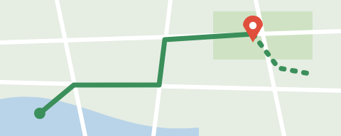</a> <b><a href="#map">Map & Route</a></b> 10 projects</td></tr>
<tr><td align="center" width="33%"><a href="#demoscene">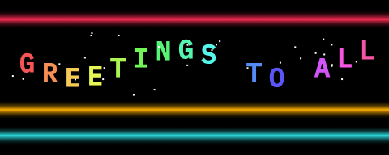</a> <b><a href="#demoscene">Demoscene</a></b> 7 projects</td><td align="center" width="33%"><a href="#sand">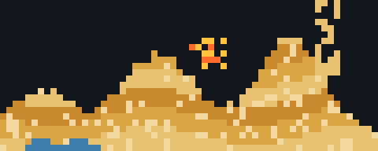</a> <b><a href="#sand">Falling Sand</a></b> 8 projects</td><td align="center" width="33%"><a href="#flow">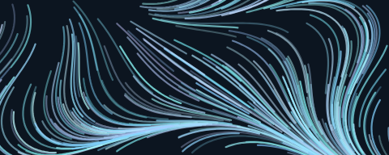</a> <b><a href="#flow">Flow & Wind Fields</a></b> 7 projects</td></tr>
<tr><td align="center" width="33%"><a href="#vhs">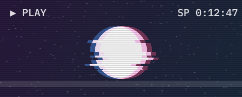</a> <b><a href="#vhs">VHS & Analog</a></b> 13 projects</td><td align="center" width="33%"><a href="#origami">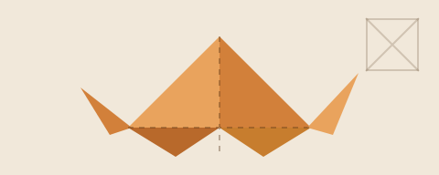</a> <b><a href="#origami">Origami & Papercraft</a></b> 8 projects</td><td align="center" width="33%"><a href="#geo">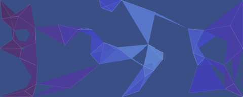</a> <b><a href="#geo">Geometric & Low-poly</a></b> 7 projects</td></tr>
<tr><td align="center" width="33%"><a href="#raytrace">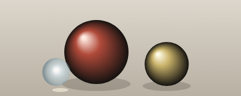</a> <b><a href="#raytrace">Path Tracing</a></b> 7 projects</td><td align="center" width="33%"><a href="#space">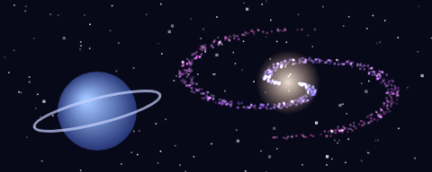</a> <b><a href="#space">Space & Stars</a></b> 8 projects</td><td align="center" width="33%"><a href="#liquid">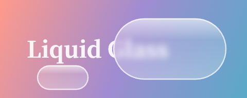</a> <b><a href="#liquid">Liquid Glass</a></b> 12 projects</td></tr>
</table>

## Main styles

### Math Explainer

> Equations, axes and geometric transforms on a 3Blue1Brown-style dark canvas

21 projects, sorted by stars.

 

| Project | Stars | Status | Language | Description |
| --- | ---: | :---: | --- | --- |
| [Manim (3b1b)](https://github.com/3b1b/manim) | 96.1k | 🟢 Active | Python | The math animation engine 3Blue1Brown himself uses (ManimGL): formulas, coordinate systems, shape transforms, in the classic blue-and-black explainer style. Good for: Explainer videos · Also in: Data Animation ⚠️ Sparse docs; beginners should start with the community edition. |
| [Manim Community](https://github.com/ManimCommunity/manim) | 42.2k | 🟢 Active | Python | Community-maintained fork of Manim with the most complete docs and tutorials. Used for many math, physics and algorithm explainer videos on Bilibili. Good for: Explainer videos · Also in: Data Animation, Code & Terminal Demo |
| [Motion Canvas](https://github.com/motion-canvas/motion-canvas) | 19.7k | 🟢 Active | TypeScript | Write animations as TypeScript generator functions, with a timeline editor and audio sync. Well suited to explainer videos and code demos. Good for: Explainer videos · MV · Also in: Motion Graphics, Code & Terminal Demo |
| [pywonderland](https://github.com/neozhaoliang/pywonderland) | 4.2k | 🟡 Slowing | Python | Made by a Chinese developer: math visuals in Python, including fractals, tilings, reaction-diffusion, and maze generation animations. Good for: Math art · Also in: Fractals & Chaos |
| [Lenia](https://github.com/Chakazul/Lenia) | 3.9k | ⚪ Dormant | Python / JS | Continuous cellular automata that grow moving, splitting "mathematical life forms", looking like organisms under a microscope. Good for: Artificial life · Also in: Artificial Life & Growth ⚠️ Not updated since 2024. |
| [ManimML](https://github.com/helblazer811/ManimML) | 3.5k | ⚪ Dormant | Python | Machine learning concept animations built on Manim: explainer animations of neural networks, convolutions, and similar structures. Good for: Explainer videos · Also in: Data Animation |
| [Mafs](https://github.com/stevenpetryk/mafs) | 3.4k | 🟢 Active | React | React components for interactive math: coordinate planes, function plots, vectors. Build draggable math explainer animations. Good for: Interactive math |
| [Code2Video](https://github.com/showlab/Code2Video) | 2.2k | 🟢 Active | Python | Academic project: has a large language model write Manim code to automatically generate educational explainer videos, with every frame rendered by code. Good for: Explainer videos |
| [Animate](https://github.com/cth9191/animate) | 1.5k | 🟢 Active | JavaScript / Canvas | Claude Code skill: draws short animations procedurally on a single canvas, with 7 built-in styles: paper cut-out, hatched ink, Riso print, sketchbook, math, pixel, and isometric. Good for: Explainer videos · Short films · Also in: Hand-drawn & Whiteboard, Pixel & Retro, Riso & Paper Collage |
| [MathBox](https://github.com/unconed/mathbox) | 1.5k | ⚪ Dormant | JavaScript | 3D math visualization in the browser: surfaces, vector fields and coordinate grids, with clean, polished visuals. Good for: Explainer videos · Also in: 3D |
| [FieldPlay](https://github.com/anvaka/fieldplay) | 1.3k | 🟢 Active | JavaScript / GLSL | Write a vector field formula and thousands of particles flow along it, like streams of silk. Good for: Vector field animation · Also in: Flow & Wind Fields |
| [Manim Agent Skills](https://github.com/adithya-s-k/manim_skill) | 1.3k | 🟡 Slowing | Python / skill | Manim skills and best practices for making 3Blue1Brown-style animations. Good for: Explainer videos |
| [Reanimate](https://github.com/reanimate/reanimate) | 1.2k | 🟡 Slowing | Haskell | SVG animation library written in Haskell, with LaTeX formula support and a look close to 3B1B. Good for: Explainer videos · Also in: Motion Graphics ⚠️ Niche language, small community. |
| [Manim Slides](https://github.com/jeertmans/manim-slides) | 975 | 🟢 Active | Python | Turn Manim animations into presentation slides you can play page by page. Can also export to a web page. Good for: Explainer videos · Talks · Also in: Code & Terminal Demo |
| [Generative Manim](https://github.com/marcelo-earth/generative-manim) | 937 | 🟢 Active | Python | Describe an animation in natural language; an LLM writes the Manim code and renders it. Good for: Explainer videos |
| [ranim](https://github.com/AzurIce/ranim) | 662 | 🟢 Active | Rust | Animation engine written in Rust, inspired by Manim. Good for: Explainer videos |
| [ManimCat](https://github.com/Wing900/ManimCat) | 494 | 🟢 Active | TypeScript / Python | Describe an animation in one sentence and AI writes the Manim code for a math animation. Supports LaTeX and auto-fixes code when rendering fails. Good for: Math explainer videos ⚠️ AGPL-3.0: if you use it in a network service offered to others, you must publish your modified source. |
| [manim-physics](https://github.com/Matheart/manim-physics) | 412 | 🟢 Active | Python | Physics simulation extension for Manim: rigid bodies, electromagnetic fields, waves, pendulums, and other physics animations. Good for: Explainer videos · Also in: Particles & Physics |
| [MathLens](https://github.com/shuyicc/MathLens) | 352 | 🟡 Slowing | Python | From a Chinese developer: paste a math problem and it analyzes it, writes a voiceover script and generates a narrated Manim explainer video. Good for: Math explainer videos |
| [manim-voiceover](https://github.com/ManimCommunity/manim-voiceover) | 326 | 🟢 Active | Python | Adds voiceover to Manim animations, syncing animation timing to the speech automatically. Good for: Explainer videos |
| [manim-skill](https://github.com/Yusuke710/manim-skill) | 193 | 🟢 Active | Skill | SKILL.md that teaches AI agents to write Manim animations. Good for: Explainer videos |

[↑ Back to the style index](#index)

### Motion Graphics

> Flat shapes, springy easing and shape morphs

87 projects, sorted by stars.

 

| Project | Stars | Status | Language | Description |
| --- | ---: | :---: | --- | --- |
| [HyperFrames](https://github.com/heygen-com/hyperframes) | 78.8k | 🟢 Active | HTML / CSS / GSAP | Open-sourced by HeyGen. Write scenes in HTML/CSS, animate with GSAP, render straight to MP4. Designed for AI coding agents. Good for: MV · Short videos · AI generation · Also in: Kinetic Type & Lyrics, Shorts, Captions & Editing ⚠️ The official skill pack's asset skills can optionally call generation services; the rendering itself is HTML code. |
| [anime.js](https://github.com/juliangarnier/anime) | 74.3k | 🟢 Active | JavaScript | Lightweight JS animation library. Timelines, stagger, and SVG stroke animation are easy to use. Good for: Web animation · MV · Also in: Kinetic Type & Lyrics |
| [reveal.js](https://github.com/hakimel/reveal.js) | 72.5k | 🟢 Active | HTML / JS | Write presentations in HTML. Auto-Animate tweens elements automatically between slides. Good for: Explainer videos · Talks · Also in: Code & Terminal Demo |
| [Remotion](https://github.com/remotion-dev/remotion) | 70.7k | 🟢 Active | React / TS | Write videos as React components and render them to MP4, with batch generation. Official add-on packages cover captions, audio visualization, three.js, and more. Good for: MV · Short videos · Batch video rendering · Also in: Shorts, Captions & Editing, Kinetic Type & Lyrics, 3D ⚠️ Free for individuals and small companies (commercial use included); larger companies need to buy a company license. |
| [React Bits](https://github.com/DavidHDev/react-bits) | 51.2k | 🟢 Active | React | Lots of animated React components: text effects, animated backgrounds, interactive motion. Copy and use. Good for: Web motion · Assets · Also in: Kinetic Type & Lyrics, Shaders & Psychedelic |
| [PixiJS](https://github.com/pixijs/pixijs) | 48.6k | 🟢 Active | TypeScript | Fast 2D rendering engine (WebGL / WebGPU) for large numbers of sprites, filters, and 2D motion effects. Good for: Web animation · MV · Also in: Particles & Physics, Generative Art |
| [Motion](https://github.com/motiondivision/motion) | 34.9k | 🟢 Active | React / JS | Formerly Framer Motion. An animation library for React and JS with smooth springs, gestures, and layout transitions. Good for: Web motion |
| [Lottie](https://github.com/airbnb/lottie-web) | 32.4k | 🟡 Slowing | JavaScript | Plays After Effects animations exported as Bodymovin JSON in the browser. The common format for flat illustration and icon animation. Good for: Effect assets · Web animation ⚠️ The animation itself is usually made in AE; code handles playback and control. |
| [GSAP](https://github.com/greensock/GSAP) | 30.2k | 🟢 Active | JavaScript | Long-established JS animation engine. Plugins like SplitText and MorphSVG are now all free. Strong at split-text animation and SVG morphing. Good for: MV · Web animation · Also in: Kinetic Type & Lyrics ⚠️ Free for commercial use, but under GreenSock's own license, not an OSI-approved open-source license. |
| [react-spring](https://github.com/pmndrs/react-spring) | 29.3k | 🟢 Active | React | React animation library built on spring physics, for natural, bouncy motion. Good for: Web motion |
| [Magic UI](https://github.com/magicuidesign/magicui) | 23.1k | 🟢 Active | React | React component library with motion built in: text animations, glowing borders, particle backgrounds, and more. Good for: Web motion · Also in: Kinetic Type & Lyrics |
| [brag](https://github.com/latent-spaces/brag) | 20.3k | 🟢 Active | Python / skill | After you finish a project, one command makes a short promo video with music and copy, rendered with HyperFrames. Good for: Project promo videos |
| [Motion Canvas](https://github.com/motion-canvas/motion-canvas) | 19.7k | 🟢 Active | TypeScript | Write animations as TypeScript generator functions, with a timeline editor and audio sync. Well suited to explainer videos and code demos. Good for: Explainer videos · MV · Also in: Code & Terminal Demo, Math Explainer |
| [mo.js](https://github.com/mojs/mojs) | 18.9k | 🟢 Active | JavaScript | JS library built for motion graphics: bursts, ripples, shape pop-ins and other small MG effects. Good for: Effect assets |
| [GSAP Skills](https://github.com/greensock/gsap-skills) | 17.9k | 🟢 Active | Skill | Official GSAP AI skills that teach coding agents to use GSAP and its plugins correctly. Good for: Web animation |
| [video-shotcraft](https://github.com/Vincentwei1021/video-shotcraft) | 16.9k | 🟢 Active | React / TS | AI coding agent skill: captures screenshots of your real web pages and turns them into cinematic product promo videos with Remotion. Good for: Product promo videos · Also in: Shorts, Captions & Editing |
| [Paper.js](https://github.com/paperjs/paper.js) | 15.2k | 🟢 Active | JavaScript | Vector graphics scripting framework with strong path operations and Bezier curves, good for vector-style generative art. Good for: Generative art · Also in: Generative Art |
| [Konva](https://github.com/konvajs/konva) | 14.9k | 🟢 Active | TypeScript | HTML5 Canvas framework with shapes, tweened animation and drag interaction. Official React and Vue wrappers. Good for: Canvas animation |
| [Theatre.js](https://github.com/theatre-js/theatre) | 12.9k | ⚪ Dormant | TypeScript | Visual timeline for web animation: define properties in code, drag keyframes in the UI. Often paired with three.js for 3D camera animation. Good for: MV · Web animation · Also in: 3D |
| [Lemo-Opuscar](https://github.com/lemomo-ai/lemo-opuscar) | 12.2k | 🟢 Active | JavaScript | A toolbox of film styles made in code: 66 ready-made styles (Memphis, subway map, chalkboard, and more) that let an AI coding agent make videos in each style, all drawn with code. Good for: MV · Short films · Also in: Hand-drawn & Whiteboard, Pixel & Retro ⚠️ Styles are tuned for Claude; results may differ with other models. |
| [SVG.js](https://github.com/svgdotjs/svg.js) | 11.9k | 🟢 Active | JavaScript | Lightweight library for manipulating and animating SVG. Good for: Web animation |
| [Zdog](https://github.com/metafizzy/zdog) | 10.7k | ⚪ Dormant | JavaScript | Pseudo-3D flat engine that draws rounded, cute flat-shaded 3D shapes. Good for: Web animation · Also in: 3D, Isometric & Voxel ⚠️ Not updated in years; simple and stable. |
| [React Native Skia](https://github.com/wcandillon/react-native-skia) | 8.8k | 🟢 Active | React Native | Draw high-performance 2D graphics and animations in React Native with Skia. Supports runtime shaders. Good for: Mobile motion · Also in: Shaders & Psychedelic |
| [Two.js](https://github.com/jonobr1/two.js) | 8.7k | 🟢 Active | JavaScript | 2D vector drawing API. The same code outputs SVG, Canvas, or WebGL, good for flat geometric animation. Good for: Web animation · Also in: Generative Art |
| [EffectCraft](https://github.com/storytold/effectcraft) | 8.4k | 🟢 Active | Rust (GUI) | Open-source compositing app written from scratch, After Effects-style: layers, keyframes, expressions, 300+ effects. Good for: Motion graphics · Post compositing · Also in: Glitch & Post FX ⚠️ Mostly a graphical interface; the expressions part can be scripted in code. |
| [Arwes](https://github.com/arwes/arwes) | 7.6k | 🟢 Active | TypeScript | Sci-fi web UI framework with futuristic effects: glowing borders, expanding lines, and text decoding. Good for: Sci-fi UI · Also in: Sci-fi HUD |
| [Remotion Skills](https://github.com/remotion-dev/skills) | 6.3k | 🟢 Active | Markdown skill | Official Remotion skills for AI coding agents, so Claude Code and others can write Remotion videos directly. Good for: MV · Short videos |
| [PAG](https://github.com/Tencent/libpag) | 5.8k | 🟢 Active | C++ / cross-platform | Tencent's open-source After Effects animation solution. Similar idea to Lottie but supports more AE features, and text and images inside can be replaced from code. Good for: Effect assets |
| [Lottie Skill](https://github.com/diffusionstudio/lottie) | 5.7k | 🟢 Active | TypeScript | Lets Claude Code or Codex write production-ready Lottie animation files directly. Good for: Lottie animation |
| [html-video](https://github.com/nexu-io/html-video) | 4.8k | 🟢 Active | HTML / CSS | Lets a local AI coding agent turn HTML/CSS into video. Ships with 21 templates, including kinetic type, Swiss grid and data cards. Good for: Short videos · Promo videos · Also in: Kinetic Type & Lyrics |
| [VAP](https://github.com/Tencent/vap) | 4.2k | 🟢 Active | Cross-platform | Tencent's open-source player for videos with an alpha channel, often used for complex effects such as live-stream gifts. Good for: Effect assets |
| [Revideo](https://github.com/midrender/revideo) | 4.2k | 🟢 Active | TypeScript | Fork of Motion Canvas focused on headless rendering, so videos can be generated in bulk through an API. Good for: Short videos · Batch video rendering · Also in: Shorts, Captions & Editing |
| [P(doom) MV (mexicat version)](https://github.com/mexicat/pdoom-video) | 3.8k | 🟢 Active | JavaScript | Another code-rendered music video for "I'm Upping My P(doom)", with word-by-word beat-synced lyrics. Good for: Lyric MV · Also in: Kinetic Type & Lyrics ⚠️ AI was used only to split the audio into stems; all visuals are rendered by code. |
| [onetake](https://github.com/feitangyuan/onetake) | 3.7k | 🟢 Active | Python / HTML | Skill for single-take motion shorts: every scene grows out of the previous one instead of switching pages like a slideshow. Good for: Product launch videos ⚠️ A paid Pro version is also available. |
| [hairline](https://github.com/lucasmarkes/hairline) | 3.4k | 🟢 Active | TypeScript | Isometric line figures and objects that turn to follow the mouse. Works with React and plain web pages. Good for: Web motion · Also in: Isometric & Voxel |
| [fframes](https://github.com/dmtrKovalenko/fframes) | 3.2k | 🟢 Active | Rust / SVG | Write video with Rust and SVG, rendered on the GPU, with a focus on speed. Also includes a skill for AI coding agents. Good for: Batch video rendering · Also in: Shorts, Captions & Editing |
| [MG Styles 15](https://github.com/Vincentwei1021/mg-styles-15) | 3.1k | 🟢 Active | Python / Web | 15 motion design style demo films, each written as code by Claude Opus 5.5 from a single prompt. Prompts and source included. Good for: Style sample clips · Also in: 3D, Hand-drawn & Whiteboard ⚠️ Of the 15, only the 3D one uses Blender; the rest are pure code. |
| [anything2explainer](https://github.com/Vincentwei1021/anything2explainer) | 3k | 🟢 Active | React / TS | Give it a topic and it makes a black-background motion graphics explainer video, with voiceover and captions. Every frame is rendered in code. Good for: Explainer videos · Also in: Data Animation |
| [P(doom) MV](https://github.com/JohnHeibel/PDoomVideo) | 2.8k | 🟢 Active | JavaScript | Full source for the music video "I'm Upping My P(doom)", made by Claude Opus 5.5 writing code. Good for: MV · Also in: Kinetic Type & Lyrics |
| [Motion Design Skill](https://github.com/LottieFiles/motion-design-skill) | 2.8k | 🟢 Active | Markdown skill | Teaches AI agents motion design principles: timing, easing, choreography, and the Disney animation principles. Good for: Motion design |
| [Pixel2Motion](https://github.com/nolangz/pixel2motion) | 2.6k | 🟢 Active | Python / SVG | Converts raster logos to clean SVG, then makes logo animations and video previews. Good for: Logo animation |
| [huashu-motion](https://github.com/alchaincyf/huashu-motion) | 2.3k | 🟢 Active | JavaScript | Has an AI coding agent make product launch films, compose its own soundtrack, and take edits by pointing at the frame. Good for: Product promo videos · Also in: 3D |
| [Astrofox](https://github.com/astrofox-io/astrofox) | 2k | 🟢 Active | TypeScript (GUI) | Motion graphics software that turns audio into visualizer videos: spectrum, waveform, text, and 3D layers can be combined and exported. Good for: Music visualizer · MV · Also in: Music Visualization ⚠️ Mainly a graphical interface. |
| [Animotion](https://github.com/animotionjs/animotion) | 1.8k | 🟢 Active | Svelte | Write animated presentations in Svelte, with smooth code highlight transitions and element tweens. Good for: Explainer videos · Talks · Also in: Code & Terminal Demo |
| [remocn](https://github.com/Remocn/remocn) | 1.7k | 🟢 Active | React / TS | Ready-made animations, transitions, backgrounds, and scene components for Remotion. Good for: MV · Short videos · Also in: Shorts, Captions & Editing ⚠️ Requires Remotion; Remotion's own license terms still apply. |
| [Liquid Logo](https://github.com/paper-design/liquid-logo) | 1.4k | 🟡 Slowing | TypeScript | Small tool from the Paper team: turns a logo into a flowing liquid-metal animation. Good for: Logo motion · Also in: Liquid Glass, Shaders & Psychedelic |
| [Reanimate](https://github.com/reanimate/reanimate) | 1.2k | 🟡 Slowing | Haskell | SVG animation library written in Haskell, with LaTeX formula support and a look close to 3B1B. Good for: Explainer videos · Also in: Math Explainer ⚠️ Niche language, small community. |
| [motion-skills](https://github.com/iart-ai/motion-skills) | 1.2k | 🟢 Active | Markdown skill | 50 AI coding agent skills: kinetic typography, data visualization, explainer videos, vertical short videos, WebGL, Manim. Good for: Various videos |
| [frame.js](https://github.com/mrdoob/frame.js) | 1.2k | 🟡 Slowing | JavaScript | JavaScript timeline editor by the author of three.js, for sequencing shots and effects in web demos. Good for: Web demo choreography · Also in: Demoscene |
| [reanimate](https://github.com/NiazMorshed2007/reanimate) | 1.2k | 🟢 Active | JavaScript | Claude Code skill: breaks any animation down frame by frame, recreates it in code, and checks frame by frame how closely the copy matches. Good for: Animation recreation |
| [Bang Motion](https://github.com/bangtutorial/bang-motion) | 1.1k | 🟢 Active | HTML | Browser motion graphics skill: intros, promos, transitions, and kinetic typography, in five styles. Good for: Intros · Promo videos · Also in: Kinetic Type & Lyrics ⚠️ The optional After Effects cartoon explainer goes through a Higgsfield bridge; the default workflow is code animation in the browser. |
| [Motion Graphics Skills](https://github.com/Barty-Bart/motion-graphics) | 1.1k | 🟢 Active | HTML / skill | Collection of motion graphics skills for Claude Code and Codex. Good for: Motion graphics |
| [motion-anything](https://github.com/nexu-io/motion-anything) | 1k | 🟢 Active | JavaScript | Describe the feel in one sentence and AI generates motion pages and launch videos. Comes with reusable shader, Canvas, and animated text recipes. Good for: Motion pages · Launch videos · Also in: Shaders & Psychedelic |
| [Rive Runtime](https://github.com/rive-app/rive-wasm) | 1k | 🟢 Active | TypeScript | Web runtime for Rive animations: vector interactive animations with state machines, with state changes controlled from code. Good for: Interactive animation ⚠️ Animations are usually made in the Rive editor, which is not open source. |
| [cinetic](https://github.com/Leonxlnx/cinetic) | 991 | 🟢 Active | TypeScript | Has an AI coding agent direct cinematic launch films and motion design from code, rendered with Remotion by default. Good for: Launch videos |
| [dotLottie Web](https://github.com/LottieFiles/dotlottie-web) | 938 | 🟢 Active | TypeScript | Official LottieFiles web player for Lottie / dotLottie, built on Rust + WASM for better performance. Good for: Effect assets · Web animation |
| [Guizang Product Video](https://github.com/op7418/guizang-product-video-skill) | 903 | 🟢 Active | Python | Guizang's promo video skill: reuses a product's real components and design language to make software update promos in code, with script, music, and voiceover. Good for: Software promo videos |
| [motion-web](https://github.com/feitangyuan/motion-web) | 836 | 🟢 Active | HTML / JS | Another skill set from the onetake author: motion-first creative websites built on vanilla three.js, Canvas, and WebGL. Good for: Motion websites · Also in: 3D |
| [Claude Remotion Skill](https://github.com/haidrrrry/claude-remotion-skill) | 828 | 🟢 Active | TypeScript | Open-source skill that teaches Claude Code and Claude Desktop to write Remotion videos. Good for: Short videos |
| [Claude Motion Design](https://github.com/howseen-ai/claude-motion-design) | 766 | 🟢 Active | Python | Skill for pure-code motion videos: HTML + Playwright + ffmpeg, with no AI-generated imagery. Good for: Motion graphics video |
| [genjutsu](https://github.com/AThevon/genjutsu) | 745 | 🟢 Active | Python / skill | Creative coding skills for Claude Code and claude.ai: motion, micro-interactions, and design sense. Good for: Creative coding · Also in: Generative Art |
| [Shader Lab](https://github.com/basementstudio/shader-lab) | 717 | 🟢 Active | TypeScript | Toolkit for creating, stacking, and animating shaders. Combine multiple effects like layers. Good for: Shader motion · Also in: Shaders & Psychedelic |
| [Rossark Motion](https://github.com/rossark0/rossark-motion-skill) | 698 | 🟢 Active | Swift / SVG | Claude Code skill: turns any SVG into a professional 60 fps animation. Good for: SVG animation |
| [drawsvg](https://github.com/cduck/drawsvg) | 696 | 🟢 Active | Python | Generate SVG graphics and animations from Python, with interactive preview in Jupyter. Good for: SVG animation · Also in: Data Animation |
| [Aora Bot](https://github.com/sam70361/aora-bot) | 619 | 🟢 Active | TypeScript | A web character engine drawn in code, with 46 original characters and 44 animation states. Good for: Character animation · Also in: Anime, MMD & VRM |
| [ff-tracking](https://github.com/mrsarac/ff-tracking) | 592 | 🟢 Active | Rust | Short film where a virtual camera films an AI agent's screen and tracks every glyph. Uses fframes two-pass rendering and SkSL shaders; the sound effects are also synthesized in code. Good for: Motion shorts · Also in: Glitch & Post FX |
| [MotionClone](https://github.com/blixvip/MotionClone) | 588 | 🟢 Active | Python | Rebuilds a reference video as an editable HyperFrames project and compares it with the original frame by frame. Good for: Motion recreation |
| [Launch Motion Skills](https://github.com/charlie947/motion-graphics-skills) | 551 | 🟢 Active | Shell / skill | 13 Claude Code skills for making launch-quality motion graphics. Every frame is code, no After Effects. Good for: Launch videos |
| [Code Animation Style Prompts](https://github.com/XiaoyeCodes/code-animation-prompts) | 522 | 🟢 Active | HTML / skill | 341 code-animation style prompts and 196 reference stills, with an offline picker. Can be installed as a Claude Code / Codex skill. Good for: Style prompts |
| [Kinetograph](https://github.com/0xS4N4TG/kinetograph) | 460 | 🟢 Active | TypeScript | Fast programmatic video engine made for AI coding agents. Good for: Batch video rendering · Also in: Shorts, Captions & Editing ⚠️ PolyForm Small Business license: free for individuals and small companies; larger companies need a commercial license. |
| [Opus Video Skills](https://github.com/tuzhechen2005/opus-video-skills) | 438 | 🟢 Active | JavaScript | Video-making skills for Claude Opus, where every frame and every note is generated in code. Good for: Short films · MV · Also in: Music Visualization |
| [Product Launch Motion](https://github.com/AbubakrChan/product-launch-motion) | 421 | 🟢 Active | JavaScript | Claude Code skill for Dribbble-quality product launch videos from code, with one shape carrying through without cuts. Good for: Product launch videos |
| [shipvideo](https://github.com/diggerhq/shipvideo) | 378 | 🟢 Active | TypeScript | Paste a URL or a one-line prompt: Opus writes HTML and renders it in the cloud, giving a 20 to 40 second launch video with no video model. Good for: Product launch videos |
| [xilo-opus-video](https://github.com/Kianzzz/xilo-opus-video) | 369 | 🟢 Active | Python | Made by a Chinese developer: Claude Opus writes code to make videos. It proposes three options with previews first, then renders the chosen one frame by frame. Good for: Short films · Also in: 3D |
| [motion2code](https://github.com/lovisdotio/motion2code) | 330 | 🟢 Active | HTML | Rebuilds a motion video as looping SVG + GSAP code, checked frame by frame against the source. Good for: Motion recreation ⚠️ The reference videos in the examples were made by a video model; this skill only handles recreating them in code. |
| [Code Video Showcase](https://github.com/Moessif/code-video-showcase) | 322 | 🟢 Active | HTML / Canvas / three.js | Pure-code beat-synced showcase video skill, rendered frame by frame with HTML, Canvas, SVG, and three.js. Good for: Beat-synced showreels · Also in: 3D |
| [video-director](https://github.com/win4r/video-director) | 320 | 🟢 Active | Python | Claude skill: directs, builds, and checks frame by frame videos rendered from HTML / Canvas. Good for: Code video director |
| [html-anime](https://github.com/blixvip/html-anime) | 246 | 🟢 Active | JavaScript | Turns a scene description into a storyboard sheet, then has a coding agent draw the whole film in HTML. No video model is called. Good for: Animated shorts · Also in: Anime, MMD & VRM |
| [What If Animation](https://github.com/kelano86/what-if-animation) | 226 | 🟢 Active | TypeScript | Enter a "what if..." topic and get a complete explainer animation, with no image or video models. Good for: Explainer shorts |
| [fy-code-animation](https://github.com/Akillll-DuoHe/fy-code-animation) | 194 | 🟢 Active | TypeScript | Turns Chinese copy, style prompts, and sound into coherent code animation (Remotion / Canvas / HTML). Good for: Explainer animation |
| [RuiC Motion Reel](https://github.com/HRuiCcc/RuiC-motion-reel) | 182 | 🟢 Active | Python | One sentence generates a motion promo film, with length computed from BPM and bars; standard promos use a Remotion template. Good for: Promo videos |
| [Vibe Knowledge Shorts](https://github.com/xiazhuo123456789/vibe-knowledge-video) | 166 | 🟢 Active | Python | Generates cinematic knowledge short videos in pure code, with bilingual captions, synthesized music, and recreated historical documents. Good for: Knowledge shorts · Also in: Kinetic Type & Lyrics |
| [YouTube Motion Graphics](https://github.com/sirioberati/YouTube-AI-Motion-Graphics) | 150 | 🟢 Active | HTML | 74 animated HTML explainer boards (charts, diagrams, flows) for YouTube explainer videos. Good for: Explainer video assets · Also in: Data Animation |
| [BB-Video](https://github.com/BubbleBrainBB/BB-Video) | 133 | 🟢 Active | JavaScript | Skill for making videos in pure code: narrated explainers and product promos in 32 visual styles. Good for: Explainers · Promo videos · Also in: 3D ⚠️ 3D mascots can optionally be made in Blender; without Blender it falls back to three.js. |
| [sy-style-100](https://github.com/xiaoxiong20xx-code/sy-style-100) | 65 | 🟢 Active | HTML | Made by a Chinese developer: 100 videos where every frame is computed by code. 20 styles plus 60 industry ads, usable commercially. Good for: Style sample clips |
| [DeepSeek Opus Motion](https://github.com/8533502-dev/deepseek-opus-motion-skill) | 57 | 🟢 Active | TypeScript | Gets DeepSeek to make Remotion motion videos close to Claude Opus quality using the same prompts. Good for: Motion videos |
| [Knowledge Explainer](https://github.com/znyupup/knowledge-explainer-skill) | 57 | 🟡 Slowing | JavaScript | Automatically turns a Markdown script into an explainer animation video, rendered with Remotion. Good for: Explainer animation |

[↑ Back to the style index](#index)

### Code & Terminal Demo

> Syntax highlighting, code appearing line by line, terminal recordings, algorithm animations

16 projects, sorted by stars.

 

| Project | Stars | Status | Language | Description |
| --- | ---: | :---: | --- | --- |
| [reveal.js](https://github.com/hakimel/reveal.js) | 72.5k | 🟢 Active | HTML / JS | Write presentations in HTML. Auto-Animate tweens elements automatically between slides. Good for: Explainer videos · Talks · Also in: Motion Graphics |
| [Algorithm Visualizer](https://github.com/algorithm-visualizer/algorithm-visualizer) | 49.4k | ⚪ Dormant | JavaScript | Animates how algorithms run, including sorting, graphs, and dynamic programming. Good for: Explainer videos · Also in: Data Animation |
| [Slidev](https://github.com/slidevjs/slidev) | 49.4k | 🟢 Active | Markdown / Vue | Write presentations in Markdown, with built-in code highlighting, smooth code transition animations, and recording. Good for: Explainer videos · Talks |
| [Manim Community](https://github.com/ManimCommunity/manim) | 42.2k | 🟢 Active | Python | Community-maintained fork of Manim with the most complete docs and tutorials. Used for many math, physics and algorithm explainer videos on Bilibili. Good for: Explainer videos · Also in: Math Explainer, Data Animation |
| [VHS](https://github.com/charmbracelet/vhs) | 21.3k | 🟢 Active | VHS script | Script terminal actions and record them automatically as a GIF or video. The easiest way to make command-line demos. Good for: Explainer videos · GIF · Also in: ASCII & Terminal |
| [Motion Canvas](https://github.com/motion-canvas/motion-canvas) | 19.7k | 🟢 Active | TypeScript | Write animations as TypeScript generator functions, with a timeline editor and audio sync. Well suited to explainer videos and code demos. Good for: Explainer videos · MV · Also in: Motion Graphics, Math Explainer |
| [asciinema](https://github.com/asciinema/asciinema) | 17.9k | 🟢 Active | Rust (CLI) | Records terminal sessions and replays them in a web player. Small files, copyable text. Good for: Explainer videos · Also in: ASCII & Terminal |
| [Terminalizer](https://github.com/faressoft/terminalizer) | 16.2k | ⚪ Dormant | JavaScript (CLI) | Records terminal sessions and renders them as animated GIFs with a window frame. Good for: GIF · Also in: ASCII & Terminal |
| [Gource](https://github.com/acaudwell/Gource) | 13.2k | 🟡 Slowing | C++ (CLI) | Renders Git commit history as a video of code "growing". A classic piece of footage for programmers. Good for: Developer videos · Also in: Data Animation |
| [Code Hike](https://github.com/code-hike/codehike) | 5.4k | 🟡 Slowing | React / Markdown | Code walkthroughs built with Markdown and React. Can be rendered with Remotion into code explainer videos. Good for: Explainer videos |
| [git-sim](https://github.com/initialcommit-com/git-sim) | 4.7k | 🟢 Active | Python | Draws the effect of Git commands as diagrams and animations (built on Manim). Good for Git teaching videos. Good for: Explainer videos · Also in: Data Animation |
| [doitlive](https://github.com/sloria/doitlive) | 3.6k | 🟢 Active | Python | Pre-write your commands, then mash the keyboard live and they type out character by character. Terminal demos without typos. Good for: Terminal demos · Also in: ASCII & Terminal |
| [Animotion](https://github.com/animotionjs/animotion) | 1.8k | 🟢 Active | Svelte | Write animated presentations in Svelte, with smooth code highlight transitions and element tweens. Good for: Explainer videos · Talks · Also in: Motion Graphics |
| [Manim Slides](https://github.com/jeertmans/manim-slides) | 975 | 🟢 Active | Python | Turn Manim animations into presentation slides you can play page by page. Can also export to a web page. Good for: Explainer videos · Talks · Also in: Math Explainer |
| [SeeCode](https://github.com/Aryanutkarsh/SeeCode) | 872 | 🟢 Active | JavaScript | Generates explorable animated diagrams from a short JSON spec, so coding agents like Claude can explain code structure. Good for: Code explainer visuals · Also in: Isometric & Voxel |
| [demoit](https://github.com/dgageot/demoit) | 780 | 🟢 Active | JavaScript | Tool for live code demos: slides, code and terminal on one page, so you don't switch windows. Good for: Live code demos |

[↑ Back to the style index](#index)

### Kinetic Type & Lyrics

> Morphing glyphs, word-by-word entrances, text that hits the lyrics on the beat

29 projects, sorted by stars.

 

| Project | Stars | Status | Language | Description |
| --- | ---: | :---: | --- | --- |
| [HyperFrames](https://github.com/heygen-com/hyperframes) | 78.8k | 🟢 Active | HTML / CSS / GSAP | Open-sourced by HeyGen. Write scenes in HTML/CSS, animate with GSAP, render straight to MP4. Designed for AI coding agents. Good for: MV · Short videos · AI generation · Also in: Motion Graphics, Shorts, Captions & Editing ⚠️ The official skill pack's asset skills can optionally call generation services; the rendering itself is HTML code. |
| [anime.js](https://github.com/juliangarnier/anime) | 74.3k | 🟢 Active | JavaScript | Lightweight JS animation library. Timelines, stagger, and SVG stroke animation are easy to use. Good for: Web animation · MV · Also in: Motion Graphics |
| [Remotion](https://github.com/remotion-dev/remotion) | 70.7k | 🟢 Active | React / TS | Write videos as React components and render them to MP4, with batch generation. Official add-on packages cover captions, audio visualization, three.js, and more. Good for: MV · Short videos · Batch video rendering · Also in: Motion Graphics, Shorts, Captions & Editing, 3D ⚠️ Free for individuals and small companies (commercial use included); larger companies need to buy a company license. |
| [React Bits](https://github.com/DavidHDev/react-bits) | 51.2k | 🟢 Active | React | Lots of animated React components: text effects, animated backgrounds, interactive motion. Copy and use. Good for: Web motion · Assets · Also in: Motion Graphics, Shaders & Psychedelic |
| [GSAP](https://github.com/greensock/GSAP) | 30.2k | 🟢 Active | JavaScript | Long-established JS animation engine. Plugins like SplitText and MorphSVG are now all free. Strong at split-text animation and SVG morphing. Good for: MV · Web animation · Also in: Motion Graphics ⚠️ Free for commercial use, but under GreenSock's own license, not an OSI-approved open-source license. |
| [Magic UI](https://github.com/magicuidesign/magicui) | 23.1k | 🟢 Active | React | React component library with motion built in: text animations, glowing borders, particle backgrounds, and more. Good for: Web motion · Also in: Motion Graphics |
| [Typed.js](https://github.com/mattboldt/typed.js) | 16.3k | 🟡 Slowing | JavaScript | Typewriter-effect text animation library. Good for: Web motion |
| [Rough Notation](https://github.com/rough-stuff/rough-notation) | 9.7k | ⚪ Dormant | TypeScript | Hand-drawn annotation animations: circle, underline, and highlight text. Good for: Explainer videos · Web animation · Also in: Hand-drawn & Whiteboard |
| [editly](https://github.com/mifi/editly) | 5.6k | 🟡 Slowing | JSON / Node | Declarative video editing from JSON or the command line, with built-in transitions, titles, and Ken Burns pan-and-zoom. Good for: Fast cuts · Short videos · Also in: Shorts, Captions & Editing |
| [Hanzi Writer](https://github.com/chanind/hanzi-writer) | 5.1k | 🟡 Slowing | TypeScript | Chinese character stroke order animation and writing practice library. One line of code animates a character stroke by stroke. Good for: Stroke order animation · Also in: Handwriting & Strokes |
| [html-video](https://github.com/nexu-io/html-video) | 4.8k | 🟢 Active | HTML / CSS | Lets a local AI coding agent turn HTML/CSS into video. Ships with 21 templates, including kinetic type, Swiss grid and data cards. Good for: Short videos · Promo videos · Also in: Motion Graphics |
| [TerminalTextEffects](https://github.com/ChrisBuilds/terminaltexteffects) | 4.3k | 🟢 Active | Python | Terminal text effects library with dozens of text entrance animations (burn, rain, decrypt and more). Good for: Intros · Text effects · Also in: ASCII & Terminal |
| [P(doom) MV (mexicat version)](https://github.com/mexicat/pdoom-video) | 3.8k | 🟢 Active | JavaScript | Another code-rendered music video for "I'm Upping My P(doom)", with word-by-word beat-synced lyrics. Good for: Lyric MV · Also in: Motion Graphics ⚠️ AI was used only to split the audio into stems; all visuals are rendered by code. |
| [Tegaki](https://github.com/gkurt/tegaki) | 3.3k | 🟢 Active | TypeScript | Handwriting animation for the web: any font and any text can be turned into a pen-writing effect. Good for: Handwriting animation · Also in: Handwriting & Strokes, Hand-drawn & Whiteboard |
| [P(doom) MV](https://github.com/JohnHeibel/PDoomVideo) | 2.8k | 🟢 Active | JavaScript | Full source for the music video "I'm Upping My P(doom)", made by Claude Opus 5.5 writing code. Good for: MV · Also in: Motion Graphics |
| [AMLL](https://github.com/amll-dev/applemusic-like-lyrics) | 2.2k | 🟢 Active | React / Vue | Apple Music-style lyrics component built by a Chinese developer: word-by-word highlighting, springy scrolling, fluid background. Good for: Lyric MV · Players · Also in: Music Visualization ⚠️ AGPL-3.0: if used in a network service offered to others, you must publish your modified source. |
| [video-talkcraft](https://github.com/Vincentwei1021/video-talkcraft) | 2.1k | 🟢 Active | React / TS | Talking-head video skill: aligns to the voiceover word by word and renders animated text cards and camera moves with Remotion. Good for: Talking-head videos · Also in: Shorts, Captions & Editing |
| [Splitting](https://github.com/shshaw/Splitting) | 1.8k | ⚪ Dormant | JavaScript | Splits text into characters or words and adds CSS variables, making per-letter animation easy. Good for: Web motion |
| [VFX-JS](https://github.com/fand/vfx-js) | 1.2k | 🟢 Active | TypeScript | Add WebGL effects to images, video, and text on web pages: glitch, RGB shift, distortion, and more. Good for: Web effects · MV · Also in: Glitch & Post FX |
| [Bang Motion](https://github.com/bangtutorial/bang-motion) | 1.1k | 🟢 Active | HTML | Browser motion graphics skill: intros, promos, transitions, and kinetic typography, in five styles. Good for: Intros · Promo videos · Also in: Motion Graphics ⚠️ The optional After Effects cartoon explainer goes through a Higgsfield bridge; the default workflow is code animation in the browser. |
| [world.execute(me) Lyric MV](https://github.com/Nyankomintsu/world-execute-me-lyric-mv) | 511 | 🟢 Active | JavaScript | Fan-made lyric MV that plays the lyrics as a chat with Claude, rendered frame by frame from code at 4K60. Good for: Lyric MV · Also in: Anime, MMD & VRM |
| [HyperFrames Motion Director](https://github.com/geekjourneyx/hyperframes-motion-director) | 477 | 🟢 Active | Skill | Turns articles, products, websites, or READMEs into Chinese-first vertical HyperFrames motion videos, with checks before delivery. Good for: Vertical promo videos · Also in: Shorts, Captions & Editing |
| [animCJK](https://github.com/parsimonhi/animCJK) | 474 | 🟢 Active | SVG / HTML | SVG animations of Chinese, Japanese and Korean characters written in correct stroke order, including Japanese kana and Korean hanja. Good for: Stroke order animation · Also in: Handwriting & Strokes |
| [DrawBot](https://github.com/typemytype/drawbot) | 455 | 🟢 Active | Python | Draw 2D graphics in Python and export GIF/MP4; commonly used by type designers for text animation. Good for: Kinetic type · GIF · Also in: Generative Art ⚠️ macOS only. |
| [Coldtype](https://github.com/coldtype/coldtype) | 341 | 🟢 Active | Python | Python display typography and animation tool. Letterforms can follow the audio rhythm, good for lyric videos and kinetic type. Good for: Lyric MV · Kinetic type · Also in: Generative Art |
| [Remotion TikTok Template](https://github.com/remotion-dev/template-tiktok) | 301 | 🟢 Active | React / TS | Official Remotion template: automatic speech recognition generates short-video captions that bounce word by word. Good for: Short videos · Also in: Shorts, Captions & Editing ⚠️ Same license terms as Remotion. |
| [FredTalk](https://github.com/njrhts2kvv-star/FredTalk) | 249 | 🟢 Active | TypeScript | A talking-head video skill, a searchable motion library, and a Remotion review workflow. Good for: Talking-head videos · Also in: Shorts, Captions & Editing |
| [Claude MV Skill](https://github.com/Joker-chichi/claude-mv-skill) | 178 | 🟢 Active | Skill | Teaches Claude to make hand-painted animation and lyric MVs: storyboard, animation, review and lyric sync, with all visuals generated procedurally. Good for: Hand-drawn MV · Also in: Hand-drawn & Whiteboard |
| [Vibe Knowledge Shorts](https://github.com/xiazhuo123456789/vibe-knowledge-video) | 166 | 🟢 Active | Python | Generates cinematic knowledge short videos in pure code, with bilingual captions, synthesized music, and recreated historical documents. Good for: Knowledge shorts · Also in: Motion Graphics |

[↑ Back to the style index](#index)

### Shorts, Captions & Editing

> Auto captions, transitions, batch-editing videos with code

29 projects, sorted by stars.

 

| Project | Stars | Status | Language | Description |
| --- | ---: | :---: | --- | --- |
| [HyperFrames](https://github.com/heygen-com/hyperframes) | 78.8k | 🟢 Active | HTML / CSS / GSAP | Open-sourced by HeyGen. Write scenes in HTML/CSS, animate with GSAP, render straight to MP4. Designed for AI coding agents. Good for: MV · Short videos · AI generation · Also in: Motion Graphics, Kinetic Type & Lyrics ⚠️ The official skill pack's asset skills can optionally call generation services; the rendering itself is HTML code. |
| [Remotion](https://github.com/remotion-dev/remotion) | 70.7k | 🟢 Active | React / TS | Write videos as React components and render them to MP4, with batch generation. Official add-on packages cover captions, audio visualization, three.js, and more. Good for: MV · Short videos · Batch video rendering · Also in: Motion Graphics, Kinetic Type & Lyrics, 3D ⚠️ Free for individuals and small companies (commercial use included); larger companies need to buy a company license. |
| [FFmpeg](https://github.com/FFmpeg/FFmpeg) | 66.5k | 🟢 Active | C (CLI) | The foundation under almost every code-to-video tool: transcoding, concatenation, filters and burned-in captions, all from the command line. Good for: Editing and compositing · Post-processing · Also in: Glitch & Post FX ⚠️ Mirror repository on GitHub. |
| [video-shotcraft](https://github.com/Vincentwei1021/video-shotcraft) | 16.9k | 🟢 Active | React / TS | AI coding agent skill: captures screenshots of your real web pages and turns them into cinematic product promo videos with Remotion. Good for: Product promo videos · Also in: Motion Graphics |
| [MoviePy](https://github.com/Zulko/moviepy) | 15.1k | 🟢 Active | Python | Python video editing library: cutting, concatenating, adding captions, and compositing, all in code. Good for: Editing and compositing |
| [editly](https://github.com/mifi/editly) | 5.6k | 🟡 Slowing | JSON / Node | Declarative video editing from JSON or the command line, with built-in transitions, titles, and Ken Burns pan-and-zoom. Good for: Fast cuts · Short videos · Also in: Kinetic Type & Lyrics |
| [ffmpeg-skill](https://github.com/kajisho5/ffmpeg-skill) | 4.5k | 🟢 Active | Python | Local editing toolkit for AI coding agents: 42 FFmpeg tools, so the agent can cut, caption and color grade. Good for: Video editing |
| [Revideo](https://github.com/midrender/revideo) | 4.2k | 🟢 Active | TypeScript | Fork of Motion Canvas focused on headless rendering, so videos can be generated in bulk through an API. Good for: Short videos · Batch video rendering · Also in: Motion Graphics |
| [fframes](https://github.com/dmtrKovalenko/fframes) | 3.2k | 🟢 Active | Rust / SVG | Write video with Rust and SVG, rendered on the GPU, with a focus on speed. Also includes a skill for AI coding agents. Good for: Batch video rendering · Also in: Motion Graphics |
| [FFCreator](https://github.com/tnfe/FFCreator) | 3.2k | 🟡 Slowing | Node.js | Node.js library for generating short videos, open-sourced by a Tencent team. Quickly composes videos from images, text, and transitions. Good for: Short videos · Batch video rendering |
| [Herk Edit Kit](https://github.com/nateherkai/herk-edit-kit) | 2.6k | 🟢 Active | HTML / skill | Skill pack for editing talking-head videos, Reels, and YouTube Shorts with Codex or Claude Code. Good for: Video editing · Short videos |
| [GL Transitions](https://github.com/gl-transitions/gl-transitions) | 2.2k | 🟢 Active | GLSL | Open collection of GLSL transitions. Plugs into editors like editly. Good for: Transitions · Also in: Glitch & Post FX |
| [video-talkcraft](https://github.com/Vincentwei1021/video-talkcraft) | 2.1k | 🟢 Active | React / TS | Talking-head video skill: aligns to the voiceover word by word and renders animated text cards and camera moves with Remotion. Good for: Talking-head videos · Also in: Kinetic Type & Lyrics |
| [ReelMimic](https://github.com/edenfunf/reelmimic) | 1.8k | 🟢 Active | JavaScript | Give it a video you like and an AI crew makes a new one in the same style using HyperFrames. Good for: Style-imitation shorts ⚠️ The repo was briefly made private in October 2026 and its stars were reset to zero, so actual interest is higher. |
| [remocn](https://github.com/Remocn/remocn) | 1.7k | 🟢 Active | React / TS | Ready-made animations, transitions, backgrounds, and scene components for Remotion. Good for: MV · Short videos · Also in: Motion Graphics ⚠️ Requires Remotion; Remotion's own license terms still apply. |
| [Diffusion Studio Core](https://github.com/diffusionstudio/core) | 1.3k | 🟡 Slowing | TypeScript | Browser-based video engine. Edit and composite video in code, built on WebCodecs. Good for: Editing and compositing |
| [Etro](https://github.com/etro-js/etro) | 1.2k | 🟢 Active | TypeScript | Composite video in the browser with TypeScript: layers, effects, keyframes, and export. Good for: Editing and compositing |
| [video-spec-builder](https://github.com/feicaiclub/video-spec-builder) | 1.1k | 🟢 Active | JavaScript | Pushes "I want to make a video" into a storyboard script precise to the second, then hands it to HyperFrames to render. Good for: Storyboard scripts |
| [adu-motion-video](https://github.com/adunext/adu-motion-video) | 722 | 🟢 Active | JavaScript | By a Chinese developer: AI video editing skill with templates in the open MotionGit .motion format. Good for: Video editing · Short videos |
| [LiveCanvas](https://github.com/pengchujin/livecanvas) | 544 | 🟢 Active | Python | Turn one sentence into an Apple Live Photo with a cover and animation. Storyboard, Remotion animation, and export in one flow. Good for: Live photos |
| [Universal Transition Shader](https://github.com/cashew-olddew/Universal-Transition-Shader) | 524 | 🟡 Slowing | Godot Shader | Packs the common transition effects into a single Godot shader. Good for: Transitions · Also in: Shaders & Psychedelic |
| [Agentic Product Demo](https://github.com/Alexwtlf/agentic-product-demo) | 482 | 🟢 Active | TypeScript | Has an AI coding agent make product demo videos with Remotion. The UI is rebuilt in code, not screen-recorded. Good for: Product demo videos |
| [HyperFrames Motion Director](https://github.com/geekjourneyx/hyperframes-motion-director) | 477 | 🟢 Active | Skill | Turns articles, products, websites, or READMEs into Chinese-first vertical HyperFrames motion videos, with checks before delivery. Good for: Vertical promo videos · Also in: Kinetic Type & Lyrics |
| [Kinetograph](https://github.com/0xS4N4TG/kinetograph) | 460 | 🟢 Active | TypeScript | Fast programmatic video engine made for AI coding agents. Good for: Batch video rendering · Also in: Motion Graphics ⚠️ PolyForm Small Business license: free for individuals and small companies; larger companies need a commercial license. |
| [Remotion TikTok Template](https://github.com/remotion-dev/template-tiktok) | 301 | 🟢 Active | React / TS | Official Remotion template: automatic speech recognition generates short-video captions that bounce word by word. Good for: Short videos · Also in: Kinetic Type & Lyrics ⚠️ Same license terms as Remotion. |
| [Remotion Audiogram Template](https://github.com/remotion-dev/template-audiogram) | 275 | 🟢 Active | React / TS | Official Remotion template: turns podcast audio into short videos with a waveform and captions. Good for: Short videos · Podcasts · Also in: Music Visualization ⚠️ Same license terms as Remotion. |
| [FredTalk](https://github.com/njrhts2kvv-star/FredTalk) | 249 | 🟢 Active | TypeScript | A talking-head video skill, a searchable motion library, and a Remotion review workflow. Good for: Talking-head videos · Also in: Kinetic Type & Lyrics |
| [Papercut Explainer](https://github.com/0xS4N4TG/papercut-explainer) | 119 | 🟢 Active | TypeScript | Vertical cut-paper style explainer shorts: 9 skills plus Remotion templates, with backgrounds and sound effects included in the repo. Good for: Vertical explainers · Also in: Riso & Paper Collage |
| [Creator Style Kit](https://github.com/threeaus/creator-style-kit) | 54 | 🟢 Active | Python | 18 vertical HyperFrames video styles (fonts, colors, motion, sound effects, composition). Good for: Vertical shorts |

[↑ Back to the style index](#index)

### Hand-drawn & Whiteboard

> Sketchy lines, stroke-by-stroke drawing, watercolor brushes, hand-drawn charts

23 projects, sorted by stars.

 

| Project | Stars | Status | Language | Description |
| --- | ---: | :---: | --- | --- |
| [Rough.js](https://github.com/rough-stuff/rough) | 21.3k | ⚪ Dormant | JavaScript | Generates hand-drawn, sketchy lines and shapes. Can be combined with other animation libraries for hand-drawn style animation. Good for: Explainer videos · Web animation |
| [Vivus](https://github.com/maxwellito/vivus) | 15.5k | ⚪ Dormant | JavaScript | SVG line-drawing animation that draws line art stroke by stroke. Good for: Web animation ⚠️ Not updated since 2022; simple and stable. |
| [Lemo-Opuscar](https://github.com/lemomo-ai/lemo-opuscar) | 12.2k | 🟢 Active | JavaScript | A toolbox of film styles made in code: 66 ready-made styles (Memphis, subway map, chalkboard, and more) that let an AI coding agent make videos in each style, all drawn with code. Good for: MV · Short films · Also in: Motion Graphics, Pixel & Retro ⚠️ Styles are tuned for Claude; results may differ with other models. |
| [Rough Notation](https://github.com/rough-stuff/rough-notation) | 9.7k | ⚪ Dormant | TypeScript | Hand-drawn annotation animations: circle, underline, and highlight text. Good for: Explainer videos · Web animation · Also in: Kinetic Type & Lyrics |
| [chart.xkcd](https://github.com/timqian/chart.xkcd) | 7.9k | 🟢 Active | JavaScript | Hand-drawn chart library in the xkcd comic style, with wobbly lines and a comic font. Good for: Hand-drawn charts · Also in: Data Animation |
| [roughViz](https://github.com/jwilber/roughViz) | 7.2k | ⚪ Dormant | JavaScript | Sketchy chart library built on Rough.js. Bar and pie charts get a hand-drawn look. Good for: Hand-drawn charts · Also in: Data Animation ⚠️ Not updated since 2024. |
| [huashu-art-motion](https://github.com/alchaincyf/huashu-art-motion) | 6.2k | 🟢 Active | JavaScript | 35 art styles and 9 narration grammars, animating pictures with code. The soundtrack is also synthesized in code. Good for: Art animation · Also in: Ink & Watercolor ⚠️ When a real person is needed on screen, an image generation model produces the frame; everything else is drawn in code. |
| [Tegaki](https://github.com/gkurt/tegaki) | 3.3k | 🟢 Active | TypeScript | Handwriting animation for the web: any font and any text can be turned into a pen-writing effect. Good for: Handwriting animation · Also in: Handwriting & Strokes, Kinetic Type & Lyrics |
| [MG Styles 15](https://github.com/Vincentwei1021/mg-styles-15) | 3.1k | 🟢 Active | Python / Web | 15 motion design style demo films, each written as code by Claude Opus 5.5 from a single prompt. Prompts and source included. Good for: Style sample clips · Also in: Motion Graphics, 3D ⚠️ Of the 15, only the 3D one uses Blender; the rest are pure code. |
| [Claude Animation Base](https://github.com/JohnHeibel/ClaudeAnimationBase) | 2.6k | 🟢 Active | p5.js | Starter template for having Claude make hand-painted cartoon animation: p5.js + p5.brush, with character and camera tools. Good for: Hand-drawn cartoons · Also in: Anime, MMD & VRM |
| [Excalidraw Animate](https://github.com/dai-shi/excalidraw-animate) | 2.1k | 🟢 Active | TypeScript | Turns Excalidraw whiteboard drawings into stroke-by-stroke animations, exportable as video. Good for: Explainer videos |
| [Animate](https://github.com/cth9191/animate) | 1.5k | 🟢 Active | JavaScript / Canvas | Claude Code skill: draws short animations procedurally on a single canvas, with 7 built-in styles: paper cut-out, hatched ink, Riso print, sketchbook, math, pixel, and isometric. Good for: Explainer videos · Short films · Also in: Pixel & Retro, Math Explainer, Riso & Paper Collage |
| [anidoodle](https://github.com/alexgreensh/anidoodle) | 1.3k | 🟢 Active | TypeScript | AI coding agent skill: draws illustrations, loop animations, and short films with soundtracks in code, in dozens of styles, with identical results on every render. Good for: Illustration · Looping animation · Short films · Also in: Generative Art |
| [spectral.js](https://github.com/rvanwijnen/spectral.js) | 1.3k | 🟡 Slowing | JavaScript | Mixes colors the way real paint does (Kubelka-Munk), so blue plus yellow gives green, not gray. For watercolor and oil-paint looks. Good for: Paint mixing |
| [p5.brush](https://github.com/acamposuribe/p5.brush) | 1.3k | 🟢 Active | JavaScript | Adds natural brushes, watercolor fills, and hatching to p5.js for hand-drawn and watercolor textures. Good for: Generative art · MV · Also in: Generative Art |
| [Pintr](https://github.com/javierbyte/pintr) | 837 | 🟢 Active | TypeScript | Turns photos into single-line illustrations drawn in one continuous stroke. Good for: Single-stroke drawing · Also in: Plotter & Line Art |
| [Whiteboard Teacher Video](https://github.com/liangdabiao/whiteboard-teacher-video) | 497 | 🟢 Active | Python | Made by a Chinese developer: turns an explainer script into a hand-drawn whiteboard video. Shapes are drawn stroke by stroke and text is written character by character, with zero image-generation cost. Good for: Knowledge shorts |
| [weilanx Claude Videos](https://github.com/Azure12355/weilanx-claude-videos) | 237 | 🟢 Active | TypeScript | Made by a Chinese developer: hand-drawn and pixel-art explainer videos written purely in code with Remotion + React + SVG. Good for: Explainer videos · Also in: Pixel & Retro ⚠️ One skill's cover image used text-to-image generation; it can be swapped for a code-rendered frame. |
| [Dashi Style Explainers](https://github.com/chuspeeism/dashi-animationstyle) | 178 | 🟢 Active | HTML | By a Chinese developer: turns Chinese talking-head knowledge scripts into explainer animations in 7 styles. Claude writes HTML / Canvas code to draw each frame. Good for: Explainers |
| [Claude MV Skill](https://github.com/Joker-chichi/claude-mv-skill) | 178 | 🟢 Active | Skill | Teaches Claude to make hand-painted animation and lyric MVs: storyboard, animation, review and lyric sync, with all visuals generated procedurally. Good for: Hand-drawn MV · Also in: Kinetic Type & Lyrics |
| [Claude Drawing Skill](https://github.com/cloveric/claude-drawing-skill) | 101 | 🟢 Active | Python | Claude paints stroke by stroke with code, in 77 styles including ink wash, oil painting, clay, cyanotype, stained glass, and Jiangnan gardens, with no image generation model. Good for: Illustration · Ink wash · Also in: Ink & Watercolor |
| [Watercolor Playground](https://github.com/msurguy/watercolor-playground) | 101 | 🟢 Active | TypeScript | Realistic watercolor simulation: paint bleeds, settles, and dries on paper. Good for: Watercolor painting · Also in: Ink & Watercolor |
| [wet-paint-flow](https://github.com/simonxxooxxoo/wet-paint-flow) | 66 | 🟢 Active | three.js | Real-time three.js flow-field painter that draws Bezier strokes with a wet, thick-paint look. Good for: Flow field drawing · Also in: Flow & Wind Fields |

[↑ Back to the style index](#index)

### Generative Art

> Algorithmic patterns, flow fields, seamless loops

40 projects, sorted by stars.

 

| Project | Stars | Status | Language | Description |
| --- | ---: | :---: | --- | --- |
| [PixiJS](https://github.com/pixijs/pixijs) | 48.6k | 🟢 Active | TypeScript | Fast 2D rendering engine (WebGL / WebGPU) for large numbers of sprites, filters, and 2D motion effects. Good for: Web animation · MV · Also in: Motion Graphics, Particles & Physics |
| [raylib](https://github.com/raysan5/raylib) | 35.6k | 🟢 Active | C (many bindings) | Simple, beginner-friendly C graphics library with bindings for dozens of languages. Quick for 2D/3D animations and small demos. Good for: 2D/3D animation · Mini games · Also in: Pixel & Retro, 3D |
| [p5.js](https://github.com/processing/p5.js) | 24.3k | 🟢 Active | JavaScript | The most popular creative coding library: draw, build interactions, and animate on the web. Plenty of Chinese tutorials too. Good for: Generative art · MV · Also in: Particles & Physics, Music Visualization ⚠️ Exporting video takes extra steps (save frames one by one, or screen-record). |
| [Paper.js](https://github.com/paperjs/paper.js) | 15.2k | 🟢 Active | JavaScript | Vector graphics scripting framework with strong path operations and Bezier curves, good for vector-style generative art. Good for: Generative art · Also in: Motion Graphics |
| [primitive](https://github.com/fogleman/primitive) | 13.6k | ⚪ Dormant | Go | Approximates a photo step by step with triangles, ellipses, and other shapes. The process can be exported as an animation. Good for: Geometric reconstruction · Also in: Geometric & Low-poly ⚠️ Not updated since 2024. |
| [openFrameworks](https://github.com/openframeworks/openFrameworks) | 10.5k | 🟢 Active | C++ | C++ creative coding framework with strong performance. Often used for interactive installations, stage visuals, and music visualization. Good for: Performances · Installations · MV · Also in: Music Visualization, 3D |
| [Two.js](https://github.com/jonobr1/two.js) | 8.7k | 🟢 Active | JavaScript | 2D vector drawing API. The same code outputs SVG, Canvas, or WebGL, good for flat geometric animation. Good for: Web animation · Also in: Motion Graphics |
| [Vanta.js](https://github.com/tengbao/vanta) | 7.3k | ⚪ Dormant | JavaScript | A few lines of code give you animated 3D backgrounds: waves, birds, fog, grids, and more. Good for: Background assets · Also in: 3D |
| [nannou](https://github.com/nannou-org/nannou) | 6.8k | 🟢 Active | Rust | Rust creative coding framework with audio and OSC modules, suited to real-time audiovisual work. Good for: Generative art · Performances · Also in: Music Visualization |
| [Shan-Shui-Inf](https://github.com/LingDong-/shan-shui-inf) | 6.4k | ⚪ Dormant | JavaScript | Procedurally generated, endlessly scrolling Chinese landscape painting. Mountains, rocks, trees, and pavilions are all drawn stroke by stroke by algorithms. Good for: Ink wash scrolls · Generative art · Also in: Ink & Watercolor ⚠️ Not updated since 2018; the work itself is complete and usable. |
| [css-doodle](https://github.com/css-doodle/css-doodle) | 6.1k | 🟢 Active | CSS | Web component that generates patterns and animations in bulk from CSS rules. Good for: Generative art |
| [Cinder](https://github.com/cinder/Cinder) | 5.5k | 🟡 Slowing | C++ | C++ creative coding framework geared toward professional real-time graphics and installation work. Good for: Performances · Installations · Also in: 3D |
| [Pts](https://github.com/williamngan/pts) | 5.4k | 🟢 Active | TypeScript | Visualization and creative coding library built around geometric relations of points, lines and shapes. Good for: Generative art · Also in: Data Animation |
| [canvas-sketch](https://github.com/mattdesl/canvas-sketch) | 5.3k | 🟢 Active | JavaScript | Generative art workflow that exports high-res frames, GIFs, and MP4, well suited to seamless looping animation. Good for: Generative art · Looping animation |
| [Tweakpane](https://github.com/cocopon/tweakpane) | 4.6k | 🟡 Slowing | TypeScript | Compact parameter panel for tweaking color, speed, and count live while creative coding. Good for: Parameter panels |
| [thi.ng/umbrella](https://github.com/thi-ng/umbrella) | 3.8k | 🟢 Active | TypeScript | Toolkit of over a hundred TypeScript packages for generative art and visualization, long maintained by its author. Good for: Generative art · Also in: Data Animation |
| [FastNoiseLite](https://github.com/Auburn/FastNoiseLite) | 3.5k | 🟢 Active | Multiple languages | Cross-language noise function library (C#, C++, GLSL, JS, Rust, and more). Basic material for flow fields, terrain, and textures. Good for: Noise functions · Also in: Procedural Generation |
| [fishdraw](https://github.com/LingDong-/fishdraw) | 2.5k | ⚪ Dormant | JavaScript | Procedurally generates line drawings of fish, output as single-line SVG that a pen plotter can draw directly. Good for: Line art · Pen plotters · Also in: Plotter & Line Art ⚠️ Not updated since 2021. |
| [The Nature of Code](https://github.com/nature-of-code/noc-book-2) | 2k | 🟢 Active | p5.js | 2024 edition of The Nature of Code: simulate forces, particles, flocking, and cellular automata with p5.js. Essential reading for generative art beginners. Good for: Tutorials · Also in: Particles & Physics, Artificial Life & Growth |
| [anidoodle](https://github.com/alexgreensh/anidoodle) | 1.3k | 🟢 Active | TypeScript | AI coding agent skill: draws illustrations, loop animations, and short films with soundtracks in code, in dozens of styles, with identical results on every render. Good for: Illustration · Looping animation · Short films · Also in: Hand-drawn & Whiteboard |
| [p5.brush](https://github.com/acamposuribe/p5.brush) | 1.3k | 🟢 Active | JavaScript | Adds natural brushes, watercolor fills, and hatching to p5.js for hand-drawn and watercolor textures. Good for: Generative art · MV · Also in: Hand-drawn & Whiteboard |
| [Radiant](https://github.com/pbakaus/radiant) | 1k | 🟢 Active | GLSL / WebGL | Curated collection of generative shader art; every piece runs directly in the browser. Good for: Shader art · Also in: Shaders & Psychedelic |
| [Generative Design Code Package](https://github.com/generative-design/Code-Package-p5.js) | 1k | 🟢 Active | JavaScript | All the p5.js example code from the book Generative Design, a classic generative design textbook. Good for: Tutorials · Generative art |
| [OPENRNDR](https://github.com/openrndr/openrndr) | 985 | 🟢 Active | Kotlin | Kotlin creative coding framework, good for generative graphics and real-time visuals. Good for: Generative art · Performances |
| [DOjS](https://github.com/SuperIlu/DOjS) | 963 | 🟡 Slowing | JavaScript（DOS） | JavaScript creative coding environment that runs on MS-DOS, with a p5.js-like API and plenty of retro flavor. Good for: Retro creative coding · Also in: Pixel & Retro |
| [Fragment](https://github.com/raphaelameaume/fragment) | 949 | 🟢 Active | JavaScript | Modern creative coding toolkit with hot reload, a parameter panel, and frame sequence export built in. Good for: Generative art · Also in: Shaders & Psychedelic ⚠️ Still in alpha. |
| [genjutsu](https://github.com/AThevon/genjutsu) | 745 | 🟢 Active | Python / skill | Creative coding skills for Claude Code and claude.ai: motion, micro-interactions, and design sense. Good for: Creative coding · Also in: Motion Graphics |
| [vsketch](https://github.com/abey79/vsketch) | 610 | 🟢 Active | Python | Python generative art environment for pen plotters. Tweak parameters with live preview, export single-line SVG. Good for: Generative art · Pen plotters · Also in: Plotter & Line Art |
| [Bauble](https://github.com/ianthehenry/bauble) | 597 | 🟢 Active | Janet（Lisp） | Playground for making 3D art with Lisp and math, built on signed distance field ray marching. Good for: 3D math art · Also in: Shaders & Psychedelic, 3D |
| [play.core](https://github.com/ertdfgcvb/play.core) | 544 | 🟡 Slowing | JavaScript | Experimental platform for ASCII character animation in JS. Each character is a "pixel". Good for: Generative art · Also in: ASCII & Terminal |
| [Processing](https://github.com/processing/processing4) | 535 | 🟢 Active | Java | The long-standing creative coding tool; save images frame by frame and stitch them into video. Good for: Generative art |
| [Mosaic](https://github.com/d3cod3/Mosaic) | 518 | 🟢 Active | C++ | Visual patching creative coding platform built on openFrameworks, connecting nodes, code, and audio. Good for: Node-based creative coding · Also in: Live Coding & VJ |
| [DrawBot](https://github.com/typemytype/drawbot) | 455 | 🟢 Active | Python | Draw 2D graphics in Python and export GIF/MP4; commonly used by type designers for text animation. Good for: Kinetic type · GIF · Also in: Kinetic Type & Lyrics ⚠️ macOS only. |
| [p5.riso](https://github.com/antiboredom/p5.riso) | 373 | 🟢 Active | JavaScript | Risograph printing library for p5.js: ink color separation, misregistration, and halftone dots for a stencil-print look. Good for: Riso print look · Also in: Riso & Paper Collage |
| [LUMEN](https://github.com/Leonxlnx/lumenshaders) | 366 | 🟢 Active | WebGL2 | Generative shader studio with 9 WebGL2 art modes. Blend styles and export seamless loops. Good for: Shader art · Also in: Shaders & Psychedelic |
| [Coldtype](https://github.com/coldtype/coldtype) | 341 | 🟢 Active | Python | Python display typography and animation tool. Letterforms can follow the audio rhythm, good for lyric videos and kinetic type. Good for: Lyric MV · Kinetic type · Also in: Kinetic Type & Lyrics |
| [flow-fields](https://github.com/romellogoodman/flow-fields) | 311 | 🟢 Active | JavaScript | JavaScript library for creating flow fields: lines that flow along noise. Good for: Flow field art · Also in: Flow & Wind Fields |
| [Space Colonization Experiments](https://github.com/jasonwebb/2d-space-colonization-experiments) | 227 | 🟡 Slowing | JavaScript | Growth animation experiments that use the space colonization algorithm to grow tree branches, leaf veins, and coral. Good for: Growth animation · Also in: Artificial Life & Growth |
| [L-System Explorer](https://github.com/anvaka/lsystem) | 100 | 🟢 Active | JavaScript / WebGL | L-system explorer in WebGL. A few rules grow plants, snowflakes and fractal curves. Good for: Growth patterns · Also in: Artificial Life & Growth |
| [neon](https://github.com/Stanko/neon) | 44 | 🟡 Slowing | JavaScript | Generative art of neon lines made with a 2D vector field. Good for: Generative art · Also in: Flow & Wind Fields |

[↑ Back to the style index](#index)

### Shaders & Psychedelic

> Procedural light, noise, fluid gradients and abstract forms

96 projects, sorted by stars.

 

| Project | Stars | Status | Language | Description |
| --- | ---: | :---: | --- | --- |
| [three.js](https://github.com/mrdoob/three.js) | 118k | 🟢 Active | JavaScript | The de facto standard for 3D on the web: scenes, materials, particles, and post-processing, with lots of examples. Good for: MV · Web 3D · Also in: 3D, Particles & Physics |
| [React Bits](https://github.com/DavidHDev/react-bits) | 51.2k | 🟢 Active | React | Lots of animated React components: text effects, animated backgrounds, interactive motion. Copy and use. Good for: Web motion · Assets · Also in: Motion Graphics, Kinetic Type & Lyrics |
| [3D Game Shaders for Beginners](https://github.com/lettier/3d-game-shaders-for-beginners) | 20k | ⚪ Dormant | GLSL / C++ | Illustrated step-by-step tutorial for dozens of 3D shader effects: SSAO, depth of field, bloom, cartoon outlines, pixelation, and more. Good for: Tutorials · Also in: 3D ⚠️ Not updated since 2023; the tutorial content is complete. |
| [WebGL Fluid](https://github.com/PavelDoGreat/WebGL-Fluid-Simulation) | 16.8k | 🟡 Slowing | JavaScript | Real-time fluid simulation in the browser. The colorful smoke looks great on video. Good for: Effect assets · Also in: Particles & Physics |
| [React Native Skia](https://github.com/wcandillon/react-native-skia) | 8.8k | 🟢 Active | React Native | Draw high-performance 2D graphics and animations in React Native with Skia. Supports runtime shaders. Good for: Mobile motion · Also in: Motion Graphics |
| [URP Toon Shader Example](https://github.com/ColinLeung-NiloCat/UnityURPToonLitShaderExample) | 7.8k | 🟢 Active | Unity HLSL | Toon lighting shader example for Unity URP. A beginner reference for anime character outlines and stepped-shade shadows. Good for: Anime rendering · Also in: Anime, MMD & VRM |
| [The Book of Shaders](https://github.com/patriciogonzalezvivo/thebookofshaders) | 7.1k | 🟡 Slowing | GLSL | Beginner book on shaders (a Chinese edition exists). Learn to write fragment shaders step by step. Good for: Tutorials |
| [Unity Shader Essentials (book source)](https://github.com/candycat1992/Unity_Shaders_Book) | 6.1k | ⚪ Dormant | Unity ShaderLab | Full source code for a classic Chinese textbook on Unity shaders, Unity Shader Essentials. Good for: Chinese tutorials · Also in: 3D ⚠️ Not updated since 2023; the book's content is complete. |
| [Shaders](https://github.com/shader-effects-inc/shaders) | 5.8k | 🟢 Active | TypeScript | WebGPU effect components for React, Vue, Svelte, Solid, and other frameworks. Good for: Web effects |
| [glslViewer](https://github.com/patriciogonzalezvivo/glslViewer) | 5.4k | 🟢 Active | GLSL / C++ | Command-line shader viewer. Can record shader pieces as frame sequences, handy for turning Shadertoy-style visuals into video. Good for: MV · Effect assets |
| [Canvas UI](https://github.com/DavidHDev/canvas-ui) | 5.3k | 🟢 Active | TypeScript | Component library that layers WebGL fluid, shader, and 3D effects over real web UI. Good for: Web effects · Also in: Particles & Physics |
| [Orillusion](https://github.com/Orillusion/orillusion) | 5.2k | 🟢 Active | TypeScript / WebGPU | Pure WebGPU web 3D engine built by a Chinese team. Good for: Web 3D · Also in: 3D |
| [TiXL](https://github.com/tixl3d/tixl) | 5.2k | 🟢 Active | Node graph / C# | Formerly Tooll3. Open-source real-time motion graphics software with nodes and a timeline. Often used for music videos and live shows. Good for: MV · Live performances · Also in: Live Coding & VJ, 3D |
| [SHADERed](https://github.com/dfranx/SHADERed) | 4.8k | ⚪ Dormant | GLSL / C++ | Cross-platform shader IDE. Step-debug shaders and build multi-pass effects. Good for: Effect assets ⚠️ Not updated since 2023. |
| [projectM](https://github.com/projectM-visualizer/projectm) | 4.6k | 🟢 Active | C++ | Open-source, MilkDrop-compatible visualizer engine. Embed it in a player or use it for music video backgrounds. Good for: Music visualizer · MV · Also in: Music Visualization |
| [Shader School](https://github.com/stackgl/shader-school) | 4.4k | ⚪ Dormant | GLSL | A level-by-level GLSL shader course: write shaders one exercise at a time in the browser. Good for: Tutorials ⚠️ Not updated since 2021. |
| [Godot Shaders](https://github.com/gdquest-demos/godot-shaders) | 4.2k | 🟢 Active | Godot Shader | GDQuest's large collection of Godot 2D and 3D shaders: dissolve, outline, water, pixelation, and more. Good for: Shader collections · Also in: 3D, Pixel & Retro |
| [UnityChan Toon Shader](https://github.com/unity3d-jp/UnityChanToonShaderVer2_Project) | 4.1k | ⚪ Dormant | Unity | Toon shader from Unity's official Japan team, for cel-shaded anime-look characters and scenes. Good for: Anime rendering · Also in: Anime, MMD & VRM ⚠️ Not updated since 2024. New projects can use Unity Toon Shader. |
| [Paper Shaders](https://github.com/paper-design/shaders) | 3.9k | 🟢 Active | TypeScript | Shader components from the Paper team: mesh gradients, grain, metallic sheen, and more. Zero dependencies. Good for: Background assets · Web |
| [LYGIA](https://github.com/patriciogonzalezvivo/lygia) | 3.5k | 🟢 Active | GLSL / HLSL / WGSL | Large shader function library: noise, lighting, color, filters. Building blocks for psychedelic visuals. Good for: Effect assets ⚠️ Free for non-commercial use; commercial use needs a separate license. |
| [TypeGPU](https://github.com/software-mansion/TypeGPU) | 3.3k | 🟢 Active | TypeScript / WebGPU | Toolkit for writing WebGPU shaders in TypeScript. Type-safe, works on the web and in React Native. Good for: WebGPU shaders |
| [ShaderGradient](https://github.com/ruucm/shadergradient) | 3.1k | 🟢 Active | TypeScript | Adjustable animated 3D gradients, the fluid-gradient style that has been popular in recent years. Good for: Background assets |
| [gl-react](https://github.com/gre/gl-react) | 3k | 🟢 Active | TypeScript | Write and compose WebGL shaders as React components. Also works with React Native. Good for: React shaders |
| [webgl-noise](https://github.com/ashima/webgl-noise) | 3k | 🟡 Slowing | GLSL | Classic GLSL procedural noise library. The noise in countless shader works comes from here. Good for: Noise functions · Also in: Procedural Generation |
| [Inferno](https://github.com/twostraws/Inferno) | 2.9k | 🟢 Active | Swift / Metal（iOS） | Collection of Metal shaders for SwiftUI: fire, water ripples, pixelation, shine sweeps, and more. Ready to use in mobile apps. Good for: App motion · Also in: Glitch & Post FX |
| [Hydra](https://github.com/hydra-synth/hydra) | 2.7k | 🟡 Slowing | JavaScript | Real-time video synthesizer in the browser, modeled on analog signal synthesizers. A few lines of code give feedback, distortion, and psychedelic color visuals. Good for: Live VJ · MV · Also in: Live Coding & VJ, Glitch & Post FX ⚠️ AGPL-3.0: if used in a network service offered to others, you must publish your modified source. |
| [glslEditor](https://github.com/patriciogonzalezvivo/glslEditor) | 2.6k | ⚪ Dormant | JavaScript | In-browser GLSL fragment shader editor with visual controls for colors and values. Good for: Shader editors ⚠️ Not updated since 2023. |
| [glslify](https://github.com/glslify/glslify) | 2.3k | ⚪ Dormant | JavaScript | Import modules into GLSL shaders the way npm does, so functions like noise and blend modes can be reused directly. Good for: Shader modules ⚠️ Not updated since 2022. |
| [glslCanvas](https://github.com/patriciogonzalezvivo/glslCanvas) | 2.3k | ⚪ Dormant | JavaScript | Small tool that runs GLSL shaders on a web page canvas. Used by The Book of Shaders. Good for: Web shaders ⚠️ Not updated since 2023. |
| [GLSL-PathTracer](https://github.com/knightcrawler25/GLSL-PathTracer) | 2.1k | ⚪ Dormant | C++ / GLSL | Small GPU physically based path tracer, good for learning and for rendering material showcases. Good for: Realistic rendering · Also in: Path Tracing ⚠️ Not updated since 2024. |
| [Butterchurn](https://github.com/jberg/butterchurn) | 2k | 🟡 Slowing | JavaScript | MilkDrop music visualizer for WebGL, with many classic psychedelic presets built in. Good for: Music visualizer · MV · Also in: Music Visualization |
| [GLSL Sandbox](https://github.com/mrdoob/glsl-sandbox) | 1.7k | 🟢 Active | JavaScript | Shader editor and gallery from the author of three.js. Open a shader, edit the code and see the result right away. Good for: Shader gallery · Also in: Live Coding & VJ |
| [Poiyomi Toon Shader](https://github.com/poiyomi/PoiyomiToonShader) | 1.7k | 🟢 Active | Unity | Full-featured Unity toon shader, commonly used for VRChat avatars. Good for: Anime rendering · Also in: Anime, MMD & VRM |
| [Dither3D](https://github.com/runevision/Dither3D) | 1.6k | 🟡 Slowing | Unity Shader | Fractal dithering shader that sticks to object surfaces and doesn't flicker when the camera moves. For 1-bit style 3D visuals. Good for: 1-bit 3D · Also in: Dither & 1-bit, 3D ⚠️ Unity shader; not updated since early 2025. |
| [Unity Toon Shader](https://github.com/Unity-Technologies/com.unity.toonshader) | 1.6k | 🟢 Active | Unity | Unity's official toon shader for Japanese anime-style characters and scenes. Good for: Anime rendering · Also in: Anime, MMD & VRM |
| [MilkDrop 3](https://github.com/milkdrop2077/MilkDrop3) | 1.5k | 🟢 Active | C++（Windows） | A continuation of MilkDrop, with new features such as any audio source and double-preset blending. Good for: Music visualizer · Also in: Music Visualization |
| [Bonzomatic](https://github.com/Gargaj/Bonzomatic) | 1.5k | 🟡 Slowing | GLSL | Live shader coding tool used in the demoscene Shader Showdown contest. Write code live and see the picture live. Good for: Live performances · Also in: Live Coding & VJ, Demoscene |
| [ShaderMan](https://github.com/smkplus/ShaderMan) | 1.5k | ⚪ Dormant | C#（Unity） | Converts Shadertoy shaders into HLSL / CG that Unity can use. Good for: Shader ports ⚠️ Not updated since 2021. |
| [GLSL Primer Cards](https://github.com/wshxbqq/GLSL-Card) | 1.5k | ⚪ Dormant | GLSL | GLSL shader language primer compiled by a Chinese developer, with functions and usage laid out as cards. Good for: Chinese tutorials ⚠️ Not updated since 2019. |
| [Liquid Logo](https://github.com/paper-design/liquid-logo) | 1.4k | 🟡 Slowing | TypeScript | Small tool from the Paper team: turns a logo into a flowing liquid-metal animation. Good for: Logo motion · Also in: Liquid Glass, Motion Graphics |
| [NoiseShader](https://github.com/keijiro/NoiseShader) | 1.4k | 🟡 Slowing | Unity HLSL | Keijiro's Unity noise shader library, with simplex noise, Perlin noise and more. Good for: Noise functions · Also in: Procedural Generation |
| [CustomShaderMaterial](https://github.com/FarazzShaikh/THREE-CustomShaderMaterial) | 1.4k | 🟡 Slowing | TypeScript | Layer your own shaders on top of three.js standard materials while keeping lighting and shadows. Good for: three.js shaders · Also in: 3D |
| [URP_Toon](https://github.com/ChiliMilk/URP_Toon) | 1.4k | ⚪ Dormant | Unity | Toon shader for Unity URP with outlines, stepped shading, and rim light. Good for: Anime rendering · Also in: Anime, MMD & VRM ⚠️ Not updated since 2024. |
| [libretro GLSL Shaders](https://github.com/libretro/glsl-shaders) | 1.3k | 🟢 Active | GLSL | RetroArch shader collection: CRT scanlines, pixel upscaling, and other retro display effects. Good for: Retro post-processing · Also in: Pixel & Retro, VHS & Analog |
| [shuding/liquid-glass](https://github.com/shuding/liquid-glass) | 1.2k | 🟡 Slowing | SVG / JS | Copy-and-paste liquid glass shader, built with SVG filters. Good for: Liquid glass · Also in: Liquid Glass |
| [PixiJS Filters](https://github.com/pixijs/filters) | 1.1k | 🟡 Slowing | TypeScript | Community filter collection for PixiJS: glitch, glow, pixelate, CRT, and dozens more effects. Good for: 2D effects · Also in: Glitch & Post FX |
| [glsl-blend](https://github.com/jamieowen/glsl-blend) | 1.1k | ⚪ Dormant | GLSL | GLSL implementations of the full set of Photoshop layer blend modes. Good for: Blend modes ⚠️ Not updated since 2022. |
| [Shader Editor](https://github.com/markusfisch/ShaderEditor) | 1.1k | 🟢 Active | Java (Android) | Write GLSL shaders on an Android phone and set them directly as live wallpaper. Good for: Phone shader coding |
| [twigl](https://github.com/doxas/twigl) | 1.1k | 🟡 Slowing | GLSL | Minimal online GLSL editor popular in Japan's tweet-sized GLSL scene. Exports GIFs and videos. Good for: Short films · GIF · Also in: Live Coding & VJ |
| [liquidGL](https://github.com/naughtyduk/liquidGL) | 1k | 🟢 Active | WebGL / WebGPU | Liquid glass effect for the web, implemented in WebGL and WebGPU. Good for: Liquid glass · Also in: Liquid Glass |
| [motion-anything](https://github.com/nexu-io/motion-anything) | 1k | 🟢 Active | JavaScript | Describe the feel in one sentence and AI generates motion pages and launch videos. Comes with reusable shader, Canvas, and animated text recipes. Good for: Motion pages · Launch videos · Also in: Motion Graphics |
| [Radiant](https://github.com/pbakaus/radiant) | 1k | 🟢 Active | GLSL / WebGL | Curated collection of generative shader art; every piece runs directly in the browser. Good for: Shader art · Also in: Generative Art |
| [Raymarching Workshop](https://github.com/electricsquare/raymarching-workshop) | 1k | ⚪ Dormant | GLSL | Beginner raymarching workshop: build up 3D shapes step by step with signed distance fields. Good for: Tutorials · Also in: 3D ⚠️ Not updated since 2021. |
| [Godot Realistic Water](https://github.com/godot-extended-libraries/godot-realistic-water) | 978 | 🟡 Slowing | Godot Shader | Realistic water surface shader for Godot. Good for: Water surfaces · Also in: 3D |
| [Fragment](https://github.com/raphaelameaume/fragment) | 949 | 🟢 Active | JavaScript | Modern creative coding toolkit with hot reload, a parameter panel, and frame sequence export built in. Good for: Generative art · Also in: Generative Art ⚠️ Still in alpha. |
| [Shader Park](https://github.com/shader-park/shader-park-core) | 831 | 🟢 Active | JavaScript | Write SDF shaders in JS-like syntax to make sculptural 3D abstract forms. Good for: MV · Generative art · Also in: 3D |
| [GodotRetro](https://github.com/ahopness/GodotRetro) | 806 | 🟢 Active | Godot Shader | Retro post-processing effects pack for Godot: CRT, VHS, dithering, pixelation. Good for: Retro post-processing · Also in: Pixel & Retro, VHS & Analog |
| [Liquid Glass Studio](https://github.com/iyinchao/liquid-glass-studio) | 802 | 🟢 Active | WebGL2 / WebGPU | By a Chinese developer: recreates Apple's liquid glass interface on the web, with real-time control of refraction, dispersion, and highlights. Good for: Liquid glass · Also in: Liquid Glass |
| [orb](https://github.com/LerSent001/orb) | 746 | 🟢 Active | WebGPU | From a Chinese developer: real-time WebGPU liquid glass orb editor, exportable to the web or SwiftUI / Metal. Good for: Liquid glass orbs · Also in: Liquid Glass |
| [shadplay](https://github.com/alphastrata/shadplay) | 727 | 🟢 Active | Rust / WGSL | Real-time WGSL shader visualization tool: write and see the result live, handy for learning shaders. Good for: Shader practice · Also in: Live Coding & VJ |
| [Shader Toy for VS Code](https://github.com/stevensona/shader-toy) | 721 | 🟢 Active | TypeScript | Live preview of Shadertoy-style GLSL shaders inside VS Code. Good for: Shader development |
| [Shader Lab](https://github.com/basementstudio/shader-lab) | 717 | 🟢 Active | TypeScript | Toolkit for creating, stacking, and animating shaders. Combine multiple effects like layers. Good for: Shader motion · Also in: Motion Graphics |
| [Godot Ocean FFT](https://github.com/tessarakkt/godot4-oceanfft) | 614 | 🟡 Slowing | Godot | Ocean waves and buoyancy based on Tessendorf FFT, implemented with compute shaders in Godot 4. Good for: Ocean · Also in: 3D, Particles & Physics |
| [LiliumToonGraph](https://github.com/you-ri/LiliumToonGraph) | 609 | 🟢 Active | Unity Shader Graph | Unity URP toon shader built with Shader Graph. Good for: Anime rendering · Also in: Anime, MMD & VRM |
| [Bauble](https://github.com/ianthehenry/bauble) | 597 | 🟢 Active | Janet（Lisp） | Playground for making 3D art with Lisp and math, built on signed distance field ray marching. Good for: 3D math art · Also in: 3D, Generative Art |
| [shader-doodle](https://github.com/mmmerl/shader-doodle) | 589 | 🟢 Active | Web Component | Web component for writing and displaying shaders. One tag puts Shadertoy-style code on a page. Good for: Web shaders |
| [Shader Minifier](https://github.com/laurentlb/shader-minifier) | 583 | 🟢 Active | F# | Shrinks GLSL / HLSL code to the minimum. A must for 4KB and 64KB demos. Good for: Demoscene · Also in: Demoscene |
| [cables](https://github.com/cables-gl/cables) | 572 | 🟢 Active | Node graph / JS | Node-based visual programming platform. Wire up real-time WebGL visuals in the browser, often used for music videos and live show visuals. Good for: MV · Live performances · Also in: Live Coding & VJ, 3D |
| [Beam](https://github.com/doodlewind/beam) | 528 | 🟢 Active | JavaScript / WebGPU | Lightweight WebGPU library by a Chinese developer. Builds shader rendering pipelines with very little code. Good for: Shader rendering |
| [Universal Transition Shader](https://github.com/cashew-olddew/Universal-Transition-Shader) | 524 | 🟡 Slowing | Godot Shader | Packs the common transition effects into a single Godot shader. Good for: Transitions · Also in: Shorts, Captions & Editing |
| [Learn wgpu (Chinese edition)](https://github.com/jinleili/learn-wgpu-zh) | 512 | 🟢 Active | Rust / WGSL | Chinese edition of the wgpu graphics programming tutorial, from the first triangle to shaders and compute pipelines. Good for: Chinese tutorials · Also in: 3D |
| [ShaderKit](https://github.com/jamesrochabrun/ShaderKit) | 489 | 🟢 Active | Swift / Metal（iOS） | Composable Metal shaders and holographic UI effects for SwiftUI. Good for: App motion · Also in: Liquid Glass |
| [Retro Crisis Shaders](https://github.com/RetroCrisis/Retro-Crisis-GDV-NTSC) | 480 | 🟢 Active | Slang Shader | Collection of CRT shader presets for RetroArch, based on Guest Advanced NTSC. Recreates the look of various old TVs. Good for: CRT post-processing · Also in: VHS & Analog, Pixel & Retro |
| [Svader](https://github.com/sockmaster27/svader) | 464 | 🟢 Active | Svelte | Svelte components rendered with GPU shaders. Good for: Web shaders |
| [Shader Skills](https://github.com/gokayfem/shader-skills) | 418 | 🟢 Active | GLSL | GLSL and Shadertoy skills for AI coding agents, with 186 shader functions. Good for: Shaders |
| [AquaInkGL](https://github.com/WishMelz/AquaInkGL) | 383 | 🟡 Slowing | WebGL | WebGL ink-wash background effect, with ink bleeding and flowing across rice paper. Good for: Ink wash backgrounds · Also in: Ink & Watercolor |
| [LUMEN](https://github.com/Leonxlnx/lumenshaders) | 366 | 🟢 Active | WebGL2 | Generative shader studio with 9 WebGL2 art modes. Blend styles and export seamless loops. Good for: Shader art · Also in: Generative Art |
| [RayTK](https://github.com/t3kt/raytk) | 358 | 🟡 Slowing | TouchDesigner | Raymarching shader toolkit for TouchDesigner; build SDF scenes with nodes. Good for: Ray marching · Also in: Live Coding & VJ, 3D ⚠️ Requires TouchDesigner (commercial software, with a free version). |
| [Godot VFX Library](https://github.com/haowg/GODOT-VFX-LIBRARY) | 354 | 🟡 Slowing | Godot | Collection of particle effects and shaders for Godot 4. Good for: Effect assets · Also in: Particles & Physics |
| [SwiftUI Shaders](https://github.com/krispuckett/SwiftUIShaders) | 347 | 🟢 Active | Swift（iOS） | 41 Metal shaders ready to drop into SwiftUI: holographic foil, kaleidoscope, magnetic distortion, and more. Good for mobile app motion. Good for: App motion · Also in: Glitch & Post FX |
| [ShaderMania](https://github.com/markusmoenig/ShaderMania) | 347 | 🟢 Active | Swift（macOS / iPad） | Metal fragment shader editor for macOS and iPadOS. Good for: Shader editors |
| [Ultimate Retro Shaders](https://github.com/Zorochase/ultimate-retro-shader-collection) | 343 | 🟢 Active | Godot Shader | Retro shader collection for Godot 4, giving the dithering, low-poly, and texture-wobble look of the PS1 and N64 era. Good for: PS1 retro 3D · Also in: Pixel & Retro, 3D |
| [Singularity](https://github.com/MisterPrada/singularity) | 317 | 🟡 Slowing | three.js / TSL | Black hole written in TSL, the three.js shading language. Runs on WebGPU and WebGL. Good for: Space effects · Also in: Space & Stars |
| [Poseidon](https://github.com/owenyuwono/poseidon) | 317 | 🟢 Active | three.js / TSL | GPU-driven real-time FFT ocean, in three.js with WebGPU. Good for: Ocean · Also in: 3D |
| [ShaderToy Browser Extension](https://github.com/patuwwy/ShaderToy-Chrome-Plugin) | 313 | 🟢 Active | JavaScript | Browser extension that adds features to shadertoy.com: resolution control, recording, slow motion, and more. Good for: Shadertoy tools |
| [AGSL Shader Playground](https://github.com/mejdi14/Android-AGSL-Shader-Playground) | 308 | 🟢 Active | Kotlin (Android) | Android AGSL shader effect library. Adds glow, ripple, gradient, and similar effects to apps. Good for: App motion |
| [Natural Disasters](https://github.com/Token-Gremlin/natural-disasters) | 300 | 🟢 Active | WebGPU | Fully procedural cinematic ocean and extreme weather simulation in the browser: storms, waves, tornadoes. Good for: Weather effects · Also in: Particles & Physics, 3D |
| [Dithering Shader](https://github.com/niccolofanton/dithering-shader) | 294 | 🟢 Active | React / TS | Real-time Bayer dithering post-processing effect for React Three Fiber, turning 3D scenes into a retro dithered look. Good for: 3D post-processing · Also in: Dither & 1-bit, 3D |
| [TSL Textures](https://github.com/boytchev/tsl-textures) | 271 | 🟢 Active | three.js / TSL | Procedural textures for three.js's shading language TSL: marble, wood grain, clouds, starfields. Good for: Procedural textures · Also in: Procedural Generation |
| [Radiance](https://github.com/zbanks/radiance) | 249 | 🟡 Slowing | C++ | Video art software for VJs: beat detection, shader effect chains, and mixing of GIF and video clips. Good for: VJ · Also in: Live Coding & VJ, Music Visualization |
| [three-good-godrays](https://github.com/Ameobea/three-good-godrays) | 236 | 🟢 Active | TypeScript | Screen-space ray-marched volumetric light (god rays) for three.js. Good for: 3D post-processing · Also in: 3D |
| [retrace.gl](https://github.com/stasilo/retrace.gl) | 196 | 🟢 Active | JavaScript | Define signed distance field CSG shapes in code, ray trace them, and export the result. Good for: Ray-traced 3D · Also in: Path Tracing, 3D |
| [WebGL CRT Shader](https://github.com/gingerbeardman/webgl-crt-shader) | 188 | 🟡 Slowing | WebGL | Adjustable CRT shader for web canvas: scanlines, screen curvature, phosphor ghosting. Good for: CRT post-processing · Also in: VHS & Analog |
| [Black Hole](https://github.com/ibra-kdbra/black-hole) | 112 | 🟢 Active | three.js / GLSL | Black hole and accretion disk made with three.js and GLSL shaders. Good for: Space effects · Also in: Space & Stars |
| [ditherwave](https://github.com/sahilsaini5/ditherwave) | 88 | 🟡 Slowing | React / WebGL2 | WebGL2 dithering component under 8KB: Bayer, halftone, ASCII, and error diffusion. Good for: Web effects · Also in: Dither & 1-bit |
| [Galaxy Shader](https://github.com/AmitDigga/threejs-galaxy-shader) | 73 | 🟡 Slowing | three.js | High-performance three.js galaxy shader with adjustable colors, spiral arms, and black hole effects. Good for: Galaxy effects · Also in: Space & Stars, Particles & Physics |

[↑ Back to the style index](#index)

### Live Coding & VJ

> Writing code live to make the picture, with a video-synth feel

13 projects, sorted by stars.

 

| Project | Stars | Status | Language | Description |
| --- | ---: | :---: | --- | --- |
| [TIC-80](https://github.com/nesbox/TIC-80) | 6.2k | 🟢 Active | Lua / JS and more | Fantasy console (240x136 pixels, 16 colors), popular for tiny demoscene pieces and live Byte Jam streams. Good for: Pixel animation · Live · Also in: Pixel & Retro, Demoscene |
| [TiXL](https://github.com/tixl3d/tixl) | 5.2k | 🟢 Active | Node graph / C# | Formerly Tooll3. Open-source real-time motion graphics software with nodes and a timeline. Often used for music videos and live shows. Good for: MV · Live performances · Also in: Shaders & Psychedelic, 3D |
| [Hydra](https://github.com/hydra-synth/hydra) | 2.7k | 🟡 Slowing | JavaScript | Real-time video synthesizer in the browser, modeled on analog signal synthesizers. A few lines of code give feedback, distortion, and psychedelic color visuals. Good for: Live VJ · MV · Also in: Glitch & Post FX, Shaders & Psychedelic ⚠️ AGPL-3.0: if used in a network service offered to others, you must publish your modified source. |
| [ossia score](https://github.com/ossia/score) | 2.1k | 🟢 Active | C++ (GUI) | Multimedia timeline sequencer that syncs audio, video, lighting, and shaders. Good for: Performances · Installations |
| [GLSL Sandbox](https://github.com/mrdoob/glsl-sandbox) | 1.7k | 🟢 Active | JavaScript | Shader editor and gallery from the author of three.js. Open a shader, edit the code and see the result right away. Good for: Shader gallery · Also in: Shaders & Psychedelic |
| [Bonzomatic](https://github.com/Gargaj/Bonzomatic) | 1.5k | 🟡 Slowing | GLSL | Live shader coding tool used in the demoscene Shader Showdown contest. Write code live and see the picture live. Good for: Live performances · Also in: Shaders & Psychedelic, Demoscene |
| [twigl](https://github.com/doxas/twigl) | 1.1k | 🟡 Slowing | GLSL | Minimal online GLSL editor popular in Japan's tweet-sized GLSL scene. Exports GIFs and videos. Good for: Short films · GIF · Also in: Shaders & Psychedelic |
| [shadplay](https://github.com/alphastrata/shadplay) | 727 | 🟢 Active | Rust / WGSL | Real-time WGSL shader visualization tool: write and see the result live, handy for learning shaders. Good for: Shader practice · Also in: Shaders & Psychedelic |
| [cables](https://github.com/cables-gl/cables) | 572 | 🟢 Active | Node graph / JS | Node-based visual programming platform. Wire up real-time WebGL visuals in the browser, often used for music videos and live show visuals. Good for: MV · Live performances · Also in: Shaders & Psychedelic, 3D |
| [Mosaic](https://github.com/d3cod3/Mosaic) | 518 | 🟢 Active | C++ | Visual patching creative coding platform built on openFrameworks, connecting nodes, code, and audio. Good for: Node-based creative coding · Also in: Generative Art |
| [modV](https://github.com/vcync/modV) | 497 | 🟡 Slowing | JavaScript | Modular music visualizer and VJ tool. Write modules in JavaScript and shaders. Good for: VJ · Music visualizer · Also in: Music Visualization |
| [RayTK](https://github.com/t3kt/raytk) | 358 | 🟡 Slowing | TouchDesigner | Raymarching shader toolkit for TouchDesigner; build SDF scenes with nodes. Good for: Ray marching · Also in: Shaders & Psychedelic, 3D ⚠️ Requires TouchDesigner (commercial software, with a free version). |
| [Radiance](https://github.com/zbanks/radiance) | 249 | 🟡 Slowing | C++ | Video art software for VJs: beat detection, shader effect chains, and mixing of GIF and video clips. Good for: VJ · Also in: Shaders & Psychedelic, Music Visualization |

[↑ Back to the style index](#index)

### Music Visualization

> Spectrums, waveforms and MilkDrop-style visuals that move with the music

26 projects, sorted by stars.

 

| Project | Stars | Status | Language | Description |
| --- | ---: | :---: | --- | --- |
| [p5.js](https://github.com/processing/p5.js) | 24.3k | 🟢 Active | JavaScript | The most popular creative coding library: draw, build interactions, and animate on the web. Plenty of Chinese tutorials too. Good for: Generative art · MV · Also in: Generative Art, Particles & Physics ⚠️ Exporting video takes extra steps (save frames one by one, or screen-record). |
| [wavesurfer.js](https://github.com/katspaugh/wavesurfer.js) | 10.5k | 🟢 Active | TypeScript | Draws and plays audio waveforms on the web. Can be used for waveform animation and audio editing interfaces. Good for: Audio waveforms |
| [openFrameworks](https://github.com/openframeworks/openFrameworks) | 10.5k | 🟢 Active | C++ | C++ creative coding framework with strong performance. Often used for interactive installations, stage visuals, and music visualization. Good for: Performances · Installations · MV · Also in: Generative Art, 3D |
| [nannou](https://github.com/nannou-org/nannou) | 6.8k | 🟢 Active | Rust | Rust creative coding framework with audio and OSC modules, suited to real-time audiovisual work. Good for: Generative art · Performances · Also in: Generative Art |
| [CAVA](https://github.com/karlstav/cava) | 6.5k | 🟢 Active | C (CLI) | Audio spectrum visualizer for the terminal. Good for: Music visualizer · Also in: ASCII & Terminal |
| [projectM](https://github.com/projectM-visualizer/projectm) | 4.6k | 🟢 Active | C++ | Open-source, MilkDrop-compatible visualizer engine. Embed it in a player or use it for music video backgrounds. Good for: Music visualizer · MV · Also in: Shaders & Psychedelic |
| [AMLL](https://github.com/amll-dev/applemusic-like-lyrics) | 2.2k | 🟢 Active | React / Vue | Apple Music-style lyrics component built by a Chinese developer: word-by-word highlighting, springy scrolling, fluid background. Good for: Lyric MV · Players · Also in: Kinetic Type & Lyrics ⚠️ AGPL-3.0: if used in a network service offered to others, you must publish your modified source. |
| [Astrofox](https://github.com/astrofox-io/astrofox) | 2k | 🟢 Active | TypeScript (GUI) | Motion graphics software that turns audio into visualizer videos: spectrum, waveform, text, and 3D layers can be combined and exported. Good for: Music visualizer · MV · Also in: Motion Graphics ⚠️ Mainly a graphical interface. |
| [Butterchurn](https://github.com/jberg/butterchurn) | 2k | 🟡 Slowing | JavaScript | MilkDrop music visualizer for WebGL, with many classic psychedelic presets built in. Good for: Music visualizer · MV · Also in: Shaders & Psychedelic |
| [Meyda](https://github.com/meyda/meyda) | 1.7k | ⚪ Dormant | TypeScript | JavaScript audio feature extraction (loudness, spectral centroid, and more), used to drive visuals that react to music. Good for: Audio analysis ⚠️ Not updated since 2024. |
| [MilkDrop 3](https://github.com/milkdrop2077/MilkDrop3) | 1.5k | 🟢 Active | C++（Windows） | A continuation of MilkDrop, with new features such as any audio source and double-preset blending. Good for: Music visualizer · Also in: Shaders & Psychedelic |
| [Musializer](https://github.com/tsoding/musializer) | 1.5k | 🟢 Active | C | Music visualizer written in C that can render straight to video. Good for: Music visualizer · MV |
| [Fractal Sound Explorer](https://github.com/HackerPoet/FractalSoundExplorer) | 1.3k | ⚪ Dormant | C++ | Click in a fractal and the path turns into sound; visuals and audio evolve together. Good for: Fractals · Audio-visual · Also in: Fractals & Chaos ⚠️ Not updated since 2021. |
| [Realtime PyAudio FFT](https://github.com/aiXander/Realtime_PyAudio_FFT) | 1.1k | 🟢 Active | Python | Analyzes audio in real time and sends the results to other programs over OSC, to drive visuals that react to music. Good for: Audio analysis |
| [audioMotion](https://github.com/hvianna/audioMotion-analyzer) | 969 | 🟢 Active | JavaScript | High-resolution real-time spectrum analyzer with adjustable bar, radial, and other styles. Good for: Music visualizer · Also in: Data Animation ⚠️ AGPL-3.0: if used in a network service offered to others, you must publish your modified source. |
| [party-mode](https://github.com/preziotte/party-mode) | 807 | 🟢 Active | JavaScript | Experimental D3-based music visualizer with several rhythmic geometric patterns. Good for: Music visualizer · Also in: Data Animation |
| [scope-tui](https://github.com/alemidev/scope-tui) | 753 | 🟢 Active | Rust (CLI) | Oscilloscope, vectorscope, and spectroscope in your terminal, drawing waveforms with characters. Good for: Terminal oscilloscope · Also in: Oscilloscope & Vector, ASCII & Terminal |
| [osci-render](https://github.com/jameshball/osci-render) | 738 | 🟢 Active | C++ / Lua | Synthesizer plugin that draws shapes on an oscilloscope: shapes become sound, and the sound turns back into glowing vector lines on the scope. Good for: Oscilloscope music · MV · Also in: Oscilloscope & Vector |
| [Waveform for OBS](https://github.com/phandasm/waveform) | 712 | 🟢 Active | C++ | Audio spectrum plugin for OBS that shows a live spectrum while streaming or recording. Good for: Live audio visualizer |
| [audioMotion Player](https://github.com/hvianna/audioMotion.js) | 643 | 🟢 Active | JavaScript | Web music player with real-time spectrum analysis, from the author of audioMotion-analyzer. Good for: Music visualizer ⚠️ AGPL-3.0: if used in a network service offered to others, you must publish your modified source. |
| [modV](https://github.com/vcync/modV) | 497 | 🟡 Slowing | JavaScript | Modular music visualizer and VJ tool. Write modules in JavaScript and shaders. Good for: VJ · Music visualizer · Also in: Live Coding & VJ |
| [Open Cubic Player](https://github.com/mywave82/opencubicplayer) | 451 | 🟢 Active | C | Unix version of the classic DOS player. Plays tracker music such as MOD and S3M, with retro visualizations. Good for: Retro music visualizer · Also in: Demoscene, ASCII & Terminal |
| [Opus Video Skills](https://github.com/tuzhechen2005/opus-video-skills) | 438 | 🟢 Active | JavaScript | Video-making skills for Claude Opus, where every frame and every note is generated in code. Good for: Short films · MV · Also in: Motion Graphics |
| [HaloFlux](https://github.com/Ryder191/haloflux) | 423 | 🟢 Active | Canvas | Sci-fi light-ring visualization that pulses to the beat. Pure Canvas in a single HTML file, no dependencies. Good for: Music visualizer · Also in: Sci-fi HUD ⚠️ Noncommercial use only. |
| [Remotion Audiogram Template](https://github.com/remotion-dev/template-audiogram) | 275 | 🟢 Active | React / TS | Official Remotion template: turns podcast audio into short videos with a waveform and captions. Good for: Short videos · Podcasts · Also in: Shorts, Captions & Editing ⚠️ Same license terms as Remotion. |
| [Radiance](https://github.com/zbanks/radiance) | 249 | 🟡 Slowing | C++ | Video art software for VJs: beat detection, shader effect chains, and mixing of GIF and video clips. Good for: VJ · Also in: Live Coding & VJ, Shaders & Psychedelic |

[↑ Back to the style index](#index)

### 3D

> 3D scenes, camera moves, materials and lighting

74 projects, sorted by stars.

 

| Project | Stars | Status | Language | Description |
| --- | ---: | :---: | --- | --- |
| [three.js](https://github.com/mrdoob/three.js) | 118k | 🟢 Active | JavaScript | The de facto standard for 3D on the web: scenes, materials, particles, and post-processing, with lots of examples. Good for: MV · Web 3D · Also in: Particles & Physics, Shaders & Psychedelic |
| [Remotion](https://github.com/remotion-dev/remotion) | 70.7k | 🟢 Active | React / TS | Write videos as React components and render them to MP4, with batch generation. Official add-on packages cover captions, audio visualization, three.js, and more. Good for: MV · Short videos · Batch video rendering · Also in: Motion Graphics, Shorts, Captions & Editing, Kinetic Type & Lyrics ⚠️ Free for individuals and small companies (commercial use included); larger companies need to buy a company license. |
| [raylib](https://github.com/raysan5/raylib) | 35.6k | 🟢 Active | C (many bindings) | Simple, beginner-friendly C graphics library with bindings for dozens of languages. Quick for 2D/3D animations and small demos. Good for: 2D/3D animation · Mini games · Also in: Pixel & Retro, Generative Art |
| [React Three Fiber](https://github.com/pmndrs/react-three-fiber) | 33.5k | 🟢 Active | React / TS | Write three.js scenes in React; pairs with Remotion to render 3D videos. Good for: MV · Web 3D |
| [Taichi](https://github.com/taichi-dev/taichi) | 28.5k | 🟢 Active | Python | High-performance parallel computing in Python, often used for physics simulations such as fluids, elastic bodies, and particles. Good for: Physics simulation · Also in: Particles & Physics |
| [Babylon.js](https://github.com/BabylonJS/Babylon.js) | 26.3k | 🟢 Active | TypeScript | Web 3D engine maintained by a Microsoft team, with a wide feature set and built-in online editing tools. Good for: Web 3D · MV |
| [img2threejs](https://github.com/img2threejs/img2threejs) | 20.3k | 🟢 Active | Python / three.js | AI coding agent skill: rebuilds a reference image as a procedural three.js 3D model in pure code, ready to animate. Good for: 3D assets ⚠️ Includes an optional Blender export bridge; the core is a pure-code three.js model. |
| [3D Game Shaders for Beginners](https://github.com/lettier/3d-game-shaders-for-beginners) | 20k | ⚪ Dormant | GLSL / C++ | Illustrated step-by-step tutorial for dozens of 3D shader effects: SSAO, depth of field, bloom, cartoon outlines, pixelation, and more. Good for: Tutorials · Also in: Shaders & Psychedelic ⚠️ Not updated since 2023; the tutorial content is complete. |
| [PlayCanvas](https://github.com/playcanvas/engine) | 17.2k | 🟢 Active | JavaScript | Web 3D engine supporting WebGL, WebGPU, and Gaussian splatting. Good for: Web 3D |
| [deck.gl](https://github.com/visgl/deck.gl) | 14.7k | 🟢 Active | TypeScript | Large-scale geospatial data visualization: animated trajectories, 3D column maps, and more. Good for: Map animation · Also in: Data Animation, Map & Route |
| [Theatre.js](https://github.com/theatre-js/theatre) | 12.9k | ⚪ Dormant | TypeScript | Visual timeline for web animation: define properties in code, drag keyframes in the UI. Often paired with three.js for 3D camera animation. Good for: MV · Web animation · Also in: Motion Graphics |
| [Zdog](https://github.com/metafizzy/zdog) | 10.7k | ⚪ Dormant | JavaScript | Pseudo-3D flat engine that draws rounded, cute flat-shaded 3D shapes. Good for: Web animation · Also in: Motion Graphics, Isometric & Voxel ⚠️ Not updated in years; simple and stable. |
| [openFrameworks](https://github.com/openframeworks/openFrameworks) | 10.5k | 🟢 Active | C++ | C++ creative coding framework with strong performance. Often used for interactive installations, stage visuals, and music visualization. Good for: Performances · Installations · MV · Also in: Generative Art, Music Visualization |
| [Vanta.js](https://github.com/tengbao/vanta) | 7.3k | ⚪ Dormant | JavaScript | A few lines of code give you animated 3D backgrounds: waves, birds, fog, grids, and more. Good for: Background assets · Also in: Generative Art |
| [ThreeUI](https://github.com/MengTo/threeui) | 7.1k | 🟢 Active | three.js | Directory of interactive three.js components, each with adjustable parameters and source code. Good for: Web 3D · Assets |
| [VoxelSpace](https://github.com/s-macke/VoxelSpace) | 6.8k | ⚪ Dormant | C / JS | Recreates the 90s game Comanche's voxel terrain flight view in under 20 lines of code, with an explanation of how it works. Good for: Retro voxel terrain · Also in: Isometric & Voxel, Pixel & Retro |
| [Unity Shader Essentials (book source)](https://github.com/candycat1992/Unity_Shaders_Book) | 6.1k | ⚪ Dormant | Unity ShaderLab | Full source code for a classic Chinese textbook on Unity shaders, Unity Shader Essentials. Good for: Chinese tutorials · Also in: Shaders & Psychedelic ⚠️ Not updated since 2023; the book's content is complete. |
| [Galacean Engine](https://github.com/galacean/engine) | 5.9k | 🟢 Active | TypeScript | Web graphics engine open-sourced by Ant Group, covering 2D, 3D, particles, and Lottie. Good for: Web 3D · Interactive · Also in: Particles & Physics |
| [Cinder](https://github.com/cinder/Cinder) | 5.5k | 🟡 Slowing | C++ | C++ creative coding framework geared toward professional real-time graphics and installation work. Good for: Performances · Installations · Also in: Generative Art |
| [Orillusion](https://github.com/Orillusion/orillusion) | 5.2k | 🟢 Active | TypeScript / WebGPU | Pure WebGPU web 3D engine built by a Chinese team. Good for: Web 3D · Also in: Shaders & Psychedelic |
| [TiXL](https://github.com/tixl3d/tixl) | 5.2k | 🟢 Active | Node graph / C# | Formerly Tooll3. Open-source real-time motion graphics software with nodes and a timeline. Often used for music videos and live shows. Good for: MV · Live performances · Also in: Live Coding & VJ, Shaders & Psychedelic |
| [WFC Infinite City](https://github.com/marian42/wavefunctioncollapse) | 4.9k | ⚪ Dormant | C#（Unity） | Uses wave function collapse to generate an endless 3D city in real time that you can keep walking through. Good for: Procedural generation · Also in: Procedural Generation ⚠️ Not updated since 2021. |
| [Godot Shaders](https://github.com/gdquest-demos/godot-shaders) | 4.2k | 🟢 Active | Godot Shader | GDQuest's large collection of Godot 2D and 3D shaders: dissolve, outline, water, pixelation, and more. Good for: Shader collections · Also in: Shaders & Psychedelic, Pixel & Retro |
| [farbrausch Tools](https://github.com/farbrausch/fr_public) | 3.8k | ⚪ Dormant | C++ | Tool source code from the legendary demo group farbrausch, 2001-2011, including .werkkzeug, which made their 64KB 3D shorts. Good for: Demoscene · Also in: Demoscene ⚠️ Historical source archive; hard to compile and use. |
| [MG Styles 15](https://github.com/Vincentwei1021/mg-styles-15) | 3.1k | 🟢 Active | Python / Web | 15 motion design style demo films, each written as code by Claude Opus 5.5 from a single prompt. Prompts and source included. Good for: Style sample clips · Also in: Motion Graphics, Hand-drawn & Whiteboard ⚠️ Of the 15, only the 3D one uses Blender; the rest are pure code. |
| [Mitsuba 3](https://github.com/mitsuba-renderer/mitsuba3) | 3k | 🟢 Active | C++ / Python | Research-grade physically based renderer. Build scenes and render frame-by-frame animation with Python scripts. Good for: Realistic rendering · Also in: Path Tracing |
| [postprocessing](https://github.com/pmndrs/postprocessing) | 3k | 🟢 Active | JavaScript | Post-processing library for three.js: bloom, chromatic aberration, glitch, depth of field, and more. Good for: 3D post-processing · Also in: Glitch & Post FX |
| [Yocto/GL](https://github.com/xelatihy/yocto-gl) | 2.9k | ⚪ Dormant | C++ | Small C++ libraries for data-driven physically based rendering, common in academia. Good for: Realistic rendering · Also in: Path Tracing ⚠️ Not updated since 2024. |
| [zero](https://github.com/sinclairzx81/zero) | 2.5k | 🟢 Active | TypeScript | 3D renderer written in JavaScript that draws 3D scenes directly in the terminal. Good for: Terminal animation · Also in: ASCII & Terminal |
| [huashu-motion](https://github.com/alchaincyf/huashu-motion) | 2.3k | 🟢 Active | JavaScript | Has an AI coding agent make product launch films, compose its own soundtrack, and take edits by pointing at the frame. Good for: Product promo videos · Also in: Motion Graphics |
| [three-vrm](https://github.com/pixiv/three-vrm) | 2.3k | 🟢 Active | TypeScript | From pixiv: use VRM anime avatars in three.js. Good for: Anime MV · Avatars · Also in: Anime, MMD & VRM |
| [three-gpu-pathtracer](https://github.com/gkjohnson/three-gpu-pathtracer) | 2k | 🟢 Active | JavaScript | GPU path tracing renderer for three.js, giving web 3D scenes realistic lighting, reflections, and depth of field. Good for: Realistic rendering · Also in: Path Tracing |
| [Dither3D](https://github.com/runevision/Dither3D) | 1.6k | 🟡 Slowing | Unity Shader | Fractal dithering shader that sticks to object surfaces and doesn't flicker when the camera moves. For 1-bit style 3D visuals. Good for: 1-bit 3D · Also in: Dither & 1-bit, Shaders & Psychedelic ⚠️ Unity shader; not updated since early 2025. |
| [MathBox](https://github.com/unconed/mathbox) | 1.5k | ⚪ Dormant | JavaScript | 3D math visualization in the browser: surfaces, vector fields and coordinate grids, with clean, polished visuals. Good for: Explainer videos · Also in: Math Explainer |
| [Bonsai](https://github.com/scallyw4g/bonsai) | 1.5k | 🟢 Active | C | Procedurally generated voxel engine. Terrain and buildings are grown from code. Good for: Procedural voxels · Also in: Procedural Generation, Isometric & Voxel |
| [Origami Simulator](https://github.com/amandaghassaei/OrigamiSimulator) | 1.4k | 🟢 Active | JavaScript / WebGL | Real-time WebGL origami simulator. Import a crease pattern and watch a sheet of paper fold itself into a crane. Good for: Origami animation · Also in: Origami & Papercraft |
| [CustomShaderMaterial](https://github.com/FarazzShaikh/THREE-CustomShaderMaterial) | 1.4k | 🟡 Slowing | TypeScript | Layer your own shaders on top of three.js standard materials while keeping lighting and shadows. Good for: three.js shaders · Also in: Shaders & Psychedelic |
| [TerraForge3D](https://github.com/Jaysmito101/TerraForge3D) | 1.3k | 🟢 Active | C++ | Procedural terrain generation and texturing tool with node-based editing. Good for: Procedural terrain · Also in: Procedural Generation ⚠️ Mostly a graphical interface. |
| [three-nebula](https://github.com/creativelifeform/three-nebula) | 1.2k | 🟢 Active | JavaScript | WebGL particle system engine for three.js, with a visual editor. Good for: 3D particles · Also in: Particles & Physics |
| [three.quarks](https://github.com/Alchemist0823/three.quarks) | 1.2k | 🟢 Active | TypeScript | Particle effects system for three.js: fire, explosions, magic, and other VFX. Good for: 3D effects · Also in: Particles & Physics |
| [Mandelbulber](https://github.com/buddhi1980/mandelbulber2) | 1.1k | 🟢 Active | C++ | 3D fractal renderer. Fractals like the Mandelbulb can be keyframed for fly-through animations. Good for: 3D fractal animation · Also in: Fractals & Chaos ⚠️ Mainly a graphical app; also supports batch rendering from the command line. |
| [Raymarching Workshop](https://github.com/electricsquare/raymarching-workshop) | 1k | ⚪ Dormant | GLSL | Beginner raymarching workshop: build up 3D shapes step by step with signed distance fields. Good for: Tutorials · Also in: Shaders & Psychedelic ⚠️ Not updated since 2021. |
| [Godot Realistic Water](https://github.com/godot-extended-libraries/godot-realistic-water) | 978 | 🟡 Slowing | Godot Shader | Realistic water surface shader for Godot. Good for: Water surfaces · Also in: Shaders & Psychedelic |
| [THREE.Terrain](https://github.com/IceCreamYou/THREE.Terrain) | 919 | 🟢 Active | JavaScript | Procedural terrain generation engine for three.js. Good for: Procedural terrain · Also in: Procedural Generation |
| [motion-web](https://github.com/feitangyuan/motion-web) | 836 | 🟢 Active | HTML / JS | Another skill set from the onetake author: motion-first creative websites built on vanilla three.js, Canvas, and WebGL. Good for: Motion websites · Also in: Motion Graphics |
| [Shader Park](https://github.com/shader-park/shader-park-core) | 831 | 🟢 Active | JavaScript | Write SDF shaders in JS-like syntax to make sculptural 3D abstract forms. Good for: MV · Generative art · Also in: Shaders & Psychedelic |
| [Solar Wanderer](https://github.com/hyqzz/Solar-Wanderer) | 764 | 🟢 Active | three.js | A 1:1 real-time solar system in the browser using NASA JPL ephemeris data. Fly to any planet. Good for: Solar system animation · Also in: Space & Stars |
| [Athenaion](https://github.com/Leonxlnx/athenaion) | 680 | 🟢 Active | three.js | Ancient Greek city-state world built purely in code with three.js. Zero assets, made by Claude. Good for: 3D worlds |
| [heerich](https://github.com/meodai/heerich) | 630 | 🟢 Active | JavaScript | Small engine that renders 3D voxel scenes to SVG. Supports boolean operations and oblique and perspective cameras. No WebGL. Good for: Voxel illustration · Also in: Isometric & Voxel |
| [Godot Ocean FFT](https://github.com/tessarakkt/godot4-oceanfft) | 614 | 🟡 Slowing | Godot | Ocean waves and buoyancy based on Tessendorf FFT, implemented with compute shaders in Godot 4. Good for: Ocean · Also in: Shaders & Psychedelic, Particles & Physics |
| [Bauble](https://github.com/ianthehenry/bauble) | 597 | 🟢 Active | Janet（Lisp） | Playground for making 3D art with Lisp and math, built on signed distance field ray marching. Good for: 3D math art · Also in: Shaders & Psychedelic, Generative Art |
| [Machine Skill](https://github.com/AirsupHQ/machine-skill) | 579 | 🟢 Active | JavaScript | Describe a machine in one line and Claude builds a realistic, physics-based interactive 3D simulation and teardown animation in code. Good for: 3D mechanical animation |
| [cables](https://github.com/cables-gl/cables) | 572 | 🟢 Active | Node graph / JS | Node-based visual programming platform. Wire up real-time WebGL visuals in the browser, often used for music videos and live show visuals. Good for: MV · Live performances · Also in: Live Coding & VJ, Shaders & Psychedelic |
| [Learn wgpu (Chinese edition)](https://github.com/jinleili/learn-wgpu-zh) | 512 | 🟢 Active | Rust / WGSL | Chinese edition of the wgpu graphics programming tutorial, from the first triangle to shaders and compute pipelines. Good for: Chinese tutorials · Also in: Shaders & Psychedelic |
| [godot-vrm](https://github.com/V-Sekai/godot-vrm) | 480 | 🟢 Active | Godot | VRM avatar import and export for Godot, with a built-in MToon toon shader. Good for: Anime 3D · Also in: Anime, MMD & VRM |
| [Claude Animation Skills](https://github.com/artemnovitckii/claude-animation-skills) | 372 | 🟢 Active | JavaScript | Six Claude skills for short-video animation: 3D cartoon explainers in three.js, stick figures, map routes, exploded-view diagrams and more. Good for: Vertical shorts · Also in: Map & Route |
| [xilo-opus-video](https://github.com/Kianzzz/xilo-opus-video) | 369 | 🟢 Active | Python | Made by a Chinese developer: Claude Opus writes code to make videos. It proposes three options with previews first, then renders the chosen one frame by frame. Good for: Short films · Also in: Motion Graphics |
| [RayTK](https://github.com/t3kt/raytk) | 358 | 🟡 Slowing | TouchDesigner | Raymarching shader toolkit for TouchDesigner; build SDF scenes with nodes. Good for: Ray marching · Also in: Shaders & Psychedelic, Live Coding & VJ ⚠️ Requires TouchDesigner (commercial software, with a free version). |
| [Ultimate Retro Shaders](https://github.com/Zorochase/ultimate-retro-shader-collection) | 343 | 🟢 Active | Godot Shader | Retro shader collection for Godot 4, giving the dithering, low-poly, and texture-wobble look of the PS1 and N64 era. Good for: PS1 retro 3D · Also in: Pixel & Retro, Shaders & Psychedelic |
| [Code Video Showcase](https://github.com/Moessif/code-video-showcase) | 322 | 🟢 Active | HTML / Canvas / three.js | Pure-code beat-synced showcase video skill, rendered frame by frame with HTML, Canvas, SVG, and three.js. Good for: Beat-synced showreels · Also in: Motion Graphics |
| [Poseidon](https://github.com/owenyuwono/poseidon) | 317 | 🟢 Active | three.js / TSL | GPU-driven real-time FFT ocean, in three.js with WebGPU. Good for: Ocean · Also in: Shaders & Psychedelic |
| [OriSim3D](https://github.com/RemiKoutcherawy/OriSim3D-Android) | 304 | 🟢 Active | Kotlin (Android) | OpenGL origami folding simulation on Android that can demonstrate folds step by step. Good for: Mobile origami animation · Also in: Origami & Papercraft |
| [Natural Disasters](https://github.com/Token-Gremlin/natural-disasters) | 300 | 🟢 Active | WebGPU | Fully procedural cinematic ocean and extreme weather simulation in the browser: storms, waves, tornadoes. Good for: Weather effects · Also in: Shaders & Psychedelic, Particles & Physics |
| [Dithering Shader](https://github.com/niccolofanton/dithering-shader) | 294 | 🟢 Active | React / TS | Real-time Bayer dithering post-processing effect for React Three Fiber, turning 3D scenes into a retro dithered look. Good for: 3D post-processing · Also in: Dither & 1-bit, Shaders & Psychedelic |
| [Papercraft](https://github.com/rodrigorc/papercraft) | 289 | 🟢 Active | Rust | Unfolds 3D models into paper models you can print, cut out, and glue together. Good for: Paper model unfolding · Also in: Origami & Papercraft |
| [babylon-mmd](https://github.com/noname0310/babylon-mmd) | 261 | 🟢 Active | TypeScript | Loads and plays MMD models and motions in Babylon.js, for anime character dance MVs. Good for: Anime MV · Also in: Anime, MMD & VRM |
| [Krbn](https://github.com/vpalos/Krbn) | 248 | 🟢 Active | TypeScript | Renders 3D scenes as pencil-sketch SVG: exact outlines, hidden lines, hatched shading. Good for: 3D line art · Also in: Plotter & Line Art |
| [three-good-godrays](https://github.com/Ameobea/three-good-godrays) | 236 | 🟢 Active | TypeScript | Screen-space ray-marched volumetric light (god rays) for three.js. Good for: 3D post-processing · Also in: Shaders & Psychedelic |
| [Papercraft World](https://github.com/andrewwoan/aimee-xus-papercraft-world) | 197 | 🟢 Active | three.js | Papercraft-style seasonal 3D portfolio site. Useful as a three.js reference for the papercraft style. Good for: Papercraft 3D web · Also in: Origami & Papercraft |
| [retrace.gl](https://github.com/stasilo/retrace.gl) | 196 | 🟢 Active | JavaScript | Define signed distance field CSG shapes in code, ray trace them, and export the result. Good for: Ray-traced 3D · Also in: Path Tracing, Shaders & Psychedelic |
| [mutracer](https://github.com/pissang/mutracer) | 173 | 🟢 Active | TypeScript / WebGPU | WebGPU physically based path tracer, written by one of the ECharts authors. Good for: Realistic rendering · Also in: Path Tracing |
| [I, Voyager Planetarium](https://github.com/ivoyager/planetarium) | 162 | 🟢 Active | Godot | Open-source solar system simulation built on Godot. Good for: Solar system · Also in: Space & Stars |
| [BB-Video](https://github.com/BubbleBrainBB/BB-Video) | 133 | 🟢 Active | JavaScript | Skill for making videos in pure code: narrated explainers and product promos in 32 visual styles. Good for: Explainers · Promo videos · Also in: Motion Graphics ⚠️ 3D mascots can optionally be made in Blender; without Blender it falls back to three.js. |
| [Cyber Ocean](https://github.com/SahilK-027/Cyber-Ocean) | 80 | 🟢 Active | three.js | 3D flow-field particle ocean built with three.js, with custom post-processing. Good for: 3D particles · Also in: Flow & Wind Fields, Particles & Physics |

[↑ Back to the style index](#index)

### Anime, MMD & VRM

> Anime characters, avatars and dance music videos

15 projects, sorted by stars.

 

| Project | Stars | Status | Language | Description |
| --- | ---: | :---: | --- | --- |
| [URP Toon Shader Example](https://github.com/ColinLeung-NiloCat/UnityURPToonLitShaderExample) | 7.8k | 🟢 Active | Unity HLSL | Toon lighting shader example for Unity URP. A beginner reference for anime character outlines and stepped-shade shadows. Good for: Anime rendering · Also in: Shaders & Psychedelic |
| [Kalidokit](https://github.com/yeemachine/kalidokit) | 5.7k | 🟡 Slowing | TypeScript | Captures face and body motion from a webcam to drive VRM / Live2D characters. Good for: Avatars |
| [UnityChan Toon Shader](https://github.com/unity3d-jp/UnityChanToonShaderVer2_Project) | 4.1k | ⚪ Dormant | Unity | Toon shader from Unity's official Japan team, for cel-shaded anime-look characters and scenes. Good for: Anime rendering · Also in: Shaders & Psychedelic ⚠️ Not updated since 2024. New projects can use Unity Toon Shader. |
| [Claude Animation Base](https://github.com/JohnHeibel/ClaudeAnimationBase) | 2.6k | 🟢 Active | p5.js | Starter template for having Claude make hand-painted cartoon animation: p5.js + p5.brush, with character and camera tools. Good for: Hand-drawn cartoons · Also in: Hand-drawn & Whiteboard |
| [three-vrm](https://github.com/pixiv/three-vrm) | 2.3k | 🟢 Active | TypeScript | From pixiv: use VRM anime avatars in three.js. Good for: Anime MV · Avatars · Also in: 3D |
| [Poiyomi Toon Shader](https://github.com/poiyomi/PoiyomiToonShader) | 1.7k | 🟢 Active | Unity | Full-featured Unity toon shader, commonly used for VRChat avatars. Good for: Anime rendering · Also in: Shaders & Psychedelic |
| [Unity Toon Shader](https://github.com/Unity-Technologies/com.unity.toonshader) | 1.6k | 🟢 Active | Unity | Unity's official toon shader for Japanese anime-style characters and scenes. Good for: Anime rendering · Also in: Shaders & Psychedelic |
| [pixi-live2d-display](https://github.com/guansss/pixi-live2d-display) | 1.5k | ⚪ Dormant | TypeScript | Displays and drives Live2D models in PixiJS, for 2D anime character animation. Good for: Anime animation |
| [URP_Toon](https://github.com/ChiliMilk/URP_Toon) | 1.4k | ⚪ Dormant | Unity | Toon shader for Unity URP with outlines, stepped shading, and rim light. Good for: Anime rendering · Also in: Shaders & Psychedelic ⚠️ Not updated since 2024. |
| [Aora Bot](https://github.com/sam70361/aora-bot) | 619 | 🟢 Active | TypeScript | A web character engine drawn in code, with 46 original characters and 44 animation states. Good for: Character animation · Also in: Motion Graphics |
| [LiliumToonGraph](https://github.com/you-ri/LiliumToonGraph) | 609 | 🟢 Active | Unity Shader Graph | Unity URP toon shader built with Shader Graph. Good for: Anime rendering · Also in: Shaders & Psychedelic |
| [world.execute(me) Lyric MV](https://github.com/Nyankomintsu/world-execute-me-lyric-mv) | 511 | 🟢 Active | JavaScript | Fan-made lyric MV that plays the lyrics as a chat with Claude, rendered frame by frame from code at 4K60. Good for: Lyric MV · Also in: Kinetic Type & Lyrics |
| [godot-vrm](https://github.com/V-Sekai/godot-vrm) | 480 | 🟢 Active | Godot | VRM avatar import and export for Godot, with a built-in MToon toon shader. Good for: Anime 3D · Also in: 3D |
| [babylon-mmd](https://github.com/noname0310/babylon-mmd) | 261 | 🟢 Active | TypeScript | Loads and plays MMD models and motions in Babylon.js, for anime character dance MVs. Good for: Anime MV · Also in: 3D |
| [html-anime](https://github.com/blixvip/html-anime) | 246 | 🟢 Active | JavaScript | Turns a scene description into a storyboard sheet, then has a coding agent draw the whole film in HTML. No video model is called. Good for: Animated shorts · Also in: Motion Graphics |

[↑ Back to the style index](#index)

### Particles & Physics

> Smoke, fluid, fireworks and collision simulations

26 projects, sorted by stars.

 

| Project | Stars | Status | Language | Description |
| --- | ---: | :---: | --- | --- |
| [three.js](https://github.com/mrdoob/three.js) | 118k | 🟢 Active | JavaScript | The de facto standard for 3D on the web: scenes, materials, particles, and post-processing, with lots of examples. Good for: MV · Web 3D · Also in: 3D, Shaders & Psychedelic |
| [PixiJS](https://github.com/pixijs/pixijs) | 48.6k | 🟢 Active | TypeScript | Fast 2D rendering engine (WebGL / WebGPU) for large numbers of sprites, filters, and 2D motion effects. Good for: Web animation · MV · Also in: Motion Graphics, Generative Art |
| [particles.js](https://github.com/VincentGarreau/particles.js) | 30.2k | ⚪ Dormant | JavaScript | Classic particle background library for web pages. Good for: Background assets ⚠️ Not updated in years. For new projects, use tsParticles. |
| [Taichi](https://github.com/taichi-dev/taichi) | 28.5k | 🟢 Active | Python | High-performance parallel computing in Python, often used for physics simulations such as fluids, elastic bodies, and particles. Good for: Physics simulation · Also in: 3D |
| [p5.js](https://github.com/processing/p5.js) | 24.3k | 🟢 Active | JavaScript | The most popular creative coding library: draw, build interactions, and animate on the web. Plenty of Chinese tutorials too. Good for: Generative art · MV · Also in: Generative Art, Music Visualization ⚠️ Exporting video takes extra steps (save frames one by one, or screen-record). |
| [Matter.js](https://github.com/liabru/matter-js) | 18.6k | 🟢 Active | JavaScript | 2D physics engine for collisions, bouncing, stacking, and similar physics animation. Good for: Physics animation |
| [WebGL Fluid](https://github.com/PavelDoGreat/WebGL-Fluid-Simulation) | 16.8k | 🟡 Slowing | JavaScript | Real-time fluid simulation in the browser. The colorful smoke looks great on video. Good for: Effect assets · Also in: Shaders & Psychedelic |
| [canvas-confetti](https://github.com/catdad/canvas-confetti) | 12.8k | 🟡 Slowing | JavaScript | Confetti and fireworks effects in one line of code. Good for: Web effects |
| [tsParticles](https://github.com/tsparticles/tsparticles) | 9.1k | 🟢 Active | TypeScript | Library of particle, confetti, and fireworks effects. Change the config and it works. Good for: Web effects |
| [Galacean Engine](https://github.com/galacean/engine) | 5.9k | 🟢 Active | TypeScript | Web graphics engine open-sourced by Ant Group, covering 2D, 3D, particles, and Lottie. Good for: Web 3D · Interactive · Also in: 3D |
| [ALIEN](https://github.com/chrxh/alien) | 5.6k | 🟢 Active | C++ / CUDA | GPU-accelerated artificial life simulation where thousands of particles form evolving organisms. Good for: Artificial life · Also in: Artificial Life & Growth ⚠️ Requires an NVIDIA GPU. |
| [The Powder Toy](https://github.com/The-Powder-Toy/The-Powder-Toy) | 5.4k | 🟢 Active | C++ | Classic falling-sand physics sandbox: simulates air pressure, temperature, electricity, and reactions among hundreds of elements. Good for: Particle sandbox · Also in: Falling Sand ⚠️ Mainly a game; good for recording physics reactions. |
| [Canvas UI](https://github.com/DavidHDev/canvas-ui) | 5.3k | 🟢 Active | TypeScript | Component library that layers WebGL fluid, shader, and 3D effects over real web UI. Good for: Web effects · Also in: Shaders & Psychedelic |
| [Particle Life](https://github.com/hunar4321/particle-life) | 3.4k | ⚪ Dormant | JS / C++ / Python | Set attraction and repulsion between a few kinds of particles and cell-like group motion emerges. Very short code. Good for: Artificial life · Also in: Artificial Life & Growth ⚠️ Not updated since 2024. |
| [Proton](https://github.com/drawcall/Proton) | 2.5k | 🟡 Slowing | JavaScript | JavaScript particle animation engine. Renders to Canvas, WebGL or the DOM, and can plug into three.js and PixiJS. Good for: Particle animation |
| [The Nature of Code](https://github.com/nature-of-code/noc-book-2) | 2k | 🟢 Active | p5.js | 2024 edition of The Nature of Code: simulate forces, particles, flocking, and cellular automata with p5.js. Essential reading for generative art beginners. Good for: Tutorials · Also in: Generative Art, Artificial Life & Growth |
| [three-nebula](https://github.com/creativelifeform/three-nebula) | 1.2k | 🟢 Active | JavaScript | WebGL particle system engine for three.js, with a visual editor. Good for: 3D particles · Also in: 3D |
| [three.quarks](https://github.com/Alchemist0823/three.quarks) | 1.2k | 🟢 Active | TypeScript | Particle effects system for three.js: fire, explosions, magic, and other VFX. Good for: 3D effects · Also in: 3D |
| [Particle Life App](https://github.com/tom-mohr/particle-life-app) | 1k | 🟡 Slowing | Java | Particle life simulator with a graphical interface. Tweak the rules and record the emergent behavior. Good for: Artificial life · Also in: Artificial Life & Growth |
| [Godot Ocean FFT](https://github.com/tessarakkt/godot4-oceanfft) | 614 | 🟡 Slowing | Godot | Ocean waves and buoyancy based on Tessendorf FFT, implemented with compute shaders in Godot 4. Good for: Ocean · Also in: Shaders & Psychedelic, 3D |
| [manim-physics](https://github.com/Matheart/manim-physics) | 412 | 🟢 Active | Python | Physics simulation extension for Manim: rigid bodies, electromagnetic fields, waves, pendulums, and other physics animations. Good for: Explainer videos · Also in: Math Explainer |
| [Godot VFX Library](https://github.com/haowg/GODOT-VFX-LIBRARY) | 354 | 🟡 Slowing | Godot | Collection of particle effects and shaders for Godot 4. Good for: Effect assets · Also in: Shaders & Psychedelic |
| [Natural Disasters](https://github.com/Token-Gremlin/natural-disasters) | 300 | 🟢 Active | WebGPU | Fully procedural cinematic ocean and extreme weather simulation in the browser: storms, waves, tornadoes. Good for: Weather effects · Also in: Shaders & Psychedelic, 3D |
| [cbirds](https://github.com/clainstone/cbirds) | 286 | 🟢 Active | C (CLI) | A flock of birds in your terminal: the Boids flocking algorithm drawn with braille dots, also exportable as sprites. Good for: Terminal animation · Also in: ASCII & Terminal |
| [Cyber Ocean](https://github.com/SahilK-027/Cyber-Ocean) | 80 | 🟢 Active | three.js | 3D flow-field particle ocean built with three.js, with custom post-processing. Good for: 3D particles · Also in: Flow & Wind Fields, 3D |
| [Galaxy Shader](https://github.com/AmitDigga/threejs-galaxy-shader) | 73 | 🟡 Slowing | three.js | High-performance three.js galaxy shader with adjustable colors, spiral arms, and black hole effects. Good for: Galaxy effects · Also in: Space & Stars, Shaders & Psychedelic |

[↑ Back to the style index](#index)

### Glitch & Post FX

> RGB shift, distortion, bloom, pixel sorting and compositing

17 projects, sorted by stars.

 

| Project | Stars | Status | Language | Description |
| --- | ---: | :---: | --- | --- |
| [FFmpeg](https://github.com/FFmpeg/FFmpeg) | 66.5k | 🟢 Active | C (CLI) | The foundation under almost every code-to-video tool: transcoding, concatenation, filters and burned-in captions, all from the command line. Good for: Editing and compositing · Post-processing · Also in: Shorts, Captions & Editing ⚠️ Mirror repository on GitHub. |
| [EffectCraft](https://github.com/storytold/effectcraft) | 8.4k | 🟢 Active | Rust (GUI) | Open-source compositing app written from scratch, After Effects-style: layers, keyframes, expressions, 300+ effects. Good for: Motion graphics · Post compositing · Also in: Motion Graphics ⚠️ Mostly a graphical interface; the expressions part can be scripted in code. |
| [Natron](https://github.com/NatronGitHub/Natron) | 5.6k | 🟢 Active | C++ / Python | Open-source node-based compositing software, scriptable with Python, for post-production compositing and effects. Good for: Post compositing |
| [ShaderGlass](https://github.com/mausimus/ShaderGlass) | 4.4k | 🟢 Active | C++（Windows） | Overlays retro shaders (CRT, pixel, and others) on the Windows desktop; screen-record to get a retro look. Good for: Retro post-processing · Also in: Pixel & Retro, VHS & Analog |
| [postprocessing](https://github.com/pmndrs/postprocessing) | 3k | 🟢 Active | JavaScript | Post-processing library for three.js: bloom, chromatic aberration, glitch, depth of field, and more. Good for: 3D post-processing · Also in: 3D |
| [Inferno](https://github.com/twostraws/Inferno) | 2.9k | 🟢 Active | Swift / Metal（iOS） | Collection of Metal shaders for SwiftUI: fire, water ripples, pixelation, shine sweeps, and more. Ready to use in mobile apps. Good for: App motion · Also in: Shaders & Psychedelic |
| [Hydra](https://github.com/hydra-synth/hydra) | 2.7k | 🟡 Slowing | JavaScript | Real-time video synthesizer in the browser, modeled on analog signal synthesizers. A few lines of code give feedback, distortion, and psychedelic color visuals. Good for: Live VJ · MV · Also in: Live Coding & VJ, Shaders & Psychedelic ⚠️ AGPL-3.0: if used in a network service offered to others, you must publish your modified source. |
| [ntsc-rs](https://github.com/ntsc-rs/ntsc-rs) | 2.7k | 🟢 Active | Rust | Open-source VHS effect: simulates NTSC signal and tape color bleed, jitter, and snow. Works standalone and as an AE, PR, and OFX plugin. Good for: VHS post-processing · Also in: VHS & Analog |
| [GL Transitions](https://github.com/gl-transitions/gl-transitions) | 2.2k | 🟢 Active | GLSL | Open collection of GLSL transitions. Plugs into editors like editly. Good for: Transitions · Also in: Shorts, Captions & Editing |
| [glitch-this](https://github.com/TotallyNotChase/glitch-this) | 1.8k | ⚪ Dormant | Python | Adds glitch effects to images and GIFs with adjustable parameters, and can output glitched GIFs directly. Good for: Glitch GIFs ⚠️ Not updated since 2024. |
| [VFX-JS](https://github.com/fand/vfx-js) | 1.2k | 🟢 Active | TypeScript | Add WebGL effects to images, video, and text on web pages: glitch, RGB shift, distortion, and more. Good for: Web effects · MV · Also in: Kinetic Type & Lyrics |
| [ntscqt](https://github.com/JargeZ/ntscqt) | 1.2k | ⚪ Dormant | Python | GUI for a VHS video simulator, giving video an old videotape look. Good for: VHS post-processing · Also in: VHS & Analog ⚠️ Not updated since 2024; use ntsc-rs for new projects. |
| [PixiJS Filters](https://github.com/pixijs/filters) | 1.1k | 🟡 Slowing | TypeScript | Community filter collection for PixiJS: glitch, glow, pixelate, CRT, and dozens more effects. Good for: 2D effects · Also in: Shaders & Psychedelic |
| [pixelsort](https://github.com/satyarth/pixelsort) | 875 | 🟢 Active | Python | Pixel sorting glitch art: rearranges pixels by rules such as brightness. Good for: Glitch art |
| [ff-tracking](https://github.com/mrsarac/ff-tracking) | 592 | 🟢 Active | Rust | Short film where a virtual camera films an AI agent's screen and tracks every glyph. Uses fframes two-pass rendering and SkSL shaders; the sound effects are also synthesized in code. Good for: Motion shorts · Also in: Motion Graphics |
| [SwiftUI Shaders](https://github.com/krispuckett/SwiftUIShaders) | 347 | 🟢 Active | Swift（iOS） | 41 Metal shaders ready to drop into SwiftUI: holographic foil, kaleidoscope, magnetic distortion, and more. Good for mobile app motion. Good for: App motion · Also in: Shaders & Psychedelic |
| [VhsFx](https://github.com/NullTale/VhsFx) | 89 | 🟡 Slowing | Unity | VHS post-processing effect for Unity URP. Good for: VHS post-processing · Also in: VHS & Analog |

[↑ Back to the style index](#index)

### Pixel & Retro

> Low resolution, limited palettes, CRT scanlines, PS1 texture

28 projects, sorted by stars.

 

| Project | Stars | Status | Language | Description |
| --- | ---: | :---: | --- | --- |
| [raylib](https://github.com/raysan5/raylib) | 35.6k | 🟢 Active | C (many bindings) | Simple, beginner-friendly C graphics library with bindings for dozens of languages. Quick for 2D/3D animations and small demos. Good for: 2D/3D animation · Mini games · Also in: 3D, Generative Art |
| [cool-retro-term](https://github.com/Swordfish90/cool-retro-term) | 26.6k | 🟢 Active | QML / C++ | Terminal that imitates an old CRT monitor: scanlines, glow, screen curvature. Screen recordings come out looking retro. Good for: Retro terminals · Also in: ASCII & Terminal, VHS & Analog |
| [WaveFunctionCollapse](https://github.com/mxgmn/WaveFunctionCollapse) | 25.5k | 🟢 Active | C# | Wave Function Collapse algorithm: generates endless variations of pixel images and maps from one small sample. The generation process itself is fun to watch. Good for: Procedural generation · Also in: Procedural Generation |
| [Pyxel](https://github.com/kitao/pyxel) | 18.5k | 🟢 Active | Python | Retro game engine for Python with a 16-color pixel display. Also good for small pixel-art animations. Good for: Pixel animation |
| [Lemo-Opuscar](https://github.com/lemomo-ai/lemo-opuscar) | 12.2k | 🟢 Active | JavaScript | A toolbox of film styles made in code: 66 ready-made styles (Memphis, subway map, chalkboard, and more) that let an AI coding agent make videos in each style, all drawn with code. Good for: MV · Short films · Also in: Motion Graphics, Hand-drawn & Whiteboard ⚠️ Styles are tuned for Claude; results may differ with other models. |
| [LÖVE](https://github.com/love2d/love) | 8.9k | 🟢 Active | Lua | Framework for making 2D games and animations in Lua. Lots of pixel-art work. Good for: Pixel animation · Mini games |
| [MarkovJunior](https://github.com/mxgmn/MarkovJunior) | 8.5k | 🟡 Slowing | C# | From the same author: a procedural generation language that uses rewrite rules to grow mazes, cities, and voxel buildings step by step. Comes with 153 example animations. Good for: Procedural generation · Also in: Procedural Generation, Isometric & Voxel |
| [VoxelSpace](https://github.com/s-macke/VoxelSpace) | 6.8k | ⚪ Dormant | C / JS | Recreates the 90s game Comanche's voxel terrain flight view in under 20 lines of code, with an explanation of how it works. Good for: Retro voxel terrain · Also in: Isometric & Voxel, 3D |
| [TIC-80](https://github.com/nesbox/TIC-80) | 6.2k | 🟢 Active | Lua / JS and more | Fantasy console (240x136 pixels, 16 colors), popular for tiny demoscene pieces and live Byte Jam streams. Good for: Pixel animation · Live · Also in: Live Coding & VJ, Demoscene |
| [pixelfx](https://github.com/patch-gg/pixelfx) | 4.7k | 🟢 Active | JavaScript | 244 pixel effect animations written in code: fire, explosions, magic, weather, and more. Exports sprite sheets. Includes an AI coding agent skill. Good for: Pixel effect assets |
| [ShaderGlass](https://github.com/mausimus/ShaderGlass) | 4.4k | 🟢 Active | C++（Windows） | Overlays retro shaders (CRT, pixel, and others) on the Windows desktop; screen-record to get a retro look. Good for: Retro post-processing · Also in: Glitch & Post FX, VHS & Analog |
| [Godot Shaders](https://github.com/gdquest-demos/godot-shaders) | 4.2k | 🟢 Active | Godot Shader | GDQuest's large collection of Godot 2D and 3D shaders: dissolve, outline, water, pixelation, and more. Good for: Shader collections · Also in: Shaders & Psychedelic, 3D |
| [Sandspiel](https://github.com/MaxBittker/sandspiel) | 3.2k | 🟢 Active | Rust / WASM | Falling-sand sandbox in the browser: sand, water, fire, and plants interact by cellular automata rules, like flowing pixel art. Good for: Falling sand visuals · Also in: Falling Sand |
| [timg](https://github.com/hzeller/timg) | 2.8k | 🟢 Active | C++ (CLI) | Shows images and plays video in the terminal, using character blocks and terminal graphics protocols. Good for: Terminal playback · Also in: ASCII & Terminal |
| [obelisk.js](https://github.com/nosir/obelisk.js) | 2.3k | ⚪ Dormant | JavaScript | Builds pixel-style isometric graphics on Canvas, stacking pixel blocks one by one. Good for: Pixel isometric · Also in: Isometric & Voxel ⚠️ Not updated since 2019. |
| [WASM-4](https://github.com/aduros/wasm4) | 1.5k | 🟢 Active | Multiple languages | Minimal fantasy console (160x160 pixels, 4 colors). Write small pixel-art pieces in many languages. Good for: Pixel animation |
| [Animate](https://github.com/cth9191/animate) | 1.5k | 🟢 Active | JavaScript / Canvas | Claude Code skill: draws short animations procedurally on a single canvas, with 7 built-in styles: paper cut-out, hatched ink, Riso print, sketchbook, math, pixel, and isometric. Good for: Explainer videos · Short films · Also in: Hand-drawn & Whiteboard, Math Explainer, Riso & Paper Collage |
| [libretro GLSL Shaders](https://github.com/libretro/glsl-shaders) | 1.3k | 🟢 Active | GLSL | RetroArch shader collection: CRT scanlines, pixel upscaling, and other retro display effects. Good for: Retro post-processing · Also in: Shaders & Psychedelic, VHS & Analog |
| [DOjS](https://github.com/SuperIlu/DOjS) | 963 | 🟡 Slowing | JavaScript（DOS） | JavaScript creative coding environment that runs on MS-DOS, with a p5.js-like API and plenty of retro flavor. Good for: Retro creative coding · Also in: Generative Art |
| [GodotRetro](https://github.com/ahopness/GodotRetro) | 806 | 🟢 Active | Godot Shader | Retro post-processing effects pack for Godot: CRT, VHS, dithering, pixelation. Good for: Retro post-processing · Also in: Shaders & Psychedelic, VHS & Analog |
| [NTSC-CRT](https://github.com/LMP88959/NTSC-CRT) | 577 | 🟢 Active | C | NTSC encoding/decoding simulation using only integer math, able to recreate how old consoles like the NES looked on a TV. Good for: CRT simulation · Also in: VHS & Analog |
| [Retro Crisis Shaders](https://github.com/RetroCrisis/Retro-Crisis-GDV-NTSC) | 480 | 🟢 Active | Slang Shader | Collection of CRT shader presets for RetroArch, based on Guest Advanced NTSC. Recreates the look of various old TVs. Good for: CRT post-processing · Also in: VHS & Analog, Shaders & Psychedelic |
| [Sandboxels](https://github.com/R74nCom/sandboxels) | 477 | 🟢 Active | JavaScript | Browser falling-sand simulation with 500+ elements and thousands of reactions. You can write your own elements as mods. Good for: Falling sand visuals · Also in: Falling Sand |
| [Ultimate Retro Shaders](https://github.com/Zorochase/ultimate-retro-shader-collection) | 343 | 🟢 Active | Godot Shader | Retro shader collection for Godot 4, giving the dithering, low-poly, and texture-wobble look of the PS1 and N64 era. Good for: PS1 retro 3D · Also in: 3D, Shaders & Psychedelic |
| [hitherdither](https://github.com/hbldh/hitherdither) | 260 | 🟢 Active | Python | Python dithering algorithm library with support for arbitrary palettes. For limited-color pixel looks and retro print textures. Good for: Dithering assets · Also in: Dither & 1-bit |
| [weilanx Claude Videos](https://github.com/Azure12355/weilanx-claude-videos) | 237 | 🟢 Active | TypeScript | Made by a Chinese developer: hand-drawn and pixel-art explainer videos written purely in code with Remotion + React + SVG. Good for: Explainer videos · Also in: Hand-drawn & Whiteboard ⚠️ One skill's cover image used text-to-image generation; it can be swapped for a code-rendered frame. |
| [Sand Slide](https://github.com/kiwijuice56/sand-slide) | 143 | 🟢 Active | Godot / C++ | Fast falling sand game built with Godot and GDExtension, with many element types. Good for: Falling sand visuals · Also in: Falling Sand |
| [FallingSandEngine](https://github.com/PieKing1215/FallingSandEngine) | 76 | 🟡 Slowing | Rust | Experimental 2D falling sand engine in Rust, where every pixel takes part in physics like in Noita. Good for: Falling sand engines · Also in: Falling Sand |

[↑ Back to the style index](#index)

### ASCII & Terminal

> Text art, Braille dots and text effects in the terminal

25 projects, sorted by stars.

 

| Project | Stars | Status | Language | Description |
| --- | ---: | :---: | --- | --- |
| [cool-retro-term](https://github.com/Swordfish90/cool-retro-term) | 26.6k | 🟢 Active | QML / C++ | Terminal that imitates an old CRT monitor: scanlines, glow, screen curvature. Screen recordings come out looking retro. Good for: Retro terminals · Also in: Pixel & Retro, VHS & Analog |
| [VHS](https://github.com/charmbracelet/vhs) | 21.3k | 🟢 Active | VHS script | Script terminal actions and record them automatically as a GIF or video. The easiest way to make command-line demos. Good for: Explainer videos · GIF · Also in: Code & Terminal Demo |
| [asciinema](https://github.com/asciinema/asciinema) | 17.9k | 🟢 Active | Rust (CLI) | Records terminal sessions and replays them in a web player. Small files, copyable text. Good for: Explainer videos · Also in: Code & Terminal Demo |
| [Terminalizer](https://github.com/faressoft/terminalizer) | 16.2k | ⚪ Dormant | JavaScript (CLI) | Records terminal sessions and renders them as animated GIFs with a window frame. Good for: GIF · Also in: Code & Terminal Demo |
| [MapSCII](https://github.com/rastapasta/mapscii) | 9.3k | 🟡 Slowing | JavaScript | Renders a world map in the terminal with Braille dots and characters; you can zoom and drag. Good for: Terminal maps · Also in: Map & Route ⚠️ Not updated since 2024. |
| [CAVA](https://github.com/karlstav/cava) | 6.5k | 🟢 Active | C (CLI) | Audio spectrum visualizer for the terminal. Good for: Music visualizer · Also in: Music Visualization |
| [Chafa](https://github.com/hpjansson/chafa) | 5.4k | 🟢 Active | C (CLI) | Converts images and animations to terminal character art, with many character sets and color modes. Good for: Text art assets |
| [CMatrix](https://github.com/abishekvashok/cmatrix) | 5.3k | ⚪ Dormant | C (CLI) | The Matrix code rain in your terminal. Good for: Terminal animation |
| [asciimatics](https://github.com/peterbrittain/asciimatics) | 4.3k | 🟢 Active | Python | Python library for terminal animation and text UIs. Can build ASCII-art effect scenes. Good for: Terminal animation |
| [TerminalTextEffects](https://github.com/ChrisBuilds/terminaltexteffects) | 4.3k | 🟢 Active | Python | Terminal text effects library with dozens of text entrance animations (burn, rain, decrypt and more). Good for: Intros · Text effects · Also in: Kinetic Type & Lyrics |
| [doitlive](https://github.com/sloria/doitlive) | 3.6k | 🟢 Active | Python | Pre-write your commands, then mash the keyboard live and they type out character by character. Terminal demos without typos. Good for: Terminal demos · Also in: Code & Terminal Demo |
| [ascii-image-converter](https://github.com/TheZoraiz/ascii-image-converter) | 3.6k | ⚪ Dormant | Go (CLI) | Command-line tool that converts images and GIFs into colored ASCII art. Good for: Text art assets |
| [timg](https://github.com/hzeller/timg) | 2.8k | 🟢 Active | C++ (CLI) | Shows images and plays video in the terminal, using character blocks and terminal graphics protocols. Good for: Terminal playback · Also in: Pixel & Retro |
| [astroterm](https://github.com/da-luce/astroterm) | 2.5k | 🟢 Active | C (CLI) | Planetarium in your terminal. Renders stars, planets, and constellations live as characters. Good for: Terminal starfields · Also in: Space & Stars |
| [zero](https://github.com/sinclairzx81/zero) | 2.5k | 🟢 Active | TypeScript | 3D renderer written in JavaScript that draws 3D scenes directly in the terminal. Good for: Terminal animation · Also in: 3D |
| [video-to-ascii](https://github.com/joelibaceta/video-to-ascii) | 1.9k | 🟡 Slowing | Python | Plays video in the terminal as character art. Good for: Effect assets |
| [Durdraw](https://github.com/durdraw/durdraw) | 1.9k | 🟢 Active | Python (terminal) | ASCII/ANSI art editor for the terminal, with frame-by-frame character animation. Good for: ANSI text animation |
| [scope-tui](https://github.com/alemidev/scope-tui) | 753 | 🟢 Active | Rust (CLI) | Oscilloscope, vectorscope, and spectroscope in your terminal, drawing waveforms with characters. Good for: Terminal oscilloscope · Also in: Oscilloscope & Vector, Music Visualization |
| [linecast](https://github.com/ashuttl/linecast) | 667 | 🟢 Active | CLI | Weather, tides, sun, moon, and stars in the terminal, in a retro almanac style. Good for: Terminal sky charts · Also in: Space & Stars |
| [play.core](https://github.com/ertdfgcvb/play.core) | 544 | 🟡 Slowing | JavaScript | Experimental platform for ASCII character animation in JS. Each character is a "pixel". Good for: Generative art · Also in: Generative Art |
| [Open Cubic Player](https://github.com/mywave82/opencubicplayer) | 451 | 🟢 Active | C | Unix version of the classic DOS player. Plays tracker music such as MOD and S3M, with retro visualizations. Good for: Retro music visualizer · Also in: Music Visualization, Demoscene |
| [termsand](https://github.com/cgsdev0/termsand) | 317 | 🟢 Active | Shell / tmux | Falling sand simulation that runs in tmux. Click with the mouse and sand falls from the top of the terminal. Good for: Terminal animation · Also in: Falling Sand |
| [cbirds](https://github.com/clainstone/cbirds) | 286 | 🟢 Active | C (CLI) | A flock of birds in your terminal: the Boids flocking algorithm drawn with braille dots, also exportable as sprites. Good for: Terminal animation · Also in: Particles & Physics |
| [proof-engine](https://github.com/Mattbusel/proof-engine) | 32 | 🟢 Active | Rust | Rendering engine where every visual is math: glyphs and particles driven by strange attractors. Good for: Math visuals · Also in: Fractals & Chaos |
| [TermiSand](https://github.com/BobdaProgrammer/TermiSand) | 22 | 🟡 Slowing | CLI | Falling-sand simulator in your terminal, drawing sand and water with characters. Good for: Terminal animation · Also in: Falling Sand |

[↑ Back to the style index](#index)

### Data Animation

> Growing charts, bar chart races, Git history animations

27 projects, sorted by stars.

 

| Project | Stars | Status | Language | Description |
| --- | ---: | :---: | --- | --- |
| [D3](https://github.com/d3/d3) | 114k | 🟢 Active | JavaScript | Low-level data visualization library with strong transition animation, often used for data journalism animations. Good for: Data videos · Web |
| [Manim (3b1b)](https://github.com/3b1b/manim) | 96.1k | 🟢 Active | Python | The math animation engine 3Blue1Brown himself uses (ManimGL): formulas, coordinate systems, shape transforms, in the classic blue-and-black explainer style. Good for: Explainer videos · Also in: Math Explainer ⚠️ Sparse docs; beginners should start with the community edition. |
| [Apache ECharts](https://github.com/apache/echarts) | 67.7k | 🟢 Active | TypeScript | One of the most widely used chart libraries in China, with rich built-in transition animations and timeline playback. Good for: Data videos · Web |
| [Algorithm Visualizer](https://github.com/algorithm-visualizer/algorithm-visualizer) | 49.4k | ⚪ Dormant | JavaScript | Animates how algorithms run, including sorting, graphs, and dynamic programming. Good for: Explainer videos · Also in: Code & Terminal Demo |
| [Manim Community](https://github.com/ManimCommunity/manim) | 42.2k | 🟢 Active | Python | Community-maintained fork of Manim with the most complete docs and tutorials. Used for many math, physics and algorithm explainer videos on Bilibili. Good for: Explainer videos · Also in: Math Explainer, Code & Terminal Demo |
| [Matplotlib](https://github.com/matplotlib/matplotlib) | 23.4k | 🟢 Active | Python | The basic Python plotting library. FuncAnimation makes data animations that export to video. Good for: Data videos |
| [Plotly](https://github.com/plotly/plotly.py) | 18.9k | 🟢 Active | Python | Interactive charting library for Python, with frame-by-frame animated charts. Good for: Data animation |
| [deck.gl](https://github.com/visgl/deck.gl) | 14.7k | 🟢 Active | TypeScript | Large-scale geospatial data visualization: animated trajectories, 3D column maps, and more. Good for: Map animation · Also in: 3D, Map & Route |
| [Gource](https://github.com/acaudwell/Gource) | 13.2k | 🟡 Slowing | C++ (CLI) | Renders Git commit history as a video of code "growing". A classic piece of footage for programmers. Good for: Developer videos · Also in: Code & Terminal Demo |
| [AntV G2](https://github.com/antvis/G2) | 12.7k | 🟢 Active | TypeScript | Visualization grammar library from Ant Group's AntV. Charts come with built-in enter and update animations. Good for: Data animation |
| [chart.xkcd](https://github.com/timqian/chart.xkcd) | 7.9k | 🟢 Active | JavaScript | Hand-drawn chart library in the xkcd comic style, with wobbly lines and a comic font. Good for: Hand-drawn charts · Also in: Hand-drawn & Whiteboard |
| [roughViz](https://github.com/jwilber/roughViz) | 7.2k | ⚪ Dormant | JavaScript | Sketchy chart library built on Rough.js. Bar and pie charts get a hand-drawn look. Good for: Hand-drawn charts · Also in: Hand-drawn & Whiteboard ⚠️ Not updated since 2024. |
| [earth](https://github.com/cambecc/earth) | 6.6k | ⚪ Dormant | JavaScript | Famous global weather animation: wind, ocean currents, and temperature flowing over the globe in real time. Good for: Global wind maps · Also in: Flow & Wind Fields, Map & Route ⚠️ Not updated since 2022; the look and the code are still a classic reference. |
| [Pts](https://github.com/williamngan/pts) | 5.4k | 🟢 Active | TypeScript | Visualization and creative coding library built around geometric relations of points, lines and shapes. Good for: Generative art · Also in: Generative Art |
| [git-sim](https://github.com/initialcommit-com/git-sim) | 4.7k | 🟢 Active | Python | Draws the effect of Git commands as diagrams and animations (built on Manim). Good for Git teaching videos. Good for: Explainer videos · Also in: Code & Terminal Demo |
| [AntV L7](https://github.com/antvis/L7) | 4.1k | 🟢 Active | TypeScript | Large-scale geospatial visualization engine from Ant Group's AntV. Map animations such as flying lines, trajectories, and heatmaps. Good for: Map animation · Also in: Map & Route |
| [thi.ng/umbrella](https://github.com/thi-ng/umbrella) | 3.8k | 🟢 Active | TypeScript | Toolkit of over a hundred TypeScript packages for generative art and visualization, long maintained by its author. Good for: Generative art · Also in: Generative Art |
| [ManimML](https://github.com/helblazer811/ManimML) | 3.5k | ⚪ Dormant | Python | Machine learning concept animations built on Manim: explainer animations of neural networks, convolutions, and similar structures. Good for: Explainer videos · Also in: Math Explainer |
| [anything2explainer](https://github.com/Vincentwei1021/anything2explainer) | 3k | 🟢 Active | React / TS | Give it a topic and it makes a black-background motion graphics explainer video, with voiceover and captions. Every frame is rendered in code. Good for: Explainer videos · Also in: Motion Graphics |
| [Vizzu](https://github.com/vizzuhq/vizzu-lib) | 2k | 🟡 Slowing | JavaScript | Chart library built for data animation. Charts morph smoothly into one another, good for data storytelling. Good for: Data story animation |
| [gganimate](https://github.com/thomasp85/gganimate) | 2k | 🟡 Slowing | R | Animation extension for R's ggplot2. Turns static charts into animations. Good for: Data videos |
| [Logstalgia](https://github.com/acaudwell/Logstalgia) | 1.8k | 🟡 Slowing | C++ (CLI) | Turns website access logs into a Pong-style animation. Good for: Playful visualization |
| [bar_chart_race](https://github.com/dexplo/bar_chart_race) | 1.5k | ⚪ Dormant | Python | Generate bar chart race animation videos in a few lines of Python. Good for: Data videos |
| [audioMotion](https://github.com/hvianna/audioMotion-analyzer) | 969 | 🟢 Active | JavaScript | High-resolution real-time spectrum analyzer with adjustable bar, radial, and other styles. Good for: Music visualizer · Also in: Music Visualization ⚠️ AGPL-3.0: if used in a network service offered to others, you must publish your modified source. |
| [party-mode](https://github.com/preziotte/party-mode) | 807 | 🟢 Active | JavaScript | Experimental D3-based music visualizer with several rhythmic geometric patterns. Good for: Music visualizer · Also in: Music Visualization |
| [drawsvg](https://github.com/cduck/drawsvg) | 696 | 🟢 Active | Python | Generate SVG graphics and animations from Python, with interactive preview in Jupyter. Good for: SVG animation · Also in: Motion Graphics |
| [YouTube Motion Graphics](https://github.com/sirioberati/YouTube-AI-Motion-Graphics) | 150 | 🟢 Active | HTML | 74 animated HTML explainer boards (charts, diagrams, flows) for YouTube explainer videos. Good for: Explainer video assets · Also in: Motion Graphics |

[↑ Back to the style index](#index)

## Niche styles

Fewer people use these, but you'd recognize them anywhere. The bar is lower here, at 20+ stars with a push in the last year. 151 projects in all.

### Ink & Watercolor

> Procedural landscape scrolls, ink bleeds, watercolor pigment and empty space

8 projects, sorted by stars.

 

| Project | Stars | Status | Language | Description |
| --- | ---: | :---: | --- | --- |
| [Shan-Shui-Inf](https://github.com/LingDong-/shan-shui-inf) | 6.4k | ⚪ Dormant | JavaScript | Procedurally generated, endlessly scrolling Chinese landscape painting. Mountains, rocks, trees, and pavilions are all drawn stroke by stroke by algorithms. Good for: Ink wash scrolls · Generative art · Also in: Generative Art ⚠️ Not updated since 2018; the work itself is complete and usable. |
| [huashu-art-motion](https://github.com/alchaincyf/huashu-art-motion) | 6.2k | 🟢 Active | JavaScript | 35 art styles and 9 narration grammars, animating pictures with code. The soundtrack is also synthesized in code. Good for: Art animation · Also in: Hand-drawn & Whiteboard ⚠️ When a real person is needed on screen, an image generation model produces the frame; everything else is drawn in code. |
| [Shuimo UI](https://github.com/shuimo-design/shuimo-ui) | 399 | 🟢 Active | Vue / TypeScript | From a Chinese team: ink wash style UI component library, with buttons and dialogs drawn as ink brush strokes. Good for: Ink wash UI |
| [AquaInkGL](https://github.com/WishMelz/AquaInkGL) | 383 | 🟡 Slowing | WebGL | WebGL ink-wash background effect, with ink bleeding and flowing across rice paper. Good for: Ink wash backgrounds · Also in: Shaders & Psychedelic |
| [Claude Drawing Skill](https://github.com/cloveric/claude-drawing-skill) | 101 | 🟢 Active | Python | Claude paints stroke by stroke with code, in 77 styles including ink wash, oil painting, clay, cyanotype, stained glass, and Jiangnan gardens, with no image generation model. Good for: Illustration · Ink wash · Also in: Hand-drawn & Whiteboard |
| [Watercolor Playground](https://github.com/msurguy/watercolor-playground) | 101 | 🟢 Active | TypeScript | Realistic watercolor simulation: paint bleeds, settles, and dries on paper. Good for: Watercolor painting · Also in: Hand-drawn & Whiteboard |
| [code-poem-film](https://github.com/bangbuilds/code-poem-film) | 63 | 🟢 Active | JavaScript | Speak a poem and get an ink-wash hand-drawn 2D animation: frames drawn by code, recitation aligned word by word, soundtrack synthesized with numpy. Good for: Poetry animation |
| [Chinese-Style Paper Animation](https://github.com/AllenAI2014/remotion-guofeng-starter) | 34 | 🟢 Active | React / Remotion | Asset library and production skill for Chinese-style paper collage animation. Give an AI a poem or idiom and it renders the video entirely in code. Good for: Poetry animation · Also in: Riso & Paper Collage |

[↑ Back to the style index](#index)

### Handwriting & Strokes

> Chinese characters and handwriting written out stroke by stroke

4 projects, sorted by stars.

 

| Project | Stars | Status | Language | Description |
| --- | ---: | :---: | --- | --- |
| [Hanzi Writer](https://github.com/chanind/hanzi-writer) | 5.1k | 🟡 Slowing | TypeScript | Chinese character stroke order animation and writing practice library. One line of code animates a character stroke by stroke. Good for: Stroke order animation · Also in: Kinetic Type & Lyrics |
| [Tegaki](https://github.com/gkurt/tegaki) | 3.3k | 🟢 Active | TypeScript | Handwriting animation for the web: any font and any text can be turned into a pen-writing effect. Good for: Handwriting animation · Also in: Kinetic Type & Lyrics, Hand-drawn & Whiteboard |
| [Make Me a Hanzi](https://github.com/skishore/makemeahanzi) | 2.7k | 🟡 Slowing | Data / JS | Open-source Chinese character stroke and component data. Stroke order animations such as Hanzi Writer use its data. Good for: Stroke data |
| [animCJK](https://github.com/parsimonhi/animCJK) | 474 | 🟢 Active | SVG / HTML | SVG animations of Chinese, Japanese and Korean characters written in correct stroke order, including Japanese kana and Korean hanja. Good for: Stroke order animation · Also in: Kinetic Type & Lyrics |

[↑ Back to the style index](#index)

### Oscilloscope & Vector

> Glowing vector lines on an oscilloscope, where pictures and sound turn into each other

2 projects, sorted by stars.

 

| Project | Stars | Status | Language | Description |
| --- | ---: | :---: | --- | --- |
| [scope-tui](https://github.com/alemidev/scope-tui) | 753 | 🟢 Active | Rust (CLI) | Oscilloscope, vectorscope, and spectroscope in your terminal, drawing waveforms with characters. Good for: Terminal oscilloscope · Also in: ASCII & Terminal, Music Visualization |
| [osci-render](https://github.com/jameshball/osci-render) | 738 | 🟢 Active | C++ / Lua | Synthesizer plugin that draws shapes on an oscilloscope: shapes become sound, and the sound turns back into glowing vector lines on the scope. Good for: Oscilloscope music · MV · Also in: Music Visualization |

[↑ Back to the style index](#index)

### Plotter & Line Art

> Single lines, hatching and line art drawn by a pen plotter

7 projects, sorted by stars.

 

| Project | Stars | Status | Language | Description |
| --- | ---: | :---: | --- | --- |
| [fishdraw](https://github.com/LingDong-/fishdraw) | 2.5k | ⚪ Dormant | JavaScript | Procedurally generates line drawings of fish, output as single-line SVG that a pen plotter can draw directly. Good for: Line art · Pen plotters · Also in: Generative Art ⚠️ Not updated since 2021. |
| [vpype](https://github.com/abey79/vpype) | 981 | 🟢 Active | Python (CLI) | Swiss Army knife for plotter vector graphics: merge, sort, crop, and layer line art before sending it to the plotter. Good for: Plotter line art |
| [Pintr](https://github.com/javierbyte/pintr) | 837 | 🟢 Active | TypeScript | Turns photos into single-line illustrations drawn in one continuous stroke. Good for: Single-stroke drawing · Also in: Hand-drawn & Whiteboard |
| [vsketch](https://github.com/abey79/vsketch) | 610 | 🟢 Active | Python | Python generative art environment for pen plotters. Tweak parameters with live preview, export single-line SVG. Good for: Generative art · Pen plotters · Also in: Generative Art |
| [Krbn](https://github.com/vpalos/Krbn) | 248 | 🟢 Active | TypeScript | Renders 3D scenes as pencil-sketch SVG: exact outlines, hidden lines, hatched shading. Good for: 3D line art · Also in: 3D |
| [p5.plotSvg](https://github.com/golanlevin/p5.plotSvg) | 217 | 🟢 Active | JavaScript | Exports p5.js work as line-art SVG suited to pen plotters. Good for: Pen plotters · p5.js |
| [Delaunay Stippler](https://github.com/NHasan143/delaunay-stippler) | 68 | 🟢 Active | JavaScript | Web tool that turns images into stipple art, placing dots with a weighted Voronoi algorithm. Good for: Pointillism · Also in: Geometric & Low-poly |

[↑ Back to the style index](#index)

### Dither & 1-bit

> Black-and-white dither dots, with an old Mac and Return of the Obra Dinn feel

5 projects, sorted by stars.

 

| Project | Stars | Status | Language | Description |
| --- | ---: | :---: | --- | --- |
| [Dither3D](https://github.com/runevision/Dither3D) | 1.6k | 🟡 Slowing | Unity Shader | Fractal dithering shader that sticks to object surfaces and doesn't flicker when the camera moves. For 1-bit style 3D visuals. Good for: 1-bit 3D · Also in: Shaders & Psychedelic, 3D ⚠️ Unity shader; not updated since early 2025. |
| [Dithering Shader](https://github.com/niccolofanton/dithering-shader) | 294 | 🟢 Active | React / TS | Real-time Bayer dithering post-processing effect for React Three Fiber, turning 3D scenes into a retro dithered look. Good for: 3D post-processing · Also in: 3D, Shaders & Psychedelic |
| [hitherdither](https://github.com/hbldh/hitherdither) | 260 | 🟢 Active | Python | Python dithering algorithm library with support for arbitrary palettes. For limited-color pixel looks and retro print textures. Good for: Dithering assets · Also in: Pixel & Retro |
| [ditherwave](https://github.com/sahilsaini5/ditherwave) | 88 | 🟡 Slowing | React / WebGL2 | WebGL2 dithering component under 8KB: Bayer, halftone, ASCII, and error diffusion. Good for: Web effects · Also in: Shaders & Psychedelic |
| [gbro Collage Info Animation](https://github.com/pyang5166/gbro-collage-info) | 54 | 🟢 Active | HTML / CSS / GSAP | Skill for halftone paper-collage infographic animations, generated segment by segment from a talking-head script. No image models. Good for: Infographic animation · Also in: Riso & Paper Collage |

[↑ Back to the style index](#index)

### Riso & Paper Collage

> Misregistered risograph colors, halftone dots and paper collage

6 projects, sorted by stars.

 

| Project | Stars | Status | Language | Description |
| --- | ---: | :---: | --- | --- |
| [Animate](https://github.com/cth9191/animate) | 1.5k | 🟢 Active | JavaScript / Canvas | Claude Code skill: draws short animations procedurally on a single canvas, with 7 built-in styles: paper cut-out, hatched ink, Riso print, sketchbook, math, pixel, and isometric. Good for: Explainer videos · Short films · Also in: Hand-drawn & Whiteboard, Pixel & Retro, Math Explainer |
| [p5.riso](https://github.com/antiboredom/p5.riso) | 373 | 🟢 Active | JavaScript | Risograph printing library for p5.js: ink color separation, misregistration, and halftone dots for a stencil-print look. Good for: Riso print look · Also in: Generative Art |
| [Riso Window Seat](https://github.com/sevenevesai/riso-windowseat) | 308 | 🟢 Active | HTML | Procedurally generated Riso print style short films, each a single HTML file, with Claude prompts included. Good for: Riso short films |
| [Papercut Explainer](https://github.com/0xS4N4TG/papercut-explainer) | 119 | 🟢 Active | TypeScript | Vertical cut-paper style explainer shorts: 9 skills plus Remotion templates, with backgrounds and sound effects included in the repo. Good for: Vertical explainers · Also in: Shorts, Captions & Editing |
| [gbro Collage Info Animation](https://github.com/pyang5166/gbro-collage-info) | 54 | 🟢 Active | HTML / CSS / GSAP | Skill for halftone paper-collage infographic animations, generated segment by segment from a talking-head script. No image models. Good for: Infographic animation · Also in: Dither & 1-bit |
| [Chinese-Style Paper Animation](https://github.com/AllenAI2014/remotion-guofeng-starter) | 34 | 🟢 Active | React / Remotion | Asset library and production skill for Chinese-style paper collage animation. Give an AI a poem or idiom and it renders the video entirely in code. Good for: Poetry animation · Also in: Ink & Watercolor |

[↑ Back to the style index](#index)

### Artificial Life & Growth

> Patterns that emerge and grow from simple rules: cellular automata, particle life, space colonization, L-systems

8 projects, sorted by stars.

 

| Project | Stars | Status | Language | Description |
| --- | ---: | :---: | --- | --- |
| [ALIEN](https://github.com/chrxh/alien) | 5.6k | 🟢 Active | C++ / CUDA | GPU-accelerated artificial life simulation where thousands of particles form evolving organisms. Good for: Artificial life · Also in: Particles & Physics ⚠️ Requires an NVIDIA GPU. |
| [Lenia](https://github.com/Chakazul/Lenia) | 3.9k | ⚪ Dormant | Python / JS | Continuous cellular automata that grow moving, splitting "mathematical life forms", looking like organisms under a microscope. Good for: Artificial life · Also in: Math Explainer ⚠️ Not updated since 2024. |
| [Particle Life](https://github.com/hunar4321/particle-life) | 3.4k | ⚪ Dormant | JS / C++ / Python | Set attraction and repulsion between a few kinds of particles and cell-like group motion emerges. Very short code. Good for: Artificial life · Also in: Particles & Physics ⚠️ Not updated since 2024. |
| [The Nature of Code](https://github.com/nature-of-code/noc-book-2) | 2k | 🟢 Active | p5.js | 2024 edition of The Nature of Code: simulate forces, particles, flocking, and cellular automata with p5.js. Essential reading for generative art beginners. Good for: Tutorials · Also in: Generative Art, Particles & Physics |
| [Particle Life App](https://github.com/tom-mohr/particle-life-app) | 1k | 🟡 Slowing | Java | Particle life simulator with a graphical interface. Tweak the rules and record the emergent behavior. Good for: Artificial life · Also in: Particles & Physics |
| [algovivo](https://github.com/juniorrojas/algovivo) | 388 | 🟢 Active | JavaScript / WASM | Energy-based soft-bodied virtual creatures that learn to crawl on their own. Runs in the browser. Good for: Soft-body creature animation |
| [Space Colonization Experiments](https://github.com/jasonwebb/2d-space-colonization-experiments) | 227 | 🟡 Slowing | JavaScript | Growth animation experiments that use the space colonization algorithm to grow tree branches, leaf veins, and coral. Good for: Growth animation · Also in: Generative Art |
| [L-System Explorer](https://github.com/anvaka/lsystem) | 100 | 🟢 Active | JavaScript / WebGL | L-system explorer in WebGL. A few rules grow plants, snowflakes and fractal curves. Good for: Growth patterns · Also in: Generative Art |

[↑ Back to the style index](#index)

### Procedural Generation

> Maps, cities and mazes grown from small samples, where the generating itself is the animation

12 projects, sorted by stars.

 

| Project | Stars | Status | Language | Description |
| --- | ---: | :---: | --- | --- |
| [WaveFunctionCollapse](https://github.com/mxgmn/WaveFunctionCollapse) | 25.5k | 🟢 Active | C# | Wave Function Collapse algorithm: generates endless variations of pixel images and maps from one small sample. The generation process itself is fun to watch. Good for: Procedural generation · Also in: Pixel & Retro |
| [MarkovJunior](https://github.com/mxgmn/MarkovJunior) | 8.5k | 🟡 Slowing | C# | From the same author: a procedural generation language that uses rewrite rules to grow mazes, cities, and voxel buildings step by step. Comes with 153 example animations. Good for: Procedural generation · Also in: Pixel & Retro, Isometric & Voxel |
| [Fantasy Map Generator](https://github.com/Azgaar/Fantasy-Map-Generator) | 6.2k | 🟢 Active | JavaScript | Procedurally generates interactive fantasy world maps. Continents, rivers, states and towns are all adjustable. Good for: Fantasy maps · Also in: Map & Route |
| [WFC Infinite City](https://github.com/marian42/wavefunctioncollapse) | 4.9k | ⚪ Dormant | C#（Unity） | Uses wave function collapse to generate an endless 3D city in real time that you can keep walking through. Good for: Procedural generation · Also in: 3D ⚠️ Not updated since 2021. |
| [FastNoiseLite](https://github.com/Auburn/FastNoiseLite) | 3.5k | 🟢 Active | Multiple languages | Cross-language noise function library (C#, C++, GLSL, JS, Rust, and more). Basic material for flow fields, terrain, and textures. Good for: Noise functions · Also in: Generative Art |
| [webgl-noise](https://github.com/ashima/webgl-noise) | 3k | 🟡 Slowing | GLSL | Classic GLSL procedural noise library. The noise in countless shader works comes from here. Good for: Noise functions · Also in: Shaders & Psychedelic |
| [Bonsai](https://github.com/scallyw4g/bonsai) | 1.5k | 🟢 Active | C | Procedurally generated voxel engine. Terrain and buildings are grown from code. Good for: Procedural voxels · Also in: Isometric & Voxel, 3D |
| [NoiseShader](https://github.com/keijiro/NoiseShader) | 1.4k | 🟡 Slowing | Unity HLSL | Keijiro's Unity noise shader library, with simplex noise, Perlin noise and more. Good for: Noise functions · Also in: Shaders & Psychedelic |
| [TerraForge3D](https://github.com/Jaysmito101/TerraForge3D) | 1.3k | 🟢 Active | C++ | Procedural terrain generation and texturing tool with node-based editing. Good for: Procedural terrain · Also in: 3D ⚠️ Mostly a graphical interface. |
| [mapgen4](https://github.com/redblobgames/mapgen4) | 948 | 🟡 Slowing | TypeScript | Red Blob Games' procedural wilderness map generator, with hand-drawn style contours and rivers. Good for: Procedural maps · Also in: Map & Route |
| [THREE.Terrain](https://github.com/IceCreamYou/THREE.Terrain) | 919 | 🟢 Active | JavaScript | Procedural terrain generation engine for three.js. Good for: Procedural terrain · Also in: 3D |
| [TSL Textures](https://github.com/boytchev/tsl-textures) | 271 | 🟢 Active | three.js / TSL | Procedural textures for three.js's shading language TSL: marble, wood grain, clouds, starfields. Good for: Procedural textures · Also in: Shaders & Psychedelic |

[↑ Back to the style index](#index)

### Fractals & Chaos

> Endless fractal zooms, chaotic strange attractors and mathematical tilings

8 projects, sorted by stars.

 

| Project | Stars | Status | Language | Description |
| --- | ---: | :---: | --- | --- |
| [pywonderland](https://github.com/neozhaoliang/pywonderland) | 4.2k | 🟡 Slowing | Python | Made by a Chinese developer: math visuals in Python, including fractals, tilings, reaction-diffusion, and maze generation animations. Good for: Math art · Also in: Math Explainer |
| [Fractal Sound Explorer](https://github.com/HackerPoet/FractalSoundExplorer) | 1.3k | ⚪ Dormant | C++ | Click in a fractal and the path turns into sound; visuals and audio evolve together. Good for: Fractals · Audio-visual · Also in: Music Visualization ⚠️ Not updated since 2021. |
| [Mandelbulber](https://github.com/buddhi1980/mandelbulber2) | 1.1k | 🟢 Active | C++ | 3D fractal renderer. Fractals like the Mandelbulb can be keyframed for fly-through animations. Good for: 3D fractal animation · Also in: 3D ⚠️ Mainly a graphical app; also supports batch rendering from the command line. |
| [XaoS](https://github.com/xaos-project/XaoS) | 627 | 🟢 Active | C++ | Real-time interactive fractal zoomer. Can record infinite-zoom fractal animations. Good for: Fractal zoom |
| [Strange Attractor Renderer](https://github.com/Icelk/strange-attractor-renderer) | 88 | 🟡 Slowing | Rust | Multithreaded strange attractor renderer that draws silky chaotic trajectories. Good for: Chaos art |
| [Hopalong Attractor](https://github.com/ratwolfzero/hopalong_python) | 38 | 🟢 Active | Python | Density visualization of the Hopalong attractor, drawing nebula-like patterns. Good for: Chaos art |
| [proof-engine](https://github.com/Mattbusel/proof-engine) | 32 | 🟢 Active | Rust | Rendering engine where every visual is math: glyphs and particles driven by strange attractors. Good for: Math visuals · Also in: ASCII & Terminal |
| [attractors](https://github.com/vdesmond/attractors) | 23 | 🟡 Slowing | Python | Python package for simulating and visualizing strange attractors, with direct animation export. Good for: Chaos animation |

[↑ Back to the style index](#index)

### Isometric & Voxel

> Isometric blocks, voxel terrain and little figures

9 projects, sorted by stars.

 

| Project | Stars | Status | Language | Description |
| --- | ---: | :---: | --- | --- |
| [Zdog](https://github.com/metafizzy/zdog) | 10.7k | ⚪ Dormant | JavaScript | Pseudo-3D flat engine that draws rounded, cute flat-shaded 3D shapes. Good for: Web animation · Also in: Motion Graphics, 3D ⚠️ Not updated in years; simple and stable. |
| [MarkovJunior](https://github.com/mxgmn/MarkovJunior) | 8.5k | 🟡 Slowing | C# | From the same author: a procedural generation language that uses rewrite rules to grow mazes, cities, and voxel buildings step by step. Comes with 153 example animations. Good for: Procedural generation · Also in: Procedural Generation, Pixel & Retro |
| [VoxelSpace](https://github.com/s-macke/VoxelSpace) | 6.8k | ⚪ Dormant | C / JS | Recreates the 90s game Comanche's voxel terrain flight view in under 20 lines of code, with an explanation of how it works. Good for: Retro voxel terrain · Also in: Pixel & Retro, 3D |
| [hairline](https://github.com/lucasmarkes/hairline) | 3.4k | 🟢 Active | TypeScript | Isometric line figures and objects that turn to follow the mouse. Works with React and plain web pages. Good for: Web motion · Also in: Motion Graphics |
| [Isomer](https://github.com/jdan/isomer) | 2.9k | ⚪ Dormant | JavaScript | Simple isometric graphics library. Draw isometric blocks and buildings in a few lines of code. Good for: Isometric graphics ⚠️ Not updated since 2022. |
| [obelisk.js](https://github.com/nosir/obelisk.js) | 2.3k | ⚪ Dormant | JavaScript | Builds pixel-style isometric graphics on Canvas, stacking pixel blocks one by one. Good for: Pixel isometric · Also in: Pixel & Retro ⚠️ Not updated since 2019. |
| [Bonsai](https://github.com/scallyw4g/bonsai) | 1.5k | 🟢 Active | C | Procedurally generated voxel engine. Terrain and buildings are grown from code. Good for: Procedural voxels · Also in: Procedural Generation, 3D |
| [SeeCode](https://github.com/Aryanutkarsh/SeeCode) | 872 | 🟢 Active | JavaScript | Generates explorable animated diagrams from a short JSON spec, so coding agents like Claude can explain code structure. Good for: Code explainer visuals · Also in: Code & Terminal Demo |
| [heerich](https://github.com/meodai/heerich) | 630 | 🟢 Active | JavaScript | Small engine that renders 3D voxel scenes to SVG. Supports boolean operations and oblique and perspective cameras. No WebGL. Good for: Voxel illustration · Also in: 3D |

[↑ Back to the style index](#index)

### Sci-fi HUD

> Glowing wireframes, chamfered frames and futuristic interfaces with decoding text

4 projects, sorted by stars.

 

| Project | Stars | Status | Language | Description |
| --- | ---: | :---: | --- | --- |
| [Arwes](https://github.com/arwes/arwes) | 7.6k | 🟢 Active | TypeScript | Sci-fi web UI framework with futuristic effects: glowing borders, expanding lines, and text decoding. Good for: Sci-fi UI · Also in: Motion Graphics |
| [augmented-ui](https://github.com/propjockey/augmented-ui) | 1.4k | ⚪ Dormant | CSS | Cyberpunk-style UI borders with cut corners and notches, in pure CSS. Good for: Cyberpunk UI ⚠️ Not updated since 2024. |
| [Cosmic UI](https://github.com/rizznme/cosmic-ui) | 762 | 🟢 Active | Astro / CSS | Sci-fi themed component collection for building spaceship-console style interfaces. Good for: Sci-fi UI |
| [HaloFlux](https://github.com/Ryder191/haloflux) | 423 | 🟢 Active | Canvas | Sci-fi light-ring visualization that pulses to the beat. Pure Canvas in a single HTML file, no dependencies. Good for: Music visualizer · Also in: Music Visualization ⚠️ Noncommercial use only. |

[↑ Back to the style index](#index)

### Map & Route

> Flight arcs, traced routes, dives toward the globe and travel paths

10 projects, sorted by stars.

 

| Project | Stars | Status | Language | Description |
| --- | ---: | :---: | --- | --- |
| [deck.gl](https://github.com/visgl/deck.gl) | 14.7k | 🟢 Active | TypeScript | Large-scale geospatial data visualization: animated trajectories, 3D column maps, and more. Good for: Map animation · Also in: Data Animation, 3D |
| [MapSCII](https://github.com/rastapasta/mapscii) | 9.3k | 🟡 Slowing | JavaScript | Renders a world map in the terminal with Braille dots and characters; you can zoom and drag. Good for: Terminal maps · Also in: ASCII & Terminal ⚠️ Not updated since 2024. |
| [earth](https://github.com/cambecc/earth) | 6.6k | ⚪ Dormant | JavaScript | Famous global weather animation: wind, ocean currents, and temperature flowing over the globe in real time. Good for: Global wind maps · Also in: Flow & Wind Fields, Data Animation ⚠️ Not updated since 2022; the look and the code are still a classic reference. |
| [Fantasy Map Generator](https://github.com/Azgaar/Fantasy-Map-Generator) | 6.2k | 🟢 Active | JavaScript | Procedurally generates interactive fantasy world maps. Continents, rivers, states and towns are all adjustable. Good for: Fantasy maps · Also in: Procedural Generation |
| [AntV L7](https://github.com/antvis/L7) | 4.1k | 🟢 Active | TypeScript | Large-scale geospatial visualization engine from Ant Group's AntV. Map animations such as flying lines, trajectories, and heatmaps. Good for: Map animation · Also in: Data Animation |
| [webgl-wind](https://github.com/mapbox/webgl-wind) | 1.1k | 🟢 Active | JavaScript / WebGL | Mapbox's WebGL wind particle visualization: hundreds of thousands of particles flow with the wind across a map. Good for: Wind field animation · Also in: Flow & Wind Fields |
| [mapgen4](https://github.com/redblobgames/mapgen4) | 948 | 🟡 Slowing | TypeScript | Red Blob Games' procedural wilderness map generator, with hand-drawn style contours and rivers. Good for: Procedural maps · Also in: Procedural Generation |
| [Trail](https://github.com/amalChandran/trail-android) | 516 | 🟢 Active | Kotlin (Android) | Smooth route line drawing animation on Google Maps for Android. Good for: Route animation |
| [Claude Animation Skills](https://github.com/artemnovitckii/claude-animation-skills) | 372 | 🟢 Active | JavaScript | Six Claude skills for short-video animation: 3D cartoon explainers in three.js, stick figures, map routes, exploded-view diagrams and more. Good for: Vertical shorts · Also in: 3D |
| [map-motion](https://github.com/SpaceZephyr/map-motion) | 110 | 🟢 Active | Python | Map animation videos from real Amap routes and satellite basemaps, such as earth zoom-ins, travel routes, and hiking elevation. Good for: Map motion videos ⚠️ The optional cartoon character calls an image generation API; the built-in figure is drawn in code. |

[↑ Back to the style index](#index)

### Demoscene

> Real-time shorts from a few KB of code, sine scrollers and rainbow bars

7 projects, sorted by stars.

 

| Project | Stars | Status | Language | Description |
| --- | ---: | :---: | --- | --- |
| [TIC-80](https://github.com/nesbox/TIC-80) | 6.2k | 🟢 Active | Lua / JS and more | Fantasy console (240x136 pixels, 16 colors), popular for tiny demoscene pieces and live Byte Jam streams. Good for: Pixel animation · Live · Also in: Pixel & Retro, Live Coding & VJ |
| [farbrausch Tools](https://github.com/farbrausch/fr_public) | 3.8k | ⚪ Dormant | C++ | Tool source code from the legendary demo group farbrausch, 2001-2011, including .werkkzeug, which made their 64KB 3D shorts. Good for: Demoscene · Also in: 3D ⚠️ Historical source archive; hard to compile and use. |
| [Teach Yourself Demoscene in 14 Days](https://github.com/psenough/teach_yourself_demoscene_in_14_days) | 2.3k | ⚪ Dormant | Guide | Two-week beginner's guide to the demoscene: what a demo is, how to start writing one, and where to compete. Good for: Tutorials |
| [Bonzomatic](https://github.com/Gargaj/Bonzomatic) | 1.5k | 🟡 Slowing | GLSL | Live shader coding tool used in the demoscene Shader Showdown contest. Write code live and see the picture live. Good for: Live performances · Also in: Shaders & Psychedelic, Live Coding & VJ |
| [frame.js](https://github.com/mrdoob/frame.js) | 1.2k | 🟡 Slowing | JavaScript | JavaScript timeline editor by the author of three.js, for sequencing shots and effects in web demos. Good for: Web demo choreography · Also in: Motion Graphics |
| [Shader Minifier](https://github.com/laurentlb/shader-minifier) | 583 | 🟢 Active | F# | Shrinks GLSL / HLSL code to the minimum. A must for 4KB and 64KB demos. Good for: Demoscene · Also in: Shaders & Psychedelic |
| [Open Cubic Player](https://github.com/mywave82/opencubicplayer) | 451 | 🟢 Active | C | Unix version of the classic DOS player. Plays tracker music such as MOD and S3M, with retro visualizations. Good for: Retro music visualizer · Also in: Music Visualization, ASCII & Terminal |

[↑ Back to the style index](#index)

### Falling Sand

> Every pixel is a grain of sand or a drop of water, flowing, burning and growing by rules

8 projects, sorted by stars.

 

| Project | Stars | Status | Language | Description |
| --- | ---: | :---: | --- | --- |
| [The Powder Toy](https://github.com/The-Powder-Toy/The-Powder-Toy) | 5.4k | 🟢 Active | C++ | Classic falling-sand physics sandbox: simulates air pressure, temperature, electricity, and reactions among hundreds of elements. Good for: Particle sandbox · Also in: Particles & Physics ⚠️ Mainly a game; good for recording physics reactions. |
| [Sandspiel](https://github.com/MaxBittker/sandspiel) | 3.2k | 🟢 Active | Rust / WASM | Falling-sand sandbox in the browser: sand, water, fire, and plants interact by cellular automata rules, like flowing pixel art. Good for: Falling sand visuals · Also in: Pixel & Retro |
| [Sandboxels](https://github.com/R74nCom/sandboxels) | 477 | 🟢 Active | JavaScript | Browser falling-sand simulation with 500+ elements and thousands of reactions. You can write your own elements as mods. Good for: Falling sand visuals · Also in: Pixel & Retro |
| [termsand](https://github.com/cgsdev0/termsand) | 317 | 🟢 Active | Shell / tmux | Falling sand simulation that runs in tmux. Click with the mouse and sand falls from the top of the terminal. Good for: Terminal animation · Also in: ASCII & Terminal |
| [Sand Slide](https://github.com/kiwijuice56/sand-slide) | 143 | 🟢 Active | Godot / C++ | Fast falling sand game built with Godot and GDExtension, with many element types. Good for: Falling sand visuals · Also in: Pixel & Retro |
| [FallingSandEngine](https://github.com/PieKing1215/FallingSandEngine) | 76 | 🟡 Slowing | Rust | Experimental 2D falling sand engine in Rust, where every pixel takes part in physics like in Noita. Good for: Falling sand engines · Also in: Pixel & Retro |
| [VSand](https://github.com/Ealrann/VSand) | 31 | 🟢 Active | Vulkan / C++ | The classic Falling Sand game rewritten in Vulkan, running large-scale pixel simulation on the GPU. Good for: Falling sand visuals |
| [TermiSand](https://github.com/BobdaProgrammer/TermiSand) | 22 | 🟡 Slowing | CLI | Falling-sand simulator in your terminal, drawing sand and water with characters. Good for: Terminal animation · Also in: ASCII & Terminal |

[↑ Back to the style index](#index)

### Flow & Wind Fields

> Thousands of particles following a vector field, like silk threads or wind

7 projects, sorted by stars.

 

| Project | Stars | Status | Language | Description |
| --- | ---: | :---: | --- | --- |
| [earth](https://github.com/cambecc/earth) | 6.6k | ⚪ Dormant | JavaScript | Famous global weather animation: wind, ocean currents, and temperature flowing over the globe in real time. Good for: Global wind maps · Also in: Map & Route, Data Animation ⚠️ Not updated since 2022; the look and the code are still a classic reference. |
| [FieldPlay](https://github.com/anvaka/fieldplay) | 1.3k | 🟢 Active | JavaScript / GLSL | Write a vector field formula and thousands of particles flow along it, like streams of silk. Good for: Vector field animation · Also in: Math Explainer |
| [webgl-wind](https://github.com/mapbox/webgl-wind) | 1.1k | 🟢 Active | JavaScript / WebGL | Mapbox's WebGL wind particle visualization: hundreds of thousands of particles flow with the wind across a map. Good for: Wind field animation · Also in: Map & Route |
| [flow-fields](https://github.com/romellogoodman/flow-fields) | 311 | 🟢 Active | JavaScript | JavaScript library for creating flow fields: lines that flow along noise. Good for: Flow field art · Also in: Generative Art |
| [Cyber Ocean](https://github.com/SahilK-027/Cyber-Ocean) | 80 | 🟢 Active | three.js | 3D flow-field particle ocean built with three.js, with custom post-processing. Good for: 3D particles · Also in: 3D, Particles & Physics |
| [wet-paint-flow](https://github.com/simonxxooxxoo/wet-paint-flow) | 66 | 🟢 Active | three.js | Real-time three.js flow-field painter that draws Bezier strokes with a wet, thick-paint look. Good for: Flow field drawing · Also in: Hand-drawn & Whiteboard |
| [neon](https://github.com/Stanko/neon) | 44 | 🟡 Slowing | JavaScript | Generative art of neon lines made with a 2D vector field. Good for: Generative art · Also in: Generative Art |

[↑ Back to the style index](#index)

### VHS & Analog

> Tape color bleed, signal jitter, scanlines and old TV texture

13 projects, sorted by stars.

 

| Project | Stars | Status | Language | Description |
| --- | ---: | :---: | --- | --- |
| [cool-retro-term](https://github.com/Swordfish90/cool-retro-term) | 26.6k | 🟢 Active | QML / C++ | Terminal that imitates an old CRT monitor: scanlines, glow, screen curvature. Screen recordings come out looking retro. Good for: Retro terminals · Also in: ASCII & Terminal, Pixel & Retro |
| [ShaderGlass](https://github.com/mausimus/ShaderGlass) | 4.4k | 🟢 Active | C++（Windows） | Overlays retro shaders (CRT, pixel, and others) on the Windows desktop; screen-record to get a retro look. Good for: Retro post-processing · Also in: Pixel & Retro, Glitch & Post FX |
| [ntsc-rs](https://github.com/ntsc-rs/ntsc-rs) | 2.7k | 🟢 Active | Rust | Open-source VHS effect: simulates NTSC signal and tape color bleed, jitter, and snow. Works standalone and as an AE, PR, and OFX plugin. Good for: VHS post-processing · Also in: Glitch & Post FX |
| [libretro GLSL Shaders](https://github.com/libretro/glsl-shaders) | 1.3k | 🟢 Active | GLSL | RetroArch shader collection: CRT scanlines, pixel upscaling, and other retro display effects. Good for: Retro post-processing · Also in: Pixel & Retro, Shaders & Psychedelic |
| [ntscqt](https://github.com/JargeZ/ntscqt) | 1.2k | ⚪ Dormant | Python | GUI for a VHS video simulator, giving video an old videotape look. Good for: VHS post-processing · Also in: Glitch & Post FX ⚠️ Not updated since 2024; use ntsc-rs for new projects. |
| [GodotRetro](https://github.com/ahopness/GodotRetro) | 806 | 🟢 Active | Godot Shader | Retro post-processing effects pack for Godot: CRT, VHS, dithering, pixelation. Good for: Retro post-processing · Also in: Shaders & Psychedelic, Pixel & Retro |
| [NTSC-CRT](https://github.com/LMP88959/NTSC-CRT) | 577 | 🟢 Active | C | NTSC encoding/decoding simulation using only integer math, able to recreate how old consoles like the NES looked on a TV. Good for: CRT simulation · Also in: Pixel & Retro |
| [Retro Crisis Shaders](https://github.com/RetroCrisis/Retro-Crisis-GDV-NTSC) | 480 | 🟢 Active | Slang Shader | Collection of CRT shader presets for RetroArch, based on Guest Advanced NTSC. Recreates the look of various old TVs. Good for: CRT post-processing · Also in: Pixel & Retro, Shaders & Psychedelic |
| [WebGL CRT Shader](https://github.com/gingerbeardman/webgl-crt-shader) | 188 | 🟡 Slowing | WebGL | Adjustable CRT shader for web canvas: scanlines, screen curvature, phosphor ghosting. Good for: CRT post-processing · Also in: Shaders & Psychedelic |
| [NTSCRT](https://github.com/finnmckenty/NTSCRT) | 187 | 🟢 Active | Swift（macOS） | Retro TV / VHS image tool for macOS: ntsc-rs signal emulation plus RetroArch CRT shaders. Good for: Old TV look |
| [NTSCplayer](https://github.com/ferropop/NTSCplayer) | 141 | 🟢 Active | C++ | Media player that adds an NTSC / VHS look to video in real time during playback. Good for: Retro players |
| [VhsFx](https://github.com/NullTale/VhsFx) | 89 | 🟡 Slowing | Unity | VHS post-processing effect for Unity URP. Good for: VHS post-processing · Also in: Glitch & Post FX |
| [VHSEffect](https://github.com/zulubo/VHSEffect) | 33 | 🟡 Slowing | Unity | Realistic VHS post-processing effect for Unity. Good for: VHS post-processing |

[↑ Back to the style index](#index)

### Origami & Papercraft

> A sheet of paper folding along its creases, plus paper models and papercraft-style 3D

8 projects, sorted by stars.

 

| Project | Stars | Status | Language | Description |
| --- | ---: | :---: | --- | --- |
| [Origami Simulator](https://github.com/amandaghassaei/OrigamiSimulator) | 1.4k | 🟢 Active | JavaScript / WebGL | Real-time WebGL origami simulator. Import a crease pattern and watch a sheet of paper fold itself into a crane. Good for: Origami animation · Also in: 3D |
| [Rabbit Ear](https://github.com/rabbit-ear/rabbit-ear) | 655 | 🟢 Active | JavaScript | Computational origami library: crease patterns, fold simulation, and origami SVG generation. Good for: Origami geometry |
| [ORIPA](https://github.com/oripa/oripa) | 334 | 🟢 Active | Java | Software for designing origami crease patterns, with a preview of the folded result. Good for: Origami design ⚠️ Mostly a graphical interface. |
| [OriSim3D](https://github.com/RemiKoutcherawy/OriSim3D-Android) | 304 | 🟢 Active | Kotlin (Android) | OpenGL origami folding simulation on Android that can demonstrate folds step by step. Good for: Mobile origami animation · Also in: 3D |
| [Papercraft](https://github.com/rodrigorc/papercraft) | 289 | 🟢 Active | Rust | Unfolds 3D models into paper models you can print, cut out, and glue together. Good for: Paper model unfolding · Also in: 3D |
| [Papercraft World](https://github.com/andrewwoan/aimee-xus-papercraft-world) | 197 | 🟢 Active | three.js | Papercraft-style seasonal 3D portfolio site. Useful as a three.js reference for the papercraft style. Good for: Papercraft 3D web · Also in: 3D |
| [Oriedita](https://github.com/oriedita/oriedita) | 134 | 🟢 Active | Java | Origami crease pattern editor and folding simulator (a fork of Orihime). Good for: Origami design ⚠️ Mostly GUI-based. |
| [kami](https://github.com/maxwase/kami) | 134 | 🟢 Active | Rust | Origami simulator driven by physical hinges. Good for: Origami simulation |

[↑ Back to the style index](#index)

### Geometric & Low-poly

> A picture approximated step by step with triangles, circles and dots, low-poly and pointillist

7 projects, sorted by stars.

 

| Project | Stars | Status | Language | Description |
| --- | ---: | :---: | --- | --- |
| [primitive](https://github.com/fogleman/primitive) | 13.6k | ⚪ Dormant | Go | Approximates a photo step by step with triangles, ellipses, and other shapes. The process can be exported as an animation. Good for: Geometric reconstruction · Also in: Generative Art ⚠️ Not updated since 2024. |
| [Triangula](https://github.com/rh12503/triangula) | 3.9k | 🟡 Slowing | Go | Turns images into high-quality triangle or polygon abstract art. Good for: Low poly |
| [Geometrize](https://github.com/Tw1ddle/geometrize) | 2.2k | ⚪ Dormant | C++ | Desktop app that turns images into basic geometric shapes. Can export SVG and a step-by-step animation. Good for: Geometric reconstruction ⚠️ Not updated since 2022; mainly a graphical app. |
| [Polyvia](https://github.com/Ovilia/Polyvia) | 1.2k | ⚪ Dormant | JavaScript | Low-poly style image and video processing. Good for: Low poly ⚠️ Not updated since 2019. |
| [triangler](https://github.com/tdh8316/triangler) | 99 | 🟢 Active | Python | Converts images into low-poly art using Delaunay triangulation. Good for: Low poly |
| [lowpoly](https://github.com/tasercake/lowpoly) | 87 | 🟡 Slowing | Python | Reliable low-poly image generator. Good for: Low poly |
| [Delaunay Stippler](https://github.com/NHasan143/delaunay-stippler) | 68 | 🟢 Active | JavaScript | Web tool that turns images into stipple art, placing dots with a weighted Voronoi algorithm. Good for: Pointillism · Also in: Plotter & Line Art |

[↑ Back to the style index](#index)

### Path Tracing

> Physically correct light bounces, with soft shadows, caustics and depth of field

7 projects, sorted by stars.

 

| Project | Stars | Status | Language | Description |
| --- | ---: | :---: | --- | --- |
| [Mitsuba 3](https://github.com/mitsuba-renderer/mitsuba3) | 3k | 🟢 Active | C++ / Python | Research-grade physically based renderer. Build scenes and render frame-by-frame animation with Python scripts. Good for: Realistic rendering · Also in: 3D |
| [Yocto/GL](https://github.com/xelatihy/yocto-gl) | 2.9k | ⚪ Dormant | C++ | Small C++ libraries for data-driven physically based rendering, common in academia. Good for: Realistic rendering · Also in: 3D ⚠️ Not updated since 2024. |
| [GLSL-PathTracer](https://github.com/knightcrawler25/GLSL-PathTracer) | 2.1k | ⚪ Dormant | C++ / GLSL | Small GPU physically based path tracer, good for learning and for rendering material showcases. Good for: Realistic rendering · Also in: Shaders & Psychedelic ⚠️ Not updated since 2024. |
| [three-gpu-pathtracer](https://github.com/gkjohnson/three-gpu-pathtracer) | 2k | 🟢 Active | JavaScript | GPU path tracing renderer for three.js, giving web 3D scenes realistic lighting, reflections, and depth of field. Good for: Realistic rendering · Also in: 3D |
| [ToyPathTracer](https://github.com/aras-p/ToyPathTracer) | 1.1k | 🟡 Slowing | C++ / C# | Toy path tracer by Aras, a well-known Unity graphics engineer, accompanied by a blog series on optimization. Good for: Tutorials |
| [retrace.gl](https://github.com/stasilo/retrace.gl) | 196 | 🟢 Active | JavaScript | Define signed distance field CSG shapes in code, ray trace them, and export the result. Good for: Ray-traced 3D · Also in: Shaders & Psychedelic, 3D |
| [mutracer](https://github.com/pissang/mutracer) | 173 | 🟢 Active | TypeScript / WebGPU | WebGPU physically based path tracer, written by one of the ECharts authors. Good for: Realistic rendering · Also in: 3D |

[↑ Back to the style index](#index)

### Space & Stars

> The solar system, starfields, galaxy arms and black holes

8 projects, sorted by stars.

 

| Project | Stars | Status | Language | Description |
| --- | ---: | :---: | --- | --- |
| [astroterm](https://github.com/da-luce/astroterm) | 2.5k | 🟢 Active | C (CLI) | Planetarium in your terminal. Renders stars, planets, and constellations live as characters. Good for: Terminal starfields · Also in: ASCII & Terminal |
| [Solar Wanderer](https://github.com/hyqzz/Solar-Wanderer) | 764 | 🟢 Active | three.js | A 1:1 real-time solar system in the browser using NASA JPL ephemeris data. Fly to any planet. Good for: Solar system animation · Also in: 3D |
| [linecast](https://github.com/ashuttl/linecast) | 667 | 🟢 Active | CLI | Weather, tides, sun, moon, and stars in the terminal, in a retro almanac style. Good for: Terminal sky charts · Also in: ASCII & Terminal |
| [Stellarium Web](https://github.com/Stellarium/stellarium-web-engine) | 660 | 🟢 Active | JavaScript / C | Web engine of the well-known astronomy software Stellarium, rendering a realistic night sky in real time. Good for: Starfields |
| [Singularity](https://github.com/MisterPrada/singularity) | 317 | 🟡 Slowing | three.js / TSL | Black hole written in TSL, the three.js shading language. Runs on WebGPU and WebGL. Good for: Space effects · Also in: Shaders & Psychedelic |
| [I, Voyager Planetarium](https://github.com/ivoyager/planetarium) | 162 | 🟢 Active | Godot | Open-source solar system simulation built on Godot. Good for: Solar system · Also in: 3D |
| [Black Hole](https://github.com/ibra-kdbra/black-hole) | 112 | 🟢 Active | three.js / GLSL | Black hole and accretion disk made with three.js and GLSL shaders. Good for: Space effects · Also in: Shaders & Psychedelic |
| [Galaxy Shader](https://github.com/AmitDigga/threejs-galaxy-shader) | 73 | 🟡 Slowing | three.js | High-performance three.js galaxy shader with adjustable colors, spiral arms, and black hole effects. Good for: Galaxy effects · Also in: Shaders & Psychedelic, Particles & Physics |

[↑ Back to the style index](#index)

### Liquid Glass

> Refracting, color-splitting glass interfaces and liquid metal, in the style of Apple's Liquid Glass

12 projects, sorted by stars.

 

| Project | Stars | Status | Language | Description |
| --- | ---: | :---: | --- | --- |
| [AndroidLiquidGlass](https://github.com/Kyant0/AndroidLiquidGlass) | 4.5k | 🟢 Active | Kotlin（Compose） | Liquid glass effect for Compose Multiplatform. Brings Apple-style glass interfaces to Android. Good for: Liquid glass |
| [liquid-dom](https://github.com/AndrewPrifer/liquid-dom) | 2.6k | 🟢 Active | TypeScript | Adds a liquid glass effect to web elements. Good for: Liquid glass |
| [Liquid Glass for RN](https://github.com/callstack/liquid-glass) | 1.7k | 🟢 Active | React Native | Liquid glass component for React Native. Good for: Liquid glass |
| [Liquid Logo](https://github.com/paper-design/liquid-logo) | 1.4k | 🟡 Slowing | TypeScript | Small tool from the Paper team: turns a logo into a flowing liquid-metal animation. Good for: Logo motion · Also in: Shaders & Psychedelic, Motion Graphics |
| [Cloudy](https://github.com/skydoves/Cloudy) | 1.3k | 🟢 Active | Kotlin（Compose） | GPU blur and liquid glass effect library for Compose Multiplatform. Good for: Blur · Glass |
| [shuding/liquid-glass](https://github.com/shuding/liquid-glass) | 1.2k | 🟡 Slowing | SVG / JS | Copy-and-paste liquid glass shader, built with SVG filters. Good for: Liquid glass · Also in: Shaders & Psychedelic |
| [liquidGL](https://github.com/naughtyduk/liquidGL) | 1k | 🟢 Active | WebGL / WebGPU | Liquid glass effect for the web, implemented in WebGL and WebGPU. Good for: Liquid glass · Also in: Shaders & Psychedelic |
| [Liquid Glass Widgets](https://github.com/sdegenaar/liquid_glass_widgets) | 812 | 🟢 Active | Flutter | Liquid glass UI component library for Flutter. Good for: Liquid glass |
| [Liquid Glass Studio](https://github.com/iyinchao/liquid-glass-studio) | 802 | 🟢 Active | WebGL2 / WebGPU | By a Chinese developer: recreates Apple's liquid glass interface on the web, with real-time control of refraction, dispersion, and highlights. Good for: Liquid glass · Also in: Shaders & Psychedelic |
| [orb](https://github.com/LerSent001/orb) | 746 | 🟢 Active | WebGPU | From a Chinese developer: real-time WebGPU liquid glass orb editor, exportable to the web or SwiftUI / Metal. Good for: Liquid glass orbs · Also in: Shaders & Psychedelic |
| [ShaderKit](https://github.com/jamesrochabrun/ShaderKit) | 489 | 🟢 Active | Swift / Metal（iOS） | Composable Metal shaders and holographic UI effects for SwiftUI. Good for: App motion · Also in: Shaders & Psychedelic |
| [liquid-glass-android](https://github.com/Mortd3kay/liquid-glass-android) | 187 | 🟡 Slowing | Kotlin（Compose） | Glassmorphism library for Jetpack Compose that uses AGSL shaders for blur, dispersion, and refraction. Good for: Glassmorphism |

[↑ Back to the style index](#index)

## Relationships

[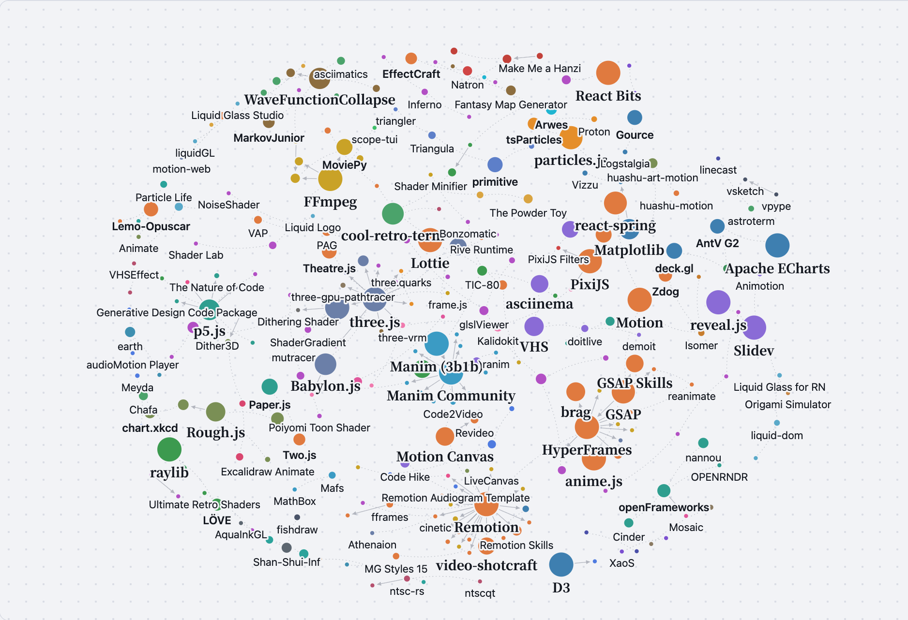](https://syydaniel.github.io/awesome-code-animation/?lang=en#graph-sec)

Click the image for the [interactive graph](https://syydaniel.github.io/awesome-code-animation/?lang=en#graph-sec). Arrows point from a source to what grew out of it, and dotted lines mean similar, often paired, or same author. You can drag, zoom, switch to the Family tree card view, and click a project to see its full lineage.

233 relationships. Looking to switch tools? See Alternative. Want more features? See Plugin / extension and Built on.

### Forked from

Split off from another project and developed separately

| Project | Relation | Project | Note |
| --- | :---: | --- | --- |
| [Manim Community](https://github.com/ManimCommunity/manim) | Forked from | [Manim (3b1b)](https://github.com/3b1b/manim) | Community fork of 3b1b's ManimGL, with fuller docs and a different API |
| [Revideo](https://github.com/midrender/revideo) | Forked from | [Motion Canvas](https://github.com/motion-canvas/motion-canvas) | Drops the editor dependency; built for headless batch rendering |

### Built on

Built on another project and can't run without it

| Project | Relation | Project | Note |
| --- | :---: | --- | --- |
| [React Three Fiber](https://github.com/pmndrs/react-three-fiber) | Built on | [three.js](https://github.com/mrdoob/three.js) | Write three.js scenes with React |
| [Vanta.js](https://github.com/tengbao/vanta) | Built on | [three.js](https://github.com/mrdoob/three.js) | Most of the animated backgrounds are drawn with three.js |
| [ShaderGradient](https://github.com/ruucm/shadergradient) | Built on | [React Three Fiber](https://github.com/pmndrs/react-three-fiber) | Renders gradients with React Three Fiber |
| [Dithering Shader](https://github.com/niccolofanton/dithering-shader) | Built on | [React Three Fiber](https://github.com/pmndrs/react-three-fiber) | Used as a post-processing effect in R3F |
| [Generative Design Code Package](https://github.com/generative-design/Code-Package-p5.js) | Built on | [p5.js](https://github.com/processing/p5.js) | Examples from the book Generative Design, written in p5.js |
| [The Nature of Code](https://github.com/nature-of-code/noc-book-2) | Built on | [p5.js](https://github.com/processing/p5.js) | Examples from the new edition of The Nature of Code, written in p5.js |
| [git-sim](https://github.com/initialcommit-com/git-sim) | Built on | [Manim Community](https://github.com/ManimCommunity/manim) | Uses Manim to animate Git operations |
| [roughViz](https://github.com/jwilber/roughViz) | Built on | [Rough.js](https://github.com/rough-stuff/rough) | Hand-drawn lines come from Rough.js |
| [vsketch](https://github.com/abey79/vsketch) | Built on | [vpype](https://github.com/abey79/vpype) | Same author; vsketch output goes straight into vpype for processing |
| [WFC Infinite City](https://github.com/marian42/wavefunctioncollapse) | Built on | [WaveFunctionCollapse](https://github.com/mxgmn/WaveFunctionCollapse) | Generates 3D cities with the WFC algorithm |
| [bar_chart_race](https://github.com/dexplo/bar_chart_race) | Built on | [Matplotlib](https://github.com/matplotlib/matplotlib) | Draws each frame with Matplotlib |
| [party-mode](https://github.com/preziotte/party-mode) | Built on | [D3](https://github.com/d3/d3) | Draws visualizations with D3 |
| [Mosaic](https://github.com/d3cod3/Mosaic) | Built on | [openFrameworks](https://github.com/openframeworks/openFrameworks) | Built on openFrameworks |
| [Claude Animation Base](https://github.com/JohnHeibel/ClaudeAnimationBase) | Built on | [p5.js](https://github.com/processing/p5.js) |  |
| [Poseidon](https://github.com/owenyuwono/poseidon) | Built on | [three.js](https://github.com/mrdoob/three.js) |  |
| [Singularity](https://github.com/MisterPrada/singularity) | Built on | [three.js](https://github.com/mrdoob/three.js) |  |

### Plugin / extension

Adds features to another project

| Project | Relation | Project | Note |
| --- | :---: | --- | --- |
| [three-vrm](https://github.com/pixiv/three-vrm) | Plugin / extension | [three.js](https://github.com/mrdoob/three.js) | Lets three.js load VRM avatars |
| [postprocessing](https://github.com/pmndrs/postprocessing) | Plugin / extension | [three.js](https://github.com/mrdoob/three.js) | Post-processing effects for three.js |
| [three.quarks](https://github.com/Alchemist0823/three.quarks) | Plugin / extension | [three.js](https://github.com/mrdoob/three.js) | Particle effects for three.js |
| [three-nebula](https://github.com/creativelifeform/three-nebula) | Plugin / extension | [three.js](https://github.com/mrdoob/three.js) | Particle system for three.js |
| [babylon-mmd](https://github.com/noname0310/babylon-mmd) | Plugin / extension | [Babylon.js](https://github.com/BabylonJS/Babylon.js) | Plays MMD models and motions in Babylon.js |
| [pixi-live2d-display](https://github.com/guansss/pixi-live2d-display) | Plugin / extension | [PixiJS](https://github.com/pixijs/pixijs) | Displays Live2D models in PixiJS |
| [PixiJS Filters](https://github.com/pixijs/filters) | Plugin / extension | [PixiJS](https://github.com/pixijs/pixijs) | Official community filters for PixiJS |
| [p5.brush](https://github.com/acamposuribe/p5.brush) | Plugin / extension | [p5.js](https://github.com/processing/p5.js) | Adds natural brushes and watercolor to p5.js |
| [p5.riso](https://github.com/antiboredom/p5.riso) | Plugin / extension | [p5.js](https://github.com/processing/p5.js) | Adds Riso-style color-separated printing to p5.js |
| [p5.plotSvg](https://github.com/golanlevin/p5.plotSvg) | Plugin / extension | [p5.js](https://github.com/processing/p5.js) | Exports p5.js sketches as pen plotter SVG |
| [Manim Slides](https://github.com/jeertmans/manim-slides) | Plugin / extension | [Manim Community](https://github.com/ManimCommunity/manim) | Turns Manim animations into slides you can step through |
| [manim-voiceover](https://github.com/ManimCommunity/manim-voiceover) | Plugin / extension | [Manim Community](https://github.com/ManimCommunity/manim) | Official community voiceover plugin |
| [ManimML](https://github.com/helblazer811/ManimML) | Plugin / extension | [Manim Community](https://github.com/ManimCommunity/manim) | Components for animating machine learning concepts |
| [manim-physics](https://github.com/Matheart/manim-physics) | Plugin / extension | [Manim Community](https://github.com/ManimCommunity/manim) | Physics simulation extension |
| [remocn](https://github.com/Remocn/remocn) | Plugin / extension | [Remotion](https://github.com/remotion-dev/remotion) | Community library of animation and transition components |
| [THREE.Terrain](https://github.com/IceCreamYou/THREE.Terrain) | Plugin / extension | [three.js](https://github.com/mrdoob/three.js) | Procedural terrain for three.js |
| [three-gpu-pathtracer](https://github.com/gkjohnson/three-gpu-pathtracer) | Plugin / extension | [three.js](https://github.com/mrdoob/three.js) | Path tracing renderer for three.js |
| [CustomShaderMaterial](https://github.com/FarazzShaikh/THREE-CustomShaderMaterial) | Plugin / extension | [three.js](https://github.com/mrdoob/three.js) | Layers custom shaders onto three.js materials |
| [three-good-godrays](https://github.com/Ameobea/three-good-godrays) | Plugin / extension | [postprocessing](https://github.com/pmndrs/postprocessing) | Used as an effect in postprocessing |
| [TSL Textures](https://github.com/boytchev/tsl-textures) | Plugin / extension | [three.js](https://github.com/mrdoob/three.js) | Textures for TSL, the three.js shading language |
| [glsl-blend](https://github.com/jamieowen/glsl-blend) | Plugin / extension | [glslify](https://github.com/glslify/glslify) | Published in the glslify module format |

### Official template / skill

A template or AI skill from the same team

| Project | Relation | Project | Note |
| --- | :---: | --- | --- |
| [Remotion TikTok Template](https://github.com/remotion-dev/template-tiktok) | Official template / skill | [Remotion](https://github.com/remotion-dev/remotion) | Official template for captioned short videos |
| [Remotion Audiogram Template](https://github.com/remotion-dev/template-audiogram) | Official template / skill | [Remotion](https://github.com/remotion-dev/remotion) | Official podcast audiogram template |
| [Remotion Skills](https://github.com/remotion-dev/skills) | Official template / skill | [Remotion](https://github.com/remotion-dev/remotion) | Official AI coding agent skill |
| [GSAP Skills](https://github.com/greensock/gsap-skills) | Official template / skill | [GSAP](https://github.com/greensock/GSAP) | Official AI skills |

### Renders with

Uses another project for rendering or low-level work by default

| Project | Relation | Project | Note |
| --- | :---: | --- | --- |
| [Code2Video](https://github.com/showlab/Code2Video) | Renders with | [Manim Community](https://github.com/ManimCommunity/manim) | An LLM writes Manim code to generate teaching videos |
| [Generative Manim](https://github.com/marcelo-earth/generative-manim) | Renders with | [Manim Community](https://github.com/ManimCommunity/manim) | An LLM writes Manim code |
| [MathLens](https://github.com/shuyicc/MathLens) | Renders with | [Manim Community](https://github.com/ManimCommunity/manim) | Math problem explainer videos rendered with Manim |
| [manim-skill](https://github.com/Yusuke710/manim-skill) | Renders with | [Manim Community](https://github.com/ManimCommunity/manim) | Teaches an AI coding agent to write Manim |
| [Manim Agent Skills](https://github.com/adithya-s-k/manim_skill) | Renders with | [Manim Community](https://github.com/ManimCommunity/manim) | Teaches an AI coding agent to write Manim |
| [video-shotcraft](https://github.com/Vincentwei1021/video-shotcraft) | Renders with | [Remotion](https://github.com/remotion-dev/remotion) |  |
| [video-talkcraft](https://github.com/Vincentwei1021/video-talkcraft) | Renders with | [Remotion](https://github.com/remotion-dev/remotion) |  |
| [anything2explainer](https://github.com/Vincentwei1021/anything2explainer) | Renders with | [Remotion](https://github.com/remotion-dev/remotion) |  |
| [Claude Remotion Skill](https://github.com/haidrrrry/claude-remotion-skill) | Renders with | [Remotion](https://github.com/remotion-dev/remotion) |  |
| [weilanx Claude Videos](https://github.com/Azure12355/weilanx-claude-videos) | Renders with | [Remotion](https://github.com/remotion-dev/remotion) |  |
| [Papercut Explainer](https://github.com/0xS4N4TG/papercut-explainer) | Renders with | [Remotion](https://github.com/remotion-dev/remotion) |  |
| [cinetic](https://github.com/Leonxlnx/cinetic) | Renders with | [Remotion](https://github.com/remotion-dev/remotion) | Defaults to the Remotion engine; also supports HyperFrames |
| [FredTalk](https://github.com/njrhts2kvv-star/FredTalk) | Renders with | [Remotion](https://github.com/remotion-dev/remotion) |  |
| [RuiC Motion Reel](https://github.com/HRuiCcc/RuiC-motion-reel) | Renders with | [Remotion](https://github.com/remotion-dev/remotion) | Standard promo videos use Remotion templates |
| [Knowledge Explainer](https://github.com/znyupup/knowledge-explainer-skill) | Renders with | [Remotion](https://github.com/remotion-dev/remotion) |  |
| [DeepSeek Opus Motion](https://github.com/8533502-dev/deepseek-opus-motion-skill) | Renders with | [Remotion](https://github.com/remotion-dev/remotion) |  |
| [What If Animation](https://github.com/kelano86/what-if-animation) | Renders with | [Remotion](https://github.com/remotion-dev/remotion) |  |
| [fy-code-animation](https://github.com/Akillll-DuoHe/fy-code-animation) | Renders with | [Remotion](https://github.com/remotion-dev/remotion) | Also supports Canvas and HTML |
| [HyperFrames](https://github.com/heygen-com/hyperframes) | Renders with | [GSAP](https://github.com/greensock/GSAP) | Uses GSAP for animation by default |
| [html-video](https://github.com/nexu-io/html-video) | Renders with | [HyperFrames](https://github.com/heygen-com/hyperframes) | Also supports Remotion |
| [brag](https://github.com/latent-spaces/brag) | Renders with | [HyperFrames](https://github.com/heygen-com/hyperframes) |  |
| [Creator Style Kit](https://github.com/threeaus/creator-style-kit) | Renders with | [HyperFrames](https://github.com/heygen-com/hyperframes) |  |
| [MotionClone](https://github.com/blixvip/MotionClone) | Renders with | [HyperFrames](https://github.com/heygen-com/hyperframes) | Rebuilds a reference video as a HyperFrames project |
| [html-anime](https://github.com/blixvip/html-anime) | Renders with | [HyperFrames](https://github.com/heygen-com/hyperframes) |  |
| [Claude Animation Skills](https://github.com/artemnovitckii/claude-animation-skills) | Renders with | [HyperFrames](https://github.com/heygen-com/hyperframes) | 2D skills use HyperFrames, 3D uses three.js |
| [motion2code](https://github.com/lovisdotio/motion2code) | Renders with | [GSAP](https://github.com/greensock/GSAP) | The recreated output is SVG plus GSAP code |
| [editly](https://github.com/mifi/editly) | Renders with | [FFmpeg](https://github.com/FFmpeg/FFmpeg) |  |
| [editly](https://github.com/mifi/editly) | Renders with | [GL Transitions](https://github.com/gl-transitions/gl-transitions) | Transition effects come from GL Transitions |
| [MoviePy](https://github.com/Zulko/moviepy) | Renders with | [FFmpeg](https://github.com/FFmpeg/FFmpeg) |  |
| [FFCreator](https://github.com/tnfe/FFCreator) | Renders with | [FFmpeg](https://github.com/FFmpeg/FFmpeg) |  |
| [ffmpeg-skill](https://github.com/kajisho5/ffmpeg-skill) | Renders with | [FFmpeg](https://github.com/FFmpeg/FFmpeg) | Wraps FFmpeg as a tool AI coding agents can call |
| [ShaderGlass](https://github.com/mausimus/ShaderGlass) | Renders with | [libretro GLSL Shaders](https://github.com/libretro/glsl-shaders) | Bundles RetroArch's retro shaders |
| [ff-tracking](https://github.com/mrsarac/ff-tracking) | Renders with | [fframes](https://github.com/dmtrKovalenko/fframes) | Renders with fframes |
| [HyperFrames Motion Director](https://github.com/geekjourneyx/hyperframes-motion-director) | Renders with | [HyperFrames](https://github.com/heygen-com/hyperframes) |  |
| [video-spec-builder](https://github.com/feicaiclub/video-spec-builder) | Renders with | [HyperFrames](https://github.com/heygen-com/hyperframes) | Hands the storyboard script to HyperFrames to render |
| [ReelMimic](https://github.com/edenfunf/reelmimic) | Renders with | [HyperFrames](https://github.com/heygen-com/hyperframes) |  |
| [LiveCanvas](https://github.com/pengchujin/livecanvas) | Renders with | [Remotion](https://github.com/remotion-dev/remotion) |  |
| [Agentic Product Demo](https://github.com/Alexwtlf/agentic-product-demo) | Renders with | [Remotion](https://github.com/remotion-dev/remotion) |  |
| [NTSCRT](https://github.com/finnmckenty/NTSCRT) | Renders with | [ntsc-rs](https://github.com/ntsc-rs/ntsc-rs) | Uses ntsc-rs for signal simulation |
| [Chinese-Style Paper Animation](https://github.com/AllenAI2014/remotion-guofeng-starter) | Renders with | [Remotion](https://github.com/remotion-dev/remotion) |  |
| [Claude Animation Base](https://github.com/JohnHeibel/ClaudeAnimationBase) | Renders with | [p5.brush](https://github.com/acamposuribe/p5.brush) | Hand-drawn strokes use p5.brush |

### Data source

Uses data from another project

| Project | Relation | Project | Note |
| --- | :---: | --- | --- |
| [Hanzi Writer](https://github.com/chanind/hanzi-writer) | Data source | [Make Me a Hanzi](https://github.com/skishore/makemeahanzi) | Stroke data comes from Make Me a Hanzi |

### Alternative

Does similar work, so one can replace the other

| Project | Relation | Project | Note |
| --- | :---: | --- | --- |
| [tsParticles](https://github.com/tsparticles/tsparticles) | Alternative | [particles.js](https://github.com/VincentGarreau/particles.js) | tsParticles reads particles.js configs, so it works as a drop-in replacement |
| [Babylon.js](https://github.com/BabylonJS/Babylon.js) | Alternative | [three.js](https://github.com/mrdoob/three.js) | Web 3D engine with more features and built-in editing tools |
| [PlayCanvas](https://github.com/playcanvas/engine) | Alternative | [three.js](https://github.com/mrdoob/three.js) | Web 3D engine, geared toward games and Gaussian splatting |
| [Konva](https://github.com/konvajs/konva) | Alternative | [PixiJS](https://github.com/pixijs/pixijs) | Both render 2D Canvas; Konva favors interactive editing, PixiJS favors performance |
| [Two.js](https://github.com/jonobr1/two.js) | Alternative | [Paper.js](https://github.com/paperjs/paper.js) | Both are 2D vector drawing APIs |
| [DOjS](https://github.com/SuperIlu/DOjS) | Alternative | [p5.js](https://github.com/processing/p5.js) | API modeled on p5.js, but runs on MS-DOS |
| [canvas-sketch](https://github.com/mattdesl/canvas-sketch) | Alternative | [Fragment](https://github.com/raphaelameaume/fragment) | Both are workflow tools for generative art |
| [nannou](https://github.com/nannou-org/nannou) | Alternative | [openFrameworks](https://github.com/openframeworks/openFrameworks) | Creative coding frameworks: the Rust one and the C++ one |
| [Cinder](https://github.com/cinder/Cinder) | Alternative | [openFrameworks](https://github.com/openframeworks/openFrameworks) | Both are C++ creative coding frameworks |
| [OPENRNDR](https://github.com/openrndr/openrndr) | Alternative | [openFrameworks](https://github.com/openframeworks/openFrameworks) | Creative coding framework in Kotlin |
| [Motion Canvas](https://github.com/motion-canvas/motion-canvas) | Alternative | [Manim Community](https://github.com/ManimCommunity/manim) | Both suit explainer animation; Motion Canvas uses TypeScript and has a timeline editor |
| [Mafs](https://github.com/stevenpetryk/mafs) | Alternative | [MathBox](https://github.com/unconed/mathbox) | Both do web math visualization; Mafs leans 2D interactive, MathBox leans 3D |
| [HyperFrames](https://github.com/heygen-com/hyperframes) | Alternative | [Remotion](https://github.com/remotion-dev/remotion) | Both render web pages to video; HyperFrames uses HTML/CSS, Remotion uses React |
| [Motion Canvas](https://github.com/motion-canvas/motion-canvas) | Alternative | [Remotion](https://github.com/remotion-dev/remotion) | Both write video in TypeScript |
| [fframes](https://github.com/dmtrKovalenko/fframes) | Alternative | [Remotion](https://github.com/remotion-dev/remotion) | Both write video in code; fframes uses Rust and SVG, built for speed |
| [anime.js](https://github.com/juliangarnier/anime) | Alternative | [GSAP](https://github.com/greensock/GSAP) | JS animation engine, lighter weight |
| [Motion](https://github.com/motiondivision/motion) | Alternative | [GSAP](https://github.com/greensock/GSAP) | JS and React animation library |
| [react-spring](https://github.com/pmndrs/react-spring) | Alternative | [Motion](https://github.com/motiondivision/motion) | Both are React animation libraries; react-spring centers on spring physics |
| [dotLottie Web](https://github.com/LottieFiles/dotlottie-web) | Alternative | [Lottie](https://github.com/airbnb/lottie-web) | Official LottieFiles player with better performance |
| [PAG](https://github.com/Tencent/libpag) | Alternative | [Lottie](https://github.com/airbnb/lottie-web) | Tencent's After Effects animation solution, supporting more AE features |
| [Rive Runtime](https://github.com/rive-app/rive-wasm) | Alternative | [Lottie](https://github.com/airbnb/lottie-web) | Interactive animation format with state machines |
| [MoviePy](https://github.com/Zulko/moviepy) | Alternative | [editly](https://github.com/mifi/editly) | Both edit video in code; MoviePy uses Python, editly uses JSON |
| [Butterchurn](https://github.com/jberg/butterchurn) | Alternative | [projectM](https://github.com/projectM-visualizer/projectm) | Both read MilkDrop presets; Butterchurn runs in the browser |
| [MilkDrop 3](https://github.com/milkdrop2077/MilkDrop3) | Alternative | [projectM](https://github.com/projectM-visualizer/projectm) | Continuation of the original MilkDrop |
| [cool-retro-term](https://github.com/Swordfish90/cool-retro-term) | Alternative | [ShaderGlass](https://github.com/mausimus/ShaderGlass) | Both can produce a CRT monitor look |
| [Hydra](https://github.com/hydra-synth/hydra) | Alternative | [cables](https://github.com/cables-gl/cables) | Both do real-time visuals; Hydra is code, cables is node patching |
| [TiXL](https://github.com/tixl3d/tixl) | Alternative | [cables](https://github.com/cables-gl/cables) | Node-based real-time motion graphics; TiXL is desktop-oriented |
| [Dither3D](https://github.com/runevision/Dither3D) | Alternative | [Dithering Shader](https://github.com/niccolofanton/dithering-shader) | Both do 3D dithering; Dither3D is for Unity, the other for R3F |
| [chart.xkcd](https://github.com/timqian/chart.xkcd) | Alternative | [roughViz](https://github.com/jwilber/roughViz) | Both are hand-drawn style chart libraries |
| [Tegaki](https://github.com/gkurt/tegaki) | Alternative | [Hanzi Writer](https://github.com/chanind/hanzi-writer) | Both are writing animation tools; Tegaki supports any font |
| [osci-render](https://github.com/jameshball/osci-render) | Alternative | [scope-tui](https://github.com/alemidev/scope-tui) | Both relate to oscilloscope visuals; osci-render draws them, scope-tui views them |
| [Particle Life App](https://github.com/tom-mohr/particle-life-app) | Alternative | [Particle Life](https://github.com/hunar4321/particle-life) | Both are particle life; particle-life-app has a graphical interface |
| [ALIEN](https://github.com/chrxh/alien) | Alternative | [Lenia](https://github.com/Chakazul/Lenia) | Both are artificial life simulations |
| [Mandelbulber](https://github.com/buddhi1980/mandelbulber2) | Alternative | [XaoS](https://github.com/xaos-project/XaoS) | Both do fractal animation; Mandelbulber does 3D, XaoS does 2D zoom |
| [Zdog](https://github.com/metafizzy/zdog) | Alternative | [Isomer](https://github.com/jdan/isomer) | Both are lightweight pseudo-3D graphics libraries |
| [obelisk.js](https://github.com/nosir/obelisk.js) | Alternative | [Isomer](https://github.com/jdan/isomer) | Both draw isometric graphics; obelisk.js leans pixel art |
| [Arwes](https://github.com/arwes/arwes) | Alternative | [Cosmic UI](https://github.com/rizznme/cosmic-ui) | Both are sci-fi style UI components |
| [augmented-ui](https://github.com/propjockey/augmented-ui) | Alternative | [Arwes](https://github.com/arwes/arwes) | Cyberpunk borders in pure CSS |
| [AntV L7](https://github.com/antvis/L7) | Alternative | [deck.gl](https://github.com/visgl/deck.gl) | Both do large-scale map visualization and trajectory animation |
| [AntV G2](https://github.com/antvis/G2) | Alternative | [Apache ECharts](https://github.com/apache/echarts) | Two chart libraries widely used in China |
| [Vizzu](https://github.com/vizzuhq/vizzu-lib) | Alternative | [bar_chart_race](https://github.com/dexplo/bar_chart_race) | Both do data animation; Vizzu excels at morphing transitions between charts |
| [Pyxel](https://github.com/kitao/pyxel) | Alternative | [TIC-80](https://github.com/nesbox/TIC-80) | Both are retro game engines or fantasy consoles |
| [WASM-4](https://github.com/aduros/wasm4) | Alternative | [TIC-80](https://github.com/nesbox/TIC-80) | Both are fantasy consoles |
| [LÖVE](https://github.com/love2d/love) | Alternative | [raylib](https://github.com/raysan5/raylib) | Both are lightweight 2D/3D programming libraries; LÖVE uses Lua, raylib uses C |
| [Proton](https://github.com/drawcall/Proton) | Alternative | [tsParticles](https://github.com/tsparticles/tsparticles) | Both are web particle libraries |
| [three.quarks](https://github.com/Alchemist0823/three.quarks) | Alternative | [three-nebula](https://github.com/creativelifeform/three-nebula) | Both are three.js particle systems |
| [VHS](https://github.com/charmbracelet/vhs) | Alternative | [asciinema](https://github.com/asciinema/asciinema) | Both make terminal demos; VHS records from a script, asciinema records real sessions |
| [Terminalizer](https://github.com/faressoft/terminalizer) | Alternative | [asciinema](https://github.com/asciinema/asciinema) | Records the terminal and renders it to GIF |
| [TerminalTextEffects](https://github.com/ChrisBuilds/terminaltexteffects) | Alternative | [asciimatics](https://github.com/peterbrittain/asciimatics) | Both are Python terminal animation libraries |
| [ascii-image-converter](https://github.com/TheZoraiz/ascii-image-converter) | Alternative | [Chafa](https://github.com/hpjansson/chafa) | Both convert images to terminal text art |
| [Slidev](https://github.com/slidevjs/slidev) | Alternative | [reveal.js](https://github.com/hakimel/reveal.js) | Both write presentations in code; Slidev uses Markdown and Vue |
| [Animotion](https://github.com/animotionjs/animotion) | Alternative | [Slidev](https://github.com/slidevjs/slidev) | Animated presentations written in Svelte |
| [EffectCraft](https://github.com/storytold/effectcraft) | Alternative | [Natron](https://github.com/NatronGitHub/Natron) | Both are open-source compositing software |
| [Animate](https://github.com/cth9191/animate) | Alternative | [Lemo-Opuscar](https://github.com/lemomo-ai/lemo-opuscar) | Both are toolkits that have Claude write code in a chosen style to make videos |
| [Claude Drawing Skill](https://github.com/cloveric/claude-drawing-skill) | Alternative | [huashu-art-motion](https://github.com/alchaincyf/huashu-art-motion) | Both are multi-style code drawing skills |
| [reanimate](https://github.com/NiazMorshed2007/reanimate) | Alternative | [motion2code](https://github.com/lovisdotio/motion2code) | Both recreate existing animations frame by frame in code |
| [MotionClone](https://github.com/blixvip/MotionClone) | Alternative | [reanimate](https://github.com/NiazMorshed2007/reanimate) | Both recreate reference videos |
| [ranim](https://github.com/AzurIce/ranim) | Alternative | [Manim Community](https://github.com/ManimCommunity/manim) | Rust animation engine inspired by Manim |
| [animCJK](https://github.com/parsimonhi/animCJK) | Alternative | [Hanzi Writer](https://github.com/chanind/hanzi-writer) | Both are Chinese character stroke order animation; animCJK provides SVG animation directly |
| [heerich](https://github.com/meodai/heerich) | Alternative | [Isomer](https://github.com/jdan/isomer) | Both draw isometric or voxel graphics; heerich outputs SVG |
| [mapgen4](https://github.com/redblobgames/mapgen4) | Alternative | [Fantasy Map Generator](https://github.com/Azgaar/Fantasy-Map-Generator) | Both are procedural map generators |
| [demoit](https://github.com/dgageot/demoit) | Alternative | [doitlive](https://github.com/sloria/doitlive) | Both are used for live code demos |
| [doitlive](https://github.com/sloria/doitlive) | Alternative | [VHS](https://github.com/charmbracelet/vhs) | Both record terminal demos; doitlive types live, VHS records from a script |
| [timg](https://github.com/hzeller/timg) | Alternative | [video-to-ascii](https://github.com/joelibaceta/video-to-ascii) | Both play video in the terminal |
| [Realtime PyAudio FFT](https://github.com/aiXander/Realtime_PyAudio_FFT) | Alternative | [Meyda](https://github.com/meyda/meyda) | Both extract audio features; one in Python, one in JavaScript |
| [ManimCat](https://github.com/Wing900/ManimCat) | Alternative | [Generative Manim](https://github.com/marcelo-earth/generative-manim) | Both have AI write Manim animations from a single sentence |
| [Shader Editor](https://github.com/markusfisch/ShaderEditor) | Alternative | [Shader Toy for VS Code](https://github.com/stevensona/shader-toy) | Both preview GLSL live; one on Android phones, one in VS Code |
| [Sandboxels](https://github.com/R74nCom/sandboxels) | Alternative | [Sandspiel](https://github.com/MaxBittker/sandspiel) | Both are web falling sand sandboxes |
| [The Powder Toy](https://github.com/The-Powder-Toy/The-Powder-Toy) | Alternative | [Sandspiel](https://github.com/MaxBittker/sandspiel) | Veteran falling sand game, with more complex elements and physics |
| [TermiSand](https://github.com/BobdaProgrammer/TermiSand) | Alternative | [termsand](https://github.com/cgsdev0/termsand) | Both are falling sand simulations in the terminal |
| [webgl-wind](https://github.com/mapbox/webgl-wind) | Alternative | [earth](https://github.com/cambecc/earth) | Both do wind field particle animation |
| [ntscqt](https://github.com/JargeZ/ntscqt) | Alternative | [ntsc-rs](https://github.com/ntsc-rs/ntsc-rs) | Both do VHS effects; ntsc-rs is updated more often |
| [Retro Crisis Shaders](https://github.com/RetroCrisis/Retro-Crisis-GDV-NTSC) | Alternative | [libretro GLSL Shaders](https://github.com/libretro/glsl-shaders) | Both are retro shaders for RetroArch |
| [VhsFx](https://github.com/NullTale/VhsFx) | Alternative | [VHSEffect](https://github.com/zulubo/VHSEffect) | Both are VHS post-processing for Unity |
| [Oriedita](https://github.com/oriedita/oriedita) | Alternative | [ORIPA](https://github.com/oripa/oripa) | Both are crease pattern editors |
| [OriSim3D](https://github.com/RemiKoutcherawy/OriSim3D-Android) | Alternative | [Origami Simulator](https://github.com/amandaghassaei/OrigamiSimulator) | Both simulate origami folding; OriSim3D runs on Android |
| [Geometrize](https://github.com/Tw1ddle/geometrize) | Alternative | [primitive](https://github.com/fogleman/primitive) | Geometrize is a port of the primitive approach |
| [Triangula](https://github.com/rh12503/triangula) | Alternative | [primitive](https://github.com/fogleman/primitive) | Both rebuild images from geometric shapes |
| [triangler](https://github.com/tdh8316/triangler) | Alternative | [Triangula](https://github.com/rh12503/triangula) | Both convert images to low poly |
| [mutracer](https://github.com/pissang/mutracer) | Alternative | [three-gpu-pathtracer](https://github.com/gkjohnson/three-gpu-pathtracer) | Both do path tracing in the browser |
| [GLSL-PathTracer](https://github.com/knightcrawler25/GLSL-PathTracer) | Alternative | [ToyPathTracer](https://github.com/aras-p/ToyPathTracer) | Both are path tracers for learning |
| [Strange Attractor Renderer](https://github.com/Icelk/strange-attractor-renderer) | Alternative | [attractors](https://github.com/vdesmond/attractors) | Both draw strange attractors |
| [P(doom) MV (mexicat version)](https://github.com/mexicat/pdoom-video) | Alternative | [P(doom) MV](https://github.com/JohnHeibel/PDoomVideo) | Same song, two authors each making an MV in code |
| [Stellarium Web](https://github.com/Stellarium/stellarium-web-engine) | Alternative | [Solar Wanderer](https://github.com/hyqzz/Solar-Wanderer) | Both render celestial bodies in the browser |
| [linecast](https://github.com/ashuttl/linecast) | Alternative | [astroterm](https://github.com/da-luce/astroterm) | Both draw starfields in the terminal |
| [AquaInkGL](https://github.com/WishMelz/AquaInkGL) | Alternative | [Shan-Shui-Inf](https://github.com/LingDong-/shan-shui-inf) | Both are procedural ink wash in the browser |
| [NoiseShader](https://github.com/keijiro/NoiseShader) | Alternative | [webgl-noise](https://github.com/ashima/webgl-noise) | Both are noise shader functions; NoiseShader is for Unity |
| [webgl-noise](https://github.com/ashima/webgl-noise) | Alternative | [LYGIA](https://github.com/patriciogonzalezvivo/lygia) | Both provide shader noise functions; LYGIA covers more |
| [Poiyomi Toon Shader](https://github.com/poiyomi/PoiyomiToonShader) | Alternative | [UnityChan Toon Shader](https://github.com/unity3d-jp/UnityChanToonShaderVer2_Project) | Both are Unity toon shaders |
| [Unity Toon Shader](https://github.com/Unity-Technologies/com.unity.toonshader) | Alternative | [UnityChan Toon Shader](https://github.com/unity3d-jp/UnityChanToonShaderVer2_Project) | Both are Japanese-style toon shaders for Unity |
| [URP_Toon](https://github.com/ChiliMilk/URP_Toon) | Alternative | [URP Toon Shader Example](https://github.com/ColinLeung-NiloCat/UnityURPToonLitShaderExample) | Both are Unity URP toon shaders |
| [LiliumToonGraph](https://github.com/you-ri/LiliumToonGraph) | Alternative | [URP Toon Shader Example](https://github.com/ColinLeung-NiloCat/UnityURPToonLitShaderExample) | Both are Unity URP toon shaders |
| [godot-vrm](https://github.com/V-Sekai/godot-vrm) | Alternative | [three-vrm](https://github.com/pixiv/three-vrm) | Same VRM format; one for Godot, one for three.js |
| [Inferno](https://github.com/twostraws/Inferno) | Alternative | [SwiftUI Shaders](https://github.com/krispuckett/SwiftUIShaders) | Both are Metal shader collections for SwiftUI |
| [ShaderKit](https://github.com/jamesrochabrun/ShaderKit) | Alternative | [Inferno](https://github.com/twostraws/Inferno) | Both add Metal shader effects to SwiftUI |
| [AGSL Shader Playground](https://github.com/mejdi14/Android-AGSL-Shader-Playground) | Alternative | [Shader Editor](https://github.com/markusfisch/ShaderEditor) | Both run shaders on Android |
| [Shader Lab](https://github.com/basementstudio/shader-lab) | Alternative | [Paper Shaders](https://github.com/paper-design/shaders) | Both are web shader effect toolkits |
| [Universal Transition Shader](https://github.com/cashew-olddew/Universal-Transition-Shader) | Alternative | [GL Transitions](https://github.com/gl-transitions/gl-transitions) | Both are shader transition collections; one is for Godot |
| [GodotRetro](https://github.com/ahopness/GodotRetro) | Alternative | [Ultimate Retro Shaders](https://github.com/Zorochase/ultimate-retro-shader-collection) | Both are retro shaders for Godot |
| [Godot Ocean FFT](https://github.com/tessarakkt/godot4-oceanfft) | Alternative | [Poseidon](https://github.com/owenyuwono/poseidon) | Both use FFT for real-time ocean |
| [ShaderMan](https://github.com/smkplus/ShaderMan) | Alternative | [Shader Toy for VS Code](https://github.com/stevensona/shader-toy) | Both revolve around Shadertoy-style shaders |
| [Liquid Glass for RN](https://github.com/callstack/liquid-glass) | Alternative | [liquid-dom](https://github.com/AndrewPrifer/liquid-dom) | Both are liquid glass effects; one for React Native, one for the web |
| [liquidGL](https://github.com/naughtyduk/liquidGL) | Alternative | [Liquid Glass Studio](https://github.com/iyinchao/liquid-glass-studio) | Both do liquid glass on the web |
| [shuding/liquid-glass](https://github.com/shuding/liquid-glass) | Alternative | [liquid-dom](https://github.com/AndrewPrifer/liquid-dom) | Both are web liquid glass |
| [AndroidLiquidGlass](https://github.com/Kyant0/AndroidLiquidGlass) | Alternative | [Cloudy](https://github.com/skydoves/Cloudy) | Both are glass effects for Compose |
| [liquid-glass-android](https://github.com/Mortd3kay/liquid-glass-android) | Alternative | [AndroidLiquidGlass](https://github.com/Kyant0/AndroidLiquidGlass) | Both are Android liquid glass |
| [WebGL CRT Shader](https://github.com/gingerbeardman/webgl-crt-shader) | Alternative | [cool-retro-term](https://github.com/Swordfish90/cool-retro-term) | Both produce a CRT monitor look |
| [Shader School](https://github.com/stackgl/shader-school) | Alternative | [The Book of Shaders](https://github.com/patriciogonzalezvivo/thebookofshaders) | Both are beginner shader tutorials |
| [Raymarching Workshop](https://github.com/electricsquare/raymarching-workshop) | Alternative | [Bauble](https://github.com/ianthehenry/bauble) | Both revolve around SDF ray marching |

### Often paired

Often used together

| Project | Relation | Project | Note |
| --- | :---: | --- | --- |
| [Theatre.js](https://github.com/theatre-js/theatre) | Often paired | [three.js](https://github.com/mrdoob/three.js) | Visual timeline and camera animation for three.js scenes |
| [Code Hike](https://github.com/code-hike/codehike) | Often paired | [Remotion](https://github.com/remotion-dev/remotion) | Code explainer components that can render to video in Remotion |
| [Lottie Skill](https://github.com/diffusionstudio/lottie) | Often paired | [Lottie](https://github.com/airbnb/lottie-web) | Has AI write Lottie files, then plays them with Lottie |
| [Bonzomatic](https://github.com/Gargaj/Bonzomatic) | Often paired | [TIC-80](https://github.com/nesbox/TIC-80) | Two tools commonly used in Demoscene live coding competitions |
| [Excalidraw Animate](https://github.com/dai-shi/excalidraw-animate) | Often paired | [Rough.js](https://github.com/rough-stuff/rough) | Excalidraw's hand-drawn lines are drawn by Rough.js |
| [Kalidokit](https://github.com/yeemachine/kalidokit) | Often paired | [three-vrm](https://github.com/pixiv/three-vrm) | Drives VRM characters with camera motion tracking |
| [Kalidokit](https://github.com/yeemachine/kalidokit) | Often paired | [pixi-live2d-display](https://github.com/guansss/pixi-live2d-display) | Drives Live2D characters with camera motion tracking |
| [Code Animation Style Prompts](https://github.com/XiaoyeCodes/code-animation-prompts) | Often paired | [Lemo-Opuscar](https://github.com/lemomo-ai/lemo-opuscar) | Style prompt library, usable with the style toolkit |
| [Shader Minifier](https://github.com/laurentlb/shader-minifier) | Often paired | [Bonzomatic](https://github.com/Gargaj/Bonzomatic) | Common tool for Demoscene shaders |
| [FastNoiseLite](https://github.com/Auburn/FastNoiseLite) | Often paired | [WaveFunctionCollapse](https://github.com/mxgmn/WaveFunctionCollapse) | Both are foundational tools for procedural generation |

### Same author

By the same person or team

| Project | Relation | Project | Note |
| --- | :---: | --- | --- |
| [frame.js](https://github.com/mrdoob/frame.js) | Same author | [three.js](https://github.com/mrdoob/three.js) | Timeline editor written by mrdoob, the three.js author |
| [p5.js](https://github.com/processing/p5.js) | Same author | [Processing](https://github.com/processing/processing4) | Both maintained by the Processing Foundation; p5.js is the web version |
| [VAP](https://github.com/Tencent/vap) | Same author | [PAG](https://github.com/Tencent/libpag) | Both are animation effect tools open-sourced by Tencent |
| [Motion Design Skill](https://github.com/LottieFiles/motion-design-skill) | Same author | [dotLottie Web](https://github.com/LottieFiles/dotlottie-web) | Made by the LottieFiles team |
| [Lottie Skill](https://github.com/diffusionstudio/lottie) | Same author | [Diffusion Studio Core](https://github.com/diffusionstudio/core) | Made by the Diffusion Studio team |
| [LYGIA](https://github.com/patriciogonzalezvivo/lygia) | Same author | [glslViewer](https://github.com/patriciogonzalezvivo/glslViewer) | Patricio Gonzalez Vivo's shader toolchain |
| [glslCanvas](https://github.com/patriciogonzalezvivo/glslCanvas) | Same author | [The Book of Shaders](https://github.com/patriciogonzalezvivo/thebookofshaders) | The web examples in The Book of Shaders run on glslCanvas |
| [glslViewer](https://github.com/patriciogonzalezvivo/glslViewer) | Same author | [The Book of Shaders](https://github.com/patriciogonzalezvivo/thebookofshaders) | Same author |
| [Rough Notation](https://github.com/rough-stuff/rough-notation) | Same author | [Rough.js](https://github.com/rough-stuff/rough) | Hand-drawn annotation library by the Rough.js author |
| [fishdraw](https://github.com/LingDong-/fishdraw) | Same author | [Shan-Shui-Inf](https://github.com/LingDong-/shan-shui-inf) | Procedural drawing work by LingDong |
| [MarkovJunior](https://github.com/mxgmn/MarkovJunior) | Same author | [WaveFunctionCollapse](https://github.com/mxgmn/WaveFunctionCollapse) | Two procedural generation projects by the same author |
| [AntV L7](https://github.com/antvis/L7) | Same author | [AntV G2](https://github.com/antvis/G2) | Made by Ant Group's AntV team |
| [Logstalgia](https://github.com/acaudwell/Logstalgia) | Same author | [Gource](https://github.com/acaudwell/Gource) | Same author |
| [video-talkcraft](https://github.com/Vincentwei1021/video-talkcraft) | Same author | [video-shotcraft](https://github.com/Vincentwei1021/video-shotcraft) | The shotcraft series: promo videos, talking-head, explainers, style sample clips |
| [anything2explainer](https://github.com/Vincentwei1021/anything2explainer) | Same author | [video-shotcraft](https://github.com/Vincentwei1021/video-shotcraft) |  |
| [MG Styles 15](https://github.com/Vincentwei1021/mg-styles-15) | Same author | [video-shotcraft](https://github.com/Vincentwei1021/video-shotcraft) |  |
| [huashu-art-motion](https://github.com/alchaincyf/huashu-art-motion) | Same author | [huashu-motion](https://github.com/alchaincyf/huashu-motion) | Huashu's animation skill series |
| [motion-web](https://github.com/feitangyuan/motion-web) | Same author | [onetake](https://github.com/feitangyuan/onetake) | Same author |
| [Athenaion](https://github.com/Leonxlnx/athenaion) | Same author | [cinetic](https://github.com/Leonxlnx/cinetic) | Same author |
| [MotionClone](https://github.com/blixvip/MotionClone) | Same author | [html-anime](https://github.com/blixvip/html-anime) | Same author |
| [Canvas UI](https://github.com/DavidHDev/canvas-ui) | Same author | [React Bits](https://github.com/DavidHDev/react-bits) | WebGL effect components by the author of React Bits |
| [audioMotion Player](https://github.com/hvianna/audioMotion.js) | Same author | [audioMotion](https://github.com/hvianna/audioMotion-analyzer) | Same author: a player and a spectrum analyzer library |
| [Kinetograph](https://github.com/0xS4N4TG/kinetograph) | Same author | [Papercut Explainer](https://github.com/0xS4N4TG/papercut-explainer) | Same author |
| [L-System Explorer](https://github.com/anvaka/lsystem) | Same author | [FieldPlay](https://github.com/anvaka/fieldplay) | Same author, anvaka |
| [Claude Animation Base](https://github.com/JohnHeibel/ClaudeAnimationBase) | Same author | [P(doom) MV](https://github.com/JohnHeibel/PDoomVideo) | Same author |
| [glslEditor](https://github.com/patriciogonzalezvivo/glslEditor) | Same author | [glslViewer](https://github.com/patriciogonzalezvivo/glslViewer) | Same author |
| [GLSL Sandbox](https://github.com/mrdoob/glsl-sandbox) | Same author | [three.js](https://github.com/mrdoob/three.js) | Shader gallery by mrdoob, the three.js author |
| [Liquid Logo](https://github.com/paper-design/liquid-logo) | Same author | [Paper Shaders](https://github.com/paper-design/shaders) | Made by the Paper team |
| [LUMEN](https://github.com/Leonxlnx/lumenshaders) | Same author | [cinetic](https://github.com/Leonxlnx/cinetic) | Same author |

## All projects

Show all 443 projects, sorted by stars

| Project | Stars | Styles | Status |
| --- | ---: | --- | :---: |
| [three.js](https://github.com/mrdoob/three.js) | 118k | [3D](#3d), [Particles & Physics](#particle), [Shaders & Psychedelic](#shader) | 🟢 |
| [D3](https://github.com/d3/d3) | 114k | [Data Animation](#data) | 🟢 |
| [Manim (3b1b)](https://github.com/3b1b/manim) | 96.1k | [Math Explainer](#math), [Data Animation](#data) | 🟢 |
| [HyperFrames](https://github.com/heygen-com/hyperframes) | 78.8k | [Motion Graphics](#mg), [Kinetic Type & Lyrics](#type), [Shorts, Captions & Editing](#short) | 🟢 |
| [anime.js](https://github.com/juliangarnier/anime) | 74.3k | [Motion Graphics](#mg), [Kinetic Type & Lyrics](#type) | 🟢 |
| [reveal.js](https://github.com/hakimel/reveal.js) | 72.5k | [Code & Terminal Demo](#code), [Motion Graphics](#mg) | 🟢 |
| [Remotion](https://github.com/remotion-dev/remotion) | 70.7k | [Motion Graphics](#mg), [Shorts, Captions & Editing](#short), [Kinetic Type & Lyrics](#type), [3D](#3d) | 🟢 |
| [Apache ECharts](https://github.com/apache/echarts) | 67.7k | [Data Animation](#data) | 🟢 |
| [FFmpeg](https://github.com/FFmpeg/FFmpeg) | 66.5k | [Shorts, Captions & Editing](#short), [Glitch & Post FX](#glitch) | 🟢 |
| [React Bits](https://github.com/DavidHDev/react-bits) | 51.2k | [Motion Graphics](#mg), [Kinetic Type & Lyrics](#type), [Shaders & Psychedelic](#shader) | 🟢 |
| [Algorithm Visualizer](https://github.com/algorithm-visualizer/algorithm-visualizer) | 49.4k | [Code & Terminal Demo](#code), [Data Animation](#data) | ⚪ |
| [Slidev](https://github.com/slidevjs/slidev) | 49.4k | [Code & Terminal Demo](#code) | 🟢 |
| [PixiJS](https://github.com/pixijs/pixijs) | 48.6k | [Motion Graphics](#mg), [Particles & Physics](#particle), [Generative Art](#gen) | 🟢 |
| [Manim Community](https://github.com/ManimCommunity/manim) | 42.2k | [Math Explainer](#math), [Data Animation](#data), [Code & Terminal Demo](#code) | 🟢 |
| [raylib](https://github.com/raysan5/raylib) | 35.6k | [Pixel & Retro](#pixel), [3D](#3d), [Generative Art](#gen) | 🟢 |
| [Motion](https://github.com/motiondivision/motion) | 34.9k | [Motion Graphics](#mg) | 🟢 |
| [React Three Fiber](https://github.com/pmndrs/react-three-fiber) | 33.5k | [3D](#3d) | 🟢 |
| [Lottie](https://github.com/airbnb/lottie-web) | 32.4k | [Motion Graphics](#mg) | 🟡 |
| [particles.js](https://github.com/VincentGarreau/particles.js) | 30.2k | [Particles & Physics](#particle) | ⚪ |
| [GSAP](https://github.com/greensock/GSAP) | 30.2k | [Motion Graphics](#mg), [Kinetic Type & Lyrics](#type) | 🟢 |
| [react-spring](https://github.com/pmndrs/react-spring) | 29.3k | [Motion Graphics](#mg) | 🟢 |
| [Taichi](https://github.com/taichi-dev/taichi) | 28.5k | [Particles & Physics](#particle), [3D](#3d) | 🟢 |
| [cool-retro-term](https://github.com/Swordfish90/cool-retro-term) | 26.6k | [ASCII & Terminal](#ascii), [Pixel & Retro](#pixel), [VHS & Analog](#vhs) | 🟢 |
| [Babylon.js](https://github.com/BabylonJS/Babylon.js) | 26.3k | [3D](#3d) | 🟢 |
| [WaveFunctionCollapse](https://github.com/mxgmn/WaveFunctionCollapse) | 25.5k | [Procedural Generation](#procgen), [Pixel & Retro](#pixel) | 🟢 |
| [p5.js](https://github.com/processing/p5.js) | 24.3k | [Generative Art](#gen), [Particles & Physics](#particle), [Music Visualization](#audio) | 🟢 |
| [Matplotlib](https://github.com/matplotlib/matplotlib) | 23.4k | [Data Animation](#data) | 🟢 |
| [Magic UI](https://github.com/magicuidesign/magicui) | 23.1k | [Motion Graphics](#mg), [Kinetic Type & Lyrics](#type) | 🟢 |
| [Rough.js](https://github.com/rough-stuff/rough) | 21.3k | [Hand-drawn & Whiteboard](#hand) | ⚪ |
| [VHS](https://github.com/charmbracelet/vhs) | 21.3k | [Code & Terminal Demo](#code), [ASCII & Terminal](#ascii) | 🟢 |
| [brag](https://github.com/latent-spaces/brag) | 20.3k | [Motion Graphics](#mg) | 🟢 |
| [img2threejs](https://github.com/img2threejs/img2threejs) | 20.3k | [3D](#3d) | 🟢 |
| [3D Game Shaders for Beginners](https://github.com/lettier/3d-game-shaders-for-beginners) | 20k | [Shaders & Psychedelic](#shader), [3D](#3d) | ⚪ |
| [Motion Canvas](https://github.com/motion-canvas/motion-canvas) | 19.7k | [Motion Graphics](#mg), [Code & Terminal Demo](#code), [Math Explainer](#math) | 🟢 |
| [mo.js](https://github.com/mojs/mojs) | 18.9k | [Motion Graphics](#mg) | 🟢 |
| [Plotly](https://github.com/plotly/plotly.py) | 18.9k | [Data Animation](#data) | 🟢 |
| [Matter.js](https://github.com/liabru/matter-js) | 18.6k | [Particles & Physics](#particle) | 🟢 |
| [Pyxel](https://github.com/kitao/pyxel) | 18.5k | [Pixel & Retro](#pixel) | 🟢 |
| [asciinema](https://github.com/asciinema/asciinema) | 17.9k | [Code & Terminal Demo](#code), [ASCII & Terminal](#ascii) | 🟢 |
| [GSAP Skills](https://github.com/greensock/gsap-skills) | 17.9k | [Motion Graphics](#mg) | 🟢 |
| [PlayCanvas](https://github.com/playcanvas/engine) | 17.2k | [3D](#3d) | 🟢 |
| [video-shotcraft](https://github.com/Vincentwei1021/video-shotcraft) | 16.9k | [Motion Graphics](#mg), [Shorts, Captions & Editing](#short) | 🟢 |
| [WebGL Fluid](https://github.com/PavelDoGreat/WebGL-Fluid-Simulation) | 16.8k | [Particles & Physics](#particle), [Shaders & Psychedelic](#shader) | 🟡 |
| [Typed.js](https://github.com/mattboldt/typed.js) | 16.3k | [Kinetic Type & Lyrics](#type) | 🟡 |
| [Terminalizer](https://github.com/faressoft/terminalizer) | 16.2k | [Code & Terminal Demo](#code), [ASCII & Terminal](#ascii) | ⚪ |
| [Vivus](https://github.com/maxwellito/vivus) | 15.5k | [Hand-drawn & Whiteboard](#hand) | ⚪ |
| [Paper.js](https://github.com/paperjs/paper.js) | 15.2k | [Generative Art](#gen), [Motion Graphics](#mg) | 🟢 |
| [MoviePy](https://github.com/Zulko/moviepy) | 15.1k | [Shorts, Captions & Editing](#short) | 🟢 |
| [Konva](https://github.com/konvajs/konva) | 14.9k | [Motion Graphics](#mg) | 🟢 |
| [deck.gl](https://github.com/visgl/deck.gl) | 14.7k | [Data Animation](#data), [3D](#3d), [Map & Route](#map) | 🟢 |
| [primitive](https://github.com/fogleman/primitive) | 13.6k | [Geometric & Low-poly](#geo), [Generative Art](#gen) | ⚪ |
| [Gource](https://github.com/acaudwell/Gource) | 13.2k | [Data Animation](#data), [Code & Terminal Demo](#code) | 🟡 |
| [Theatre.js](https://github.com/theatre-js/theatre) | 12.9k | [Motion Graphics](#mg), [3D](#3d) | ⚪ |
| [canvas-confetti](https://github.com/catdad/canvas-confetti) | 12.8k | [Particles & Physics](#particle) | 🟡 |
| [AntV G2](https://github.com/antvis/G2) | 12.7k | [Data Animation](#data) | 🟢 |
| [Lemo-Opuscar](https://github.com/lemomo-ai/lemo-opuscar) | 12.2k | [Motion Graphics](#mg), [Hand-drawn & Whiteboard](#hand), [Pixel & Retro](#pixel) | 🟢 |
| [SVG.js](https://github.com/svgdotjs/svg.js) | 11.9k | [Motion Graphics](#mg) | 🟢 |
| [Zdog](https://github.com/metafizzy/zdog) | 10.7k | [Motion Graphics](#mg), [3D](#3d), [Isometric & Voxel](#iso) | ⚪ |
| [wavesurfer.js](https://github.com/katspaugh/wavesurfer.js) | 10.5k | [Music Visualization](#audio) | 🟢 |
| [openFrameworks](https://github.com/openframeworks/openFrameworks) | 10.5k | [Generative Art](#gen), [Music Visualization](#audio), [3D](#3d) | 🟢 |
| [Rough Notation](https://github.com/rough-stuff/rough-notation) | 9.7k | [Hand-drawn & Whiteboard](#hand), [Kinetic Type & Lyrics](#type) | ⚪ |
| [MapSCII](https://github.com/rastapasta/mapscii) | 9.3k | [Map & Route](#map), [ASCII & Terminal](#ascii) | 🟡 |
| [tsParticles](https://github.com/tsparticles/tsparticles) | 9.1k | [Particles & Physics](#particle) | 🟢 |
| [LÖVE](https://github.com/love2d/love) | 8.9k | [Pixel & Retro](#pixel) | 🟢 |
| [React Native Skia](https://github.com/wcandillon/react-native-skia) | 8.8k | [Motion Graphics](#mg), [Shaders & Psychedelic](#shader) | 🟢 |
| [Two.js](https://github.com/jonobr1/two.js) | 8.7k | [Motion Graphics](#mg), [Generative Art](#gen) | 🟢 |
| [MarkovJunior](https://github.com/mxgmn/MarkovJunior) | 8.5k | [Procedural Generation](#procgen), [Pixel & Retro](#pixel), [Isometric & Voxel](#iso) | 🟡 |
| [EffectCraft](https://github.com/storytold/effectcraft) | 8.4k | [Motion Graphics](#mg), [Glitch & Post FX](#glitch) | 🟢 |
| [chart.xkcd](https://github.com/timqian/chart.xkcd) | 7.9k | [Hand-drawn & Whiteboard](#hand), [Data Animation](#data) | 🟢 |
| [URP Toon Shader Example](https://github.com/ColinLeung-NiloCat/UnityURPToonLitShaderExample) | 7.8k | [Shaders & Psychedelic](#shader), [Anime, MMD & VRM](#anime) | 🟢 |
| [Arwes](https://github.com/arwes/arwes) | 7.6k | [Sci-fi HUD](#scifi), [Motion Graphics](#mg) | 🟢 |
| [Vanta.js](https://github.com/tengbao/vanta) | 7.3k | [3D](#3d), [Generative Art](#gen) | ⚪ |
| [roughViz](https://github.com/jwilber/roughViz) | 7.2k | [Hand-drawn & Whiteboard](#hand), [Data Animation](#data) | ⚪ |
| [ThreeUI](https://github.com/MengTo/threeui) | 7.1k | [3D](#3d) | 🟢 |
| [The Book of Shaders](https://github.com/patriciogonzalezvivo/thebookofshaders) | 7.1k | [Shaders & Psychedelic](#shader) | 🟡 |
| [VoxelSpace](https://github.com/s-macke/VoxelSpace) | 6.8k | [Isometric & Voxel](#iso), [Pixel & Retro](#pixel), [3D](#3d) | ⚪ |
| [nannou](https://github.com/nannou-org/nannou) | 6.8k | [Generative Art](#gen), [Music Visualization](#audio) | 🟢 |
| [earth](https://github.com/cambecc/earth) | 6.6k | [Flow & Wind Fields](#flow), [Map & Route](#map), [Data Animation](#data) | ⚪ |
| [CAVA](https://github.com/karlstav/cava) | 6.5k | [Music Visualization](#audio), [ASCII & Terminal](#ascii) | 🟢 |
| [Shan-Shui-Inf](https://github.com/LingDong-/shan-shui-inf) | 6.4k | [Ink & Watercolor](#ink), [Generative Art](#gen) | ⚪ |
| [Remotion Skills](https://github.com/remotion-dev/skills) | 6.3k | [Motion Graphics](#mg) | 🟢 |
| [huashu-art-motion](https://github.com/alchaincyf/huashu-art-motion) | 6.2k | [Hand-drawn & Whiteboard](#hand), [Ink & Watercolor](#ink) | 🟢 |
| [TIC-80](https://github.com/nesbox/TIC-80) | 6.2k | [Pixel & Retro](#pixel), [Live Coding & VJ](#live), [Demoscene](#demoscene) | 🟢 |
| [Fantasy Map Generator](https://github.com/Azgaar/Fantasy-Map-Generator) | 6.2k | [Procedural Generation](#procgen), [Map & Route](#map) | 🟢 |
| [Unity Shader Essentials (book source)](https://github.com/candycat1992/Unity_Shaders_Book) | 6.1k | [Shaders & Psychedelic](#shader), [3D](#3d) | ⚪ |
| [css-doodle](https://github.com/css-doodle/css-doodle) | 6.1k | [Generative Art](#gen) | 🟢 |
| [Galacean Engine](https://github.com/galacean/engine) | 5.9k | [3D](#3d), [Particles & Physics](#particle) | 🟢 |
| [Shaders](https://github.com/shader-effects-inc/shaders) | 5.8k | [Shaders & Psychedelic](#shader) | 🟢 |
| [PAG](https://github.com/Tencent/libpag) | 5.8k | [Motion Graphics](#mg) | 🟢 |
| [Kalidokit](https://github.com/yeemachine/kalidokit) | 5.7k | [Anime, MMD & VRM](#anime) | 🟡 |
| [Lottie Skill](https://github.com/diffusionstudio/lottie) | 5.7k | [Motion Graphics](#mg) | 🟢 |
| [Natron](https://github.com/NatronGitHub/Natron) | 5.6k | [Glitch & Post FX](#glitch) | 🟢 |
| [editly](https://github.com/mifi/editly) | 5.6k | [Shorts, Captions & Editing](#short), [Kinetic Type & Lyrics](#type) | 🟡 |
| [ALIEN](https://github.com/chrxh/alien) | 5.6k | [Artificial Life & Growth](#alife), [Particles & Physics](#particle) | 🟢 |
| [Cinder](https://github.com/cinder/Cinder) | 5.5k | [Generative Art](#gen), [3D](#3d) | 🟡 |
| [Code Hike](https://github.com/code-hike/codehike) | 5.4k | [Code & Terminal Demo](#code) | 🟡 |
| [The Powder Toy](https://github.com/The-Powder-Toy/The-Powder-Toy) | 5.4k | [Falling Sand](#sand), [Particles & Physics](#particle) | 🟢 |
| [Chafa](https://github.com/hpjansson/chafa) | 5.4k | [ASCII & Terminal](#ascii) | 🟢 |
| [Pts](https://github.com/williamngan/pts) | 5.4k | [Generative Art](#gen), [Data Animation](#data) | 🟢 |
| [glslViewer](https://github.com/patriciogonzalezvivo/glslViewer) | 5.4k | [Shaders & Psychedelic](#shader) | 🟢 |
| [Canvas UI](https://github.com/DavidHDev/canvas-ui) | 5.3k | [Shaders & Psychedelic](#shader), [Particles & Physics](#particle) | 🟢 |
| [canvas-sketch](https://github.com/mattdesl/canvas-sketch) | 5.3k | [Generative Art](#gen) | 🟢 |
| [CMatrix](https://github.com/abishekvashok/cmatrix) | 5.3k | [ASCII & Terminal](#ascii) | ⚪ |
| [Orillusion](https://github.com/Orillusion/orillusion) | 5.2k | [3D](#3d), [Shaders & Psychedelic](#shader) | 🟢 |
| [TiXL](https://github.com/tixl3d/tixl) | 5.2k | [Live Coding & VJ](#live), [Shaders & Psychedelic](#shader), [3D](#3d) | 🟢 |
| [Hanzi Writer](https://github.com/chanind/hanzi-writer) | 5.1k | [Handwriting & Strokes](#hanzi), [Kinetic Type & Lyrics](#type) | 🟡 |
| [WFC Infinite City](https://github.com/marian42/wavefunctioncollapse) | 4.9k | [Procedural Generation](#procgen), [3D](#3d) | ⚪ |
| [SHADERed](https://github.com/dfranx/SHADERed) | 4.8k | [Shaders & Psychedelic](#shader) | ⚪ |
| [html-video](https://github.com/nexu-io/html-video) | 4.8k | [Motion Graphics](#mg), [Kinetic Type & Lyrics](#type) | 🟢 |
| [git-sim](https://github.com/initialcommit-com/git-sim) | 4.7k | [Code & Terminal Demo](#code), [Data Animation](#data) | 🟢 |
| [pixelfx](https://github.com/patch-gg/pixelfx) | 4.7k | [Pixel & Retro](#pixel) | 🟢 |
| [Tweakpane](https://github.com/cocopon/tweakpane) | 4.6k | [Generative Art](#gen) | 🟡 |
| [projectM](https://github.com/projectM-visualizer/projectm) | 4.6k | [Music Visualization](#audio), [Shaders & Psychedelic](#shader) | 🟢 |
| [ffmpeg-skill](https://github.com/kajisho5/ffmpeg-skill) | 4.5k | [Shorts, Captions & Editing](#short) | 🟢 |
| [AndroidLiquidGlass](https://github.com/Kyant0/AndroidLiquidGlass) | 4.5k | [Liquid Glass](#liquid) | 🟢 |
| [Shader School](https://github.com/stackgl/shader-school) | 4.4k | [Shaders & Psychedelic](#shader) | ⚪ |
| [ShaderGlass](https://github.com/mausimus/ShaderGlass) | 4.4k | [Pixel & Retro](#pixel), [Glitch & Post FX](#glitch), [VHS & Analog](#vhs) | 🟢 |
| [asciimatics](https://github.com/peterbrittain/asciimatics) | 4.3k | [ASCII & Terminal](#ascii) | 🟢 |
| [TerminalTextEffects](https://github.com/ChrisBuilds/terminaltexteffects) | 4.3k | [ASCII & Terminal](#ascii), [Kinetic Type & Lyrics](#type) | 🟢 |
| [pywonderland](https://github.com/neozhaoliang/pywonderland) | 4.2k | [Fractals & Chaos](#fractal), [Math Explainer](#math) | 🟡 |
| [Godot Shaders](https://github.com/gdquest-demos/godot-shaders) | 4.2k | [Shaders & Psychedelic](#shader), [3D](#3d), [Pixel & Retro](#pixel) | 🟢 |
| [VAP](https://github.com/Tencent/vap) | 4.2k | [Motion Graphics](#mg) | 🟢 |
| [Revideo](https://github.com/midrender/revideo) | 4.2k | [Motion Graphics](#mg), [Shorts, Captions & Editing](#short) | 🟢 |
| [UnityChan Toon Shader](https://github.com/unity3d-jp/UnityChanToonShaderVer2_Project) | 4.1k | [Shaders & Psychedelic](#shader), [Anime, MMD & VRM](#anime) | ⚪ |
| [AntV L7](https://github.com/antvis/L7) | 4.1k | [Map & Route](#map), [Data Animation](#data) | 🟢 |
| [Paper Shaders](https://github.com/paper-design/shaders) | 3.9k | [Shaders & Psychedelic](#shader) | 🟢 |
| [Lenia](https://github.com/Chakazul/Lenia) | 3.9k | [Artificial Life & Growth](#alife), [Math Explainer](#math) | ⚪ |
| [Triangula](https://github.com/rh12503/triangula) | 3.9k | [Geometric & Low-poly](#geo) | 🟡 |
| [thi.ng/umbrella](https://github.com/thi-ng/umbrella) | 3.8k | [Generative Art](#gen), [Data Animation](#data) | 🟢 |
| [farbrausch Tools](https://github.com/farbrausch/fr_public) | 3.8k | [Demoscene](#demoscene), [3D](#3d) | ⚪ |
| [P(doom) MV (mexicat version)](https://github.com/mexicat/pdoom-video) | 3.8k | [Kinetic Type & Lyrics](#type), [Motion Graphics](#mg) | 🟢 |
| [onetake](https://github.com/feitangyuan/onetake) | 3.7k | [Motion Graphics](#mg) | 🟢 |
| [doitlive](https://github.com/sloria/doitlive) | 3.6k | [Code & Terminal Demo](#code), [ASCII & Terminal](#ascii) | 🟢 |
| [ascii-image-converter](https://github.com/TheZoraiz/ascii-image-converter) | 3.6k | [ASCII & Terminal](#ascii) | ⚪ |
| [FastNoiseLite](https://github.com/Auburn/FastNoiseLite) | 3.5k | [Procedural Generation](#procgen), [Generative Art](#gen) | 🟢 |
| [ManimML](https://github.com/helblazer811/ManimML) | 3.5k | [Math Explainer](#math), [Data Animation](#data) | ⚪ |
| [LYGIA](https://github.com/patriciogonzalezvivo/lygia) | 3.5k | [Shaders & Psychedelic](#shader) | 🟢 |
| [Mafs](https://github.com/stevenpetryk/mafs) | 3.4k | [Math Explainer](#math) | 🟢 |
| [hairline](https://github.com/lucasmarkes/hairline) | 3.4k | [Isometric & Voxel](#iso), [Motion Graphics](#mg) | 🟢 |
| [Particle Life](https://github.com/hunar4321/particle-life) | 3.4k | [Artificial Life & Growth](#alife), [Particles & Physics](#particle) | ⚪ |
| [TypeGPU](https://github.com/software-mansion/TypeGPU) | 3.3k | [Shaders & Psychedelic](#shader) | 🟢 |
| [Tegaki](https://github.com/gkurt/tegaki) | 3.3k | [Handwriting & Strokes](#hanzi), [Kinetic Type & Lyrics](#type), [Hand-drawn & Whiteboard](#hand) | 🟢 |
| [Sandspiel](https://github.com/MaxBittker/sandspiel) | 3.2k | [Falling Sand](#sand), [Pixel & Retro](#pixel) | 🟢 |
| [fframes](https://github.com/dmtrKovalenko/fframes) | 3.2k | [Motion Graphics](#mg), [Shorts, Captions & Editing](#short) | 🟢 |
| [FFCreator](https://github.com/tnfe/FFCreator) | 3.2k | [Shorts, Captions & Editing](#short) | 🟡 |
| [MG Styles 15](https://github.com/Vincentwei1021/mg-styles-15) | 3.1k | [Motion Graphics](#mg), [3D](#3d), [Hand-drawn & Whiteboard](#hand) | 🟢 |
| [ShaderGradient](https://github.com/ruucm/shadergradient) | 3.1k | [Shaders & Psychedelic](#shader) | 🟢 |
| [anything2explainer](https://github.com/Vincentwei1021/anything2explainer) | 3k | [Data Animation](#data), [Motion Graphics](#mg) | 🟢 |
| [gl-react](https://github.com/gre/gl-react) | 3k | [Shaders & Psychedelic](#shader) | 🟢 |
| [webgl-noise](https://github.com/ashima/webgl-noise) | 3k | [Shaders & Psychedelic](#shader), [Procedural Generation](#procgen) | 🟡 |
| [Mitsuba 3](https://github.com/mitsuba-renderer/mitsuba3) | 3k | [Path Tracing](#raytrace), [3D](#3d) | 🟢 |
| [postprocessing](https://github.com/pmndrs/postprocessing) | 3k | [Glitch & Post FX](#glitch), [3D](#3d) | 🟢 |
| [Inferno](https://github.com/twostraws/Inferno) | 2.9k | [Shaders & Psychedelic](#shader), [Glitch & Post FX](#glitch) | 🟢 |
| [Yocto/GL](https://github.com/xelatihy/yocto-gl) | 2.9k | [Path Tracing](#raytrace), [3D](#3d) | ⚪ |
| [Isomer](https://github.com/jdan/isomer) | 2.9k | [Isometric & Voxel](#iso) | ⚪ |
| [P(doom) MV](https://github.com/JohnHeibel/PDoomVideo) | 2.8k | [Kinetic Type & Lyrics](#type), [Motion Graphics](#mg) | 🟢 |
| [timg](https://github.com/hzeller/timg) | 2.8k | [ASCII & Terminal](#ascii), [Pixel & Retro](#pixel) | 🟢 |
| [Motion Design Skill](https://github.com/LottieFiles/motion-design-skill) | 2.8k | [Motion Graphics](#mg) | 🟢 |
| [Make Me a Hanzi](https://github.com/skishore/makemeahanzi) | 2.7k | [Handwriting & Strokes](#hanzi) | 🟡 |
| [Hydra](https://github.com/hydra-synth/hydra) | 2.7k | [Live Coding & VJ](#live), [Glitch & Post FX](#glitch), [Shaders & Psychedelic](#shader) | 🟡 |
| [ntsc-rs](https://github.com/ntsc-rs/ntsc-rs) | 2.7k | [VHS & Analog](#vhs), [Glitch & Post FX](#glitch) | 🟢 |
| [glslEditor](https://github.com/patriciogonzalezvivo/glslEditor) | 2.6k | [Shaders & Psychedelic](#shader) | ⚪ |
| [Pixel2Motion](https://github.com/nolangz/pixel2motion) | 2.6k | [Motion Graphics](#mg) | 🟢 |
| [liquid-dom](https://github.com/AndrewPrifer/liquid-dom) | 2.6k | [Liquid Glass](#liquid) | 🟢 |
| [Claude Animation Base](https://github.com/JohnHeibel/ClaudeAnimationBase) | 2.6k | [Hand-drawn & Whiteboard](#hand), [Anime, MMD & VRM](#anime) | 🟢 |
| [Herk Edit Kit](https://github.com/nateherkai/herk-edit-kit) | 2.6k | [Shorts, Captions & Editing](#short) | 🟢 |
| [fishdraw](https://github.com/LingDong-/fishdraw) | 2.5k | [Plotter & Line Art](#plotter), [Generative Art](#gen) | ⚪ |
| [astroterm](https://github.com/da-luce/astroterm) | 2.5k | [ASCII & Terminal](#ascii), [Space & Stars](#space) | 🟢 |
| [Proton](https://github.com/drawcall/Proton) | 2.5k | [Particles & Physics](#particle) | 🟡 |
| [zero](https://github.com/sinclairzx81/zero) | 2.5k | [ASCII & Terminal](#ascii), [3D](#3d) | 🟢 |
| [huashu-motion](https://github.com/alchaincyf/huashu-motion) | 2.3k | [Motion Graphics](#mg), [3D](#3d) | 🟢 |
| [obelisk.js](https://github.com/nosir/obelisk.js) | 2.3k | [Isometric & Voxel](#iso), [Pixel & Retro](#pixel) | ⚪ |
| [Teach Yourself Demoscene in 14 Days](https://github.com/psenough/teach_yourself_demoscene_in_14_days) | 2.3k | [Demoscene](#demoscene) | ⚪ |
| [glslify](https://github.com/glslify/glslify) | 2.3k | [Shaders & Psychedelic](#shader) | ⚪ |
| [glslCanvas](https://github.com/patriciogonzalezvivo/glslCanvas) | 2.3k | [Shaders & Psychedelic](#shader) | ⚪ |
| [three-vrm](https://github.com/pixiv/three-vrm) | 2.3k | [Anime, MMD & VRM](#anime), [3D](#3d) | 🟢 |
| [Code2Video](https://github.com/showlab/Code2Video) | 2.2k | [Math Explainer](#math) | 🟢 |
| [GL Transitions](https://github.com/gl-transitions/gl-transitions) | 2.2k | [Shorts, Captions & Editing](#short), [Glitch & Post FX](#glitch) | 🟢 |
| [AMLL](https://github.com/amll-dev/applemusic-like-lyrics) | 2.2k | [Kinetic Type & Lyrics](#type), [Music Visualization](#audio) | 🟢 |
| [Geometrize](https://github.com/Tw1ddle/geometrize) | 2.2k | [Geometric & Low-poly](#geo) | ⚪ |
| [Excalidraw Animate](https://github.com/dai-shi/excalidraw-animate) | 2.1k | [Hand-drawn & Whiteboard](#hand) | 🟢 |
| [ossia score](https://github.com/ossia/score) | 2.1k | [Live Coding & VJ](#live) | 🟢 |
| [video-talkcraft](https://github.com/Vincentwei1021/video-talkcraft) | 2.1k | [Shorts, Captions & Editing](#short), [Kinetic Type & Lyrics](#type) | 🟢 |
| [GLSL-PathTracer](https://github.com/knightcrawler25/GLSL-PathTracer) | 2.1k | [Path Tracing](#raytrace), [Shaders & Psychedelic](#shader) | ⚪ |
| [Vizzu](https://github.com/vizzuhq/vizzu-lib) | 2k | [Data Animation](#data) | 🟡 |
| [three-gpu-pathtracer](https://github.com/gkjohnson/three-gpu-pathtracer) | 2k | [Path Tracing](#raytrace), [3D](#3d) | 🟢 |
| [Astrofox](https://github.com/astrofox-io/astrofox) | 2k | [Music Visualization](#audio), [Motion Graphics](#mg) | 🟢 |
| [gganimate](https://github.com/thomasp85/gganimate) | 2k | [Data Animation](#data) | 🟡 |
| [Butterchurn](https://github.com/jberg/butterchurn) | 2k | [Music Visualization](#audio), [Shaders & Psychedelic](#shader) | 🟡 |
| [The Nature of Code](https://github.com/nature-of-code/noc-book-2) | 2k | [Generative Art](#gen), [Particles & Physics](#particle), [Artificial Life & Growth](#alife) | 🟢 |
| [video-to-ascii](https://github.com/joelibaceta/video-to-ascii) | 1.9k | [ASCII & Terminal](#ascii) | 🟡 |
| [Durdraw](https://github.com/durdraw/durdraw) | 1.9k | [ASCII & Terminal](#ascii) | 🟢 |
| [Logstalgia](https://github.com/acaudwell/Logstalgia) | 1.8k | [Data Animation](#data) | 🟡 |
| [glitch-this](https://github.com/TotallyNotChase/glitch-this) | 1.8k | [Glitch & Post FX](#glitch) | ⚪ |
| [ReelMimic](https://github.com/edenfunf/reelmimic) | 1.8k | [Shorts, Captions & Editing](#short) | 🟢 |
| [Animotion](https://github.com/animotionjs/animotion) | 1.8k | [Code & Terminal Demo](#code), [Motion Graphics](#mg) | 🟢 |
| [Splitting](https://github.com/shshaw/Splitting) | 1.8k | [Kinetic Type & Lyrics](#type) | ⚪ |
| [Liquid Glass for RN](https://github.com/callstack/liquid-glass) | 1.7k | [Liquid Glass](#liquid) | 🟢 |
| [GLSL Sandbox](https://github.com/mrdoob/glsl-sandbox) | 1.7k | [Shaders & Psychedelic](#shader), [Live Coding & VJ](#live) | 🟢 |
| [Poiyomi Toon Shader](https://github.com/poiyomi/PoiyomiToonShader) | 1.7k | [Shaders & Psychedelic](#shader), [Anime, MMD & VRM](#anime) | 🟢 |
| [Meyda](https://github.com/meyda/meyda) | 1.7k | [Music Visualization](#audio) | ⚪ |
| [remocn](https://github.com/Remocn/remocn) | 1.7k | [Motion Graphics](#mg), [Shorts, Captions & Editing](#short) | 🟢 |
| [Dither3D](https://github.com/runevision/Dither3D) | 1.6k | [Dither & 1-bit](#dither), [Shaders & Psychedelic](#shader), [3D](#3d) | 🟡 |
| [Unity Toon Shader](https://github.com/Unity-Technologies/com.unity.toonshader) | 1.6k | [Shaders & Psychedelic](#shader), [Anime, MMD & VRM](#anime) | 🟢 |
| [WASM-4](https://github.com/aduros/wasm4) | 1.5k | [Pixel & Retro](#pixel) | 🟢 |
| [MilkDrop 3](https://github.com/milkdrop2077/MilkDrop3) | 1.5k | [Music Visualization](#audio), [Shaders & Psychedelic](#shader) | 🟢 |
| [Animate](https://github.com/cth9191/animate) | 1.5k | [Hand-drawn & Whiteboard](#hand), [Pixel & Retro](#pixel), [Math Explainer](#math), [Riso & Paper Collage](#riso) | 🟢 |
| [pixi-live2d-display](https://github.com/guansss/pixi-live2d-display) | 1.5k | [Anime, MMD & VRM](#anime) | ⚪ |
| [MathBox](https://github.com/unconed/mathbox) | 1.5k | [Math Explainer](#math), [3D](#3d) | ⚪ |
| [Bonzomatic](https://github.com/Gargaj/Bonzomatic) | 1.5k | [Shaders & Psychedelic](#shader), [Live Coding & VJ](#live), [Demoscene](#demoscene) | 🟡 |
| [ShaderMan](https://github.com/smkplus/ShaderMan) | 1.5k | [Shaders & Psychedelic](#shader) | ⚪ |
| [Musializer](https://github.com/tsoding/musializer) | 1.5k | [Music Visualization](#audio) | 🟢 |
| [Bonsai](https://github.com/scallyw4g/bonsai) | 1.5k | [Procedural Generation](#procgen), [Isometric & Voxel](#iso), [3D](#3d) | 🟢 |
| [bar_chart_race](https://github.com/dexplo/bar_chart_race) | 1.5k | [Data Animation](#data) | ⚪ |
| [GLSL Primer Cards](https://github.com/wshxbqq/GLSL-Card) | 1.5k | [Shaders & Psychedelic](#shader) | ⚪ |
| [augmented-ui](https://github.com/propjockey/augmented-ui) | 1.4k | [Sci-fi HUD](#scifi) | ⚪ |
| [Liquid Logo](https://github.com/paper-design/liquid-logo) | 1.4k | [Liquid Glass](#liquid), [Shaders & Psychedelic](#shader), [Motion Graphics](#mg) | 🟡 |
| [Origami Simulator](https://github.com/amandaghassaei/OrigamiSimulator) | 1.4k | [Origami & Papercraft](#origami), [3D](#3d) | 🟢 |
| [NoiseShader](https://github.com/keijiro/NoiseShader) | 1.4k | [Shaders & Psychedelic](#shader), [Procedural Generation](#procgen) | 🟡 |
| [CustomShaderMaterial](https://github.com/FarazzShaikh/THREE-CustomShaderMaterial) | 1.4k | [Shaders & Psychedelic](#shader), [3D](#3d) | 🟡 |
| [URP_Toon](https://github.com/ChiliMilk/URP_Toon) | 1.4k | [Shaders & Psychedelic](#shader), [Anime, MMD & VRM](#anime) | ⚪ |
| [FieldPlay](https://github.com/anvaka/fieldplay) | 1.3k | [Flow & Wind Fields](#flow), [Math Explainer](#math) | 🟢 |
| [anidoodle](https://github.com/alexgreensh/anidoodle) | 1.3k | [Hand-drawn & Whiteboard](#hand), [Generative Art](#gen) | 🟢 |
| [Cloudy](https://github.com/skydoves/Cloudy) | 1.3k | [Liquid Glass](#liquid) | 🟢 |
| [spectral.js](https://github.com/rvanwijnen/spectral.js) | 1.3k | [Hand-drawn & Whiteboard](#hand) | 🟡 |
| [libretro GLSL Shaders](https://github.com/libretro/glsl-shaders) | 1.3k | [Pixel & Retro](#pixel), [Shaders & Psychedelic](#shader), [VHS & Analog](#vhs) | 🟢 |
| [p5.brush](https://github.com/acamposuribe/p5.brush) | 1.3k | [Hand-drawn & Whiteboard](#hand), [Generative Art](#gen) | 🟢 |
| [Manim Agent Skills](https://github.com/adithya-s-k/manim_skill) | 1.3k | [Math Explainer](#math) | 🟡 |
| [TerraForge3D](https://github.com/Jaysmito101/TerraForge3D) | 1.3k | [Procedural Generation](#procgen), [3D](#3d) | 🟢 |
| [Diffusion Studio Core](https://github.com/diffusionstudio/core) | 1.3k | [Shorts, Captions & Editing](#short) | 🟡 |
| [Fractal Sound Explorer](https://github.com/HackerPoet/FractalSoundExplorer) | 1.3k | [Fractals & Chaos](#fractal), [Music Visualization](#audio) | ⚪ |
| [three-nebula](https://github.com/creativelifeform/three-nebula) | 1.2k | [Particles & Physics](#particle), [3D](#3d) | 🟢 |
| [Reanimate](https://github.com/reanimate/reanimate) | 1.2k | [Math Explainer](#math), [Motion Graphics](#mg) | 🟡 |
| [shuding/liquid-glass](https://github.com/shuding/liquid-glass) | 1.2k | [Liquid Glass](#liquid), [Shaders & Psychedelic](#shader) | 🟡 |
| [motion-skills](https://github.com/iart-ai/motion-skills) | 1.2k | [Motion Graphics](#mg) | 🟢 |
| [frame.js](https://github.com/mrdoob/frame.js) | 1.2k | [Demoscene](#demoscene), [Motion Graphics](#mg) | 🟡 |
| [three.quarks](https://github.com/Alchemist0823/three.quarks) | 1.2k | [Particles & Physics](#particle), [3D](#3d) | 🟢 |
| [reanimate](https://github.com/NiazMorshed2007/reanimate) | 1.2k | [Motion Graphics](#mg) | 🟢 |
| [Polyvia](https://github.com/Ovilia/Polyvia) | 1.2k | [Geometric & Low-poly](#geo) | ⚪ |
| [VFX-JS](https://github.com/fand/vfx-js) | 1.2k | [Glitch & Post FX](#glitch), [Kinetic Type & Lyrics](#type) | 🟢 |
| [ntscqt](https://github.com/JargeZ/ntscqt) | 1.2k | [VHS & Analog](#vhs), [Glitch & Post FX](#glitch) | ⚪ |
| [Etro](https://github.com/etro-js/etro) | 1.2k | [Shorts, Captions & Editing](#short) | 🟢 |
| [PixiJS Filters](https://github.com/pixijs/filters) | 1.1k | [Glitch & Post FX](#glitch), [Shaders & Psychedelic](#shader) | 🟡 |
| [ToyPathTracer](https://github.com/aras-p/ToyPathTracer) | 1.1k | [Path Tracing](#raytrace) | 🟡 |
| [glsl-blend](https://github.com/jamieowen/glsl-blend) | 1.1k | [Shaders & Psychedelic](#shader) | ⚪ |
| [webgl-wind](https://github.com/mapbox/webgl-wind) | 1.1k | [Flow & Wind Fields](#flow), [Map & Route](#map) | 🟢 |
| [Shader Editor](https://github.com/markusfisch/ShaderEditor) | 1.1k | [Shaders & Psychedelic](#shader) | 🟢 |
| [twigl](https://github.com/doxas/twigl) | 1.1k | [Shaders & Psychedelic](#shader), [Live Coding & VJ](#live) | 🟡 |
| [Realtime PyAudio FFT](https://github.com/aiXander/Realtime_PyAudio_FFT) | 1.1k | [Music Visualization](#audio) | 🟢 |
| [Mandelbulber](https://github.com/buddhi1980/mandelbulber2) | 1.1k | [Fractals & Chaos](#fractal), [3D](#3d) | 🟢 |
| [video-spec-builder](https://github.com/feicaiclub/video-spec-builder) | 1.1k | [Shorts, Captions & Editing](#short) | 🟢 |
| [Bang Motion](https://github.com/bangtutorial/bang-motion) | 1.1k | [Motion Graphics](#mg), [Kinetic Type & Lyrics](#type) | 🟢 |
| [Motion Graphics Skills](https://github.com/Barty-Bart/motion-graphics) | 1.1k | [Motion Graphics](#mg) | 🟢 |
| [liquidGL](https://github.com/naughtyduk/liquidGL) | 1k | [Liquid Glass](#liquid), [Shaders & Psychedelic](#shader) | 🟢 |
| [Particle Life App](https://github.com/tom-mohr/particle-life-app) | 1k | [Artificial Life & Growth](#alife), [Particles & Physics](#particle) | 🟡 |
| [motion-anything](https://github.com/nexu-io/motion-anything) | 1k | [Motion Graphics](#mg), [Shaders & Psychedelic](#shader) | 🟢 |
| [Radiant](https://github.com/pbakaus/radiant) | 1k | [Shaders & Psychedelic](#shader), [Generative Art](#gen) | 🟢 |
| [Generative Design Code Package](https://github.com/generative-design/Code-Package-p5.js) | 1k | [Generative Art](#gen) | 🟢 |
| [Rive Runtime](https://github.com/rive-app/rive-wasm) | 1k | [Motion Graphics](#mg) | 🟢 |
| [Raymarching Workshop](https://github.com/electricsquare/raymarching-workshop) | 1k | [Shaders & Psychedelic](#shader), [3D](#3d) | ⚪ |
| [cinetic](https://github.com/Leonxlnx/cinetic) | 991 | [Motion Graphics](#mg) | 🟢 |
| [OPENRNDR](https://github.com/openrndr/openrndr) | 985 | [Generative Art](#gen) | 🟢 |
| [vpype](https://github.com/abey79/vpype) | 981 | [Plotter & Line Art](#plotter) | 🟢 |
| [Godot Realistic Water](https://github.com/godot-extended-libraries/godot-realistic-water) | 978 | [Shaders & Psychedelic](#shader), [3D](#3d) | 🟡 |
| [Manim Slides](https://github.com/jeertmans/manim-slides) | 975 | [Math Explainer](#math), [Code & Terminal Demo](#code) | 🟢 |
| [audioMotion](https://github.com/hvianna/audioMotion-analyzer) | 969 | [Music Visualization](#audio), [Data Animation](#data) | 🟢 |
| [DOjS](https://github.com/SuperIlu/DOjS) | 963 | [Pixel & Retro](#pixel), [Generative Art](#gen) | 🟡 |
| [Fragment](https://github.com/raphaelameaume/fragment) | 949 | [Generative Art](#gen), [Shaders & Psychedelic](#shader) | 🟢 |
| [mapgen4](https://github.com/redblobgames/mapgen4) | 948 | [Procedural Generation](#procgen), [Map & Route](#map) | 🟡 |
| [dotLottie Web](https://github.com/LottieFiles/dotlottie-web) | 938 | [Motion Graphics](#mg) | 🟢 |
| [Generative Manim](https://github.com/marcelo-earth/generative-manim) | 937 | [Math Explainer](#math) | 🟢 |
| [THREE.Terrain](https://github.com/IceCreamYou/THREE.Terrain) | 919 | [Procedural Generation](#procgen), [3D](#3d) | 🟢 |
| [Guizang Product Video](https://github.com/op7418/guizang-product-video-skill) | 903 | [Motion Graphics](#mg) | 🟢 |
| [pixelsort](https://github.com/satyarth/pixelsort) | 875 | [Glitch & Post FX](#glitch) | 🟢 |
| [SeeCode](https://github.com/Aryanutkarsh/SeeCode) | 872 | [Code & Terminal Demo](#code), [Isometric & Voxel](#iso) | 🟢 |
| [Pintr](https://github.com/javierbyte/pintr) | 837 | [Plotter & Line Art](#plotter), [Hand-drawn & Whiteboard](#hand) | 🟢 |
| [motion-web](https://github.com/feitangyuan/motion-web) | 836 | [3D](#3d), [Motion Graphics](#mg) | 🟢 |
| [Shader Park](https://github.com/shader-park/shader-park-core) | 831 | [Shaders & Psychedelic](#shader), [3D](#3d) | 🟢 |
| [Claude Remotion Skill](https://github.com/haidrrrry/claude-remotion-skill) | 828 | [Motion Graphics](#mg) | 🟢 |
| [Liquid Glass Widgets](https://github.com/sdegenaar/liquid_glass_widgets) | 812 | [Liquid Glass](#liquid) | 🟢 |
| [party-mode](https://github.com/preziotte/party-mode) | 807 | [Music Visualization](#audio), [Data Animation](#data) | 🟢 |
| [GodotRetro](https://github.com/ahopness/GodotRetro) | 806 | [Shaders & Psychedelic](#shader), [Pixel & Retro](#pixel), [VHS & Analog](#vhs) | 🟢 |
| [Liquid Glass Studio](https://github.com/iyinchao/liquid-glass-studio) | 802 | [Liquid Glass](#liquid), [Shaders & Psychedelic](#shader) | 🟢 |
| [demoit](https://github.com/dgageot/demoit) | 780 | [Code & Terminal Demo](#code) | 🟢 |
| [Claude Motion Design](https://github.com/howseen-ai/claude-motion-design) | 766 | [Motion Graphics](#mg) | 🟢 |
| [Solar Wanderer](https://github.com/hyqzz/Solar-Wanderer) | 764 | [Space & Stars](#space), [3D](#3d) | 🟢 |
| [Cosmic UI](https://github.com/rizznme/cosmic-ui) | 762 | [Sci-fi HUD](#scifi) | 🟢 |
| [scope-tui](https://github.com/alemidev/scope-tui) | 753 | [Oscilloscope & Vector](#scope), [ASCII & Terminal](#ascii), [Music Visualization](#audio) | 🟢 |
| [orb](https://github.com/LerSent001/orb) | 746 | [Liquid Glass](#liquid), [Shaders & Psychedelic](#shader) | 🟢 |
| [genjutsu](https://github.com/AThevon/genjutsu) | 745 | [Generative Art](#gen), [Motion Graphics](#mg) | 🟢 |
| [osci-render](https://github.com/jameshball/osci-render) | 738 | [Oscilloscope & Vector](#scope), [Music Visualization](#audio) | 🟢 |
| [shadplay](https://github.com/alphastrata/shadplay) | 727 | [Shaders & Psychedelic](#shader), [Live Coding & VJ](#live) | 🟢 |
| [adu-motion-video](https://github.com/adunext/adu-motion-video) | 722 | [Shorts, Captions & Editing](#short) | 🟢 |
| [Shader Toy for VS Code](https://github.com/stevensona/shader-toy) | 721 | [Shaders & Psychedelic](#shader) | 🟢 |
| [Shader Lab](https://github.com/basementstudio/shader-lab) | 717 | [Shaders & Psychedelic](#shader), [Motion Graphics](#mg) | 🟢 |
| [Waveform for OBS](https://github.com/phandasm/waveform) | 712 | [Music Visualization](#audio) | 🟢 |
| [Rossark Motion](https://github.com/rossark0/rossark-motion-skill) | 698 | [Motion Graphics](#mg) | 🟢 |
| [drawsvg](https://github.com/cduck/drawsvg) | 696 | [Motion Graphics](#mg), [Data Animation](#data) | 🟢 |
| [Athenaion](https://github.com/Leonxlnx/athenaion) | 680 | [3D](#3d) | 🟢 |
| [linecast](https://github.com/ashuttl/linecast) | 667 | [Space & Stars](#space), [ASCII & Terminal](#ascii) | 🟢 |
| [ranim](https://github.com/AzurIce/ranim) | 662 | [Math Explainer](#math) | 🟢 |
| [Stellarium Web](https://github.com/Stellarium/stellarium-web-engine) | 660 | [Space & Stars](#space) | 🟢 |
| [Rabbit Ear](https://github.com/rabbit-ear/rabbit-ear) | 655 | [Origami & Papercraft](#origami) | 🟢 |
| [audioMotion Player](https://github.com/hvianna/audioMotion.js) | 643 | [Music Visualization](#audio) | 🟢 |
| [heerich](https://github.com/meodai/heerich) | 630 | [Isometric & Voxel](#iso), [3D](#3d) | 🟢 |
| [XaoS](https://github.com/xaos-project/XaoS) | 627 | [Fractals & Chaos](#fractal) | 🟢 |
| [Aora Bot](https://github.com/sam70361/aora-bot) | 619 | [Motion Graphics](#mg), [Anime, MMD & VRM](#anime) | 🟢 |
| [Godot Ocean FFT](https://github.com/tessarakkt/godot4-oceanfft) | 614 | [Shaders & Psychedelic](#shader), [3D](#3d), [Particles & Physics](#particle) | 🟡 |
| [vsketch](https://github.com/abey79/vsketch) | 610 | [Plotter & Line Art](#plotter), [Generative Art](#gen) | 🟢 |
| [LiliumToonGraph](https://github.com/you-ri/LiliumToonGraph) | 609 | [Shaders & Psychedelic](#shader), [Anime, MMD & VRM](#anime) | 🟢 |
| [Bauble](https://github.com/ianthehenry/bauble) | 597 | [Shaders & Psychedelic](#shader), [3D](#3d), [Generative Art](#gen) | 🟢 |
| [ff-tracking](https://github.com/mrsarac/ff-tracking) | 592 | [Motion Graphics](#mg), [Glitch & Post FX](#glitch) | 🟢 |
| [shader-doodle](https://github.com/mmmerl/shader-doodle) | 589 | [Shaders & Psychedelic](#shader) | 🟢 |
| [MotionClone](https://github.com/blixvip/MotionClone) | 588 | [Motion Graphics](#mg) | 🟢 |
| [Shader Minifier](https://github.com/laurentlb/shader-minifier) | 583 | [Demoscene](#demoscene), [Shaders & Psychedelic](#shader) | 🟢 |
| [Machine Skill](https://github.com/AirsupHQ/machine-skill) | 579 | [3D](#3d) | 🟢 |
| [NTSC-CRT](https://github.com/LMP88959/NTSC-CRT) | 577 | [VHS & Analog](#vhs), [Pixel & Retro](#pixel) | 🟢 |
| [cables](https://github.com/cables-gl/cables) | 572 | [Live Coding & VJ](#live), [Shaders & Psychedelic](#shader), [3D](#3d) | 🟢 |
| [Launch Motion Skills](https://github.com/charlie947/motion-graphics-skills) | 551 | [Motion Graphics](#mg) | 🟢 |
| [play.core](https://github.com/ertdfgcvb/play.core) | 544 | [ASCII & Terminal](#ascii), [Generative Art](#gen) | 🟡 |
| [LiveCanvas](https://github.com/pengchujin/livecanvas) | 544 | [Shorts, Captions & Editing](#short) | 🟢 |
| [Processing](https://github.com/processing/processing4) | 535 | [Generative Art](#gen) | 🟢 |
| [Beam](https://github.com/doodlewind/beam) | 528 | [Shaders & Psychedelic](#shader) | 🟢 |
| [Universal Transition Shader](https://github.com/cashew-olddew/Universal-Transition-Shader) | 524 | [Shaders & Psychedelic](#shader), [Shorts, Captions & Editing](#short) | 🟡 |
| [Code Animation Style Prompts](https://github.com/XiaoyeCodes/code-animation-prompts) | 522 | [Motion Graphics](#mg) | 🟢 |
| [Mosaic](https://github.com/d3cod3/Mosaic) | 518 | [Live Coding & VJ](#live), [Generative Art](#gen) | 🟢 |
| [Trail](https://github.com/amalChandran/trail-android) | 516 | [Map & Route](#map) | 🟢 |
| [Learn wgpu (Chinese edition)](https://github.com/jinleili/learn-wgpu-zh) | 512 | [Shaders & Psychedelic](#shader), [3D](#3d) | 🟢 |
| [world.execute(me) Lyric MV](https://github.com/Nyankomintsu/world-execute-me-lyric-mv) | 511 | [Kinetic Type & Lyrics](#type), [Anime, MMD & VRM](#anime) | 🟢 |
| [Whiteboard Teacher Video](https://github.com/liangdabiao/whiteboard-teacher-video) | 497 | [Hand-drawn & Whiteboard](#hand) | 🟢 |
| [modV](https://github.com/vcync/modV) | 497 | [Music Visualization](#audio), [Live Coding & VJ](#live) | 🟡 |
| [ManimCat](https://github.com/Wing900/ManimCat) | 494 | [Math Explainer](#math) | 🟢 |
| [ShaderKit](https://github.com/jamesrochabrun/ShaderKit) | 489 | [Shaders & Psychedelic](#shader), [Liquid Glass](#liquid) | 🟢 |
| [Agentic Product Demo](https://github.com/Alexwtlf/agentic-product-demo) | 482 | [Shorts, Captions & Editing](#short) | 🟢 |
| [Retro Crisis Shaders](https://github.com/RetroCrisis/Retro-Crisis-GDV-NTSC) | 480 | [VHS & Analog](#vhs), [Pixel & Retro](#pixel), [Shaders & Psychedelic](#shader) | 🟢 |
| [godot-vrm](https://github.com/V-Sekai/godot-vrm) | 480 | [Anime, MMD & VRM](#anime), [3D](#3d) | 🟢 |
| [HyperFrames Motion Director](https://github.com/geekjourneyx/hyperframes-motion-director) | 477 | [Shorts, Captions & Editing](#short), [Kinetic Type & Lyrics](#type) | 🟢 |
| [Sandboxels](https://github.com/R74nCom/sandboxels) | 477 | [Falling Sand](#sand), [Pixel & Retro](#pixel) | 🟢 |
| [animCJK](https://github.com/parsimonhi/animCJK) | 474 | [Handwriting & Strokes](#hanzi), [Kinetic Type & Lyrics](#type) | 🟢 |
| [Svader](https://github.com/sockmaster27/svader) | 464 | [Shaders & Psychedelic](#shader) | 🟢 |
| [Kinetograph](https://github.com/0xS4N4TG/kinetograph) | 460 | [Shorts, Captions & Editing](#short), [Motion Graphics](#mg) | 🟢 |
| [DrawBot](https://github.com/typemytype/drawbot) | 455 | [Kinetic Type & Lyrics](#type), [Generative Art](#gen) | 🟢 |
| [Open Cubic Player](https://github.com/mywave82/opencubicplayer) | 451 | [Music Visualization](#audio), [Demoscene](#demoscene), [ASCII & Terminal](#ascii) | 🟢 |
| [Opus Video Skills](https://github.com/tuzhechen2005/opus-video-skills) | 438 | [Motion Graphics](#mg), [Music Visualization](#audio) | 🟢 |
| [HaloFlux](https://github.com/Ryder191/haloflux) | 423 | [Sci-fi HUD](#scifi), [Music Visualization](#audio) | 🟢 |
| [Product Launch Motion](https://github.com/AbubakrChan/product-launch-motion) | 421 | [Motion Graphics](#mg) | 🟢 |
| [Shader Skills](https://github.com/gokayfem/shader-skills) | 418 | [Shaders & Psychedelic](#shader) | 🟢 |
| [manim-physics](https://github.com/Matheart/manim-physics) | 412 | [Math Explainer](#math), [Particles & Physics](#particle) | 🟢 |
| [Shuimo UI](https://github.com/shuimo-design/shuimo-ui) | 399 | [Ink & Watercolor](#ink) | 🟢 |
| [algovivo](https://github.com/juniorrojas/algovivo) | 388 | [Artificial Life & Growth](#alife) | 🟢 |
| [AquaInkGL](https://github.com/WishMelz/AquaInkGL) | 383 | [Ink & Watercolor](#ink), [Shaders & Psychedelic](#shader) | 🟡 |
| [shipvideo](https://github.com/diggerhq/shipvideo) | 378 | [Motion Graphics](#mg) | 🟢 |
| [p5.riso](https://github.com/antiboredom/p5.riso) | 373 | [Riso & Paper Collage](#riso), [Generative Art](#gen) | 🟢 |
| [Claude Animation Skills](https://github.com/artemnovitckii/claude-animation-skills) | 372 | [3D](#3d), [Map & Route](#map) | 🟢 |
| [xilo-opus-video](https://github.com/Kianzzz/xilo-opus-video) | 369 | [Motion Graphics](#mg), [3D](#3d) | 🟢 |
| [LUMEN](https://github.com/Leonxlnx/lumenshaders) | 366 | [Shaders & Psychedelic](#shader), [Generative Art](#gen) | 🟢 |
| [RayTK](https://github.com/t3kt/raytk) | 358 | [Shaders & Psychedelic](#shader), [Live Coding & VJ](#live), [3D](#3d) | 🟡 |
| [Godot VFX Library](https://github.com/haowg/GODOT-VFX-LIBRARY) | 354 | [Particles & Physics](#particle), [Shaders & Psychedelic](#shader) | 🟡 |
| [MathLens](https://github.com/shuyicc/MathLens) | 352 | [Math Explainer](#math) | 🟡 |
| [SwiftUI Shaders](https://github.com/krispuckett/SwiftUIShaders) | 347 | [Shaders & Psychedelic](#shader), [Glitch & Post FX](#glitch) | 🟢 |
| [ShaderMania](https://github.com/markusmoenig/ShaderMania) | 347 | [Shaders & Psychedelic](#shader) | 🟢 |
| [Ultimate Retro Shaders](https://github.com/Zorochase/ultimate-retro-shader-collection) | 343 | [Pixel & Retro](#pixel), [3D](#3d), [Shaders & Psychedelic](#shader) | 🟢 |
| [Coldtype](https://github.com/coldtype/coldtype) | 341 | [Kinetic Type & Lyrics](#type), [Generative Art](#gen) | 🟢 |
| [ORIPA](https://github.com/oripa/oripa) | 334 | [Origami & Papercraft](#origami) | 🟢 |
| [motion2code](https://github.com/lovisdotio/motion2code) | 330 | [Motion Graphics](#mg) | 🟢 |
| [manim-voiceover](https://github.com/ManimCommunity/manim-voiceover) | 326 | [Math Explainer](#math) | 🟢 |
| [Code Video Showcase](https://github.com/Moessif/code-video-showcase) | 322 | [Motion Graphics](#mg), [3D](#3d) | 🟢 |
| [video-director](https://github.com/win4r/video-director) | 320 | [Motion Graphics](#mg) | 🟢 |
| [termsand](https://github.com/cgsdev0/termsand) | 317 | [Falling Sand](#sand), [ASCII & Terminal](#ascii) | 🟢 |
| [Singularity](https://github.com/MisterPrada/singularity) | 317 | [Space & Stars](#space), [Shaders & Psychedelic](#shader) | 🟡 |
| [Poseidon](https://github.com/owenyuwono/poseidon) | 317 | [Shaders & Psychedelic](#shader), [3D](#3d) | 🟢 |
| [ShaderToy Browser Extension](https://github.com/patuwwy/ShaderToy-Chrome-Plugin) | 313 | [Shaders & Psychedelic](#shader) | 🟢 |
| [flow-fields](https://github.com/romellogoodman/flow-fields) | 311 | [Flow & Wind Fields](#flow), [Generative Art](#gen) | 🟢 |
| [Riso Window Seat](https://github.com/sevenevesai/riso-windowseat) | 308 | [Riso & Paper Collage](#riso) | 🟢 |
| [AGSL Shader Playground](https://github.com/mejdi14/Android-AGSL-Shader-Playground) | 308 | [Shaders & Psychedelic](#shader) | 🟢 |
| [OriSim3D](https://github.com/RemiKoutcherawy/OriSim3D-Android) | 304 | [Origami & Papercraft](#origami), [3D](#3d) | 🟢 |
| [Remotion TikTok Template](https://github.com/remotion-dev/template-tiktok) | 301 | [Shorts, Captions & Editing](#short), [Kinetic Type & Lyrics](#type) | 🟢 |
| [Natural Disasters](https://github.com/Token-Gremlin/natural-disasters) | 300 | [Shaders & Psychedelic](#shader), [Particles & Physics](#particle), [3D](#3d) | 🟢 |
| [Dithering Shader](https://github.com/niccolofanton/dithering-shader) | 294 | [Dither & 1-bit](#dither), [3D](#3d), [Shaders & Psychedelic](#shader) | 🟢 |
| [Papercraft](https://github.com/rodrigorc/papercraft) | 289 | [Origami & Papercraft](#origami), [3D](#3d) | 🟢 |
| [cbirds](https://github.com/clainstone/cbirds) | 286 | [ASCII & Terminal](#ascii), [Particles & Physics](#particle) | 🟢 |
| [Remotion Audiogram Template](https://github.com/remotion-dev/template-audiogram) | 275 | [Music Visualization](#audio), [Shorts, Captions & Editing](#short) | 🟢 |
| [TSL Textures](https://github.com/boytchev/tsl-textures) | 271 | [Shaders & Psychedelic](#shader), [Procedural Generation](#procgen) | 🟢 |
| [babylon-mmd](https://github.com/noname0310/babylon-mmd) | 261 | [Anime, MMD & VRM](#anime), [3D](#3d) | 🟢 |
| [hitherdither](https://github.com/hbldh/hitherdither) | 260 | [Dither & 1-bit](#dither), [Pixel & Retro](#pixel) | 🟢 |
| [FredTalk](https://github.com/njrhts2kvv-star/FredTalk) | 249 | [Shorts, Captions & Editing](#short), [Kinetic Type & Lyrics](#type) | 🟢 |
| [Radiance](https://github.com/zbanks/radiance) | 249 | [Live Coding & VJ](#live), [Shaders & Psychedelic](#shader), [Music Visualization](#audio) | 🟡 |
| [Krbn](https://github.com/vpalos/Krbn) | 248 | [Plotter & Line Art](#plotter), [3D](#3d) | 🟢 |
| [html-anime](https://github.com/blixvip/html-anime) | 246 | [Anime, MMD & VRM](#anime), [Motion Graphics](#mg) | 🟢 |
| [weilanx Claude Videos](https://github.com/Azure12355/weilanx-claude-videos) | 237 | [Hand-drawn & Whiteboard](#hand), [Pixel & Retro](#pixel) | 🟢 |
| [three-good-godrays](https://github.com/Ameobea/three-good-godrays) | 236 | [Shaders & Psychedelic](#shader), [3D](#3d) | 🟢 |
| [Space Colonization Experiments](https://github.com/jasonwebb/2d-space-colonization-experiments) | 227 | [Artificial Life & Growth](#alife), [Generative Art](#gen) | 🟡 |
| [What If Animation](https://github.com/kelano86/what-if-animation) | 226 | [Motion Graphics](#mg) | 🟢 |
| [p5.plotSvg](https://github.com/golanlevin/p5.plotSvg) | 217 | [Plotter & Line Art](#plotter) | 🟢 |
| [Papercraft World](https://github.com/andrewwoan/aimee-xus-papercraft-world) | 197 | [Origami & Papercraft](#origami), [3D](#3d) | 🟢 |
| [retrace.gl](https://github.com/stasilo/retrace.gl) | 196 | [Path Tracing](#raytrace), [Shaders & Psychedelic](#shader), [3D](#3d) | 🟢 |
| [fy-code-animation](https://github.com/Akillll-DuoHe/fy-code-animation) | 194 | [Motion Graphics](#mg) | 🟢 |
| [manim-skill](https://github.com/Yusuke710/manim-skill) | 193 | [Math Explainer](#math) | 🟢 |
| [WebGL CRT Shader](https://github.com/gingerbeardman/webgl-crt-shader) | 188 | [VHS & Analog](#vhs), [Shaders & Psychedelic](#shader) | 🟡 |
| [NTSCRT](https://github.com/finnmckenty/NTSCRT) | 187 | [VHS & Analog](#vhs) | 🟢 |
| [liquid-glass-android](https://github.com/Mortd3kay/liquid-glass-android) | 187 | [Liquid Glass](#liquid) | 🟡 |
| [RuiC Motion Reel](https://github.com/HRuiCcc/RuiC-motion-reel) | 182 | [Motion Graphics](#mg) | 🟢 |
| [Dashi Style Explainers](https://github.com/chuspeeism/dashi-animationstyle) | 178 | [Hand-drawn & Whiteboard](#hand) | 🟢 |
| [Claude MV Skill](https://github.com/Joker-chichi/claude-mv-skill) | 178 | [Hand-drawn & Whiteboard](#hand), [Kinetic Type & Lyrics](#type) | 🟢 |
| [mutracer](https://github.com/pissang/mutracer) | 173 | [Path Tracing](#raytrace), [3D](#3d) | 🟢 |
| [Vibe Knowledge Shorts](https://github.com/xiazhuo123456789/vibe-knowledge-video) | 166 | [Kinetic Type & Lyrics](#type), [Motion Graphics](#mg) | 🟢 |
| [I, Voyager Planetarium](https://github.com/ivoyager/planetarium) | 162 | [Space & Stars](#space), [3D](#3d) | 🟢 |
| [YouTube Motion Graphics](https://github.com/sirioberati/YouTube-AI-Motion-Graphics) | 150 | [Data Animation](#data), [Motion Graphics](#mg) | 🟢 |
| [Sand Slide](https://github.com/kiwijuice56/sand-slide) | 143 | [Falling Sand](#sand), [Pixel & Retro](#pixel) | 🟢 |
| [NTSCplayer](https://github.com/ferropop/NTSCplayer) | 141 | [VHS & Analog](#vhs) | 🟢 |
| [Oriedita](https://github.com/oriedita/oriedita) | 134 | [Origami & Papercraft](#origami) | 🟢 |
| [kami](https://github.com/maxwase/kami) | 134 | [Origami & Papercraft](#origami) | 🟢 |
| [BB-Video](https://github.com/BubbleBrainBB/BB-Video) | 133 | [Motion Graphics](#mg), [3D](#3d) | 🟢 |
| [Papercut Explainer](https://github.com/0xS4N4TG/papercut-explainer) | 119 | [Riso & Paper Collage](#riso), [Shorts, Captions & Editing](#short) | 🟢 |
| [Black Hole](https://github.com/ibra-kdbra/black-hole) | 112 | [Space & Stars](#space), [Shaders & Psychedelic](#shader) | 🟢 |
| [map-motion](https://github.com/SpaceZephyr/map-motion) | 110 | [Map & Route](#map) | 🟢 |
| [Claude Drawing Skill](https://github.com/cloveric/claude-drawing-skill) | 101 | [Ink & Watercolor](#ink), [Hand-drawn & Whiteboard](#hand) | 🟢 |
| [Watercolor Playground](https://github.com/msurguy/watercolor-playground) | 101 | [Ink & Watercolor](#ink), [Hand-drawn & Whiteboard](#hand) | 🟢 |
| [L-System Explorer](https://github.com/anvaka/lsystem) | 100 | [Artificial Life & Growth](#alife), [Generative Art](#gen) | 🟢 |
| [triangler](https://github.com/tdh8316/triangler) | 99 | [Geometric & Low-poly](#geo) | 🟢 |
| [VhsFx](https://github.com/NullTale/VhsFx) | 89 | [VHS & Analog](#vhs), [Glitch & Post FX](#glitch) | 🟡 |
| [ditherwave](https://github.com/sahilsaini5/ditherwave) | 88 | [Dither & 1-bit](#dither), [Shaders & Psychedelic](#shader) | 🟡 |
| [Strange Attractor Renderer](https://github.com/Icelk/strange-attractor-renderer) | 88 | [Fractals & Chaos](#fractal) | 🟡 |
| [lowpoly](https://github.com/tasercake/lowpoly) | 87 | [Geometric & Low-poly](#geo) | 🟡 |
| [Cyber Ocean](https://github.com/SahilK-027/Cyber-Ocean) | 80 | [Flow & Wind Fields](#flow), [3D](#3d), [Particles & Physics](#particle) | 🟢 |
| [FallingSandEngine](https://github.com/PieKing1215/FallingSandEngine) | 76 | [Falling Sand](#sand), [Pixel & Retro](#pixel) | 🟡 |
| [Galaxy Shader](https://github.com/AmitDigga/threejs-galaxy-shader) | 73 | [Space & Stars](#space), [Shaders & Psychedelic](#shader), [Particles & Physics](#particle) | 🟡 |
| [Delaunay Stippler](https://github.com/NHasan143/delaunay-stippler) | 68 | [Geometric & Low-poly](#geo), [Plotter & Line Art](#plotter) | 🟢 |
| [wet-paint-flow](https://github.com/simonxxooxxoo/wet-paint-flow) | 66 | [Flow & Wind Fields](#flow), [Hand-drawn & Whiteboard](#hand) | 🟢 |
| [sy-style-100](https://github.com/xiaoxiong20xx-code/sy-style-100) | 65 | [Motion Graphics](#mg) | 🟢 |
| [code-poem-film](https://github.com/bangbuilds/code-poem-film) | 63 | [Ink & Watercolor](#ink) | 🟢 |
| [DeepSeek Opus Motion](https://github.com/8533502-dev/deepseek-opus-motion-skill) | 57 | [Motion Graphics](#mg) | 🟢 |
| [Knowledge Explainer](https://github.com/znyupup/knowledge-explainer-skill) | 57 | [Motion Graphics](#mg) | 🟡 |
| [Creator Style Kit](https://github.com/threeaus/creator-style-kit) | 54 | [Shorts, Captions & Editing](#short) | 🟢 |
| [gbro Collage Info Animation](https://github.com/pyang5166/gbro-collage-info) | 54 | [Riso & Paper Collage](#riso), [Dither & 1-bit](#dither) | 🟢 |
| [neon](https://github.com/Stanko/neon) | 44 | [Flow & Wind Fields](#flow), [Generative Art](#gen) | 🟡 |
| [Hopalong Attractor](https://github.com/ratwolfzero/hopalong_python) | 38 | [Fractals & Chaos](#fractal) | 🟢 |
| [Chinese-Style Paper Animation](https://github.com/AllenAI2014/remotion-guofeng-starter) | 34 | [Ink & Watercolor](#ink), [Riso & Paper Collage](#riso) | 🟢 |
| [VHSEffect](https://github.com/zulubo/VHSEffect) | 33 | [VHS & Analog](#vhs) | 🟡 |
| [proof-engine](https://github.com/Mattbusel/proof-engine) | 32 | [Fractals & Chaos](#fractal), [ASCII & Terminal](#ascii) | 🟢 |
| [VSand](https://github.com/Ealrann/VSand) | 31 | [Falling Sand](#sand) | 🟢 |
| [attractors](https://github.com/vdesmond/attractors) | 23 | [Fractals & Chaos](#fractal) | 🟡 |
| [TermiSand](https://github.com/BobdaProgrammer/TermiSand) | 22 | [Falling Sand](#sand), [ASCII & Terminal](#ascii) | 🟡 |

## Related lists

**Creative coding**

- [awesome-creative-coding](https://github.com/terkelg/awesome-creative-coding): tutorials, books and tools for creative coding.
- [awesome-plotters](https://github.com/beardicus/awesome-plotters): code and resources for pen plotters.
- [morphogenesis-resources](https://github.com/jasonwebb/morphogenesis-resources): growing forms with code, including reaction-diffusion, differential growth, slime molds and L-systems.
- [awesome-demoscene](https://github.com/psykon/awesome-demoscene): demoscene tools, code and reading.
- [awesome-glsl](https://github.com/vanrez-nez/awesome-glsl): resources for learning GLSL shaders.
- [Awesome-Unity-Shader](https://github.com/QianMo/Awesome-Unity-Shader): a collection of striking Unity shaders, written up in Chinese.

**Claude / Opus galleries**: videos and prompts people made with Claude, good for inspiration. A few works use Blender or video generation models, which these lists usually mark, so check before relying on them.

- [awesome-opus5-5-videos](https://github.com/yihui-dev/awesome-opus5-5-videos): videos made with Claude Opus 5.5 and the prompts behind them.
- [opus-video-prompts](https://github.com/joeseesun/opus-video-prompts): Opus 5.5 code-video examples and copyable prompts, in Chinese.
- [awesome-claude-5-5-videos](https://github.com/athemeroy/awesome-claude-5-5-videos): Claude 5.5 video workflows with source and model noted.
- [awesome-opus-5.5-video](https://github.com/zhuyansen/awesome-opus-5.5-video): videos, motion graphics, 3D scenes and games made with Opus 5.5.
- [awesome-claude-video](https://github.com/opusvideo/awesome-claude-video): Claude Opus 5.5 videos and animation.

**AI video skills**

- [awesome-claude-video-skills](https://github.com/zhuyansen/awesome-claude-video-skills): skills that let coding agents make videos. Some call generation models, so its rules differ from this list.
- [awesome-motion-design-agent-skills](https://github.com/frankxai/awesome-motion-design-agent-skills): AI skills for motion design.

## Contributing

Found a good project? [Suggest it in an issue](https://github.com/syydaniel/awesome-code-animation/issues/new/choose), or edit [`data/projects.json`](data/projects.json) and open a pull request. See [CONTRIBUTING.en.md](CONTRIBUTING.en.md).
Every Monday a search collects new candidates into an issue, and help judging them is welcome.
The READMEs and the web page are generated by `python scripts/build.py`, so please don't edit them by hand.

If this list helped you, a ⭐ star helps other people find it.

## Star History

## License

The curation is released under [CC0 1.0](LICENSE) and is free to use. Works in `docs/showcase/` (videos and posters) stay with their authors and are not covered by CC0. Each project keeps its own license, so check it before commercial use.
