

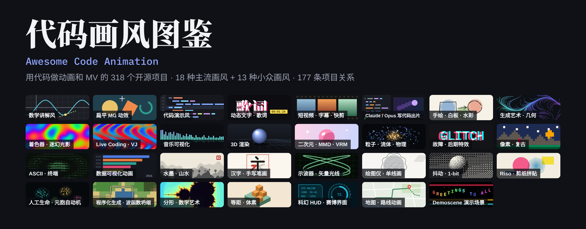

# 代码画风图鉴 · Awesome Code Animation

**用代码画动画、做 MV 的开源项目合集，按画风索引。**

A curated list of open-source tools for making animations and music videos **with code**, indexed by visual style. [English](README.en.md)

    

**[🎨 画风索引](#index)** · **[🕸️ 关系图谱](#relations)** · **[🖥️ 交互版网页](docs/index.html)**（下载后用浏览器打开，可按画风筛选、搜索、看演化树）

[画风索引](#index) · [小众画风区](#niche) · [关系图谱](#relations) · [收录标准](#rules) · [全部项目](#all) · [推荐项目](https://github.com/syydaniel/awesome-code-animation/issues/new/choose)

## 这是什么

想用代码做一支 MV、一段讲解动画、一个片头，第一个问题往往是「我想要的那种画风，该用什么工具做」。这里把 GitHub 上用代码做动画、做视频的开源项目按**画风**归类：3B1B 式数学讲解、扁平 MG、着色器迷幻光影、像素复古、ASCII 终端、音乐可视化、二次元 MMD……先挑画风，再挑工具。一个项目常能做好几种画风，所以会同时出现在几个画风里。

除了 17 种主流画风，还有收录小众画风的[小众画风区](#niche)（水墨山水、汉字笔顺、示波器、绘图仪、人工生命……），其中 89 个是让 Claude、Opus 等 AI 编程助手写代码出片的技能和作品，也都按画风归在各自的分类里。[关系图谱](#relations)把有关系的项目连在一起，看得出谁从谁演化而来、谁能替换谁。

## 收录标准

- **画面必须由代码绘制或渲染。** 用视频生成、图像生成模型出画面的项目不收，用 Blender 等 3D 软件出画面的也不收。个别项目带有可选的生成功能或 Blender 选项，会在说明里注明。
- **主流画风：** GitHub 星数 1000 以上，或近一年内有更新且星数 200 以上。
- **小众画风区：** 门槛放宽到近一年内有更新、星数 20 以上，星数不高但有意思的项目也能被看到。
- **让 Claude / Opus 等 AI 编程助手写代码出片的技能和作品：** 照样按画风归类，门槛放宽到近一年内有更新、星数 50 以上。
- **已归档（只读）的仓库不收。** 看过但没收的项目和原因记在 [`data/excluded.json`](data/excluded.json)。
- 状态按仓库最近一次推送计算：🟢 活跃（半年内）· 🟡 放缓（两年内）· ⚪ 停更（超过两年，多数仍能用，只是不再加新功能）。
- 星数和状态每周一由 GitHub Actions 自动刷新，新项目候选每周自动整理成 Issue，当前数据更新于 2026-11-03。

## 按目的先挑

| 想做什么 | 先看这几个 |
| --- | --- |
| 做知识讲解视频 | [Manim 社区版](https://github.com/ManimCommunity/manim) · [Motion Canvas](https://github.com/motion-canvas/motion-canvas) · [Animate](https://github.com/cth9191/animate) |
| 做 MV、批量出短视频 | [Remotion](https://github.com/remotion-dev/remotion) · [HyperFrames](https://github.com/heygen-com/hyperframes) · [three.js](https://github.com/mrdoob/three.js) |
| 用 Claude / Opus 写代码出片 | [Lemo-Opuscar](https://github.com/lemomo-ai/lemo-opuscar) · [Remotion Skills](https://github.com/remotion-dev/skills) · [代码动画画风提示词](https://github.com/XiaoyeCodes/code-animation-prompts) |
| 中国风：水墨、汉字、诗词 | [Shan-Shui-Inf 千里江山](https://github.com/LingDong-/shan-shui-inf) · [Hanzi Writer](https://github.com/chanind/hanzi-writer) · [code-poem-film](https://github.com/bangbuilds/code-poem-film) |
| 现场 VJ、迷幻画面 | [Hydra](https://github.com/hydra-synth/hydra) · [TiXL](https://github.com/tixl3d/tixl) · [cables](https://github.com/cables-gl/cables) |
| 音乐可视化 | [Butterchurn](https://github.com/jberg/butterchurn) · [projectM](https://github.com/projectM-visualizer/projectm) · [Astrofox](https://github.com/astrofox-io/astrofox) |
| 程序员科普视频 | [Slidev](https://github.com/slidevjs/slidev) · [VHS](https://github.com/charmbracelet/vhs) · [Gource](https://github.com/acaudwell/Gource) |
| 看看小众画风 | [osci-render](https://github.com/jameshball/osci-render) · [Lenia](https://github.com/Chakazul/Lenia) · [WaveFunctionCollapse](https://github.com/mxgmn/WaveFunctionCollapse) |

## 画风索引

点图片跳到对应画风的项目表。每张小样图都是用代码画出来的，代码在 [`site/template.html`](site/template.html) 里。

<table>
<tr><td align="center" width="33%"><a href="#math">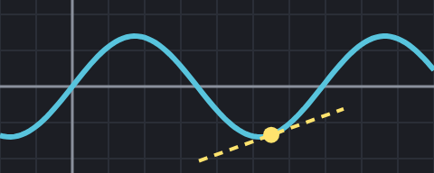</a> <b><a href="#math">数学讲解风</a></b> Math Explainer · 21 个项目</td><td align="center" width="33%"> <b><a href="#mg">扁平 MG 动效</a></b> Motion Graphics · 84 个项目</td><td align="center" width="33%"><a href="#code">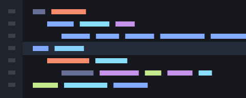</a> <b><a href="#code">代码演示风</a></b> Code & Terminal Demo · 16 个项目</td></tr>
<tr><td align="center" width="33%"> <b><a href="#type">动态文字 · 歌词</a></b> Kinetic Type & Lyrics · 29 个项目</td><td align="center" width="33%"> <b><a href="#short">短视频 · 字幕 · 快剪</a></b> Shorts, Captions & Editing · 28 个项目</td><td align="center" width="33%"><a href="#hand">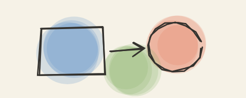</a> <b><a href="#hand">手绘 · 白板 · 水彩</a></b> Hand-drawn & Whiteboard · 23 个项目</td></tr>
<tr><td align="center" width="33%"><a href="#gen">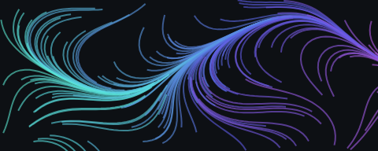</a> <b><a href="#gen">生成艺术 · 几何</a></b> Generative Art · 37 个项目</td><td align="center" width="33%"><a href="#shader">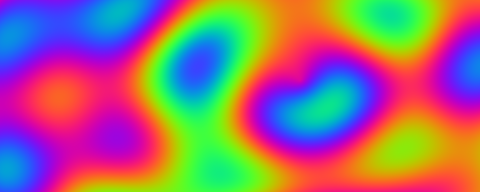</a> <b><a href="#shader">着色器 · 迷幻光影</a></b> Shaders & Psychedelic · 40 个项目</td><td align="center" width="33%"><a href="#live">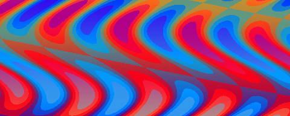</a> <b><a href="#live">Live Coding · VJ</a></b> Live Coding & VJ · 9 个项目</td></tr>
<tr><td align="center" width="33%"><a href="#audio">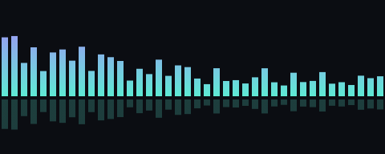</a> <b><a href="#audio">音乐可视化</a></b> Music Visualization · 25 个项目</td><td align="center" width="33%"><a href="#3d">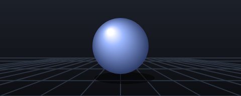</a> <b><a href="#3d">3D 渲染</a></b> 3D · 58 个项目</td><td align="center" width="33%"> <b><a href="#anime">二次元 · MMD · VRM</a></b> Anime, MMD & VRM · 8 个项目</td></tr>
<tr><td align="center" width="33%"><a href="#particle">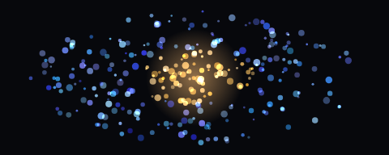</a> <b><a href="#particle">粒子 · 流体 · 物理</a></b> Particles & Physics · 23 个项目</td><td align="center" width="33%"><a href="#glitch">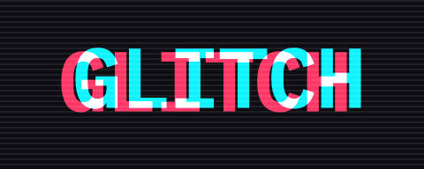</a> <b><a href="#glitch">故障 · 后期特效</a></b> Glitch & Post FX · 16 个项目</td><td align="center" width="33%"><a href="#pixel">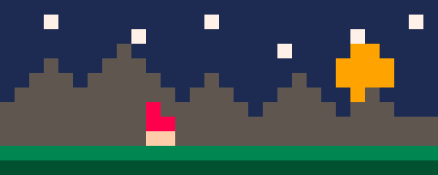</a> <b><a href="#pixel">像素 · 复古</a></b> Pixel & Retro · 26 个项目</td></tr>
<tr><td align="center" width="33%"><a href="#ascii">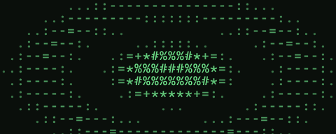</a> <b><a href="#ascii">ASCII · 终端</a></b> ASCII & Terminal · 25 个项目</td><td align="center" width="33%"><a href="#data">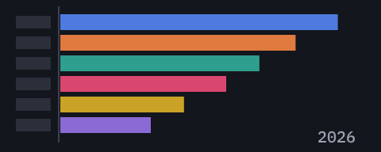</a> <b><a href="#data">数据可视化动画</a></b> Data Animation · 27 个项目</td></tr>
</table>

### 小众画风区

<table>
<tr><td align="center" width="33%"> <b><a href="#ink">水墨 · 水彩</a></b> Ink & Watercolor · 8 个项目</td><td align="center" width="33%"><a href="#hanzi">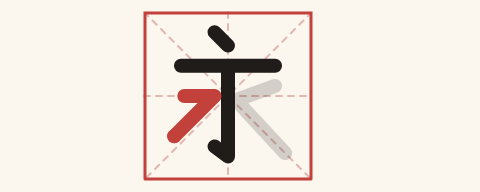</a> <b><a href="#hanzi">汉字 · 手写笔画</a></b> Handwriting & Strokes · 4 个项目</td><td align="center" width="33%"><a href="#scope">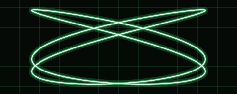</a> <b><a href="#scope">示波器 · 矢量光线</a></b> Oscilloscope & Vector · 2 个项目</td></tr>
<tr><td align="center" width="33%"><a href="#plotter">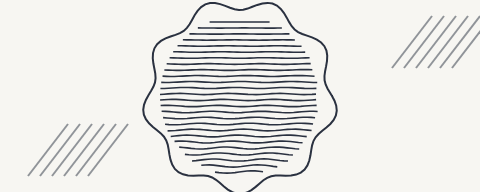</a> <b><a href="#plotter">绘图仪 · 单线画</a></b> Plotter & Line Art · 7 个项目</td><td align="center" width="33%"><a href="#dither">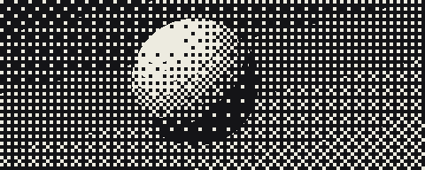</a> <b><a href="#dither">抖动 · 1-bit</a></b> Dither & 1-bit · 5 个项目</td><td align="center" width="33%"><a href="#riso">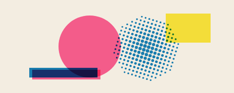</a> <b><a href="#riso">Riso · 剪纸拼贴</a></b> Riso & Paper Collage · 6 个项目</td></tr>
<tr><td align="center" width="33%"><a href="#alife">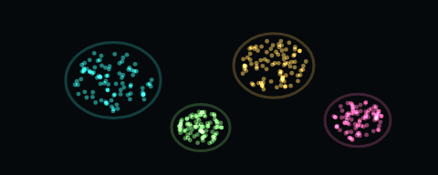</a> <b><a href="#alife">人工生命 · 生长形态</a></b> Artificial Life & Growth · 8 个项目</td><td align="center" width="33%"><a href="#procgen">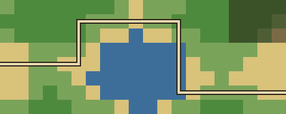</a> <b><a href="#procgen">程序化生成 · 波函数坍缩</a></b> Procedural Generation · 9 个项目</td><td align="center" width="33%"><a href="#fractal">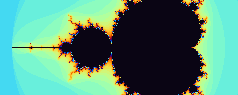</a> <b><a href="#fractal">分形 · 混沌 · 数学艺术</a></b> Fractals & Chaos · 8 个项目</td></tr>
<tr><td align="center" width="33%"><a href="#iso">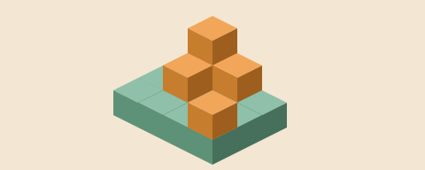</a> <b><a href="#iso">等距 · 体素</a></b> Isometric & Voxel · 9 个项目</td><td align="center" width="33%"><a href="#scifi">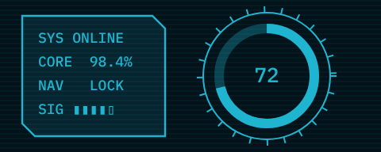</a> <b><a href="#scifi">科幻 HUD · 赛博界面</a></b> Sci-fi HUD · 4 个项目</td><td align="center" width="33%"><a href="#map">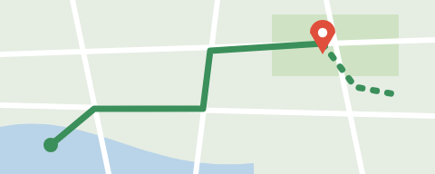</a> <b><a href="#map">地图 · 路线动画</a></b> Map & Route · 10 个项目</td></tr>
<tr><td align="center" width="33%"><a href="#demoscene">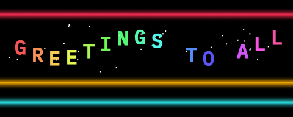</a> <b><a href="#demoscene">Demoscene 演示场景</a></b> Demoscene · 7 个项目</td><td align="center" width="33%"> <b><a href="#sand">落沙 · 像素物理</a></b> Falling Sand · 8 个项目</td><td align="center" width="33%"><a href="#flow">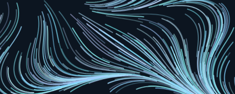</a> <b><a href="#flow">流场 · 风场</a></b> Flow & Wind Fields · 7 个项目</td></tr>
<tr><td align="center" width="33%"><a href="#vhs">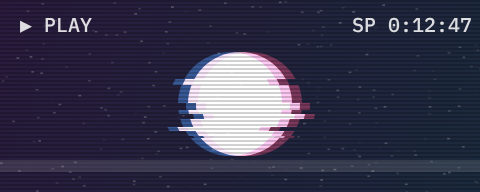</a> <b><a href="#vhs">VHS · 模拟信号</a></b> VHS & Analog · 11 个项目</td><td align="center" width="33%"> <b><a href="#origami">折纸 · 纸艺</a></b> Origami & Papercraft · 8 个项目</td><td align="center" width="33%"><a href="#geo">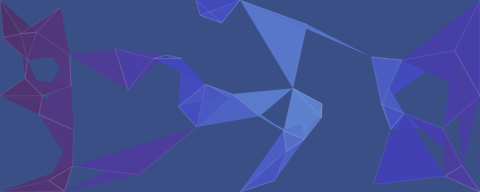</a> <b><a href="#geo">几何重构 · 低多边形</a></b> Geometric & Low-poly · 7 个项目</td></tr>
<tr><td align="center" width="33%"><a href="#raytrace">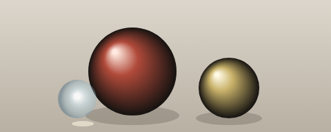</a> <b><a href="#raytrace">写实光追</a></b> Path Tracing · 6 个项目</td><td align="center" width="33%"><a href="#space">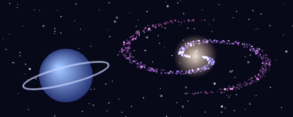</a> <b><a href="#space">星空 · 宇宙</a></b> Space & Stars · 7 个项目</td></tr>
</table>

## 主流画风

### 数学讲解风 · Math Explainer

> 公式、坐标系、几何变换，3B1B 式的蓝黑画面

共 21 个项目，按星数排序。

 

| 项目 | 星数 | 状态 | 写法 | 说明 |
| --- | ---: | :---: | --- | --- |
| [Manim (3b1b)](https://github.com/3b1b/manim) | 96.1k | 🟢 活跃 | Python | 3Blue1Brown 本人做视频用的数学动画引擎（ManimGL），公式、坐标系、图形变换，经典蓝黑讲解画风。 适合：讲解视频 · 也在：数据可视化动画 ⚠️ 文档较少，新手建议先用社区版。 |
| [Manim 社区版](https://github.com/ManimCommunity/manim) | 42.2k | 🟢 活跃 | Python | Manim 社区维护版，文档和教程最全，B 站大量数学、物理、算法科普视频用它制作。 适合：讲解视频 · 也在：数据可视化动画、代码演示风 |
| [Motion Canvas](https://github.com/motion-canvas/motion-canvas) | 19.7k | 🟢 活跃 | TypeScript | 用 TypeScript 生成器函数写动画，带时间轴编辑器，可以对着音频卡点，很适合讲解视频和代码演示。 适合：讲解视频 · MV · 也在：扁平 MG 动效、代码演示风 |
| [pywonderland](https://github.com/neozhaoliang/pywonderland) | 4.2k | 🟡 放缓 | Python | 国人作品：用 Python 画数学之美，分形、镶嵌、反应扩散、迷宫生成动画都有。 适合：数学艺术 · 也在：分形 · 混沌 · 数学艺术 |
| [Lenia](https://github.com/Chakazul/Lenia) | 3.9k | ⚪ 停更 | Python / JS | 连续元胞自动机，长出会移动、会分裂的「数学生命体」，画面像显微镜下的生物。 适合：人工生命 · 也在：人工生命 · 生长形态 ⚠️ 2024 年后未更新。 |
| [ManimML](https://github.com/helblazer811/ManimML) | 3.5k | ⚪ 停更 | Python | 基于 Manim 的机器学习概念动画：神经网络、卷积等结构的讲解动画。 适合：讲解视频 · 也在：数据可视化动画 |
| [Mafs](https://github.com/stevenpetryk/mafs) | 3.4k | 🟢 活跃 | React | React 数学交互组件：坐标系、函数图像、向量，能做可拖动的数学讲解动画。 适合：数学交互 |
| [Code2Video](https://github.com/showlab/Code2Video) | 2.2k | 🟢 活跃 | Python | 学术项目：让大模型编写 Manim 代码，自动生成教学讲解视频，画面全部由代码渲染。 适合：讲解视频 |
| [Animate](https://github.com/cth9191/animate) | 1.5k | 🟢 活跃 | JavaScript / Canvas | Claude Code 技能：用单个 canvas 程序化绘制短动画，内置剪纸、排线墨水、Riso 印刷、速写本、数学、像素、等距 7 种画风。 适合：讲解视频 · 短片 · 也在：手绘 · 白板 · 水彩、像素 · 复古、Riso · 剪纸拼贴 |
| [MathBox](https://github.com/unconed/mathbox) | 1.5k | ⚪ 停更 | JavaScript | 浏览器里的 3D 数学可视化：曲面、向量场、坐标网格，画面干净有质感。 适合：讲解视频 · 也在：3D 渲染 |
| [FieldPlay](https://github.com/anvaka/fieldplay) | 1.3k | 🟢 活跃 | JavaScript / GLSL | 写一个向量场公式，成千上万的粒子就沿着它流动，画面像流动的丝线。 适合：矢量场动画 · 也在：流场 · 风场 |
| [Manim Agent Skills](https://github.com/adithya-s-k/manim_skill) | 1.3k | 🟡 放缓 | Python / 技能 | 做 3Blue1Brown 风格动画的 Manim 技能和最佳实践。 适合：讲解视频 |
| [Reanimate](https://github.com/reanimate/reanimate) | 1.2k | 🟡 放缓 | Haskell | Haskell 写的 SVG 动画库，支持 LaTeX 公式，画面风格接近 3B1B。 适合：讲解视频 · 也在：扁平 MG 动效 ⚠️ 语言小众，社区较小。 |
| [Manim Slides](https://github.com/jeertmans/manim-slides) | 975 | 🟢 活跃 | Python | 把 Manim 动画做成可以逐页播放的演示幻灯片，也能导出成网页。 适合：讲解视频 · 演讲 · 也在：代码演示风 |
| [Generative Manim](https://github.com/marcelo-earth/generative-manim) | 937 | 🟢 活跃 | Python | 用自然语言描述，由大模型写出 Manim 代码并渲染成动画。 适合：讲解视频 |
| [ranim](https://github.com/AzurIce/ranim) | 662 | 🟢 活跃 | Rust | 受 Manim 启发、用 Rust 写的动画引擎。 适合：讲解视频 |
| [ManimCat](https://github.com/Wing900/ManimCat) | 494 | 🟢 活跃 | TypeScript / Python | 国人作品：用一句话描述，由 AI 写 Manim 代码生成数学动画，支持 LaTeX，渲染出错会自动修代码。 适合：数学讲解视频 ⚠️ AGPL-3.0：用在对外提供的网络服务里时，需要公开修改后的源码。 |
| [manim-physics](https://github.com/Matheart/manim-physics) | 412 | 🟢 活跃 | Python | Manim 的物理模拟扩展：刚体、电磁场、波动、单摆等物理动画。 适合：讲解视频 · 也在：粒子 · 流体 · 物理 |
| [MathLens](https://github.com/shuyicc/MathLens) | 352 | 🟡 放缓 | Python | 国人作品：粘贴一道数学题，自动分析、写配音稿、生成带配音的 Manim 讲解视频。 适合：数学讲解视频 |
| [manim-voiceover](https://github.com/ManimCommunity/manim-voiceover) | 326 | 🟢 活跃 | Python | 给 Manim 动画加配音，按语音时间自动对齐动画节奏。 适合：讲解视频 |
| [manim-skill](https://github.com/Yusuke710/manim-skill) | 193 | 🟢 活跃 | 技能 | 教 AI 助手写 Manim 动画的 SKILL.md。 适合：讲解视频 |

[↑ 回到画风索引](#index)

### 扁平 MG 动效 · Motion Graphics

> 扁平图形、弹性缓动、形状变换

共 84 个项目，按星数排序。

 

| 项目 | 星数 | 状态 | 写法 | 说明 |
| --- | ---: | :---: | --- | --- |
| [HyperFrames](https://github.com/heygen-com/hyperframes) | 78.8k | 🟢 活跃 | HTML / CSS / GSAP | HeyGen 开源，用 HTML/CSS 写画面、GSAP 做动画，直接渲染成 MP4，专门为 AI 编程助手设计。 适合：MV · 短视频 · AI 生成 · 也在：动态文字 · 歌词、短视频 · 字幕 · 快剪 ⚠️ 官方技能包里的素材技能可以选择调用生成服务；画面渲染本身是 HTML 代码。 |
| [anime.js](https://github.com/juliangarnier/anime) | 74.3k | 🟢 活跃 | JavaScript | 轻量 JS 动画库，时间轴、交错（stagger）、SVG 描边动画都很顺手。 适合：网页动画 · MV · 也在：动态文字 · 歌词 |
| [reveal.js](https://github.com/hakimel/reveal.js) | 72.5k | 🟢 活跃 | HTML / JS | 用 HTML 写演示文稿，Auto-Animate 能让元素在页面之间自动补间过渡。 适合：讲解视频 · 演讲 · 也在：代码演示风 |
| [Remotion](https://github.com/remotion-dev/remotion) | 70.7k | 🟢 活跃 | React / TS | 用 React 组件写视频，渲染成 MP4，可批量生成；官方有字幕、音频可视化、three.js 等扩展包。 适合：MV · 短视频 · 批量出片 · 也在：短视频 · 字幕 · 快剪、动态文字 · 歌词、3D 渲染 ⚠️ 个人和小公司免费（含商用），较大的公司需购买公司授权。 |
| [React Bits](https://github.com/DavidHDev/react-bits) | 51.2k | 🟢 活跃 | React | 大量带动画的 React 组件：文字特效、动态背景、交互动效，复制即用。 适合：网页动效 · 素材 · 也在：动态文字 · 歌词、着色器 · 迷幻光影 |
| [PixiJS](https://github.com/pixijs/pixijs) | 48.6k | 🟢 活跃 | TypeScript | 高性能 2D 渲染引擎（WebGL / WebGPU），适合大量精灵、滤镜和 2D 动效。 适合：网页动画 · MV · 也在：粒子 · 流体 · 物理、生成艺术 · 几何 |
| [Motion](https://github.com/motiondivision/motion) | 34.9k | 🟢 活跃 | React / JS | 原 Framer Motion，React 和 JS 动画库，弹簧、手势、布局过渡都很顺手。 适合：网页动效 |
| [Lottie](https://github.com/airbnb/lottie-web) | 32.4k | 🟡 放缓 | JavaScript | 在网页里播放 After Effects 导出的动画（Bodymovin JSON），扁平插画和图标动画的通用格式。 适合：特效素材 · 网页动画 ⚠️ 动画本身通常在 AE 里做，代码负责播放和控制。 |
| [GSAP](https://github.com/greensock/GSAP) | 30.2k | 🟢 活跃 | JavaScript | 老牌 JS 动画引擎，SplitText、MorphSVG 等插件现已全部免费，文字拆分动画和 SVG 变形很强。 适合：MV · 网页动画 · 也在：动态文字 · 歌词 ⚠️ 免费且可商用，但使用 GreenSock 自有许可，不是 OSI 认证的开源许可。 |
| [react-spring](https://github.com/pmndrs/react-spring) | 29.3k | 🟢 活跃 | React | 基于弹簧物理的 React 动画库，动作自然有弹性。 适合：网页动效 |
| [Magic UI](https://github.com/magicuidesign/magicui) | 23.1k | 🟢 活跃 | React | 带动效的 React 组件库：文字动画、流光边框、粒子背景等。 适合：网页动效 · 也在：动态文字 · 歌词 |
| [brag](https://github.com/latent-spaces/brag) | 20.3k | 🟢 活跃 | Python / 技能 | 做完一个项目，一条命令生成带音乐的宣传短片和文案，用 HyperFrames 渲染。 适合：项目宣传片 |
| [Motion Canvas](https://github.com/motion-canvas/motion-canvas) | 19.7k | 🟢 活跃 | TypeScript | 用 TypeScript 生成器函数写动画，带时间轴编辑器，可以对着音频卡点，很适合讲解视频和代码演示。 适合：讲解视频 · MV · 也在：代码演示风、数学讲解风 |
| [mo.js](https://github.com/mojs/mojs) | 18.9k | 🟢 活跃 | JavaScript | 专做 Motion Graphics 的 JS 库：爆裂、波纹、形状弹出等 MG 小动效。 适合：特效素材 |
| [GSAP Skills](https://github.com/greensock/gsap-skills) | 17.9k | 🟢 活跃 | 技能 | GSAP 官方的 AI 技能，教编程助手正确使用 GSAP 和它的插件。 适合：网页动画 |
| [video-shotcraft](https://github.com/Vincentwei1021/video-shotcraft) | 16.9k | 🟢 活跃 | React / TS | AI 编程助手技能：截取你的真实网页，用 Remotion 做成电影感的产品宣传片。 适合：产品宣传片 · 也在：短视频 · 字幕 · 快剪 |
| [Paper.js](https://github.com/paperjs/paper.js) | 15.2k | 🟢 活跃 | JavaScript | 矢量图形脚本框架，路径运算和贝塞尔曲线很强，适合矢量风生成艺术。 适合：生成艺术 · 也在：生成艺术 · 几何 |
| [Konva](https://github.com/konvajs/konva) | 14.9k | 🟢 活跃 | TypeScript | HTML5 Canvas 框架，图形、补间动画、拖拽交互都有，React / Vue 有官方封装。 适合：Canvas 动画 |
| [Theatre.js](https://github.com/theatre-js/theatre) | 12.9k | ⚪ 停更 | TypeScript | 网页动画的可视化时间轴：代码里定义属性，界面里拖关键帧，常配 three.js 做 3D 镜头动画。 适合：MV · 网页动画 · 也在：3D 渲染 |
| [Lemo-Opuscar](https://github.com/lemomo-ai/lemo-opuscar) | 12.2k | 🟢 活跃 | JavaScript | 代码实现的影片画风工具箱：66 种现成画风（孟菲斯、地铁线路图、黑板等），让 AI 编程助手按画风出片，全部用代码绘制。 适合：MV · 短片 · 也在：手绘 · 白板 · 水彩、像素 · 复古 ⚠️ 画风针对 Claude 调校，用其他模型效果可能不同。 |
| [SVG.js](https://github.com/svgdotjs/svg.js) | 11.9k | 🟢 活跃 | JavaScript | 轻量的 SVG 操作和动画库。 适合：网页动画 |
| [Zdog](https://github.com/metafizzy/zdog) | 10.7k | ⚪ 停更 | JavaScript | 伪 3D 扁平引擎，画出圆润可爱的扁平立体图形。 适合：网页动画 · 也在：3D 渲染、等距 · 体素 ⚠️ 多年未更新，功能简单稳定。 |
| [Two.js](https://github.com/jonobr1/two.js) | 8.7k | 🟢 活跃 | JavaScript | 2D 矢量绘图 API，同一套代码可输出 SVG、Canvas 或 WebGL，适合几何扁平动画。 适合：网页动画 · 也在：生成艺术 · 几何 |
| [EffectCraft](https://github.com/storytold/effectcraft) | 8.4k | 🟢 活跃 | Rust（图形界面） | 从零写的开源合成软件，思路类似 After Effects：图层、关键帧、表达式、三百多种特效。 适合：MG · 后期合成 · 也在：故障 · 后期特效 ⚠️ 以图形界面为主，表达式部分可以写代码。 |
| [Arwes](https://github.com/arwes/arwes) | 7.6k | 🟢 活跃 | TypeScript | 科幻风网页界面框架：发光边框、线条展开、文字解码等未来感动效。 适合：科幻界面 · 也在：科幻 HUD · 赛博界面 |
| [Remotion Skills](https://github.com/remotion-dev/skills) | 6.3k | 🟢 活跃 | Markdown 技能 | Remotion 官方的 AI 编程助手技能，让 Claude Code 等直接写 Remotion 视频。 适合：MV · 短视频 |
| [PAG](https://github.com/Tencent/libpag) | 5.8k | 🟢 活跃 | C++ / 多端 | 腾讯开源的 AE 动画方案，思路类似 Lottie，支持更多 AE 特性，可以用代码替换里面的文字和图片。 适合：特效素材 |
| [Lottie Skill](https://github.com/diffusionstudio/lottie) | 5.7k | 🟢 活跃 | TypeScript | 让 Claude Code / Codex 直接写出可上线的 Lottie 动画文件。 适合：Lottie 动画 |
| [html-video](https://github.com/nexu-io/html-video) | 4.8k | 🟢 活跃 | HTML / CSS | 让本地 AI 编程助手把 HTML/CSS 写成视频，自带动态字体、瑞士网格、数据卡片等 21 个模板。 适合：短视频 · 宣传片 · 也在：动态文字 · 歌词 |
| [VAP](https://github.com/Tencent/vap) | 4.2k | 🟢 活跃 | 多端 | 腾讯开源的带透明通道的视频动画播放方案，常用于直播礼物这类复杂特效。 适合：特效素材 |
| [Revideo](https://github.com/midrender/revideo) | 4.2k | 🟢 活跃 | TypeScript | 从 Motion Canvas 分出来的版本，主打无界面渲染，可通过 API 批量生成视频。 适合：短视频 · 批量出片 · 也在：短视频 · 字幕 · 快剪 |
| [P(doom) MV（mexicat 版）](https://github.com/mexicat/pdoom-video) | 3.8k | 🟢 活跃 | JavaScript | 《I'm Upping My P(doom)》的另一支代码渲染 MV，歌词逐字卡点。 适合：歌词 MV · 也在：动态文字 · 歌词 ⚠️ 只用了 AI 做音频分轨，画面全部由代码渲染。 |
| [onetake](https://github.com/feitangyuan/onetake) | 3.7k | 🟢 活跃 | Python / HTML | 一镜到底的动效短片技能：每个画面都从上一个画面里长出来，不像 PPT 那样换页。 适合：产品发布片 ⚠️ 另有付费的 Pro 版。 |
| [hairline](https://github.com/lucasmarkes/hairline) | 3.4k | 🟢 活跃 | TypeScript | 会跟随鼠标转动的等距线条人物和物件，React 和原生网页都能用。 适合：网页动效 · 也在：等距 · 体素 |
| [fframes](https://github.com/dmtrKovalenko/fframes) | 3.2k | 🟢 活跃 | Rust / SVG | 用 Rust 和 SVG 写视频，在 GPU 上渲染，主打速度；也附带给 AI 编程助手用的技能。 适合：批量出片 · 也在：短视频 · 字幕 · 快剪 |
| [MG Styles 15](https://github.com/Vincentwei1021/mg-styles-15) | 3.1k | 🟢 活跃 | Python / Web | 15 种动效画风样片，每支都由 Claude Opus 5.5 根据一句提示词写代码做出，附提示词和源码。 适合：画风样片 · 也在：3D 渲染、手绘 · 白板 · 水彩 ⚠️ 15 支里只有 3D 那一支用到 Blender，其余都是纯代码。 |
| [anything2explainer](https://github.com/Vincentwei1021/anything2explainer) | 3k | 🟢 活跃 | React / TS | 输入一个话题，生成黑底动态图形讲解视频（带配音和字幕），画面全部由代码渲染。 适合：讲解视频 · 也在：数据可视化动画 |
| [P(doom) MV](https://github.com/JohnHeibel/PDoomVideo) | 2.8k | 🟢 活跃 | JavaScript | Claude Opus 5.5 写代码做出的音乐 MV《I'm Upping My P(doom)》完整源码。 适合：MV · 也在：动态文字 · 歌词 |
| [Motion Design Skill](https://github.com/LottieFiles/motion-design-skill) | 2.8k | 🟢 活跃 | Markdown 技能 | 教 AI 助手动效设计原则：节奏、缓动、编排和迪士尼动画法则。 适合：动效设计 |
| [Pixel2Motion](https://github.com/nolangz/pixel2motion) | 2.6k | 🟢 活跃 | Python / SVG | 把位图 Logo 转成干净的 SVG，再做成 Logo 动画和视频预览。 适合：Logo 动画 |
| [huashu-motion](https://github.com/alchaincyf/huashu-motion) | 2.3k | 🟢 活跃 | JavaScript | 国人作品：让 AI 编程助手做产品发布片，自己写配乐，可以指着画面改。 适合：产品宣传片 · 也在：3D 渲染 |
| [Astrofox](https://github.com/astrofox-io/astrofox) | 2k | 🟢 活跃 | TypeScript（图形界面） | 把音频做成可视化视频的动效软件：频谱、波形、文字、3D 图层可组合导出。 适合：音乐可视化 · MV · 也在：音乐可视化 ⚠️ 以图形界面为主。 |
| [Animotion](https://github.com/animotionjs/animotion) | 1.8k | 🟢 活跃 | Svelte | 用 Svelte 写带动画的演示，代码高亮过渡、元素补间都很顺。 适合：讲解视频 · 演讲 · 也在：代码演示风 |
| [remocn](https://github.com/Remocn/remocn) | 1.7k | 🟢 活跃 | React / TS | 给 Remotion 用的现成动画、转场、背景和场景组件。 适合：MV · 短视频 · 也在：短视频 · 字幕 · 快剪 ⚠️ 需配合 Remotion 使用，Remotion 自身的授权条款仍然适用。 |
| [Reanimate](https://github.com/reanimate/reanimate) | 1.2k | 🟡 放缓 | Haskell | Haskell 写的 SVG 动画库，支持 LaTeX 公式，画面风格接近 3B1B。 适合：讲解视频 · 也在：数学讲解风 ⚠️ 语言小众，社区较小。 |
| [motion-skills](https://github.com/iart-ai/motion-skills) | 1.2k | 🟢 活跃 | Markdown 技能 | 50 个 AI 编程助手技能：动态文字、数据可视化、讲解视频、竖屏短视频、WebGL、Manim。 适合：各类视频 |
| [frame.js](https://github.com/mrdoob/frame.js) | 1.2k | 🟡 放缓 | JavaScript | three.js 作者写的 JavaScript 时间轴编辑器，用来编排网页 demo 的镜头和特效。 适合：网页 demo 编排 · 也在：Demoscene 演示场景 |
| [reanimate](https://github.com/NiazMorshed2007/reanimate) | 1.2k | 🟢 活跃 | JavaScript | Claude Code 技能：逐帧拆解任何一段动画，再用代码复刻，并逐帧验证复刻得像不像。 适合：复刻动画 |
| [Bang Motion](https://github.com/bangtutorial/bang-motion) | 1.1k | 🟢 活跃 | HTML | 浏览器动效技能：片头、宣传片、转场、动态文字，五种风格。 适合：片头 · 宣传片 · 也在：动态文字 · 歌词 ⚠️ 可选的 After Effects 卡通讲解要通过 Higgsfield 桥接；默认流程是浏览器里的代码动画。 |
| [Motion Graphics Skills](https://github.com/Barty-Bart/motion-graphics) | 1.1k | 🟢 活跃 | HTML / 技能 | 给 Claude Code 和 Codex 用的动态图形技能合集。 适合：MG 动画 |
| [motion-anything](https://github.com/nexu-io/motion-anything) | 1k | 🟢 活跃 | JavaScript | 用一句话描述感觉，AI 生成动效页面和发布视频；自带可直接复用的着色器、Canvas 和动态文字配方。 适合：动效页面 · 发布片 · 也在：着色器 · 迷幻光影 |
| [Rive 运行时](https://github.com/rive-app/rive-wasm) | 1k | 🟢 活跃 | TypeScript | Rive 动画的网页运行时，带状态机的矢量交互动画，用代码控制状态切换。 适合：交互动画 ⚠️ 动画通常在 Rive 编辑器里做，编辑器本身不开源。 |
| [cinetic](https://github.com/Leonxlnx/cinetic) | 991 | 🟢 活跃 | TypeScript | 让 AI 编程助手当导演，用代码做电影感发布片和动效，默认用 Remotion 渲染。 适合：发布片 |
| [dotLottie Web](https://github.com/LottieFiles/dotlottie-web) | 938 | 🟢 活跃 | TypeScript | LottieFiles 官方的 Lottie / dotLottie 网页播放器，基于 Rust + WASM，性能更好。 适合：特效素材 · 网页动画 |
| [归藏产品宣传片](https://github.com/op7418/guizang-product-video-skill) | 903 | 🟢 活跃 | Python | 归藏的宣传片技能：复用产品的真实组件和设计语言，用代码做软件更新宣传片，含文案、配乐和配音。 适合：软件宣传片 |
| [motion-web](https://github.com/feitangyuan/motion-web) | 836 | 🟢 活跃 | HTML / JS | onetake 作者的另一套技能：用原生 three.js、Canvas、WebGL 做动效优先的创意网站。 适合：动效网站 · 也在：3D 渲染 |
| [Claude Remotion Skill](https://github.com/haidrrrry/claude-remotion-skill) | 828 | 🟢 活跃 | TypeScript | 教 Claude Code、Claude Desktop 写 Remotion 视频的开源技能。 适合：短视频 |
| [Claude Motion Design](https://github.com/howseen-ai/claude-motion-design) | 766 | 🟢 活跃 | Python | 纯代码动效视频技能：HTML + Playwright + ffmpeg，全程不用 AI 生成画面。 适合：MG 视频 |
| [genjutsu](https://github.com/AThevon/genjutsu) | 745 | 🟢 活跃 | Python / 技能 | 给 Claude Code、claude.ai 用的创意编程技能：动效、微交互和设计感。 适合：创意编程 · 也在：生成艺术 · 几何 |
| [Rossark Motion](https://github.com/rossark0/rossark-motion-skill) | 698 | 🟢 活跃 | Swift / SVG | Claude Code 技能：把任意 SVG 做成 60 帧的专业动画。 适合：SVG 动画 |
| [drawsvg](https://github.com/cduck/drawsvg) | 696 | 🟢 活跃 | Python | 用 Python 生成 SVG 图形和动画，可以在 Jupyter 里交互预览。 适合：SVG 动画 · 也在：数据可视化动画 |
| [Aora Bot](https://github.com/sam70361/aora-bot) | 619 | 🟢 活跃 | TypeScript | 国人作品：代码绘制的网页角色引擎，46 个原创角色、44 种动画状态。 适合：角色动画 · 也在：二次元 · MMD · VRM |
| [ff-tracking](https://github.com/mrsarac/ff-tracking) | 592 | 🟢 活跃 | Rust | 虚拟镜头拍摄 AI 助手的屏幕、追踪每个字形的短片，用 fframes 两遍渲染加 SkSL 着色器，音效也是代码合成。 适合：动效短片 · 也在：故障 · 后期特效 |
| [MotionClone](https://github.com/blixvip/MotionClone) | 588 | 🟢 活跃 | Python | 把参考视频重建成可编辑的 HyperFrames 项目，并和原片逐帧比对。 适合：复刻动效 |
| [Launch Motion Skills](https://github.com/charlie947/motion-graphics-skills) | 551 | 🟢 活跃 | Shell / 技能 | 13 个做发布级动态图形的 Claude Code 技能，每一帧都是代码，不用 After Effects。 适合：发布片 |
| [代码动画画风提示词](https://github.com/XiaoyeCodes/code-animation-prompts) | 522 | 🟢 活跃 | HTML / 技能 | 341 种代码动画画风提示词和 196 张参考静帧，带离线挑选器，可装成 Claude Code / Codex 技能。 适合：画风提示词 |
| [Kinetograph](https://github.com/0xS4N4TG/kinetograph) | 460 | 🟢 活跃 | TypeScript | 给 AI 编程助手用的高速代码视频引擎。 适合：批量出片 · 也在：短视频 · 字幕 · 快剪 ⚠️ PolyForm Small Business 许可：个人和小公司免费，较大公司需要商业授权。 |
| [Opus Video Skills](https://github.com/tuzhechen2005/opus-video-skills) | 438 | 🟢 活跃 | JavaScript | 给 Claude Opus 用的做视频技能，每一帧画面和每一个音符都用代码生成。 适合：短片 · MV · 也在：音乐可视化 |
| [Product Launch Motion](https://github.com/AbubakrChan/product-launch-motion) | 421 | 🟢 活跃 | JavaScript | Claude Code 技能：用代码做 Dribbble 水准的产品发布片，一个形状贯穿到底不切镜。 适合：产品发布片 |
| [shipvideo](https://github.com/diggerhq/shipvideo) | 378 | 🟢 活跃 | TypeScript | 贴一个网址或一句话，Opus 写 HTML、云端渲染，得到 20–40 秒的发布视频，不用视频模型。 适合：产品发布片 |
| [xilo-opus-video](https://github.com/Kianzzz/xilo-opus-video) | 369 | 🟢 活跃 | Python | 国人作品：用 Claude Opus 写代码做视频，先给三个方案和预览，确认后逐帧渲染成片。 适合：短片 · 也在：3D 渲染 |
| [motion2code](https://github.com/lovisdotio/motion2code) | 330 | 🟢 活跃 | HTML | 把一段动效视频复刻成循环的 SVG + GSAP 代码，并逐帧比对。 适合：复刻动效 ⚠️ 示例里的参考视频由视频模型生成；本技能只负责用代码复刻。 |
| [Code Video Showcase](https://github.com/Moessif/code-video-showcase) | 322 | 🟢 活跃 | HTML / Canvas / three.js | 国人作品：纯代码的卡点展示视频技能，HTML / Canvas / SVG / three.js 逐帧渲染。 适合：卡点展示片 · 也在：3D 渲染 |
| [video-director](https://github.com/win4r/video-director) | 320 | 🟢 活跃 | Python | Claude 技能：导演、搭建并逐帧检查 HTML / Canvas 渲染的视频。 适合：代码视频导演 |
| [html-anime](https://github.com/blixvip/html-anime) | 246 | 🟢 活跃 | JavaScript | 把场景描述变成分镜表，再让编程助手用 HTML 把整部片画出来，不调用视频模型。 适合：动画短片 · 也在：二次元 · MMD · VRM |
| [What If Animation](https://github.com/kelano86/what-if-animation) | 226 | 🟢 活跃 | TypeScript | 输入一个「如果……会怎样」的话题，出一支完整的讲解动画，不用图像或视频模型。 适合：讲解短片 |
| [fy-code-animation](https://github.com/Akillll-DuoHe/fy-code-animation) | 194 | 🟢 活跃 | TypeScript | 国人作品：把中文文案、画风提示词和声音做成连贯的代码动画（Remotion / Canvas / HTML）。 适合：讲解动画 |
| [RuiC Motion Reel](https://github.com/HRuiCcc/RuiC-motion-reel) | 182 | 🟢 活跃 | Python | 国人作品：一句话生成动效宣传片，时长按 BPM 和小节计算，常规宣传片走 Remotion 模板。 适合：宣传片 |
| [Vibe 知识短片](https://github.com/xiazhuo123456789/vibe-knowledge-video) | 166 | 🟢 活跃 | Python | 国人作品：纯代码生成电影感知识短视频，双语字幕、合成配乐、历史文献再现。 适合：知识短视频 · 也在：动态文字 · 歌词 |
| [YouTube Motion Graphics](https://github.com/sirioberati/YouTube-AI-Motion-Graphics) | 150 | 🟢 活跃 | HTML | 74 块 HTML 动画讲解板：图表、示意图、流程，给 YouTube 讲解视频用。 适合：讲解视频素材 · 也在：数据可视化动画 |
| [BB-Video](https://github.com/BubbleBrainBB/BB-Video) | 133 | 🟢 活跃 | JavaScript | 纯代码做视频的技能：带配音的讲解片和产品宣传片，32 种画风。 适合：讲解 · 宣传片 · 也在：3D 渲染 ⚠️ 3D 吉祥物可选用 Blender 制作，不装 Blender 时用 three.js。 |
| [sy-style-100](https://github.com/xiaoxiong20xx-code/sy-style-100) | 65 | 🟢 活跃 | HTML | 国人作品：100 条每一帧都由代码算出来的视频，20 种画风加 60 条行业广告，可商用。 适合：画风样片 |
| [DeepSeek Opus Motion](https://github.com/8533502-dev/deepseek-opus-motion-skill) | 57 | 🟢 活跃 | TypeScript | 让 DeepSeek 用和 Claude Opus 同样的提示词做出接近的 Remotion 动效视频。 适合：动效视频 |
| [Knowledge Explainer](https://github.com/znyupup/knowledge-explainer-skill) | 57 | 🟡 放缓 | JavaScript | 把一份 Markdown 文稿自动做成讲解动画视频，用 Remotion 渲染。 适合：讲解动画 |

[↑ 回到画风索引](#index)

### 代码演示风 · Code & Terminal Demo

> 代码高亮、逐行出现、终端录屏、算法动画

共 16 个项目，按星数排序。

 

| 项目 | 星数 | 状态 | 写法 | 说明 |
| --- | ---: | :---: | --- | --- |
| [reveal.js](https://github.com/hakimel/reveal.js) | 72.5k | 🟢 活跃 | HTML / JS | 用 HTML 写演示文稿，Auto-Animate 能让元素在页面之间自动补间过渡。 适合：讲解视频 · 演讲 · 也在：扁平 MG 动效 |
| [Algorithm Visualizer](https://github.com/algorithm-visualizer/algorithm-visualizer) | 49.4k | ⚪ 停更 | JavaScript | 把排序、图、动态规划等算法的执行过程画成动画。 适合：讲解视频 · 也在：数据可视化动画 |
| [Slidev](https://github.com/slidevjs/slidev) | 49.4k | 🟢 活跃 | Markdown / Vue | 用 Markdown 写演示文稿，内置代码高亮和代码平滑过渡动画，支持录制。 适合：讲解视频 · 演讲 |
| [Manim 社区版](https://github.com/ManimCommunity/manim) | 42.2k | 🟢 活跃 | Python | Manim 社区维护版，文档和教程最全，B 站大量数学、物理、算法科普视频用它制作。 适合：讲解视频 · 也在：数学讲解风、数据可视化动画 |
| [VHS](https://github.com/charmbracelet/vhs) | 21.3k | 🟢 活跃 | VHS 脚本 | 用脚本写好终端操作，自动录成 GIF 或视频，做命令行演示最方便。 适合：讲解视频 · GIF · 也在：ASCII · 终端 |
| [Motion Canvas](https://github.com/motion-canvas/motion-canvas) | 19.7k | 🟢 活跃 | TypeScript | 用 TypeScript 生成器函数写动画，带时间轴编辑器，可以对着音频卡点，很适合讲解视频和代码演示。 适合：讲解视频 · MV · 也在：扁平 MG 动效、数学讲解风 |
| [asciinema](https://github.com/asciinema/asciinema) | 17.9k | 🟢 活跃 | Rust（命令行） | 录制终端会话，用网页播放器回放，体积小、文字可复制。 适合：讲解视频 · 也在：ASCII · 终端 |
| [Terminalizer](https://github.com/faressoft/terminalizer) | 16.2k | ⚪ 停更 | JavaScript（命令行） | 录制终端操作，渲染成带窗口样式的 GIF 动图。 适合：GIF · 也在：ASCII · 终端 |
| [Gource](https://github.com/acaudwell/Gource) | 13.2k | 🟡 放缓 | C++（命令行） | 把 Git 提交历史渲染成「代码生长」动画视频，经典的程序员视频素材。 适合：程序员视频 · 也在：数据可视化动画 |
| [Code Hike](https://github.com/code-hike/codehike) | 5.4k | 🟡 放缓 | React / Markdown | 用 Markdown 和 React 做代码讲解，可以配合 Remotion 渲染成代码讲解视频。 适合：讲解视频 |
| [git-sim](https://github.com/initialcommit-com/git-sim) | 4.7k | 🟢 活跃 | Python | 把 Git 命令的效果画成图示和动画（底层基于 Manim），适合做 Git 教学视频。 适合：讲解视频 · 也在：数据可视化动画 |
| [doitlive](https://github.com/sloria/doitlive) | 3.6k | 🟢 活跃 | Python | 预先写好命令，现场随便敲键盘就会逐字「打」出来，录终端演示不怕打错。 适合：终端演示 · 也在：ASCII · 终端 |
| [Animotion](https://github.com/animotionjs/animotion) | 1.8k | 🟢 活跃 | Svelte | 用 Svelte 写带动画的演示，代码高亮过渡、元素补间都很顺。 适合：讲解视频 · 演讲 · 也在：扁平 MG 动效 |
| [Manim Slides](https://github.com/jeertmans/manim-slides) | 975 | 🟢 活跃 | Python | 把 Manim 动画做成可以逐页播放的演示幻灯片，也能导出成网页。 适合：讲解视频 · 演讲 · 也在：数学讲解风 |
| [SeeCode](https://github.com/Aryanutkarsh/SeeCode) | 872 | 🟢 活跃 | JavaScript | 用一小段 JSON 生成可以探索的动画示意图，给 Claude 等编程助手讲解代码结构用。 适合：代码讲解图 · 也在：等距 · 体素 |
| [demoit](https://github.com/dgageot/demoit) | 780 | 🟢 活跃 | JavaScript | 做现场代码演示的工具：幻灯片、代码、终端在同一个页面里，不用来回切窗口。 适合：现场代码演示 |

[↑ 回到画风索引](#index)

### 动态文字 · 歌词 · Kinetic Type & Lyrics

> 字形变形、逐字出场、跟着歌词卡点

共 29 个项目，按星数排序。

 

| 项目 | 星数 | 状态 | 写法 | 说明 |
| --- | ---: | :---: | --- | --- |
| [HyperFrames](https://github.com/heygen-com/hyperframes) | 78.8k | 🟢 活跃 | HTML / CSS / GSAP | HeyGen 开源，用 HTML/CSS 写画面、GSAP 做动画，直接渲染成 MP4，专门为 AI 编程助手设计。 适合：MV · 短视频 · AI 生成 · 也在：扁平 MG 动效、短视频 · 字幕 · 快剪 ⚠️ 官方技能包里的素材技能可以选择调用生成服务；画面渲染本身是 HTML 代码。 |
| [anime.js](https://github.com/juliangarnier/anime) | 74.3k | 🟢 活跃 | JavaScript | 轻量 JS 动画库，时间轴、交错（stagger）、SVG 描边动画都很顺手。 适合：网页动画 · MV · 也在：扁平 MG 动效 |
| [Remotion](https://github.com/remotion-dev/remotion) | 70.7k | 🟢 活跃 | React / TS | 用 React 组件写视频，渲染成 MP4，可批量生成；官方有字幕、音频可视化、three.js 等扩展包。 适合：MV · 短视频 · 批量出片 · 也在：扁平 MG 动效、短视频 · 字幕 · 快剪、3D 渲染 ⚠️ 个人和小公司免费（含商用），较大的公司需购买公司授权。 |
| [React Bits](https://github.com/DavidHDev/react-bits) | 51.2k | 🟢 活跃 | React | 大量带动画的 React 组件：文字特效、动态背景、交互动效，复制即用。 适合：网页动效 · 素材 · 也在：扁平 MG 动效、着色器 · 迷幻光影 |
| [GSAP](https://github.com/greensock/GSAP) | 30.2k | 🟢 活跃 | JavaScript | 老牌 JS 动画引擎，SplitText、MorphSVG 等插件现已全部免费，文字拆分动画和 SVG 变形很强。 适合：MV · 网页动画 · 也在：扁平 MG 动效 ⚠️ 免费且可商用，但使用 GreenSock 自有许可，不是 OSI 认证的开源许可。 |
| [Magic UI](https://github.com/magicuidesign/magicui) | 23.1k | 🟢 活跃 | React | 带动效的 React 组件库：文字动画、流光边框、粒子背景等。 适合：网页动效 · 也在：扁平 MG 动效 |
| [Typed.js](https://github.com/mattboldt/typed.js) | 16.3k | 🟡 放缓 | JavaScript | 打字机效果的文字动画库。 适合：网页动效 |
| [Rough Notation](https://github.com/rough-stuff/rough-notation) | 9.7k | ⚪ 停更 | TypeScript | 手绘风格的标注动画：圈出、划线、高亮文字。 适合：讲解视频 · 网页动画 · 也在：手绘 · 白板 · 水彩 |
| [editly](https://github.com/mifi/editly) | 5.6k | 🟡 放缓 | JSON / Node | 用 JSON 或命令行声明式剪视频，自带转场、标题、Ken Burns 推拉等效果。 适合：快剪 · 短视频 · 也在：短视频 · 字幕 · 快剪 |
| [Hanzi Writer](https://github.com/chanind/hanzi-writer) | 5.1k | 🟡 放缓 | TypeScript | 汉字笔顺动画和书写练习库，一行代码让汉字按笔顺一笔一笔写出来。 适合：汉字笔顺动画 · 也在：汉字 · 手写笔画 |
| [html-video](https://github.com/nexu-io/html-video) | 4.8k | 🟢 活跃 | HTML / CSS | 让本地 AI 编程助手把 HTML/CSS 写成视频，自带动态字体、瑞士网格、数据卡片等 21 个模板。 适合：短视频 · 宣传片 · 也在：扁平 MG 动效 |
| [TerminalTextEffects](https://github.com/ChrisBuilds/terminaltexteffects) | 4.3k | 🟢 活跃 | Python | 终端文字特效库，几十种文字出场动画（燃烧、雨落、解码等）。 适合：片头 · 文字特效 · 也在：ASCII · 终端 |
| [P(doom) MV（mexicat 版）](https://github.com/mexicat/pdoom-video) | 3.8k | 🟢 活跃 | JavaScript | 《I'm Upping My P(doom)》的另一支代码渲染 MV，歌词逐字卡点。 适合：歌词 MV · 也在：扁平 MG 动效 ⚠️ 只用了 AI 做音频分轨，画面全部由代码渲染。 |
| [Tegaki](https://github.com/gkurt/tegaki) | 3.3k | 🟢 活跃 | TypeScript | 网页手写字动画，任意字体、任意文字都能做成笔尖书写的效果。 适合：手写字动画 · 也在：汉字 · 手写笔画、手绘 · 白板 · 水彩 |
| [P(doom) MV](https://github.com/JohnHeibel/PDoomVideo) | 2.8k | 🟢 活跃 | JavaScript | Claude Opus 5.5 写代码做出的音乐 MV《I'm Upping My P(doom)》完整源码。 适合：MV · 也在：扁平 MG 动效 |
| [AMLL](https://github.com/amll-dev/applemusic-like-lyrics) | 2.2k | 🟢 活跃 | React / Vue | 国人开发的类 Apple Music 歌词组件：逐字高亮、弹性滚动、流体背景。 适合：歌词 MV · 播放器 · 也在：音乐可视化 ⚠️ AGPL-3.0：用在对外提供的网络服务里时，需要公开修改后的源码。 |
| [video-talkcraft](https://github.com/Vincentwei1021/video-talkcraft) | 2.1k | 🟢 活跃 | React / TS | 口播视频技能：按配音逐字对齐，用 Remotion 渲染动态字卡和运镜。 适合：口播视频 · 也在：短视频 · 字幕 · 快剪 |
| [Splitting](https://github.com/shshaw/Splitting) | 1.8k | ⚪ 停更 | JavaScript | 把文字拆成单个字符或单词并加上 CSS 变量，方便做逐字动画。 适合：网页动效 |
| [VFX-JS](https://github.com/fand/vfx-js) | 1.2k | 🟢 活跃 | TypeScript | 给网页里的图片、视频、文字加 WebGL 特效：故障、RGB 偏移、扭曲等。 适合：网页特效 · MV · 也在：故障 · 后期特效 |
| [Bang Motion](https://github.com/bangtutorial/bang-motion) | 1.1k | 🟢 活跃 | HTML | 浏览器动效技能：片头、宣传片、转场、动态文字，五种风格。 适合：片头 · 宣传片 · 也在：扁平 MG 动效 ⚠️ 可选的 After Effects 卡通讲解要通过 Higgsfield 桥接；默认流程是浏览器里的代码动画。 |
| [world.execute(me) 歌词 MV](https://github.com/Nyankomintsu/world-execute-me-lyric-mv) | 511 | 🟢 活跃 | JavaScript | 粉丝自制的歌词 MV，把歌词演成和 Claude 的聊天，逐帧代码渲染到 4K60。 适合：歌词 MV · 也在：二次元 · MMD · VRM |
| [HyperFrames Motion Director](https://github.com/geekjourneyx/hyperframes-motion-director) | 477 | 🟢 活跃 | 技能 | 国人作品：把文章、产品、网站或 README 做成中文优先的竖屏 HyperFrames 动效视频，交付前带检查。 适合：竖屏宣传片 · 也在：短视频 · 字幕 · 快剪 |
| [animCJK](https://github.com/parsimonhi/animCJK) | 474 | 🟢 活跃 | SVG / HTML | 中日韩汉字按正确笔顺书写的 SVG 动画，日文假名和韩文汉字也有。 适合：汉字笔顺动画 · 也在：汉字 · 手写笔画 |
| [DrawBot](https://github.com/typemytype/drawbot) | 455 | 🟢 活跃 | Python | 用 Python 画 2D 图形并导出 GIF/MP4，字体设计圈常用来做文字动画。 适合：动态字体 · GIF · 也在：生成艺术 · 几何 ⚠️ 只支持 macOS。 |
| [Coldtype](https://github.com/coldtype/coldtype) | 341 | 🟢 活跃 | Python | Python 写的展示型排版与动画工具，可以跟着音频节奏做字形变化，适合歌词 MV 和动态字体。 适合：歌词 MV · 动态字体 · 也在：生成艺术 · 几何 |
| [Remotion TikTok 模板](https://github.com/remotion-dev/template-tiktok) | 301 | 🟢 活跃 | React / TS | Remotion 官方模板：语音自动识别，生成逐字跳动的短视频字幕。 适合：短视频 · 也在：短视频 · 字幕 · 快剪 ⚠️ 授权条款同 Remotion。 |
| [FredTalk](https://github.com/njrhts2kvv-star/FredTalk) | 249 | 🟢 活跃 | TypeScript | 国人作品：口播视频制作技能、可检索的动效库和 Remotion 审看流程。 适合：口播视频 · 也在：短视频 · 字幕 · 快剪 |
| [Claude MV Skill](https://github.com/Joker-chichi/claude-mv-skill) | 178 | 🟢 活跃 | 技能 | 教 Claude 做手绘风动画和歌词 MV：分镜、动画、审片、歌词对位，画面全部程序化生成。 适合：手绘 MV · 也在：手绘 · 白板 · 水彩 |
| [Vibe 知识短片](https://github.com/xiazhuo123456789/vibe-knowledge-video) | 166 | 🟢 活跃 | Python | 国人作品：纯代码生成电影感知识短视频，双语字幕、合成配乐、历史文献再现。 适合：知识短视频 · 也在：扁平 MG 动效 |

[↑ 回到画风索引](#index)

### 短视频 · 字幕 · 快剪 · Shorts, Captions & Editing

> 自动字幕、转场、用代码批量剪辑出片

共 28 个项目，按星数排序。

 

| 项目 | 星数 | 状态 | 写法 | 说明 |
| --- | ---: | :---: | --- | --- |
| [HyperFrames](https://github.com/heygen-com/hyperframes) | 78.8k | 🟢 活跃 | HTML / CSS / GSAP | HeyGen 开源，用 HTML/CSS 写画面、GSAP 做动画，直接渲染成 MP4，专门为 AI 编程助手设计。 适合：MV · 短视频 · AI 生成 · 也在：扁平 MG 动效、动态文字 · 歌词 ⚠️ 官方技能包里的素材技能可以选择调用生成服务；画面渲染本身是 HTML 代码。 |
| [Remotion](https://github.com/remotion-dev/remotion) | 70.7k | 🟢 活跃 | React / TS | 用 React 组件写视频，渲染成 MP4，可批量生成；官方有字幕、音频可视化、three.js 等扩展包。 适合：MV · 短视频 · 批量出片 · 也在：扁平 MG 动效、动态文字 · 歌词、3D 渲染 ⚠️ 个人和小公司免费（含商用），较大的公司需购买公司授权。 |
| [FFmpeg](https://github.com/FFmpeg/FFmpeg) | 66.5k | 🟢 活跃 | C（命令行） | 几乎所有代码出片工具的底层：转码、拼接、滤镜、字幕烧录都能用命令行完成。 适合：剪辑合成 · 后期 · 也在：故障 · 后期特效 ⚠️ GitHub 上是镜像仓库。 |
| [video-shotcraft](https://github.com/Vincentwei1021/video-shotcraft) | 16.9k | 🟢 活跃 | React / TS | AI 编程助手技能：截取你的真实网页，用 Remotion 做成电影感的产品宣传片。 适合：产品宣传片 · 也在：扁平 MG 动效 |
| [MoviePy](https://github.com/Zulko/moviepy) | 15.1k | 🟢 活跃 | Python | Python 视频剪辑库：切片、拼接、加字幕、合成都能用代码完成。 适合：剪辑合成 |
| [editly](https://github.com/mifi/editly) | 5.6k | 🟡 放缓 | JSON / Node | 用 JSON 或命令行声明式剪视频，自带转场、标题、Ken Burns 推拉等效果。 适合：快剪 · 短视频 · 也在：动态文字 · 歌词 |
| [ffmpeg-skill](https://github.com/kajisho5/ffmpeg-skill) | 4.5k | 🟢 活跃 | Python | 给 AI 编程助手用的本地剪辑工具：42 个 FFmpeg 工具，切片、字幕、调色都能让助手完成。 适合：剪辑 |
| [Revideo](https://github.com/midrender/revideo) | 4.2k | 🟢 活跃 | TypeScript | 从 Motion Canvas 分出来的版本，主打无界面渲染，可通过 API 批量生成视频。 适合：短视频 · 批量出片 · 也在：扁平 MG 动效 |
| [fframes](https://github.com/dmtrKovalenko/fframes) | 3.2k | 🟢 活跃 | Rust / SVG | 用 Rust 和 SVG 写视频，在 GPU 上渲染，主打速度；也附带给 AI 编程助手用的技能。 适合：批量出片 · 也在：扁平 MG 动效 |
| [FFCreator](https://github.com/tnfe/FFCreator) | 3.2k | 🟡 放缓 | Node.js | 腾讯团队开源的 Node.js 短视频生成库，用图片、文字和转场快速合成视频。 适合：短视频 · 批量出片 |
| [Herk Edit Kit](https://github.com/nateherkai/herk-edit-kit) | 2.6k | 🟢 活跃 | HTML / 技能 | 用 Codex 或 Claude Code 剪口播、Reels 和 YouTube Shorts 的技能包。 适合：剪辑 · 短视频 |
| [GL Transitions](https://github.com/gl-transitions/gl-transitions) | 2.2k | 🟢 活跃 | GLSL | 开源 GLSL 转场合集，可以接进 editly 等剪辑工具使用。 适合：转场 · 也在：故障 · 后期特效 |
| [video-talkcraft](https://github.com/Vincentwei1021/video-talkcraft) | 2.1k | 🟢 活跃 | React / TS | 口播视频技能：按配音逐字对齐，用 Remotion 渲染动态字卡和运镜。 适合：口播视频 · 也在：动态文字 · 歌词 |
| [ReelMimic](https://github.com/edenfunf/reelmimic) | 1.8k | 🟢 活跃 | JavaScript | 给它一支你喜欢的视频，AI 小组照着同样的风格用 HyperFrames 做一支新的。 适合：仿风格短视频 ⚠️ 2026 年 10 月仓库短暂设为私有，星数被清零过，实际关注度更高。 |
| [remocn](https://github.com/Remocn/remocn) | 1.7k | 🟢 活跃 | React / TS | 给 Remotion 用的现成动画、转场、背景和场景组件。 适合：MV · 短视频 · 也在：扁平 MG 动效 ⚠️ 需配合 Remotion 使用，Remotion 自身的授权条款仍然适用。 |
| [Diffusion Studio Core](https://github.com/diffusionstudio/core) | 1.3k | 🟡 放缓 | TypeScript | 浏览器端视频引擎，用代码剪辑和合成视频，基于 WebCodecs。 适合：剪辑合成 |
| [Etro](https://github.com/etro-js/etro) | 1.2k | 🟢 活跃 | TypeScript | 在浏览器里用 TypeScript 合成视频：图层、特效、关键帧，可导出。 适合：剪辑合成 |
| [video-spec-builder](https://github.com/feicaiclub/video-spec-builder) | 1.1k | 🟢 活跃 | JavaScript | 国人作品：把「我想做个视频」逼成精确到秒的分镜脚本，再交给 HyperFrames 渲染。 适合：分镜脚本 |
| [adu-motion-video](https://github.com/adunext/adu-motion-video) | 722 | 🟢 活跃 | JavaScript | 国人作品：AI 剪辑技能，模板采用 MotionGit .motion 开放格式。 适合：剪辑 · 短视频 |
| [LiveCanvas 实况画布](https://github.com/pengchujin/livecanvas) | 544 | 🟢 活跃 | Python | 国人作品：一句话做成带封面和动画的苹果 Live 图，分镜、Remotion 动画、导出一条龙。 适合：Live 图 |
| [Agentic Product Demo](https://github.com/Alexwtlf/agentic-product-demo) | 482 | 🟢 活跃 | TypeScript | 让 AI 编程助手用 Remotion 做产品演示视频，界面是用代码重建的，不是录屏。 适合：产品演示视频 |
| [HyperFrames Motion Director](https://github.com/geekjourneyx/hyperframes-motion-director) | 477 | 🟢 活跃 | 技能 | 国人作品：把文章、产品、网站或 README 做成中文优先的竖屏 HyperFrames 动效视频，交付前带检查。 适合：竖屏宣传片 · 也在：动态文字 · 歌词 |
| [Kinetograph](https://github.com/0xS4N4TG/kinetograph) | 460 | 🟢 活跃 | TypeScript | 给 AI 编程助手用的高速代码视频引擎。 适合：批量出片 · 也在：扁平 MG 动效 ⚠️ PolyForm Small Business 许可：个人和小公司免费，较大公司需要商业授权。 |
| [Remotion TikTok 模板](https://github.com/remotion-dev/template-tiktok) | 301 | 🟢 活跃 | React / TS | Remotion 官方模板：语音自动识别，生成逐字跳动的短视频字幕。 适合：短视频 · 也在：动态文字 · 歌词 ⚠️ 授权条款同 Remotion。 |
| [Remotion 音频图模板](https://github.com/remotion-dev/template-audiogram) | 275 | 🟢 活跃 | React / TS | Remotion 官方模板：把播客音频做成带波形和字幕的短视频。 适合：短视频 · 播客 · 也在：音乐可视化 ⚠️ 授权条款同 Remotion。 |
| [FredTalk](https://github.com/njrhts2kvv-star/FredTalk) | 249 | 🟢 活跃 | TypeScript | 国人作品：口播视频制作技能、可检索的动效库和 Remotion 审看流程。 适合：口播视频 · 也在：动态文字 · 歌词 |
| [Papercut Explainer](https://github.com/0xS4N4TG/papercut-explainer) | 119 | 🟢 活跃 | TypeScript | 剪纸风竖屏讲解短视频，9 个技能加 Remotion 模板，背景和音效都在仓库里。 适合：竖屏讲解 · 也在：Riso · 剪纸拼贴 |
| [Creator Style Kit](https://github.com/threeaus/creator-style-kit) | 54 | 🟢 活跃 | Python | 18 套竖屏 HyperFrames 视频风格（字体、配色、动效、音效、构图）。 适合：竖屏短视频 |

[↑ 回到画风索引](#index)

### 手绘 · 白板 · 水彩 · Hand-drawn & Whiteboard

> 草图线条、逐笔绘制、水彩笔触、手绘图表

共 23 个项目，按星数排序。

 

| 项目 | 星数 | 状态 | 写法 | 说明 |
| --- | ---: | :---: | --- | --- |
| [Rough.js](https://github.com/rough-stuff/rough) | 21.3k | ⚪ 停更 | JavaScript | 生成手绘草图风格的线条和图形，可以和其他动画库组合做手绘风动画。 适合：讲解视频 · 网页动画 |
| [Vivus](https://github.com/maxwellito/vivus) | 15.5k | ⚪ 停更 | JavaScript | SVG 描线动画，让线稿一笔一笔画出来。 适合：网页动画 ⚠️ 2022 年后未更新，功能简单稳定。 |
| [Lemo-Opuscar](https://github.com/lemomo-ai/lemo-opuscar) | 12.2k | 🟢 活跃 | JavaScript | 代码实现的影片画风工具箱：66 种现成画风（孟菲斯、地铁线路图、黑板等），让 AI 编程助手按画风出片，全部用代码绘制。 适合：MV · 短片 · 也在：扁平 MG 动效、像素 · 复古 ⚠️ 画风针对 Claude 调校，用其他模型效果可能不同。 |
| [Rough Notation](https://github.com/rough-stuff/rough-notation) | 9.7k | ⚪ 停更 | TypeScript | 手绘风格的标注动画：圈出、划线、高亮文字。 适合：讲解视频 · 网页动画 · 也在：动态文字 · 歌词 |
| [chart.xkcd](https://github.com/timqian/chart.xkcd) | 7.9k | 🟢 活跃 | JavaScript | xkcd 漫画风的手绘图表库，图表有手抖线条和漫画字体。 适合：手绘图表 · 也在：数据可视化动画 |
| [roughViz](https://github.com/jwilber/roughViz) | 7.2k | ⚪ 停更 | JavaScript | 基于 Rough.js 的草图风图表库，柱状图、饼图都是手绘质感。 适合：手绘图表 · 也在：数据可视化动画 ⚠️ 2024 年后未更新。 |
| [huashu-art-motion](https://github.com/alchaincyf/huashu-art-motion) | 6.2k | 🟢 活跃 | JavaScript | 国人作品：35 种艺术画风、9 种解说语法，用代码让画动起来，配乐也是代码合成。 适合：艺术动画 · 也在：水墨 · 水彩 ⚠️ 画面里需要真人时会交给生图模型出帧，其余画面由代码绘制。 |
| [Tegaki](https://github.com/gkurt/tegaki) | 3.3k | 🟢 活跃 | TypeScript | 网页手写字动画，任意字体、任意文字都能做成笔尖书写的效果。 适合：手写字动画 · 也在：汉字 · 手写笔画、动态文字 · 歌词 |
| [MG Styles 15](https://github.com/Vincentwei1021/mg-styles-15) | 3.1k | 🟢 活跃 | Python / Web | 15 种动效画风样片，每支都由 Claude Opus 5.5 根据一句提示词写代码做出，附提示词和源码。 适合：画风样片 · 也在：扁平 MG 动效、3D 渲染 ⚠️ 15 支里只有 3D 那一支用到 Blender，其余都是纯代码。 |
| [Claude Animation Base](https://github.com/JohnHeibel/ClaudeAnimationBase) | 2.6k | 🟢 活跃 | p5.js | 让 Claude 画手绘卡通动画的起步模板：p5.js + p5.brush，附角色和镜头工具。 适合：手绘卡通 · 也在：二次元 · MMD · VRM |
| [Excalidraw Animate](https://github.com/dai-shi/excalidraw-animate) | 2.1k | 🟢 活跃 | TypeScript | 把 Excalidraw 白板图变成逐笔绘制的动画，可导出成视频。 适合：讲解视频 |
| [Animate](https://github.com/cth9191/animate) | 1.5k | 🟢 活跃 | JavaScript / Canvas | Claude Code 技能：用单个 canvas 程序化绘制短动画，内置剪纸、排线墨水、Riso 印刷、速写本、数学、像素、等距 7 种画风。 适合：讲解视频 · 短片 · 也在：像素 · 复古、数学讲解风、Riso · 剪纸拼贴 |
| [anidoodle](https://github.com/alexgreensh/anidoodle) | 1.3k | 🟢 活跃 | TypeScript | AI 编程助手技能：用代码画插画、循环动画和带配乐的短片，几十种画风，每次渲染结果一致。 适合：插画 · 循环动画 · 短片 · 也在：生成艺术 · 几何 |
| [spectral.js](https://github.com/rvanwijnen/spectral.js) | 1.3k | 🟡 放缓 | JavaScript | 按真实颜料原理（Kubelka-Munk）混色，蓝加黄会变成绿而不是灰，做水彩油画质感用。 适合：颜料混色 |
| [p5.brush](https://github.com/acamposuribe/p5.brush) | 1.3k | 🟢 活跃 | JavaScript | 给 p5.js 加自然笔刷、水彩填充和排线，做出手绘、水彩质感的画面。 适合：生成艺术 · MV · 也在：生成艺术 · 几何 |
| [Pintr](https://github.com/javierbyte/pintr) | 837 | 🟢 活跃 | TypeScript | 把照片变成一笔画到底的单线插画。 适合：一笔画 · 也在：绘图仪 · 单线画 |
| [白板老师视频](https://github.com/liangdabiao/whiteboard-teacher-video) | 497 | 🟢 活跃 | Python | 国人作品：把讲解稿变成白板手绘讲解视频，图形逐笔绘出、文字逐字写出，零生图成本。 适合：知识短视频 |
| [weilanx Claude Videos](https://github.com/Azure12355/weilanx-claude-videos) | 237 | 🟢 活跃 | TypeScript | 国人作品：手绘风和像素风讲解视频，用 Remotion + React + SVG 纯代码写成。 适合：讲解视频 · 也在：像素 · 复古 ⚠️ 有一个技能的封面图用了文生图，可以换成代码渲染的帧。 |
| [dashi 画风讲解](https://github.com/chuspeeism/dashi-animationstyle) | 178 | 🟢 活跃 | HTML | 国人作品：把中文知识口播做成 7 种画风的讲解动画，画面由 Claude 写 HTML / Canvas 逐帧画出。 适合：知识讲解 |
| [Claude MV Skill](https://github.com/Joker-chichi/claude-mv-skill) | 178 | 🟢 活跃 | 技能 | 教 Claude 做手绘风动画和歌词 MV：分镜、动画、审片、歌词对位，画面全部程序化生成。 适合：手绘 MV · 也在：动态文字 · 歌词 |
| [Claude Drawing Skill](https://github.com/cloveric/claude-drawing-skill) | 101 | 🟢 活跃 | Python | Claude 用代码一笔一笔作画，77 种画风：水墨、油画、黏土、蓝晒、彩色玻璃、江南园林等，不用生图模型。 适合：插画 · 水墨 · 也在：水墨 · 水彩 |
| [Watercolor Playground](https://github.com/msurguy/watercolor-playground) | 101 | 🟢 活跃 | TypeScript | 写实水彩模拟：颜料在纸上晕染、沉淀、干燥。 适合：水彩绘画 · 也在：水墨 · 水彩 |
| [wet-paint-flow](https://github.com/simonxxooxxoo/wet-paint-flow) | 66 | 🟢 活跃 | three.js | 实时 three.js 流场画笔，画出带湿润厚涂质感的贝塞尔笔触。 适合：流场绘画 · 也在：流场 · 风场 |

[↑ 回到画风索引](#index)

### 生成艺术 · 几何 · Generative Art

> 算法图案、流场、无缝循环

共 37 个项目，按星数排序。

 

| 项目 | 星数 | 状态 | 写法 | 说明 |
| --- | ---: | :---: | --- | --- |
| [PixiJS](https://github.com/pixijs/pixijs) | 48.6k | 🟢 活跃 | TypeScript | 高性能 2D 渲染引擎（WebGL / WebGPU），适合大量精灵、滤镜和 2D 动效。 适合：网页动画 · MV · 也在：扁平 MG 动效、粒子 · 流体 · 物理 |
| [raylib](https://github.com/raysan5/raylib) | 35.6k | 🟢 活跃 | C（多语言绑定） | 简单好上手的 C 图形库，几十种语言有绑定，写 2D/3D 动画和小 demo 很快。 适合：2D/3D 动画 · 小游戏 · 也在：像素 · 复古、3D 渲染 |
| [p5.js](https://github.com/processing/p5.js) | 24.3k | 🟢 活跃 | JavaScript | 最流行的创意编程库，在网页上画图、做交互和动画，中文教程也很多。 适合：生成艺术 · MV · 也在：粒子 · 流体 · 物理、音乐可视化 ⚠️ 导出视频需要额外步骤（逐帧保存或录屏）。 |
| [Paper.js](https://github.com/paperjs/paper.js) | 15.2k | 🟢 活跃 | JavaScript | 矢量图形脚本框架，路径运算和贝塞尔曲线很强，适合矢量风生成艺术。 适合：生成艺术 · 也在：扁平 MG 动效 |
| [primitive](https://github.com/fogleman/primitive) | 13.6k | ⚪ 停更 | Go | 用三角形、椭圆等几何图形一步步逼近一张照片，过程可以导出成动画。 适合：几何重构 · 也在：几何重构 · 低多边形 ⚠️ 2024 年后未更新。 |
| [openFrameworks](https://github.com/openframeworks/openFrameworks) | 10.5k | 🟢 活跃 | C++ | C++ 创意编程框架，性能强，常用于互动装置、舞台视觉和音乐可视化。 适合：演出 · 装置 · MV · 也在：音乐可视化、3D 渲染 |
| [Two.js](https://github.com/jonobr1/two.js) | 8.7k | 🟢 活跃 | JavaScript | 2D 矢量绘图 API，同一套代码可输出 SVG、Canvas 或 WebGL，适合几何扁平动画。 适合：网页动画 · 也在：扁平 MG 动效 |
| [Vanta.js](https://github.com/tengbao/vanta) | 7.3k | ⚪ 停更 | JavaScript | 几行代码生成动态 3D 背景：波浪、飞鸟、雾气、网格等。 适合：背景素材 · 也在：3D 渲染 |
| [nannou](https://github.com/nannou-org/nannou) | 6.8k | 🟢 活跃 | Rust | Rust 创意编程框架，带音频和 OSC 模块，适合实时音画作品。 适合：生成艺术 · 演出 · 也在：音乐可视化 |
| [Shan-Shui-Inf 千里江山](https://github.com/LingDong-/shan-shui-inf) | 6.4k | ⚪ 停更 | JavaScript | 程序化生成无限延伸的中国山水长卷，山石、树木、亭台全由算法一笔笔画出。 适合：水墨长卷 · 生成艺术 · 也在：水墨 · 水彩 ⚠️ 2018 年后未更新，作品本身完整可用。 |
| [css-doodle](https://github.com/css-doodle/css-doodle) | 6.1k | 🟢 活跃 | CSS | 用 CSS 规则批量生成图案和动画的网页组件。 适合：生成艺术 |
| [Cinder](https://github.com/cinder/Cinder) | 5.5k | 🟡 放缓 | C++ | C++ 创意编程框架，偏专业的实时图形与装置作品。 适合：演出 · 装置 · 也在：3D 渲染 |
| [Pts](https://github.com/williamngan/pts) | 5.4k | 🟢 活跃 | TypeScript | 围绕点、线、面几何关系的可视化与创意编程库。 适合：生成艺术 · 也在：数据可视化动画 |
| [canvas-sketch](https://github.com/mattdesl/canvas-sketch) | 5.3k | 🟢 活跃 | JavaScript | 生成艺术工作流，支持导出高清帧、GIF 和 MP4，适合做无缝循环动画。 适合：生成艺术 · 循环动画 |
| [Tweakpane](https://github.com/cocopon/tweakpane) | 4.6k | 🟡 放缓 | TypeScript | 小巧的参数调节面板，创意编程时实时调颜色、速度、数量。 适合：调参面板 |
| [thi.ng/umbrella](https://github.com/thi-ng/umbrella) | 3.8k | 🟢 活跃 | TypeScript | 由上百个 TypeScript 包组成的生成艺术与可视化工具集，作者长期维护。 适合：生成艺术 · 也在：数据可视化动画 |
| [FastNoiseLite](https://github.com/Auburn/FastNoiseLite) | 3.5k | 🟢 活跃 | 多语言 | 跨语言的噪声函数库（C#、C++、GLSL、JS、Rust 等），流场、地形、纹理的基础材料。 适合：噪声函数 · 也在：程序化生成 · 波函数坍缩 |
| [fishdraw](https://github.com/LingDong-/fishdraw) | 2.5k | ⚪ 停更 | JavaScript | 程序化生成鱼的线稿插画，输出单线 SVG，可以直接交给绘图仪画出来。 适合：线稿 · 绘图仪 · 也在：绘图仪 · 单线画 ⚠️ 2021 年后未更新。 |
| [The Nature of Code](https://github.com/nature-of-code/noc-book-2) | 2k | 🟢 活跃 | p5.js | 《代码本色》2024 新版：用 p5.js 模拟力、粒子、群集、元胞自动机，生成艺术入门必读。 适合：教程 · 也在：粒子 · 流体 · 物理、人工生命 · 生长形态 |
| [anidoodle](https://github.com/alexgreensh/anidoodle) | 1.3k | 🟢 活跃 | TypeScript | AI 编程助手技能：用代码画插画、循环动画和带配乐的短片，几十种画风，每次渲染结果一致。 适合：插画 · 循环动画 · 短片 · 也在：手绘 · 白板 · 水彩 |
| [p5.brush](https://github.com/acamposuribe/p5.brush) | 1.3k | 🟢 活跃 | JavaScript | 给 p5.js 加自然笔刷、水彩填充和排线，做出手绘、水彩质感的画面。 适合：生成艺术 · MV · 也在：手绘 · 白板 · 水彩 |
| [Generative Design 代码包](https://github.com/generative-design/Code-Package-p5.js) | 1k | 🟢 活跃 | JavaScript | 《Generative Design》一书的 p5.js 全部示例代码，生成设计的经典教材。 适合：教程 · 生成艺术 |
| [OPENRNDR](https://github.com/openrndr/openrndr) | 985 | 🟢 活跃 | Kotlin | Kotlin 创意编程框架，适合做生成图形和实时视觉。 适合：生成艺术 · 演出 |
| [DOjS](https://github.com/SuperIlu/DOjS) | 963 | 🟡 放缓 | JavaScript（DOS） | 跑在 MS-DOS 上的 JavaScript 创意编程环境，API 类似 p5.js，复古味十足。 适合：复古创意编程 · 也在：像素 · 复古 |
| [Fragment](https://github.com/raphaelameaume/fragment) | 949 | 🟢 活跃 | JavaScript | 新一代创意编程工具包，热更新、参数面板、导出帧序列都内置好了。 适合：生成艺术 · 也在：着色器 · 迷幻光影 ⚠️ 仍在 alpha 阶段。 |
| [genjutsu](https://github.com/AThevon/genjutsu) | 745 | 🟢 活跃 | Python / 技能 | 给 Claude Code、claude.ai 用的创意编程技能：动效、微交互和设计感。 适合：创意编程 · 也在：扁平 MG 动效 |
| [vsketch](https://github.com/abey79/vsketch) | 610 | 🟢 活跃 | Python | 为绘图仪设计的 Python 生成艺术环境，改参数实时预览，导出单线 SVG。 适合：生成艺术 · 绘图仪 · 也在：绘图仪 · 单线画 |
| [play.core](https://github.com/ertdfgcvb/play.core) | 544 | 🟡 放缓 | JavaScript | 用 JS 写 ASCII 字符动画的实验平台，每个字符就是一个“像素”。 适合：生成艺术 · 也在：ASCII · 终端 |
| [Processing](https://github.com/processing/processing4) | 535 | 🟢 活跃 | Java | 创意编程的老牌工具，可以逐帧保存图片再合成视频。 适合：生成艺术 |
| [Mosaic](https://github.com/d3cod3/Mosaic) | 518 | 🟢 活跃 | C++ | 基于 openFrameworks 的可视化连线创意编程平台，节点、代码、音频都能接。 适合：节点式创意编程 · 也在：Live Coding · VJ |
| [DrawBot](https://github.com/typemytype/drawbot) | 455 | 🟢 活跃 | Python | 用 Python 画 2D 图形并导出 GIF/MP4，字体设计圈常用来做文字动画。 适合：动态字体 · GIF · 也在：动态文字 · 歌词 ⚠️ 只支持 macOS。 |
| [p5.riso](https://github.com/antiboredom/p5.riso) | 373 | 🟢 活跃 | JavaScript | p5.js 的 Riso 印刷库：按油墨分色、套色错位、半调网点，做出孔版印刷的质感。 适合：Riso 印刷风 · 也在：Riso · 剪纸拼贴 |
| [Coldtype](https://github.com/coldtype/coldtype) | 341 | 🟢 活跃 | Python | Python 写的展示型排版与动画工具，可以跟着音频节奏做字形变化，适合歌词 MV 和动态字体。 适合：歌词 MV · 动态字体 · 也在：动态文字 · 歌词 |
| [flow-fields](https://github.com/romellogoodman/flow-fields) | 311 | 🟢 活跃 | JavaScript | 创建流场的 JavaScript 库，画出顺着噪声流动的线条。 适合：流场生成艺术 · 也在：流场 · 风场 |
| [空间殖民实验](https://github.com/jasonwebb/2d-space-colonization-experiments) | 227 | 🟡 放缓 | JavaScript | 用空间殖民算法长出树枝、叶脉、珊瑚的生长动画实验。 适合：生长动画 · 也在：人工生命 · 生长形态 |
| [L-System Explorer](https://github.com/anvaka/lsystem) | 100 | 🟢 活跃 | JavaScript / WebGL | WebGL 的 L 系统浏览器，几行规则长出植物、雪花和分形曲线。 适合：生长图案 · 也在：人工生命 · 生长形态 |
| [neon](https://github.com/Stanko/neon) | 44 | 🟡 放缓 | JavaScript | 用二维向量场生成的霓虹线条生成艺术。 适合：生成艺术 · 也在：流场 · 风场 |

[↑ 回到画风索引](#index)

### 着色器 · 迷幻光影 · Shaders & Psychedelic

> 程序化光影、噪声、流体渐变、抽象造型

共 40 个项目，按星数排序。

 

| 项目 | 星数 | 状态 | 写法 | 说明 |
| --- | ---: | :---: | --- | --- |
| [three.js](https://github.com/mrdoob/three.js) | 118k | 🟢 活跃 | JavaScript | 网页 3D 的事实标准：场景、材质、粒子、后期处理都有，案例极多。 适合：MV · 网页 3D · 也在：3D 渲染、粒子 · 流体 · 物理 |
| [React Bits](https://github.com/DavidHDev/react-bits) | 51.2k | 🟢 活跃 | React | 大量带动画的 React 组件：文字特效、动态背景、交互动效，复制即用。 适合：网页动效 · 素材 · 也在：扁平 MG 动效、动态文字 · 歌词 |
| [WebGL Fluid](https://github.com/PavelDoGreat/WebGL-Fluid-Simulation) | 16.8k | 🟡 放缓 | JavaScript | 浏览器里的实时流体模拟，彩色烟雾效果很出片。 适合：特效素材 · 也在：粒子 · 流体 · 物理 |
| [The Book of Shaders](https://github.com/patriciogonzalezvivo/thebookofshaders) | 7.1k | 🟡 放缓 | GLSL | 着色器入门书（有中文版），一步步学写片元着色器。 适合：教程 |
| [Shaders](https://github.com/shader-effects-inc/shaders) | 5.8k | 🟢 活跃 | TypeScript | WebGPU 特效组件，支持 React、Vue、Svelte、Solid 等框架。 适合：网页特效 |
| [glslViewer](https://github.com/patriciogonzalezvivo/glslViewer) | 5.4k | 🟢 活跃 | GLSL / C++ | 命令行着色器查看器，可以把 shader 作品录成帧序列，适合把 Shadertoy 式画面做成视频。 适合：MV · 特效素材 |
| [Canvas UI](https://github.com/DavidHDev/canvas-ui) | 5.3k | 🟢 活跃 | TypeScript | 在真实网页界面上叠加 WebGL 流体、着色器和 3D 特效的组件库。 适合：网页特效 · 也在：粒子 · 流体 · 物理 |
| [TiXL](https://github.com/tixl3d/tixl) | 5.2k | 🟢 活跃 | 节点连线 / C# | 原 Tooll3，开源实时动态图形软件，节点加时间轴，常用于音乐视频和现场演出。 适合：MV · 现场演出 · 也在：Live Coding · VJ、3D 渲染 |
| [SHADERed](https://github.com/dfranx/SHADERed) | 4.8k | ⚪ 停更 | GLSL / C++ | 跨平台着色器 IDE，可以单步调试 shader、搭多 pass 特效。 适合：特效素材 ⚠️ 2023 年后未更新。 |
| [projectM](https://github.com/projectM-visualizer/projectm) | 4.6k | 🟢 活跃 | C++ | 开源的 MilkDrop 兼容可视化引擎，可嵌入播放器或做 MV 背景。 适合：音乐可视化 · MV · 也在：音乐可视化 |
| [Paper Shaders](https://github.com/paper-design/shaders) | 3.9k | 🟢 活跃 | TypeScript | Paper 团队的着色器组件：网格渐变、颗粒、金属光泽等，零依赖。 适合：背景素材 · 网页 |
| [LYGIA](https://github.com/patriciogonzalezvivo/lygia) | 3.5k | 🟢 活跃 | GLSL / HLSL / WGSL | 大型着色器函数库：噪声、光照、颜色、滤镜，搭迷幻画面的积木。 适合：特效素材 ⚠️ 非商用免费；商用需要另外获得授权。 |
| [ShaderGradient](https://github.com/ruucm/shadergradient) | 3.1k | 🟢 活跃 | TypeScript | 可调参数的动态 3D 渐变，近年很流行的流体渐变画风。 适合：背景素材 |
| [gl-react](https://github.com/gre/gl-react) | 3k | 🟢 活跃 | TypeScript | 用 React 组件的方式编写、组合 WebGL 着色器，React Native 也能用。 适合：React 着色器 |
| [Hydra](https://github.com/hydra-synth/hydra) | 2.7k | 🟡 放缓 | JavaScript | 浏览器里的实时视频合成器，模仿模拟信号合成器，几行代码就能出反馈、扭曲、色彩迷幻的画面。 适合：现场 VJ · MV · 也在：Live Coding · VJ、故障 · 后期特效 ⚠️ AGPL-3.0：用在对外提供的网络服务里时，需要公开修改后的源码。 |
| [glslCanvas](https://github.com/patriciogonzalezvivo/glslCanvas) | 2.3k | ⚪ 停更 | JavaScript | 把 GLSL 着色器放到网页 canvas 上运行的小工具，《The Book of Shaders》就用它。 适合：网页着色器 ⚠️ 2023 年后未更新。 |
| [GLSL-PathTracer](https://github.com/knightcrawler25/GLSL-PathTracer) | 2.1k | ⚪ 停更 | C++ / GLSL | 小巧的 GPU 物理路径追踪器，适合学习和渲染材质展示。 适合：写实渲染 · 也在：写实光追 ⚠️ 2024 年后未更新。 |
| [Butterchurn](https://github.com/jberg/butterchurn) | 2k | 🟡 放缓 | JavaScript | WebGL 版 MilkDrop 音乐可视化，自带大量经典迷幻预设。 适合：音乐可视化 · MV · 也在：音乐可视化 |
| [Dither3D](https://github.com/runevision/Dither3D) | 1.6k | 🟡 放缓 | Unity Shader | 贴在物体表面、镜头移动也不闪烁的分形抖动着色器，做 1-bit 风格的 3D 画面。 适合：1-bit 3D · 也在：抖动 · 1-bit、3D 渲染 ⚠️ Unity 着色器；2025 年初后未更新。 |
| [MilkDrop 3](https://github.com/milkdrop2077/MilkDrop3) | 1.5k | 🟢 活跃 | C++（Windows） | MilkDrop 的延续版本，支持任意音源、双预设混合等新功能。 适合：音乐可视化 · 也在：音乐可视化 |
| [Bonzomatic](https://github.com/Gargaj/Bonzomatic) | 1.5k | 🟡 放缓 | GLSL | Demoscene「Shader Showdown」比赛用的实时着色器写码工具，现场写代码现场出画面。 适合：现场演出 · 也在：Live Coding · VJ、Demoscene 演示场景 |
| [libretro GLSL Shaders](https://github.com/libretro/glsl-shaders) | 1.3k | 🟢 活跃 | GLSL | RetroArch 的着色器合集：CRT 扫描线、像素放大等复古显示效果。 适合：复古后期 · 也在：像素 · 复古、VHS · 模拟信号 |
| [PixiJS Filters](https://github.com/pixijs/filters) | 1.1k | 🟡 放缓 | TypeScript | PixiJS 社区滤镜合集：故障、辉光、像素化、CRT 等几十种效果。 适合：2D 特效 · 也在：故障 · 后期特效 |
| [Shader Editor](https://github.com/markusfisch/ShaderEditor) | 1.1k | 🟢 活跃 | Java（安卓） | 在安卓手机上写 GLSL 着色器，可以直接设成动态壁纸。 适合：手机写着色器 |
| [twigl](https://github.com/doxas/twigl) | 1.1k | 🟡 放缓 | GLSL | 极简 GLSL 在线编辑器，日本「推特 GLSL」圈常用，可以导出 GIF 和视频。 适合：短片 · GIF · 也在：Live Coding · VJ |
| [motion-anything](https://github.com/nexu-io/motion-anything) | 1k | 🟢 活跃 | JavaScript | 用一句话描述感觉，AI 生成动效页面和发布视频；自带可直接复用的着色器、Canvas 和动态文字配方。 适合：动效页面 · 发布片 · 也在：扁平 MG 动效 |
| [Fragment](https://github.com/raphaelameaume/fragment) | 949 | 🟢 活跃 | JavaScript | 新一代创意编程工具包，热更新、参数面板、导出帧序列都内置好了。 适合：生成艺术 · 也在：生成艺术 · 几何 ⚠️ 仍在 alpha 阶段。 |
| [Shader Park](https://github.com/shader-park/shader-park-core) | 831 | 🟢 活跃 | JavaScript | 用类 JS 语法写 SDF 着色器，做出雕塑感的 3D 抽象造型。 适合：MV · 生成艺术 · 也在：3D 渲染 |
| [Shader Toy for VS Code](https://github.com/stevensona/shader-toy) | 721 | 🟢 活跃 | TypeScript | 在 VS Code 里实时预览 Shadertoy 风格的 GLSL 着色器。 适合：着色器开发 |
| [Shader Minifier](https://github.com/laurentlb/shader-minifier) | 583 | 🟢 活跃 | F# | 把 GLSL / HLSL 代码压缩到最小，4KB、64KB 小体积 demo 的必备工具。 适合：Demoscene · 也在：Demoscene 演示场景 |
| [cables](https://github.com/cables-gl/cables) | 572 | 🟢 活跃 | 节点连线 / JS | 节点式可视化编程平台，在浏览器里连线做实时 WebGL 画面，常用于 MV 和演出视觉。 适合：MV · 现场演出 · 也在：Live Coding · VJ、3D 渲染 |
| [Retro Crisis 着色器](https://github.com/RetroCrisis/Retro-Crisis-GDV-NTSC) | 480 | 🟢 活跃 | Slang Shader | RetroArch 的 CRT 着色器预设合集，基于 Guest Advanced NTSC，复刻各种老电视的画面。 适合：CRT 后期 · 也在：VHS · 模拟信号、像素 · 复古 |
| [Shader Skills](https://github.com/gokayfem/shader-skills) | 418 | 🟢 活跃 | GLSL | 给 AI 编程助手的 GLSL / Shadertoy 技能，附 186 个着色器函数。 适合：着色器 |
| [AquaInkGL](https://github.com/WishMelz/AquaInkGL) | 383 | 🟡 放缓 | WebGL | 国人作品：WebGL 实现的水墨画背景特效，墨色在宣纸上晕开流动。 适合：水墨背景 · 也在：水墨 · 水彩 |
| [SwiftUI Shaders](https://github.com/krispuckett/SwiftUIShaders) | 347 | 🟢 活跃 | Swift（iOS） | 41 个可直接用在 SwiftUI 里的 Metal 着色器：全息箔、万花筒、磁力扭曲等，适合手机 App 动效。 适合：App 动效 · 也在：故障 · 后期特效 |
| [Ultimate Retro Shaders](https://github.com/Zorochase/ultimate-retro-shader-collection) | 343 | 🟢 活跃 | Godot Shader | Godot 4 的复古着色器合集，做出 PS1、N64 时代的抖动、低多边形、贴图摇晃质感。 适合：PS1 复古 3D · 也在：像素 · 复古、3D 渲染 |
| [Dithering Shader](https://github.com/niccolofanton/dithering-shader) | 294 | 🟢 活跃 | React / TS | React Three Fiber 的实时 Bayer 抖动后期效果，把 3D 场景变成复古抖动画面。 适合：3D 后期 · 也在：抖动 · 1-bit、3D 渲染 |
| [Black Hole](https://github.com/ibra-kdbra/black-hole) | 112 | 🟢 活跃 | three.js / GLSL | three.js 和 GLSL 着色器做的黑洞和吸积盘。 适合：宇宙特效 · 也在：星空 · 宇宙 |
| [ditherwave](https://github.com/sahilsaini5/ditherwave) | 88 | 🟡 放缓 | React / WebGL2 | 不到 8KB 的 WebGL2 抖动组件：Bayer、半调、ASCII、误差扩散。 适合：网页特效 · 也在：抖动 · 1-bit |
| [Galaxy Shader](https://github.com/AmitDigga/threejs-galaxy-shader) | 73 | 🟡 放缓 | three.js | 高性能的 three.js 星系着色器，可调颜色、旋臂和黑洞效果。 适合：星系特效 · 也在：星空 · 宇宙、粒子 · 流体 · 物理 |

[↑ 回到画风索引](#index)

### Live Coding · VJ

> 现场写代码出画面，视频合成器质感

共 9 个项目，按星数排序。

 

| 项目 | 星数 | 状态 | 写法 | 说明 |
| --- | ---: | :---: | --- | --- |
| [TIC-80](https://github.com/nesbox/TIC-80) | 6.2k | 🟢 活跃 | Lua / JS 等 | 幻想主机（240×136 像素、16 色），demoscene 小体积作品和直播 Byte Jam 常用。 适合：像素动画 · 现场 · 也在：像素 · 复古、Demoscene 演示场景 |
| [TiXL](https://github.com/tixl3d/tixl) | 5.2k | 🟢 活跃 | 节点连线 / C# | 原 Tooll3，开源实时动态图形软件，节点加时间轴，常用于音乐视频和现场演出。 适合：MV · 现场演出 · 也在：着色器 · 迷幻光影、3D 渲染 |
| [Hydra](https://github.com/hydra-synth/hydra) | 2.7k | 🟡 放缓 | JavaScript | 浏览器里的实时视频合成器，模仿模拟信号合成器，几行代码就能出反馈、扭曲、色彩迷幻的画面。 适合：现场 VJ · MV · 也在：故障 · 后期特效、着色器 · 迷幻光影 ⚠️ AGPL-3.0：用在对外提供的网络服务里时，需要公开修改后的源码。 |
| [ossia score](https://github.com/ossia/score) | 2.1k | 🟢 活跃 | C++（图形界面） | 多媒体时间线编排工具，可同步音频、视频、灯光和着色器。 适合：演出 · 装置 |
| [Bonzomatic](https://github.com/Gargaj/Bonzomatic) | 1.5k | 🟡 放缓 | GLSL | Demoscene「Shader Showdown」比赛用的实时着色器写码工具，现场写代码现场出画面。 适合：现场演出 · 也在：着色器 · 迷幻光影、Demoscene 演示场景 |
| [twigl](https://github.com/doxas/twigl) | 1.1k | 🟡 放缓 | GLSL | 极简 GLSL 在线编辑器，日本「推特 GLSL」圈常用，可以导出 GIF 和视频。 适合：短片 · GIF · 也在：着色器 · 迷幻光影 |
| [cables](https://github.com/cables-gl/cables) | 572 | 🟢 活跃 | 节点连线 / JS | 节点式可视化编程平台，在浏览器里连线做实时 WebGL 画面，常用于 MV 和演出视觉。 适合：MV · 现场演出 · 也在：着色器 · 迷幻光影、3D 渲染 |
| [Mosaic](https://github.com/d3cod3/Mosaic) | 518 | 🟢 活跃 | C++ | 基于 openFrameworks 的可视化连线创意编程平台，节点、代码、音频都能接。 适合：节点式创意编程 · 也在：生成艺术 · 几何 |
| [modV](https://github.com/vcync/modV) | 497 | 🟡 放缓 | JavaScript | 模块化的音乐可视化和 VJ 工具，用 JavaScript 和着色器写模块。 适合：VJ · 音乐可视化 · 也在：音乐可视化 |

[↑ 回到画风索引](#index)

### 音乐可视化 · Music Visualization

> 频谱、波形、MilkDrop 式随音乐律动

共 25 个项目，按星数排序。

 

| 项目 | 星数 | 状态 | 写法 | 说明 |
| --- | ---: | :---: | --- | --- |
| [p5.js](https://github.com/processing/p5.js) | 24.3k | 🟢 活跃 | JavaScript | 最流行的创意编程库，在网页上画图、做交互和动画，中文教程也很多。 适合：生成艺术 · MV · 也在：生成艺术 · 几何、粒子 · 流体 · 物理 ⚠️ 导出视频需要额外步骤（逐帧保存或录屏）。 |
| [wavesurfer.js](https://github.com/katspaugh/wavesurfer.js) | 10.5k | 🟢 活跃 | TypeScript | 网页音频波形绘制与播放，可做波形动画和音频编辑界面。 适合：音频波形 |
| [openFrameworks](https://github.com/openframeworks/openFrameworks) | 10.5k | 🟢 活跃 | C++ | C++ 创意编程框架，性能强，常用于互动装置、舞台视觉和音乐可视化。 适合：演出 · 装置 · MV · 也在：生成艺术 · 几何、3D 渲染 |
| [nannou](https://github.com/nannou-org/nannou) | 6.8k | 🟢 活跃 | Rust | Rust 创意编程框架，带音频和 OSC 模块，适合实时音画作品。 适合：生成艺术 · 演出 · 也在：生成艺术 · 几何 |
| [CAVA](https://github.com/karlstav/cava) | 6.5k | 🟢 活跃 | C（命令行） | 终端里的音频频谱可视化。 适合：音乐可视化 · 也在：ASCII · 终端 |
| [projectM](https://github.com/projectM-visualizer/projectm) | 4.6k | 🟢 活跃 | C++ | 开源的 MilkDrop 兼容可视化引擎，可嵌入播放器或做 MV 背景。 适合：音乐可视化 · MV · 也在：着色器 · 迷幻光影 |
| [AMLL](https://github.com/amll-dev/applemusic-like-lyrics) | 2.2k | 🟢 活跃 | React / Vue | 国人开发的类 Apple Music 歌词组件：逐字高亮、弹性滚动、流体背景。 适合：歌词 MV · 播放器 · 也在：动态文字 · 歌词 ⚠️ AGPL-3.0：用在对外提供的网络服务里时，需要公开修改后的源码。 |
| [Astrofox](https://github.com/astrofox-io/astrofox) | 2k | 🟢 活跃 | TypeScript（图形界面） | 把音频做成可视化视频的动效软件：频谱、波形、文字、3D 图层可组合导出。 适合：音乐可视化 · MV · 也在：扁平 MG 动效 ⚠️ 以图形界面为主。 |
| [Butterchurn](https://github.com/jberg/butterchurn) | 2k | 🟡 放缓 | JavaScript | WebGL 版 MilkDrop 音乐可视化，自带大量经典迷幻预设。 适合：音乐可视化 · MV · 也在：着色器 · 迷幻光影 |
| [Meyda](https://github.com/meyda/meyda) | 1.7k | ⚪ 停更 | TypeScript | JavaScript 音频特征提取：响度、频谱质心等，拿来驱动随音乐变化的画面。 适合：音频分析 ⚠️ 2024 年后未更新。 |
| [MilkDrop 3](https://github.com/milkdrop2077/MilkDrop3) | 1.5k | 🟢 活跃 | C++（Windows） | MilkDrop 的延续版本，支持任意音源、双预设混合等新功能。 适合：音乐可视化 · 也在：着色器 · 迷幻光影 |
| [Musializer](https://github.com/tsoding/musializer) | 1.5k | 🟢 活跃 | C | C 语言写的音乐可视化工具，可以直接渲染输出成视频。 适合：音乐可视化 · MV |
| [Fractal Sound Explorer](https://github.com/HackerPoet/FractalSoundExplorer) | 1.3k | ⚪ 停更 | C++ | 在分形里点一下，轨迹就变成声音，画面和声音一起演化。 适合：分形 · 音画 · 也在：分形 · 混沌 · 数学艺术 ⚠️ 2021 年后未更新。 |
| [Realtime PyAudio FFT](https://github.com/aiXander/Realtime_PyAudio_FFT) | 1.1k | 🟢 活跃 | Python | 实时分析音频并通过 OSC 发给其他程序，拿来驱动随音乐变化的画面。 适合：音频分析 |
| [audioMotion](https://github.com/hvianna/audioMotion-analyzer) | 969 | 🟢 活跃 | JavaScript | 高分辨率实时频谱分析器，柱状、圆形等频谱样式可调。 适合：音乐可视化 · 也在：数据可视化动画 ⚠️ AGPL-3.0：用在对外提供的网络服务里时，需要公开修改后的源码。 |
| [party-mode](https://github.com/preziotte/party-mode) | 807 | 🟢 活跃 | JavaScript | 基于 D3 的实验性音乐可视化，多种几何律动图案。 适合：音乐可视化 · 也在：数据可视化动画 |
| [scope-tui](https://github.com/alemidev/scope-tui) | 753 | 🟢 活跃 | Rust（命令行） | 终端里的示波器、矢量示波器和频谱仪，用字符画出波形。 适合：终端示波器 · 也在：示波器 · 矢量光线、ASCII · 终端 |
| [osci-render](https://github.com/jameshball/osci-render) | 738 | 🟢 活跃 | C++ / Lua | 在示波器上画图形的合成器插件：图形变成声音，声音在示波器上又还原成发光的矢量线。 适合：示波器音乐 · MV · 也在：示波器 · 矢量光线 |
| [Waveform for OBS](https://github.com/phandasm/waveform) | 712 | 🟢 活跃 | C++ | OBS 的音频频谱插件，直播和录屏时实时显示频谱。 适合：直播音频可视化 |
| [audioMotion 播放器](https://github.com/hvianna/audioMotion.js) | 643 | 🟢 活跃 | JavaScript | 带实时频谱分析的网页音乐播放器，audioMotion-analyzer 的作者出品。 适合：音乐可视化 ⚠️ AGPL-3.0：用在对外提供的网络服务里时，需要公开修改后的源码。 |
| [modV](https://github.com/vcync/modV) | 497 | 🟡 放缓 | JavaScript | 模块化的音乐可视化和 VJ 工具，用 JavaScript 和着色器写模块。 适合：VJ · 音乐可视化 · 也在：Live Coding · VJ |
| [Open Cubic Player](https://github.com/mywave82/opencubicplayer) | 451 | 🟢 活跃 | C | 老牌 DOS 播放器的 Unix 版，播放 MOD、S3M 等 tracker 音乐，附带复古可视化。 适合：复古音乐可视化 · 也在：Demoscene 演示场景、ASCII · 终端 |
| [Opus Video Skills](https://github.com/tuzhechen2005/opus-video-skills) | 438 | 🟢 活跃 | JavaScript | 给 Claude Opus 用的做视频技能，每一帧画面和每一个音符都用代码生成。 适合：短片 · MV · 也在：扁平 MG 动效 |
| [HaloFlux](https://github.com/Ryder191/haloflux) | 423 | 🟢 活跃 | Canvas | 随节拍律动的科幻光环可视化，纯 Canvas 单个 HTML 文件，没有依赖。 适合：音乐可视化 · 也在：科幻 HUD · 赛博界面 ⚠️ 仅限非商业使用。 |
| [Remotion 音频图模板](https://github.com/remotion-dev/template-audiogram) | 275 | 🟢 活跃 | React / TS | Remotion 官方模板：把播客音频做成带波形和字幕的短视频。 适合：短视频 · 播客 · 也在：短视频 · 字幕 · 快剪 ⚠️ 授权条款同 Remotion。 |

[↑ 回到画风索引](#index)

### 3D 渲染

> 三维场景、镜头运动、材质灯光

共 58 个项目，按星数排序。

 

| 项目 | 星数 | 状态 | 写法 | 说明 |
| --- | ---: | :---: | --- | --- |
| [three.js](https://github.com/mrdoob/three.js) | 118k | 🟢 活跃 | JavaScript | 网页 3D 的事实标准：场景、材质、粒子、后期处理都有，案例极多。 适合：MV · 网页 3D · 也在：粒子 · 流体 · 物理、着色器 · 迷幻光影 |
| [Remotion](https://github.com/remotion-dev/remotion) | 70.7k | 🟢 活跃 | React / TS | 用 React 组件写视频，渲染成 MP4，可批量生成；官方有字幕、音频可视化、three.js 等扩展包。 适合：MV · 短视频 · 批量出片 · 也在：扁平 MG 动效、短视频 · 字幕 · 快剪、动态文字 · 歌词 ⚠️ 个人和小公司免费（含商用），较大的公司需购买公司授权。 |
| [raylib](https://github.com/raysan5/raylib) | 35.6k | 🟢 活跃 | C（多语言绑定） | 简单好上手的 C 图形库，几十种语言有绑定，写 2D/3D 动画和小 demo 很快。 适合：2D/3D 动画 · 小游戏 · 也在：像素 · 复古、生成艺术 · 几何 |
| [React Three Fiber](https://github.com/pmndrs/react-three-fiber) | 33.5k | 🟢 活跃 | React / TS | 用 React 写 three.js 场景，可以配合 Remotion 渲染 3D 视频。 适合：MV · 网页 3D |
| [Taichi](https://github.com/taichi-dev/taichi) | 28.5k | 🟢 活跃 | Python | Python 高性能并行计算，常用来写流体、弹性体、粒子等物理模拟。 适合：物理模拟 · 也在：粒子 · 流体 · 物理 |
| [Babylon.js](https://github.com/BabylonJS/Babylon.js) | 26.3k | 🟢 活跃 | TypeScript | 微软团队维护的网页 3D 引擎，功能全，自带在线编辑工具。 适合：网页 3D · MV |
| [img2threejs](https://github.com/img2threejs/img2threejs) | 20.3k | 🟢 活跃 | Python / three.js | AI 编程助手技能：照着参考图，用纯代码重建程序化的 three.js 3D 模型，可直接做动画。 适合：3D 素材 ⚠️ 附带可选的 Blender 导出桥，核心是纯代码 three.js 模型。 |
| [PlayCanvas](https://github.com/playcanvas/engine) | 17.2k | 🟢 活跃 | JavaScript | 网页 3D 引擎，支持 WebGL / WebGPU 和高斯泼溅。 适合：网页 3D |
| [deck.gl](https://github.com/visgl/deck.gl) | 14.7k | 🟢 活跃 | TypeScript | 大规模地理数据可视化：轨迹动画、3D 柱状地图等。 适合：地图动画 · 也在：数据可视化动画、地图 · 路线动画 |
| [Theatre.js](https://github.com/theatre-js/theatre) | 12.9k | ⚪ 停更 | TypeScript | 网页动画的可视化时间轴：代码里定义属性，界面里拖关键帧，常配 three.js 做 3D 镜头动画。 适合：MV · 网页动画 · 也在：扁平 MG 动效 |
| [Zdog](https://github.com/metafizzy/zdog) | 10.7k | ⚪ 停更 | JavaScript | 伪 3D 扁平引擎，画出圆润可爱的扁平立体图形。 适合：网页动画 · 也在：扁平 MG 动效、等距 · 体素 ⚠️ 多年未更新，功能简单稳定。 |
| [openFrameworks](https://github.com/openframeworks/openFrameworks) | 10.5k | 🟢 活跃 | C++ | C++ 创意编程框架，性能强，常用于互动装置、舞台视觉和音乐可视化。 适合：演出 · 装置 · MV · 也在：生成艺术 · 几何、音乐可视化 |
| [Vanta.js](https://github.com/tengbao/vanta) | 7.3k | ⚪ 停更 | JavaScript | 几行代码生成动态 3D 背景：波浪、飞鸟、雾气、网格等。 适合：背景素材 · 也在：生成艺术 · 几何 |
| [ThreeUI](https://github.com/MengTo/threeui) | 7.1k | 🟢 活跃 | three.js | three.js 交互组件目录，每个组件都带可调参数和源码。 适合：网页 3D · 素材 |
| [VoxelSpace](https://github.com/s-macke/VoxelSpace) | 6.8k | ⚪ 停更 | C / JS | 不到 20 行代码复刻 90 年代《科曼奇》的体素地形飞行画面，附原理讲解。 适合：复古体素地形 · 也在：等距 · 体素、像素 · 复古 |
| [Galacean Engine](https://github.com/galacean/engine) | 5.9k | 🟢 活跃 | TypeScript | 蚂蚁集团开源的 Web 图形引擎，2D、3D、粒子、Lottie 都能用。 适合：网页 3D · 互动 · 也在：粒子 · 流体 · 物理 |
| [Cinder](https://github.com/cinder/Cinder) | 5.5k | 🟡 放缓 | C++ | C++ 创意编程框架，偏专业的实时图形与装置作品。 适合：演出 · 装置 · 也在：生成艺术 · 几何 |
| [TiXL](https://github.com/tixl3d/tixl) | 5.2k | 🟢 活跃 | 节点连线 / C# | 原 Tooll3，开源实时动态图形软件，节点加时间轴，常用于音乐视频和现场演出。 适合：MV · 现场演出 · 也在：Live Coding · VJ、着色器 · 迷幻光影 |
| [WFC 无限城市](https://github.com/marian42/wavefunctioncollapse) | 4.9k | ⚪ 停更 | C#（Unity） | 用波函数坍缩实时生成可以无限走下去的 3D 城市。 适合：程序化生成 · 也在：程序化生成 · 波函数坍缩 ⚠️ 2021 年后未更新。 |
| [farbrausch 工具集](https://github.com/farbrausch/fr_public) | 3.8k | ⚪ 停更 | C++ | 传奇 demo 团队 farbrausch 2001–2011 年的工具源码，包括做出 64KB 3D 短片的 .werkkzeug。 适合：Demoscene · 也在：Demoscene 演示场景 ⚠️ 历史源码存档，编译和使用门槛较高。 |
| [MG Styles 15](https://github.com/Vincentwei1021/mg-styles-15) | 3.1k | 🟢 活跃 | Python / Web | 15 种动效画风样片，每支都由 Claude Opus 5.5 根据一句提示词写代码做出，附提示词和源码。 适合：画风样片 · 也在：扁平 MG 动效、手绘 · 白板 · 水彩 ⚠️ 15 支里只有 3D 那一支用到 Blender，其余都是纯代码。 |
| [Mitsuba 3](https://github.com/mitsuba-renderer/mitsuba3) | 3k | 🟢 活跃 | C++ / Python | 研究级物理渲染器，用 Python 脚本搭场景、渲染逐帧动画。 适合：写实渲染 · 也在：写实光追 |
| [postprocessing](https://github.com/pmndrs/postprocessing) | 3k | 🟢 活跃 | JavaScript | three.js 后期处理库：辉光、色差、故障、景深等。 适合：3D 后期 · 也在：故障 · 后期特效 |
| [Yocto/GL](https://github.com/xelatihy/yocto-gl) | 2.9k | ⚪ 停更 | C++ | 数据驱动的物理渲染小型 C++ 库，学术界常用。 适合：写实渲染 · 也在：写实光追 ⚠️ 2024 年后未更新。 |
| [zero](https://github.com/sinclairzx81/zero) | 2.5k | 🟢 活跃 | TypeScript | JavaScript 写的 3D 渲染器，直接把 3D 画面渲染在终端里。 适合：终端动画 · 也在：ASCII · 终端 |
| [huashu-motion](https://github.com/alchaincyf/huashu-motion) | 2.3k | 🟢 活跃 | JavaScript | 国人作品：让 AI 编程助手做产品发布片，自己写配乐，可以指着画面改。 适合：产品宣传片 · 也在：扁平 MG 动效 |
| [three-vrm](https://github.com/pixiv/three-vrm) | 2.3k | 🟢 活跃 | TypeScript | pixiv 出品，在 three.js 里使用 VRM 二次元虚拟形象。 适合：二次元 MV · 虚拟形象 · 也在：二次元 · MMD · VRM |
| [three-gpu-pathtracer](https://github.com/gkjohnson/three-gpu-pathtracer) | 2k | 🟢 活跃 | JavaScript | three.js 的 GPU 路径追踪渲染器，让网页 3D 场景有真实的光照、反射和景深。 适合：写实渲染 · 也在：写实光追 |
| [Dither3D](https://github.com/runevision/Dither3D) | 1.6k | 🟡 放缓 | Unity Shader | 贴在物体表面、镜头移动也不闪烁的分形抖动着色器，做 1-bit 风格的 3D 画面。 适合：1-bit 3D · 也在：抖动 · 1-bit、着色器 · 迷幻光影 ⚠️ Unity 着色器；2025 年初后未更新。 |
| [MathBox](https://github.com/unconed/mathbox) | 1.5k | ⚪ 停更 | JavaScript | 浏览器里的 3D 数学可视化：曲面、向量场、坐标网格，画面干净有质感。 适合：讲解视频 · 也在：数学讲解风 |
| [Bonsai](https://github.com/scallyw4g/bonsai) | 1.5k | 🟢 活跃 | C | 程序化生成的体素引擎，地形和建筑都由代码长出来。 适合：程序化体素 · 也在：程序化生成 · 波函数坍缩、等距 · 体素 |
| [Origami Simulator](https://github.com/amandaghassaei/OrigamiSimulator) | 1.4k | 🟢 活跃 | JavaScript / WebGL | 实时 WebGL 折纸模拟：导入折痕图，看一张纸自己折成纸鹤。 适合：折纸动画 · 也在：折纸 · 纸艺 |
| [TerraForge3D](https://github.com/Jaysmito101/TerraForge3D) | 1.3k | 🟢 活跃 | C++ | 程序化地形生成和贴图工具，节点式编辑。 适合：程序化地形 · 也在：程序化生成 · 波函数坍缩 ⚠️ 以图形界面为主。 |
| [three-nebula](https://github.com/creativelifeform/three-nebula) | 1.2k | 🟢 活跃 | JavaScript | three.js 的 WebGL 粒子系统引擎，附可视化编辑器。 适合：3D 粒子 · 也在：粒子 · 流体 · 物理 |
| [three.quarks](https://github.com/Alchemist0823/three.quarks) | 1.2k | 🟢 活跃 | TypeScript | three.js 的粒子特效系统：火焰、爆炸、魔法等 VFX。 适合：3D 特效 · 也在：粒子 · 流体 · 物理 |
| [Mandelbulber](https://github.com/buddhi1980/mandelbulber2) | 1.1k | 🟢 活跃 | C++ | 3D 分形渲染器，曼德博球等分形可以设关键帧做飞行动画。 适合：3D 分形动画 · 也在：分形 · 混沌 · 数学艺术 ⚠️ 以图形界面为主，也支持命令行批量渲染。 |
| [THREE.Terrain](https://github.com/IceCreamYou/THREE.Terrain) | 919 | 🟢 活跃 | JavaScript | 给 three.js 用的程序化地形生成引擎。 适合：程序化地形 · 也在：程序化生成 · 波函数坍缩 |
| [motion-web](https://github.com/feitangyuan/motion-web) | 836 | 🟢 活跃 | HTML / JS | onetake 作者的另一套技能：用原生 three.js、Canvas、WebGL 做动效优先的创意网站。 适合：动效网站 · 也在：扁平 MG 动效 |
| [Shader Park](https://github.com/shader-park/shader-park-core) | 831 | 🟢 活跃 | JavaScript | 用类 JS 语法写 SDF 着色器，做出雕塑感的 3D 抽象造型。 适合：MV · 生成艺术 · 也在：着色器 · 迷幻光影 |
| [遨游太阳系](https://github.com/hyqzz/Solar-Wanderer) | 764 | 🟢 活跃 | three.js | 国人作品：浏览器里 1:1 实时的太阳系，用 NASA JPL 星历数据，可以飞到任意行星。 适合：太阳系动画 · 也在：星空 · 宇宙 |
| [Athenaion](https://github.com/Leonxlnx/athenaion) | 680 | 🟢 活跃 | three.js | 用 three.js 纯代码搭出的古希腊城邦世界，零素材，由 Claude 制作。 适合：3D 世界 |
| [heerich](https://github.com/meodai/heerich) | 630 | 🟢 活跃 | JavaScript | 把 3D 体素场景渲染成 SVG 的小引擎，支持布尔运算和斜轴、透视相机，不用 WebGL。 适合：体素插画 · 也在：等距 · 体素 |
| [Machine Skill](https://github.com/AirsupHQ/machine-skill) | 579 | 🟢 活跃 | JavaScript | 一句话描述一台机器，Claude 用代码搭出写实、带物理的交互式 3D 模拟和拆解动画。 适合：3D 机械动画 |
| [cables](https://github.com/cables-gl/cables) | 572 | 🟢 活跃 | 节点连线 / JS | 节点式可视化编程平台，在浏览器里连线做实时 WebGL 画面，常用于 MV 和演出视觉。 适合：MV · 现场演出 · 也在：Live Coding · VJ、着色器 · 迷幻光影 |
| [Claude Animation Skills](https://github.com/artemnovitckii/claude-animation-skills) | 372 | 🟢 活跃 | JavaScript | 六个做短视频动画的 Claude 技能：three.js 3D 卡通讲解、火柴人、地图路线、爆炸拆解图等。 适合：竖屏短视频 · 也在：地图 · 路线动画 |
| [xilo-opus-video](https://github.com/Kianzzz/xilo-opus-video) | 369 | 🟢 活跃 | Python | 国人作品：用 Claude Opus 写代码做视频，先给三个方案和预览，确认后逐帧渲染成片。 适合：短片 · 也在：扁平 MG 动效 |
| [Ultimate Retro Shaders](https://github.com/Zorochase/ultimate-retro-shader-collection) | 343 | 🟢 活跃 | Godot Shader | Godot 4 的复古着色器合集，做出 PS1、N64 时代的抖动、低多边形、贴图摇晃质感。 适合：PS1 复古 3D · 也在：像素 · 复古、着色器 · 迷幻光影 |
| [Code Video Showcase](https://github.com/Moessif/code-video-showcase) | 322 | 🟢 活跃 | HTML / Canvas / three.js | 国人作品：纯代码的卡点展示视频技能，HTML / Canvas / SVG / three.js 逐帧渲染。 适合：卡点展示片 · 也在：扁平 MG 动效 |
| [OriSim3D](https://github.com/RemiKoutcherawy/OriSim3D-Android) | 304 | 🟢 活跃 | Kotlin（安卓） | 安卓上的 OpenGL 折纸折叠模拟，可以按步骤演示折法。 适合：手机折纸动画 · 也在：折纸 · 纸艺 |
| [Dithering Shader](https://github.com/niccolofanton/dithering-shader) | 294 | 🟢 活跃 | React / TS | React Three Fiber 的实时 Bayer 抖动后期效果，把 3D 场景变成复古抖动画面。 适合：3D 后期 · 也在：抖动 · 1-bit、着色器 · 迷幻光影 |
| [Papercraft](https://github.com/rodrigorc/papercraft) | 289 | 🟢 活跃 | Rust | 把 3D 模型展开成可以打印、剪下、粘起来的纸模。 适合：纸模展开 · 也在：折纸 · 纸艺 |
| [babylon-mmd](https://github.com/noname0310/babylon-mmd) | 261 | 🟢 活跃 | TypeScript | 在 Babylon.js 里加载并播放 MMD 模型和动作，做二次元角色舞蹈 MV。 适合：二次元 MV · 也在：二次元 · MMD · VRM |
| [Krbn](https://github.com/vpalos/Krbn) | 248 | 🟢 活跃 | TypeScript | 把 3D 场景渲染成铅笔线稿风格的 SVG：精确轮廓、隐藏线、排线阴影。 适合：3D 线稿 · 也在：绘图仪 · 单线画 |
| [Papercraft World](https://github.com/andrewwoan/aimee-xus-papercraft-world) | 197 | 🟢 活跃 | three.js | 纸艺风格的季节主题 3D 作品集网站，可以当纸艺画风的 three.js 参考。 适合：纸艺 3D 网页 · 也在：折纸 · 纸艺 |
| [mutracer](https://github.com/pissang/mutracer) | 173 | 🟢 活跃 | TypeScript / WebGPU | ECharts 作者之一写的 WebGPU 物理渲染路径追踪器。 适合：写实渲染 · 也在：写实光追 |
| [I, Voyager Planetarium](https://github.com/ivoyager/planetarium) | 162 | 🟢 活跃 | Godot | 基于 Godot 的开源太阳系模拟。 适合：太阳系 · 也在：星空 · 宇宙 |
| [BB-Video](https://github.com/BubbleBrainBB/BB-Video) | 133 | 🟢 活跃 | JavaScript | 纯代码做视频的技能：带配音的讲解片和产品宣传片，32 种画风。 适合：讲解 · 宣传片 · 也在：扁平 MG 动效 ⚠️ 3D 吉祥物可选用 Blender 制作，不装 Blender 时用 three.js。 |
| [Cyber Ocean](https://github.com/SahilK-027/Cyber-Ocean) | 80 | 🟢 活跃 | three.js | three.js 做的 3D 流场粒子海洋，配自定义后期效果。 适合：3D 粒子 · 也在：流场 · 风场、粒子 · 流体 · 物理 |

[↑ 回到画风索引](#index)

### 二次元 · MMD · VRM

> 动漫角色、虚拟形象、舞蹈 MV

共 8 个项目，按星数排序。

 

| 项目 | 星数 | 状态 | 写法 | 说明 |
| --- | ---: | :---: | --- | --- |
| [Kalidokit](https://github.com/yeemachine/kalidokit) | 5.7k | 🟡 放缓 | TypeScript | 用摄像头捕捉面部和身体动作，驱动 VRM / Live2D 角色。 适合：虚拟形象 |
| [Claude Animation Base](https://github.com/JohnHeibel/ClaudeAnimationBase) | 2.6k | 🟢 活跃 | p5.js | 让 Claude 画手绘卡通动画的起步模板：p5.js + p5.brush，附角色和镜头工具。 适合：手绘卡通 · 也在：手绘 · 白板 · 水彩 |
| [three-vrm](https://github.com/pixiv/three-vrm) | 2.3k | 🟢 活跃 | TypeScript | pixiv 出品，在 three.js 里使用 VRM 二次元虚拟形象。 适合：二次元 MV · 虚拟形象 · 也在：3D 渲染 |
| [pixi-live2d-display](https://github.com/guansss/pixi-live2d-display) | 1.5k | ⚪ 停更 | TypeScript | 在 PixiJS 里显示和驱动 Live2D 模型，做 2D 二次元角色动画。 适合：二次元动画 |
| [Aora Bot](https://github.com/sam70361/aora-bot) | 619 | 🟢 活跃 | TypeScript | 国人作品：代码绘制的网页角色引擎，46 个原创角色、44 种动画状态。 适合：角色动画 · 也在：扁平 MG 动效 |
| [world.execute(me) 歌词 MV](https://github.com/Nyankomintsu/world-execute-me-lyric-mv) | 511 | 🟢 活跃 | JavaScript | 粉丝自制的歌词 MV，把歌词演成和 Claude 的聊天，逐帧代码渲染到 4K60。 适合：歌词 MV · 也在：动态文字 · 歌词 |
| [babylon-mmd](https://github.com/noname0310/babylon-mmd) | 261 | 🟢 活跃 | TypeScript | 在 Babylon.js 里加载并播放 MMD 模型和动作，做二次元角色舞蹈 MV。 适合：二次元 MV · 也在：3D 渲染 |
| [html-anime](https://github.com/blixvip/html-anime) | 246 | 🟢 活跃 | JavaScript | 把场景描述变成分镜表，再让编程助手用 HTML 把整部片画出来，不调用视频模型。 适合：动画短片 · 也在：扁平 MG 动效 |

[↑ 回到画风索引](#index)

### 粒子 · 流体 · 物理 · Particles & Physics

> 烟雾、流体、烟花、碰撞模拟

共 23 个项目，按星数排序。

 

| 项目 | 星数 | 状态 | 写法 | 说明 |
| --- | ---: | :---: | --- | --- |
| [three.js](https://github.com/mrdoob/three.js) | 118k | 🟢 活跃 | JavaScript | 网页 3D 的事实标准：场景、材质、粒子、后期处理都有，案例极多。 适合：MV · 网页 3D · 也在：3D 渲染、着色器 · 迷幻光影 |
| [PixiJS](https://github.com/pixijs/pixijs) | 48.6k | 🟢 活跃 | TypeScript | 高性能 2D 渲染引擎（WebGL / WebGPU），适合大量精灵、滤镜和 2D 动效。 适合：网页动画 · MV · 也在：扁平 MG 动效、生成艺术 · 几何 |
| [particles.js](https://github.com/VincentGarreau/particles.js) | 30.2k | ⚪ 停更 | JavaScript | 经典的网页粒子背景库。 适合：背景素材 ⚠️ 多年未更新，新项目建议用 tsParticles。 |
| [Taichi](https://github.com/taichi-dev/taichi) | 28.5k | 🟢 活跃 | Python | Python 高性能并行计算，常用来写流体、弹性体、粒子等物理模拟。 适合：物理模拟 · 也在：3D 渲染 |
| [p5.js](https://github.com/processing/p5.js) | 24.3k | 🟢 活跃 | JavaScript | 最流行的创意编程库，在网页上画图、做交互和动画，中文教程也很多。 适合：生成艺术 · MV · 也在：生成艺术 · 几何、音乐可视化 ⚠️ 导出视频需要额外步骤（逐帧保存或录屏）。 |
| [Matter.js](https://github.com/liabru/matter-js) | 18.6k | 🟢 活跃 | JavaScript | 2D 物理引擎，碰撞、弹跳、堆叠等物理动画。 适合：物理动画 |
| [WebGL Fluid](https://github.com/PavelDoGreat/WebGL-Fluid-Simulation) | 16.8k | 🟡 放缓 | JavaScript | 浏览器里的实时流体模拟，彩色烟雾效果很出片。 适合：特效素材 · 也在：着色器 · 迷幻光影 |
| [canvas-confetti](https://github.com/catdad/canvas-confetti) | 12.8k | 🟡 放缓 | JavaScript | 一行代码放彩带和烟花效果。 适合：网页特效 |
| [tsParticles](https://github.com/tsparticles/tsparticles) | 9.1k | 🟢 活跃 | TypeScript | 粒子、彩带、烟花等效果库，改配置就能用。 适合：网页特效 |
| [Galacean Engine](https://github.com/galacean/engine) | 5.9k | 🟢 活跃 | TypeScript | 蚂蚁集团开源的 Web 图形引擎，2D、3D、粒子、Lottie 都能用。 适合：网页 3D · 互动 · 也在：3D 渲染 |
| [ALIEN](https://github.com/chrxh/alien) | 5.6k | 🟢 活跃 | C++ / CUDA | GPU 加速的人工生命模拟，成千上万个粒子组成会进化的生物体。 适合：人工生命 · 也在：人工生命 · 生长形态 ⚠️ 需要 NVIDIA 显卡。 |
| [The Powder Toy](https://github.com/The-Powder-Toy/The-Powder-Toy) | 5.4k | 🟢 活跃 | C++ | 经典落沙物理沙盒：模拟气压、温度、电和上百种元素的反应。 适合：粒子沙盒 · 也在：落沙 · 像素物理 ⚠️ 以游戏为主，适合录制物理反应画面。 |
| [Canvas UI](https://github.com/DavidHDev/canvas-ui) | 5.3k | 🟢 活跃 | TypeScript | 在真实网页界面上叠加 WebGL 流体、着色器和 3D 特效的组件库。 适合：网页特效 · 也在：着色器 · 迷幻光影 |
| [Particle Life](https://github.com/hunar4321/particle-life) | 3.4k | ⚪ 停更 | JS / C++ / Python | 几种粒子之间设定吸引和排斥，就能涌现出像细胞一样的群体运动，代码很短。 适合：人工生命 · 也在：人工生命 · 生长形态 ⚠️ 2024 年后未更新。 |
| [Proton](https://github.com/drawcall/Proton) | 2.5k | 🟡 放缓 | JavaScript | JavaScript 粒子动画引擎，可以渲染到 Canvas、WebGL、DOM，也能接 three.js 和 PixiJS。 适合：粒子动画 |
| [The Nature of Code](https://github.com/nature-of-code/noc-book-2) | 2k | 🟢 活跃 | p5.js | 《代码本色》2024 新版：用 p5.js 模拟力、粒子、群集、元胞自动机，生成艺术入门必读。 适合：教程 · 也在：生成艺术 · 几何、人工生命 · 生长形态 |
| [three-nebula](https://github.com/creativelifeform/three-nebula) | 1.2k | 🟢 活跃 | JavaScript | three.js 的 WebGL 粒子系统引擎，附可视化编辑器。 适合：3D 粒子 · 也在：3D 渲染 |
| [three.quarks](https://github.com/Alchemist0823/three.quarks) | 1.2k | 🟢 活跃 | TypeScript | three.js 的粒子特效系统：火焰、爆炸、魔法等 VFX。 适合：3D 特效 · 也在：3D 渲染 |
| [Particle Life App](https://github.com/tom-mohr/particle-life-app) | 1k | 🟡 放缓 | Java | 带图形界面的粒子生命模拟器，可以调规则、录下涌现过程。 适合：人工生命 · 也在：人工生命 · 生长形态 |
| [manim-physics](https://github.com/Matheart/manim-physics) | 412 | 🟢 活跃 | Python | Manim 的物理模拟扩展：刚体、电磁场、波动、单摆等物理动画。 适合：讲解视频 · 也在：数学讲解风 |
| [cbirds](https://github.com/clainstone/cbirds) | 286 | 🟢 活跃 | C（命令行） | 终端里的鸟群：Boids 群集算法用盲文点阵画出来，也能导出精灵图。 适合：终端动画 · 也在：ASCII · 终端 |
| [Cyber Ocean](https://github.com/SahilK-027/Cyber-Ocean) | 80 | 🟢 活跃 | three.js | three.js 做的 3D 流场粒子海洋，配自定义后期效果。 适合：3D 粒子 · 也在：流场 · 风场、3D 渲染 |
| [Galaxy Shader](https://github.com/AmitDigga/threejs-galaxy-shader) | 73 | 🟡 放缓 | three.js | 高性能的 three.js 星系着色器，可调颜色、旋臂和黑洞效果。 适合：星系特效 · 也在：星空 · 宇宙、着色器 · 迷幻光影 |

[↑ 回到画风索引](#index)

### 故障 · 后期特效 · Glitch & Post FX

> RGB 偏移、扭曲、辉光、像素排序、合成

共 16 个项目，按星数排序。

 

| 项目 | 星数 | 状态 | 写法 | 说明 |
| --- | ---: | :---: | --- | --- |
| [FFmpeg](https://github.com/FFmpeg/FFmpeg) | 66.5k | 🟢 活跃 | C（命令行） | 几乎所有代码出片工具的底层：转码、拼接、滤镜、字幕烧录都能用命令行完成。 适合：剪辑合成 · 后期 · 也在：短视频 · 字幕 · 快剪 ⚠️ GitHub 上是镜像仓库。 |
| [EffectCraft](https://github.com/storytold/effectcraft) | 8.4k | 🟢 活跃 | Rust（图形界面） | 从零写的开源合成软件，思路类似 After Effects：图层、关键帧、表达式、三百多种特效。 适合：MG · 后期合成 · 也在：扁平 MG 动效 ⚠️ 以图形界面为主，表达式部分可以写代码。 |
| [Natron](https://github.com/NatronGitHub/Natron) | 5.6k | 🟢 活跃 | C++ / Python | 开源节点式合成软件，可用 Python 脚本控制，做后期合成和特效。 适合：后期合成 |
| [ShaderGlass](https://github.com/mausimus/ShaderGlass) | 4.4k | 🟢 活跃 | C++（Windows） | 在 Windows 桌面上叠加 CRT、像素等复古着色器，录屏就能得到复古画面。 适合：复古后期 · 也在：像素 · 复古、VHS · 模拟信号 |
| [postprocessing](https://github.com/pmndrs/postprocessing) | 3k | 🟢 活跃 | JavaScript | three.js 后期处理库：辉光、色差、故障、景深等。 适合：3D 后期 · 也在：3D 渲染 |
| [Hydra](https://github.com/hydra-synth/hydra) | 2.7k | 🟡 放缓 | JavaScript | 浏览器里的实时视频合成器，模仿模拟信号合成器，几行代码就能出反馈、扭曲、色彩迷幻的画面。 适合：现场 VJ · MV · 也在：Live Coding · VJ、着色器 · 迷幻光影 ⚠️ AGPL-3.0：用在对外提供的网络服务里时，需要公开修改后的源码。 |
| [ntsc-rs](https://github.com/ntsc-rs/ntsc-rs) | 2.7k | 🟢 活跃 | Rust | 开源 VHS 效果：模拟 NTSC 信号和录像带的色渗、抖动、雪花，可单独用，也是 AE、PR、OFX 插件。 适合：VHS 后期 · 也在：VHS · 模拟信号 |
| [GL Transitions](https://github.com/gl-transitions/gl-transitions) | 2.2k | 🟢 活跃 | GLSL | 开源 GLSL 转场合集，可以接进 editly 等剪辑工具使用。 适合：转场 · 也在：短视频 · 字幕 · 快剪 |
| [glitch-this](https://github.com/TotallyNotChase/glitch-this) | 1.8k | ⚪ 停更 | Python | 给图片和 GIF 加故障效果，参数可调，能直接输出故障动图。 适合：故障 GIF ⚠️ 2024 年后未更新。 |
| [VFX-JS](https://github.com/fand/vfx-js) | 1.2k | 🟢 活跃 | TypeScript | 给网页里的图片、视频、文字加 WebGL 特效：故障、RGB 偏移、扭曲等。 适合：网页特效 · MV · 也在：动态文字 · 歌词 |
| [ntscqt](https://github.com/JargeZ/ntscqt) | 1.2k | ⚪ 停更 | Python | VHS 视频模拟器的图形界面，给视频加老录像带质感。 适合：VHS 后期 · 也在：VHS · 模拟信号 ⚠️ 2024 年后未更新，新项目建议用 ntsc-rs。 |
| [PixiJS Filters](https://github.com/pixijs/filters) | 1.1k | 🟡 放缓 | TypeScript | PixiJS 社区滤镜合集：故障、辉光、像素化、CRT 等几十种效果。 适合：2D 特效 · 也在：着色器 · 迷幻光影 |
| [pixelsort](https://github.com/satyarth/pixelsort) | 875 | 🟢 活跃 | Python | 像素排序故障艺术：按亮度等规则重新排列像素。 适合：故障艺术 |
| [ff-tracking](https://github.com/mrsarac/ff-tracking) | 592 | 🟢 活跃 | Rust | 虚拟镜头拍摄 AI 助手的屏幕、追踪每个字形的短片，用 fframes 两遍渲染加 SkSL 着色器，音效也是代码合成。 适合：动效短片 · 也在：扁平 MG 动效 |
| [SwiftUI Shaders](https://github.com/krispuckett/SwiftUIShaders) | 347 | 🟢 活跃 | Swift（iOS） | 41 个可直接用在 SwiftUI 里的 Metal 着色器：全息箔、万花筒、磁力扭曲等，适合手机 App 动效。 适合：App 动效 · 也在：着色器 · 迷幻光影 |
| [VhsFx](https://github.com/NullTale/VhsFx) | 89 | 🟡 放缓 | Unity | Unity URP 的 VHS 后期效果。 适合：VHS 后期 · 也在：VHS · 模拟信号 |

[↑ 回到画风索引](#index)

### 像素 · 复古 · Pixel & Retro

> 低分辨率、有限色板、CRT 扫描线、PS1 质感

共 26 个项目，按星数排序。

 

| 项目 | 星数 | 状态 | 写法 | 说明 |
| --- | ---: | :---: | --- | --- |
| [raylib](https://github.com/raysan5/raylib) | 35.6k | 🟢 活跃 | C（多语言绑定） | 简单好上手的 C 图形库，几十种语言有绑定，写 2D/3D 动画和小 demo 很快。 适合：2D/3D 动画 · 小游戏 · 也在：3D 渲染、生成艺术 · 几何 |
| [cool-retro-term](https://github.com/Swordfish90/cool-retro-term) | 26.6k | 🟢 活跃 | QML / C++ | 模仿老式 CRT 显示器的终端：扫描线、辉光、屏幕弯曲，录屏就是复古画面。 适合：复古终端 · 也在：ASCII · 终端、VHS · 模拟信号 |
| [WaveFunctionCollapse](https://github.com/mxgmn/WaveFunctionCollapse) | 25.5k | 🟢 活跃 | C# | 波函数坍缩算法：从一张小样图生成无限变化的像素图和地图，生成过程本身就很好看。 适合：程序化生成 · 也在：程序化生成 · 波函数坍缩 |
| [Pyxel](https://github.com/kitao/pyxel) | 18.5k | 🟢 活跃 | Python | Python 复古游戏引擎，16 色像素画面，也适合做像素风小动画。 适合：像素动画 |
| [Lemo-Opuscar](https://github.com/lemomo-ai/lemo-opuscar) | 12.2k | 🟢 活跃 | JavaScript | 代码实现的影片画风工具箱：66 种现成画风（孟菲斯、地铁线路图、黑板等），让 AI 编程助手按画风出片，全部用代码绘制。 适合：MV · 短片 · 也在：扁平 MG 动效、手绘 · 白板 · 水彩 ⚠️ 画风针对 Claude 调校，用其他模型效果可能不同。 |
| [LÖVE](https://github.com/love2d/love) | 8.9k | 🟢 活跃 | Lua | 用 Lua 写 2D 游戏和动画的框架，像素风作品很多。 适合：像素动画 · 小游戏 |
| [MarkovJunior](https://github.com/mxgmn/MarkovJunior) | 8.5k | 🟡 放缓 | C# | 同作者的程序化生成语言，用重写规则逐步长出迷宫、城市、体素建筑，附 153 个示例动画。 适合：程序化生成 · 也在：程序化生成 · 波函数坍缩、等距 · 体素 |
| [VoxelSpace](https://github.com/s-macke/VoxelSpace) | 6.8k | ⚪ 停更 | C / JS | 不到 20 行代码复刻 90 年代《科曼奇》的体素地形飞行画面，附原理讲解。 适合：复古体素地形 · 也在：等距 · 体素、3D 渲染 |
| [TIC-80](https://github.com/nesbox/TIC-80) | 6.2k | 🟢 活跃 | Lua / JS 等 | 幻想主机（240×136 像素、16 色），demoscene 小体积作品和直播 Byte Jam 常用。 适合：像素动画 · 现场 · 也在：Live Coding · VJ、Demoscene 演示场景 |
| [pixelfx](https://github.com/patch-gg/pixelfx) | 4.7k | 🟢 活跃 | JavaScript | 244 个用代码写的像素特效动画：火焰、爆炸、魔法、天气等，可导出精灵图；附带 AI 编程助手技能。 适合：像素特效素材 |
| [ShaderGlass](https://github.com/mausimus/ShaderGlass) | 4.4k | 🟢 活跃 | C++（Windows） | 在 Windows 桌面上叠加 CRT、像素等复古着色器，录屏就能得到复古画面。 适合：复古后期 · 也在：故障 · 后期特效、VHS · 模拟信号 |
| [Sandspiel](https://github.com/MaxBittker/sandspiel) | 3.2k | 🟢 活跃 | Rust / WASM | 浏览器里的落沙沙盒：沙、水、火、植物按元胞自动机规则互相作用，画面像会流动的像素画。 适合：落沙画面 · 也在：落沙 · 像素物理 |
| [timg](https://github.com/hzeller/timg) | 2.8k | 🟢 活跃 | C++（命令行） | 在终端里显示图片、播放视频，用字符块和终端图形协议。 适合：终端播放 · 也在：ASCII · 终端 |
| [obelisk.js](https://github.com/nosir/obelisk.js) | 2.3k | ⚪ 停更 | JavaScript | 用 Canvas 搭像素风等距图形，像素积木一块块堆出来。 适合：像素等距 · 也在：等距 · 体素 ⚠️ 2019 年后未更新。 |
| [WASM-4](https://github.com/aduros/wasm4) | 1.5k | 🟢 活跃 | 多种语言 | 极简幻想主机（160×160 像素、4 色），可以用多种语言写像素小作品。 适合：像素动画 |
| [Animate](https://github.com/cth9191/animate) | 1.5k | 🟢 活跃 | JavaScript / Canvas | Claude Code 技能：用单个 canvas 程序化绘制短动画，内置剪纸、排线墨水、Riso 印刷、速写本、数学、像素、等距 7 种画风。 适合：讲解视频 · 短片 · 也在：手绘 · 白板 · 水彩、数学讲解风、Riso · 剪纸拼贴 |
| [libretro GLSL Shaders](https://github.com/libretro/glsl-shaders) | 1.3k | 🟢 活跃 | GLSL | RetroArch 的着色器合集：CRT 扫描线、像素放大等复古显示效果。 适合：复古后期 · 也在：着色器 · 迷幻光影、VHS · 模拟信号 |
| [DOjS](https://github.com/SuperIlu/DOjS) | 963 | 🟡 放缓 | JavaScript（DOS） | 跑在 MS-DOS 上的 JavaScript 创意编程环境，API 类似 p5.js，复古味十足。 适合：复古创意编程 · 也在：生成艺术 · 几何 |
| [NTSC-CRT](https://github.com/LMP88959/NTSC-CRT) | 577 | 🟢 活跃 | C | 只用整数运算的 NTSC 编解码模拟，能还原 NES 等老主机在电视上的画面。 适合：CRT 模拟 · 也在：VHS · 模拟信号 |
| [Retro Crisis 着色器](https://github.com/RetroCrisis/Retro-Crisis-GDV-NTSC) | 480 | 🟢 活跃 | Slang Shader | RetroArch 的 CRT 着色器预设合集，基于 Guest Advanced NTSC，复刻各种老电视的画面。 适合：CRT 后期 · 也在：VHS · 模拟信号、着色器 · 迷幻光影 |
| [Sandboxels](https://github.com/R74nCom/sandboxels) | 477 | 🟢 活跃 | JavaScript | 网页落沙模拟，500 多种元素、上千种反应，元素可以用 mod 自己写。 适合：落沙画面 · 也在：落沙 · 像素物理 |
| [Ultimate Retro Shaders](https://github.com/Zorochase/ultimate-retro-shader-collection) | 343 | 🟢 活跃 | Godot Shader | Godot 4 的复古着色器合集，做出 PS1、N64 时代的抖动、低多边形、贴图摇晃质感。 适合：PS1 复古 3D · 也在：3D 渲染、着色器 · 迷幻光影 |
| [hitherdither](https://github.com/hbldh/hitherdither) | 260 | 🟢 活跃 | Python | Python 抖动算法库，支持任意调色板，做限色像素和复古印刷感画面。 适合：抖动素材 · 也在：抖动 · 1-bit |
| [weilanx Claude Videos](https://github.com/Azure12355/weilanx-claude-videos) | 237 | 🟢 活跃 | TypeScript | 国人作品：手绘风和像素风讲解视频，用 Remotion + React + SVG 纯代码写成。 适合：讲解视频 · 也在：手绘 · 白板 · 水彩 ⚠️ 有一个技能的封面图用了文生图，可以换成代码渲染的帧。 |
| [Sand Slide](https://github.com/kiwijuice56/sand-slide) | 143 | 🟢 活跃 | Godot / C++ | 用 Godot 和 GDExtension 写的高速落沙游戏，元素种类很多。 适合：落沙画面 · 也在：落沙 · 像素物理 |
| [FallingSandEngine](https://github.com/PieKing1215/FallingSandEngine) | 76 | 🟡 放缓 | Rust | Rust 写的实验性 2D 落沙引擎，类似《Noita》那样每个像素都参与物理。 适合：落沙引擎 · 也在：落沙 · 像素物理 |

[↑ 回到画风索引](#index)

### ASCII · 终端

> 字符画、盲文点阵、终端里的文字特效

共 25 个项目，按星数排序。

 

| 项目 | 星数 | 状态 | 写法 | 说明 |
| --- | ---: | :---: | --- | --- |
| [cool-retro-term](https://github.com/Swordfish90/cool-retro-term) | 26.6k | 🟢 活跃 | QML / C++ | 模仿老式 CRT 显示器的终端：扫描线、辉光、屏幕弯曲，录屏就是复古画面。 适合：复古终端 · 也在：像素 · 复古、VHS · 模拟信号 |
| [VHS](https://github.com/charmbracelet/vhs) | 21.3k | 🟢 活跃 | VHS 脚本 | 用脚本写好终端操作，自动录成 GIF 或视频，做命令行演示最方便。 适合：讲解视频 · GIF · 也在：代码演示风 |
| [asciinema](https://github.com/asciinema/asciinema) | 17.9k | 🟢 活跃 | Rust（命令行） | 录制终端会话，用网页播放器回放，体积小、文字可复制。 适合：讲解视频 · 也在：代码演示风 |
| [Terminalizer](https://github.com/faressoft/terminalizer) | 16.2k | ⚪ 停更 | JavaScript（命令行） | 录制终端操作，渲染成带窗口样式的 GIF 动图。 适合：GIF · 也在：代码演示风 |
| [MapSCII](https://github.com/rastapasta/mapscii) | 9.3k | 🟡 放缓 | JavaScript | 在终端里用盲文点阵和字符渲染世界地图，可以缩放拖动。 适合：终端地图 · 也在：地图 · 路线动画 ⚠️ 2024 年后未更新。 |
| [CAVA](https://github.com/karlstav/cava) | 6.5k | 🟢 活跃 | C（命令行） | 终端里的音频频谱可视化。 适合：音乐可视化 · 也在：音乐可视化 |
| [Chafa](https://github.com/hpjansson/chafa) | 5.4k | 🟢 活跃 | C（命令行） | 把图片和动画转成终端字符画，支持多种字符集和颜色模式。 适合：字符画素材 |
| [CMatrix](https://github.com/abishekvashok/cmatrix) | 5.3k | ⚪ 停更 | C（命令行） | 终端里的《黑客帝国》代码雨。 适合：终端动画 |
| [asciimatics](https://github.com/peterbrittain/asciimatics) | 4.3k | 🟢 活跃 | Python | Python 终端动画和字符界面库，可以搭字符画特效场景。 适合：终端动画 |
| [TerminalTextEffects](https://github.com/ChrisBuilds/terminaltexteffects) | 4.3k | 🟢 活跃 | Python | 终端文字特效库，几十种文字出场动画（燃烧、雨落、解码等）。 适合：片头 · 文字特效 · 也在：动态文字 · 歌词 |
| [doitlive](https://github.com/sloria/doitlive) | 3.6k | 🟢 活跃 | Python | 预先写好命令，现场随便敲键盘就会逐字「打」出来，录终端演示不怕打错。 适合：终端演示 · 也在：代码演示风 |
| [ascii-image-converter](https://github.com/TheZoraiz/ascii-image-converter) | 3.6k | ⚪ 停更 | Go（命令行） | 把图片和 GIF 转成彩色字符画的命令行工具。 适合：字符画素材 |
| [timg](https://github.com/hzeller/timg) | 2.8k | 🟢 活跃 | C++（命令行） | 在终端里显示图片、播放视频，用字符块和终端图形协议。 适合：终端播放 · 也在：像素 · 复古 |
| [astroterm](https://github.com/da-luce/astroterm) | 2.5k | 🟢 活跃 | C（命令行） | 终端里的天象仪，用字符实时渲染星空、行星和星座。 适合：终端星空 · 也在：星空 · 宇宙 |
| [zero](https://github.com/sinclairzx81/zero) | 2.5k | 🟢 活跃 | TypeScript | JavaScript 写的 3D 渲染器，直接把 3D 画面渲染在终端里。 适合：终端动画 · 也在：3D 渲染 |
| [video-to-ascii](https://github.com/joelibaceta/video-to-ascii) | 1.9k | 🟡 放缓 | Python | 把视频在终端里以字符画的形式播放。 适合：特效素材 |
| [Durdraw](https://github.com/durdraw/durdraw) | 1.9k | 🟢 活跃 | Python（终端） | 终端里的 ASCII / ANSI 字符画编辑器，支持逐帧做字符动画。 适合：ANSI 字符动画 |
| [scope-tui](https://github.com/alemidev/scope-tui) | 753 | 🟢 活跃 | Rust（命令行） | 终端里的示波器、矢量示波器和频谱仪，用字符画出波形。 适合：终端示波器 · 也在：示波器 · 矢量光线、音乐可视化 |
| [linecast](https://github.com/ashuttl/linecast) | 667 | 🟢 活跃 | 命令行 | 终端里的天气、潮汐、日月和星空，复古年历风格。 适合：终端天象 · 也在：星空 · 宇宙 |
| [play.core](https://github.com/ertdfgcvb/play.core) | 544 | 🟡 放缓 | JavaScript | 用 JS 写 ASCII 字符动画的实验平台，每个字符就是一个“像素”。 适合：生成艺术 · 也在：生成艺术 · 几何 |
| [Open Cubic Player](https://github.com/mywave82/opencubicplayer) | 451 | 🟢 活跃 | C | 老牌 DOS 播放器的 Unix 版，播放 MOD、S3M 等 tracker 音乐，附带复古可视化。 适合：复古音乐可视化 · 也在：音乐可视化、Demoscene 演示场景 |
| [termsand](https://github.com/cgsdev0/termsand) | 317 | 🟢 活跃 | Shell / tmux | 在 tmux 里跑的落沙模拟，鼠标一点沙子就从终端顶上落下来。 适合：终端动画 · 也在：落沙 · 像素物理 |
| [cbirds](https://github.com/clainstone/cbirds) | 286 | 🟢 活跃 | C（命令行） | 终端里的鸟群：Boids 群集算法用盲文点阵画出来，也能导出精灵图。 适合：终端动画 · 也在：粒子 · 流体 · 物理 |
| [proof-engine](https://github.com/Mattbusel/proof-engine) | 32 | 🟢 活跃 | Rust | 每一个画面都是数学的渲染引擎：字形和粒子由奇异吸引子驱动。 适合：数学画面 · 也在：分形 · 混沌 · 数学艺术 |
| [TermiSand](https://github.com/BobdaProgrammer/TermiSand) | 22 | 🟡 放缓 | 命令行 | 终端里的落沙模拟器，用字符画出沙子和水。 适合：终端动画 · 也在：落沙 · 像素物理 |

[↑ 回到画风索引](#index)

### 数据可视化动画 · Data Animation

> 图表生长、条形图竞赛、Git 历史动画

共 27 个项目，按星数排序。

 

| 项目 | 星数 | 状态 | 写法 | 说明 |
| --- | ---: | :---: | --- | --- |
| [D3](https://github.com/d3/d3) | 114k | 🟢 活跃 | JavaScript | 数据可视化底层库，过渡动画能力强，常用于数据新闻动画。 适合：数据视频 · 网页 |
| [Manim (3b1b)](https://github.com/3b1b/manim) | 96.1k | 🟢 活跃 | Python | 3Blue1Brown 本人做视频用的数学动画引擎（ManimGL），公式、坐标系、图形变换，经典蓝黑讲解画风。 适合：讲解视频 · 也在：数学讲解风 ⚠️ 文档较少，新手建议先用社区版。 |
| [Apache ECharts](https://github.com/apache/echarts) | 67.7k | 🟢 活跃 | TypeScript | 国内最常用的图表库之一，自带丰富的过渡动画和时间轴播放。 适合：数据视频 · 网页 |
| [Algorithm Visualizer](https://github.com/algorithm-visualizer/algorithm-visualizer) | 49.4k | ⚪ 停更 | JavaScript | 把排序、图、动态规划等算法的执行过程画成动画。 适合：讲解视频 · 也在：代码演示风 |
| [Manim 社区版](https://github.com/ManimCommunity/manim) | 42.2k | 🟢 活跃 | Python | Manim 社区维护版，文档和教程最全，B 站大量数学、物理、算法科普视频用它制作。 适合：讲解视频 · 也在：数学讲解风、代码演示风 |
| [Matplotlib](https://github.com/matplotlib/matplotlib) | 23.4k | 🟢 活跃 | Python | Python 最基础的绘图库，用 FuncAnimation 就能做数据动画并导出视频。 适合：数据视频 |
| [Plotly](https://github.com/plotly/plotly.py) | 18.9k | 🟢 活跃 | Python | Python 交互图表库，支持按帧播放的动画图表。 适合：数据动画 |
| [deck.gl](https://github.com/visgl/deck.gl) | 14.7k | 🟢 活跃 | TypeScript | 大规模地理数据可视化：轨迹动画、3D 柱状地图等。 适合：地图动画 · 也在：3D 渲染、地图 · 路线动画 |
| [Gource](https://github.com/acaudwell/Gource) | 13.2k | 🟡 放缓 | C++（命令行） | 把 Git 提交历史渲染成「代码生长」动画视频，经典的程序员视频素材。 适合：程序员视频 · 也在：代码演示风 |
| [AntV G2](https://github.com/antvis/G2) | 12.7k | 🟢 活跃 | TypeScript | 蚂蚁 AntV 的可视化语法库，图表自带入场和更新动画。 适合：数据动画 |
| [chart.xkcd](https://github.com/timqian/chart.xkcd) | 7.9k | 🟢 活跃 | JavaScript | xkcd 漫画风的手绘图表库，图表有手抖线条和漫画字体。 适合：手绘图表 · 也在：手绘 · 白板 · 水彩 |
| [roughViz](https://github.com/jwilber/roughViz) | 7.2k | ⚪ 停更 | JavaScript | 基于 Rough.js 的草图风图表库，柱状图、饼图都是手绘质感。 适合：手绘图表 · 也在：手绘 · 白板 · 水彩 ⚠️ 2024 年后未更新。 |
| [earth](https://github.com/cambecc/earth) | 6.6k | ⚪ 停更 | JavaScript | 著名的全球天气动画，风、洋流和气温在地球上实时流动。 适合：全球风场 · 也在：流场 · 风场、地图 · 路线动画 ⚠️ 2022 年后未更新，效果和代码仍是经典参考。 |
| [Pts](https://github.com/williamngan/pts) | 5.4k | 🟢 活跃 | TypeScript | 围绕点、线、面几何关系的可视化与创意编程库。 适合：生成艺术 · 也在：生成艺术 · 几何 |
| [git-sim](https://github.com/initialcommit-com/git-sim) | 4.7k | 🟢 活跃 | Python | 把 Git 命令的效果画成图示和动画（底层基于 Manim），适合做 Git 教学视频。 适合：讲解视频 · 也在：代码演示风 |
| [AntV L7](https://github.com/antvis/L7) | 4.1k | 🟢 活跃 | TypeScript | 蚂蚁 AntV 的大规模地理可视化引擎，飞线、轨迹、热力等地图动画。 适合：地图动画 · 也在：地图 · 路线动画 |
| [thi.ng/umbrella](https://github.com/thi-ng/umbrella) | 3.8k | 🟢 活跃 | TypeScript | 由上百个 TypeScript 包组成的生成艺术与可视化工具集，作者长期维护。 适合：生成艺术 · 也在：生成艺术 · 几何 |
| [ManimML](https://github.com/helblazer811/ManimML) | 3.5k | ⚪ 停更 | Python | 基于 Manim 的机器学习概念动画：神经网络、卷积等结构的讲解动画。 适合：讲解视频 · 也在：数学讲解风 |
| [anything2explainer](https://github.com/Vincentwei1021/anything2explainer) | 3k | 🟢 活跃 | React / TS | 输入一个话题，生成黑底动态图形讲解视频（带配音和字幕），画面全部由代码渲染。 适合：讲解视频 · 也在：扁平 MG 动效 |
| [Vizzu](https://github.com/vizzuhq/vizzu-lib) | 2k | 🟡 放缓 | JavaScript | 专门做数据动画的图表库，图表之间可以平滑变形过渡，适合讲数据故事。 适合：数据故事动画 |
| [gganimate](https://github.com/thomasp85/gganimate) | 2k | 🟡 放缓 | R | R 语言 ggplot2 的动画扩展，把静态图表变成动画。 适合：数据视频 |
| [Logstalgia](https://github.com/acaudwell/Logstalgia) | 1.8k | 🟡 放缓 | C++（命令行） | 把网站访问日志变成乒乓球式的动画。 适合：趣味可视化 |
| [bar_chart_race](https://github.com/dexplo/bar_chart_race) | 1.5k | ⚪ 停更 | Python | 几行 Python 生成「条形图竞赛」动画视频。 适合：数据视频 |
| [audioMotion](https://github.com/hvianna/audioMotion-analyzer) | 969 | 🟢 活跃 | JavaScript | 高分辨率实时频谱分析器，柱状、圆形等频谱样式可调。 适合：音乐可视化 · 也在：音乐可视化 ⚠️ AGPL-3.0：用在对外提供的网络服务里时，需要公开修改后的源码。 |
| [party-mode](https://github.com/preziotte/party-mode) | 807 | 🟢 活跃 | JavaScript | 基于 D3 的实验性音乐可视化，多种几何律动图案。 适合：音乐可视化 · 也在：音乐可视化 |
| [drawsvg](https://github.com/cduck/drawsvg) | 696 | 🟢 活跃 | Python | 用 Python 生成 SVG 图形和动画，可以在 Jupyter 里交互预览。 适合：SVG 动画 · 也在：扁平 MG 动效 |
| [YouTube Motion Graphics](https://github.com/sirioberati/YouTube-AI-Motion-Graphics) | 150 | 🟢 活跃 | HTML | 74 块 HTML 动画讲解板：图表、示意图、流程，给 YouTube 讲解视频用。 适合：讲解视频素材 · 也在：扁平 MG 动效 |

[↑ 回到画风索引](#index)

## 小众画风区

这些画风用的人不多，但很有辨识度。门槛放宽到近一年内有更新、星数 50 以上；共 132 个项目。

### 水墨 · 水彩 · Ink & Watercolor

> 程序化山水长卷、水墨晕染、水彩沉淀和留白

共 8 个项目，按星数排序。

 

| 项目 | 星数 | 状态 | 写法 | 说明 |
| --- | ---: | :---: | --- | --- |
| [Shan-Shui-Inf 千里江山](https://github.com/LingDong-/shan-shui-inf) | 6.4k | ⚪ 停更 | JavaScript | 程序化生成无限延伸的中国山水长卷，山石、树木、亭台全由算法一笔笔画出。 适合：水墨长卷 · 生成艺术 · 也在：生成艺术 · 几何 ⚠️ 2018 年后未更新，作品本身完整可用。 |
| [huashu-art-motion](https://github.com/alchaincyf/huashu-art-motion) | 6.2k | 🟢 活跃 | JavaScript | 国人作品：35 种艺术画风、9 种解说语法，用代码让画动起来，配乐也是代码合成。 适合：艺术动画 · 也在：手绘 · 白板 · 水彩 ⚠️ 画面里需要真人时会交给生图模型出帧，其余画面由代码绘制。 |
| [水墨 UI](https://github.com/shuimo-design/shuimo-ui) | 399 | 🟢 活跃 | Vue / TypeScript | 国人作品：水墨风的界面组件库，按钮、弹窗都是水墨笔触。 适合：水墨风界面 |
| [AquaInkGL](https://github.com/WishMelz/AquaInkGL) | 383 | 🟡 放缓 | WebGL | 国人作品：WebGL 实现的水墨画背景特效，墨色在宣纸上晕开流动。 适合：水墨背景 · 也在：着色器 · 迷幻光影 |
| [Claude Drawing Skill](https://github.com/cloveric/claude-drawing-skill) | 101 | 🟢 活跃 | Python | Claude 用代码一笔一笔作画，77 种画风：水墨、油画、黏土、蓝晒、彩色玻璃、江南园林等，不用生图模型。 适合：插画 · 水墨 · 也在：手绘 · 白板 · 水彩 |
| [Watercolor Playground](https://github.com/msurguy/watercolor-playground) | 101 | 🟢 活跃 | TypeScript | 写实水彩模拟：颜料在纸上晕染、沉淀、干燥。 适合：水彩绘画 · 也在：手绘 · 白板 · 水彩 |
| [code-poem-film](https://github.com/bangbuilds/code-poem-film) | 63 | 🟢 活跃 | JavaScript | 说一首诗，做出水墨手绘风 2D 动画：代码逐帧绘制，朗诵逐字对位，配乐用 numpy 合成。 适合：诗词动画 |
| [国风纸片动画](https://github.com/AllenAI2014/remotion-guofeng-starter) | 34 | 🟢 活跃 | React / Remotion | 国风纸片拼贴动画素材库和制作技能：给 AI 一首诗或成语，全程代码渲染出片。 适合：诗词动画 · 也在：Riso · 剪纸拼贴 |

[↑ 回到画风索引](#index)

### 汉字 · 手写笔画 · Handwriting & Strokes

> 按笔顺一笔一笔写出来的汉字和手写字

共 4 个项目，按星数排序。

 

| 项目 | 星数 | 状态 | 写法 | 说明 |
| --- | ---: | :---: | --- | --- |
| [Hanzi Writer](https://github.com/chanind/hanzi-writer) | 5.1k | 🟡 放缓 | TypeScript | 汉字笔顺动画和书写练习库，一行代码让汉字按笔顺一笔一笔写出来。 适合：汉字笔顺动画 · 也在：动态文字 · 歌词 |
| [Tegaki](https://github.com/gkurt/tegaki) | 3.3k | 🟢 活跃 | TypeScript | 网页手写字动画，任意字体、任意文字都能做成笔尖书写的效果。 适合：手写字动画 · 也在：动态文字 · 歌词、手绘 · 白板 · 水彩 |
| [Make Me a Hanzi](https://github.com/skishore/makemeahanzi) | 2.7k | 🟡 放缓 | 数据 / JS | 开源的汉字笔画与部件数据，Hanzi Writer 等笔顺动画都用它的数据。 适合：笔画数据 |
| [animCJK](https://github.com/parsimonhi/animCJK) | 474 | 🟢 活跃 | SVG / HTML | 中日韩汉字按正确笔顺书写的 SVG 动画，日文假名和韩文汉字也有。 适合：汉字笔顺动画 · 也在：动态文字 · 歌词 |

[↑ 回到画风索引](#index)

### 示波器 · 矢量光线 · Oscilloscope & Vector

> 示波器上发光的矢量线，图形和声音互相转换

共 2 个项目，按星数排序。

 

| 项目 | 星数 | 状态 | 写法 | 说明 |
| --- | ---: | :---: | --- | --- |
| [scope-tui](https://github.com/alemidev/scope-tui) | 753 | 🟢 活跃 | Rust（命令行） | 终端里的示波器、矢量示波器和频谱仪，用字符画出波形。 适合：终端示波器 · 也在：ASCII · 终端、音乐可视化 |
| [osci-render](https://github.com/jameshball/osci-render) | 738 | 🟢 活跃 | C++ / Lua | 在示波器上画图形的合成器插件：图形变成声音，声音在示波器上又还原成发光的矢量线。 适合：示波器音乐 · MV · 也在：音乐可视化 |

[↑ 回到画风索引](#index)

### 绘图仪 · 单线画 · Plotter & Line Art

> 绘图仪画出的单线、排线和线稿

共 7 个项目，按星数排序。

 

| 项目 | 星数 | 状态 | 写法 | 说明 |
| --- | ---: | :---: | --- | --- |
| [fishdraw](https://github.com/LingDong-/fishdraw) | 2.5k | ⚪ 停更 | JavaScript | 程序化生成鱼的线稿插画，输出单线 SVG，可以直接交给绘图仪画出来。 适合：线稿 · 绘图仪 · 也在：生成艺术 · 几何 ⚠️ 2021 年后未更新。 |
| [vpype](https://github.com/abey79/vpype) | 981 | 🟢 活跃 | Python（命令行） | 绘图仪矢量图形的瑞士军刀：合并、排序、裁剪、分层，整理好线稿再交给绘图仪。 适合：绘图仪线稿 |
| [Pintr](https://github.com/javierbyte/pintr) | 837 | 🟢 活跃 | TypeScript | 把照片变成一笔画到底的单线插画。 适合：一笔画 · 也在：手绘 · 白板 · 水彩 |
| [vsketch](https://github.com/abey79/vsketch) | 610 | 🟢 活跃 | Python | 为绘图仪设计的 Python 生成艺术环境，改参数实时预览，导出单线 SVG。 适合：生成艺术 · 绘图仪 · 也在：生成艺术 · 几何 |
| [Krbn](https://github.com/vpalos/Krbn) | 248 | 🟢 活跃 | TypeScript | 把 3D 场景渲染成铅笔线稿风格的 SVG：精确轮廓、隐藏线、排线阴影。 适合：3D 线稿 · 也在：3D 渲染 |
| [p5.plotSvg](https://github.com/golanlevin/p5.plotSvg) | 217 | 🟢 活跃 | JavaScript | 把 p5.js 作品导出成适合绘图仪的 SVG 线稿。 适合：绘图仪 · p5.js |
| [Delaunay Stippler](https://github.com/NHasan143/delaunay-stippler) | 68 | 🟢 活跃 | JavaScript | 把图片变成点彩画的网页工具，用加权 Voronoi 算法排布墨点。 适合：点彩画 · 也在：几何重构 · 低多边形 |

[↑ 回到画风索引](#index)

### 抖动 · 1-bit

> 黑白两色的抖动网点，复古 Mac 和《奥伯拉丁》式质感

共 5 个项目，按星数排序。

 

| 项目 | 星数 | 状态 | 写法 | 说明 |
| --- | ---: | :---: | --- | --- |
| [Dither3D](https://github.com/runevision/Dither3D) | 1.6k | 🟡 放缓 | Unity Shader | 贴在物体表面、镜头移动也不闪烁的分形抖动着色器，做 1-bit 风格的 3D 画面。 适合：1-bit 3D · 也在：着色器 · 迷幻光影、3D 渲染 ⚠️ Unity 着色器；2025 年初后未更新。 |
| [Dithering Shader](https://github.com/niccolofanton/dithering-shader) | 294 | 🟢 活跃 | React / TS | React Three Fiber 的实时 Bayer 抖动后期效果，把 3D 场景变成复古抖动画面。 适合：3D 后期 · 也在：3D 渲染、着色器 · 迷幻光影 |
| [hitherdither](https://github.com/hbldh/hitherdither) | 260 | 🟢 活跃 | Python | Python 抖动算法库，支持任意调色板，做限色像素和复古印刷感画面。 适合：抖动素材 · 也在：像素 · 复古 |
| [ditherwave](https://github.com/sahilsaini5/ditherwave) | 88 | 🟡 放缓 | React / WebGL2 | 不到 8KB 的 WebGL2 抖动组件：Bayer、半调、ASCII、误差扩散。 适合：网页特效 · 也在：着色器 · 迷幻光影 |
| [gbro 拼贴信息动画](https://github.com/pyang5166/gbro-collage-info) | 54 | 🟢 活跃 | HTML / CSS / GSAP | 半调网点纸拼贴风的信息图动画技能，按口播稿逐段生成，不用生图模型。 适合：信息动画 · 也在：Riso · 剪纸拼贴 |

[↑ 回到画风索引](#index)

### Riso · 剪纸拼贴

> 孔版印刷的套色错位、半调网点、剪纸拼贴

共 6 个项目，按星数排序。

 

| 项目 | 星数 | 状态 | 写法 | 说明 |
| --- | ---: | :---: | --- | --- |
| [Animate](https://github.com/cth9191/animate) | 1.5k | 🟢 活跃 | JavaScript / Canvas | Claude Code 技能：用单个 canvas 程序化绘制短动画，内置剪纸、排线墨水、Riso 印刷、速写本、数学、像素、等距 7 种画风。 适合：讲解视频 · 短片 · 也在：手绘 · 白板 · 水彩、像素 · 复古、数学讲解风 |
| [p5.riso](https://github.com/antiboredom/p5.riso) | 373 | 🟢 活跃 | JavaScript | p5.js 的 Riso 印刷库：按油墨分色、套色错位、半调网点，做出孔版印刷的质感。 适合：Riso 印刷风 · 也在：生成艺术 · 几何 |
| [Riso Window Seat](https://github.com/sevenevesai/riso-windowseat) | 308 | 🟢 活跃 | HTML | 程序化生成的 Riso 印刷风短片，每支都是单个 HTML 文件，附 Claude 提示词。 适合：Riso 短片 |
| [Papercut Explainer](https://github.com/0xS4N4TG/papercut-explainer) | 119 | 🟢 活跃 | TypeScript | 剪纸风竖屏讲解短视频，9 个技能加 Remotion 模板，背景和音效都在仓库里。 适合：竖屏讲解 · 也在：短视频 · 字幕 · 快剪 |
| [gbro 拼贴信息动画](https://github.com/pyang5166/gbro-collage-info) | 54 | 🟢 活跃 | HTML / CSS / GSAP | 半调网点纸拼贴风的信息图动画技能，按口播稿逐段生成，不用生图模型。 适合：信息动画 · 也在：抖动 · 1-bit |
| [国风纸片动画](https://github.com/AllenAI2014/remotion-guofeng-starter) | 34 | 🟢 活跃 | React / Remotion | 国风纸片拼贴动画素材库和制作技能：给 AI 一首诗或成语，全程代码渲染出片。 适合：诗词动画 · 也在：水墨 · 水彩 |

[↑ 回到画风索引](#index)

### 人工生命 · 生长形态 · Artificial Life & Growth

> 从简单规则里涌现、生长出来的图案：元胞自动机、粒子生命、空间殖民、L 系统

共 8 个项目，按星数排序。

 

| 项目 | 星数 | 状态 | 写法 | 说明 |
| --- | ---: | :---: | --- | --- |
| [ALIEN](https://github.com/chrxh/alien) | 5.6k | 🟢 活跃 | C++ / CUDA | GPU 加速的人工生命模拟，成千上万个粒子组成会进化的生物体。 适合：人工生命 · 也在：粒子 · 流体 · 物理 ⚠️ 需要 NVIDIA 显卡。 |
| [Lenia](https://github.com/Chakazul/Lenia) | 3.9k | ⚪ 停更 | Python / JS | 连续元胞自动机，长出会移动、会分裂的「数学生命体」，画面像显微镜下的生物。 适合：人工生命 · 也在：数学讲解风 ⚠️ 2024 年后未更新。 |
| [Particle Life](https://github.com/hunar4321/particle-life) | 3.4k | ⚪ 停更 | JS / C++ / Python | 几种粒子之间设定吸引和排斥，就能涌现出像细胞一样的群体运动，代码很短。 适合：人工生命 · 也在：粒子 · 流体 · 物理 ⚠️ 2024 年后未更新。 |
| [The Nature of Code](https://github.com/nature-of-code/noc-book-2) | 2k | 🟢 活跃 | p5.js | 《代码本色》2024 新版：用 p5.js 模拟力、粒子、群集、元胞自动机，生成艺术入门必读。 适合：教程 · 也在：生成艺术 · 几何、粒子 · 流体 · 物理 |
| [Particle Life App](https://github.com/tom-mohr/particle-life-app) | 1k | 🟡 放缓 | Java | 带图形界面的粒子生命模拟器，可以调规则、录下涌现过程。 适合：人工生命 · 也在：粒子 · 流体 · 物理 |
| [algovivo](https://github.com/juniorrojas/algovivo) | 388 | 🟢 活跃 | JavaScript / WASM | 基于能量模型的软体虚拟生物，会自己学会爬行，网页里就能跑。 适合：软体生物动画 |
| [空间殖民实验](https://github.com/jasonwebb/2d-space-colonization-experiments) | 227 | 🟡 放缓 | JavaScript | 用空间殖民算法长出树枝、叶脉、珊瑚的生长动画实验。 适合：生长动画 · 也在：生成艺术 · 几何 |
| [L-System Explorer](https://github.com/anvaka/lsystem) | 100 | 🟢 活跃 | JavaScript / WebGL | WebGL 的 L 系统浏览器，几行规则长出植物、雪花和分形曲线。 适合：生长图案 · 也在：生成艺术 · 几何 |

[↑ 回到画风索引](#index)

### 程序化生成 · 波函数坍缩 · Procedural Generation

> 从小样图长出地图、城市和迷宫，生成过程本身就是动画

共 9 个项目，按星数排序。

 

| 项目 | 星数 | 状态 | 写法 | 说明 |
| --- | ---: | :---: | --- | --- |
| [WaveFunctionCollapse](https://github.com/mxgmn/WaveFunctionCollapse) | 25.5k | 🟢 活跃 | C# | 波函数坍缩算法：从一张小样图生成无限变化的像素图和地图，生成过程本身就很好看。 适合：程序化生成 · 也在：像素 · 复古 |
| [MarkovJunior](https://github.com/mxgmn/MarkovJunior) | 8.5k | 🟡 放缓 | C# | 同作者的程序化生成语言，用重写规则逐步长出迷宫、城市、体素建筑，附 153 个示例动画。 适合：程序化生成 · 也在：像素 · 复古、等距 · 体素 |
| [Fantasy Map Generator](https://github.com/Azgaar/Fantasy-Map-Generator) | 6.2k | 🟢 活跃 | JavaScript | 程序化生成可交互的奇幻世界地图：大陆、河流、国家、城镇都能调。 适合：奇幻地图 · 也在：地图 · 路线动画 |
| [WFC 无限城市](https://github.com/marian42/wavefunctioncollapse) | 4.9k | ⚪ 停更 | C#（Unity） | 用波函数坍缩实时生成可以无限走下去的 3D 城市。 适合：程序化生成 · 也在：3D 渲染 ⚠️ 2021 年后未更新。 |
| [FastNoiseLite](https://github.com/Auburn/FastNoiseLite) | 3.5k | 🟢 活跃 | 多语言 | 跨语言的噪声函数库（C#、C++、GLSL、JS、Rust 等），流场、地形、纹理的基础材料。 适合：噪声函数 · 也在：生成艺术 · 几何 |
| [Bonsai](https://github.com/scallyw4g/bonsai) | 1.5k | 🟢 活跃 | C | 程序化生成的体素引擎，地形和建筑都由代码长出来。 适合：程序化体素 · 也在：等距 · 体素、3D 渲染 |
| [TerraForge3D](https://github.com/Jaysmito101/TerraForge3D) | 1.3k | 🟢 活跃 | C++ | 程序化地形生成和贴图工具，节点式编辑。 适合：程序化地形 · 也在：3D 渲染 ⚠️ 以图形界面为主。 |
| [mapgen4](https://github.com/redblobgames/mapgen4) | 948 | 🟡 放缓 | TypeScript | Red Blob Games 的程序化荒野地图生成器，手绘风等高线和河流。 适合：程序化地图 · 也在：地图 · 路线动画 |
| [THREE.Terrain](https://github.com/IceCreamYou/THREE.Terrain) | 919 | 🟢 活跃 | JavaScript | 给 three.js 用的程序化地形生成引擎。 适合：程序化地形 · 也在：3D 渲染 |

[↑ 回到画风索引](#index)

### 分形 · 混沌 · 数学艺术 · Fractals & Chaos

> 无限放大的分形、奇异吸引子的混沌轨迹、数学镶嵌

共 8 个项目，按星数排序。

 

| 项目 | 星数 | 状态 | 写法 | 说明 |
| --- | ---: | :---: | --- | --- |
| [pywonderland](https://github.com/neozhaoliang/pywonderland) | 4.2k | 🟡 放缓 | Python | 国人作品：用 Python 画数学之美，分形、镶嵌、反应扩散、迷宫生成动画都有。 适合：数学艺术 · 也在：数学讲解风 |
| [Fractal Sound Explorer](https://github.com/HackerPoet/FractalSoundExplorer) | 1.3k | ⚪ 停更 | C++ | 在分形里点一下，轨迹就变成声音，画面和声音一起演化。 适合：分形 · 音画 · 也在：音乐可视化 ⚠️ 2021 年后未更新。 |
| [Mandelbulber](https://github.com/buddhi1980/mandelbulber2) | 1.1k | 🟢 活跃 | C++ | 3D 分形渲染器，曼德博球等分形可以设关键帧做飞行动画。 适合：3D 分形动画 · 也在：3D 渲染 ⚠️ 以图形界面为主，也支持命令行批量渲染。 |
| [XaoS](https://github.com/xaos-project/XaoS) | 627 | 🟢 活跃 | C++ | 实时交互的分形缩放器，可以录下无限放大的分形动画。 适合：分形缩放 |
| [Strange Attractor Renderer](https://github.com/Icelk/strange-attractor-renderer) | 88 | 🟡 放缓 | Rust | 多线程的奇异吸引子渲染器，画出像丝绸一样的混沌轨迹。 适合：混沌艺术 |
| [Hopalong Attractor](https://github.com/ratwolfzero/hopalong_python) | 38 | 🟢 活跃 | Python | Hopalong 吸引子的密度可视化，画出星云一样的图案。 适合：混沌艺术 |
| [proof-engine](https://github.com/Mattbusel/proof-engine) | 32 | 🟢 活跃 | Rust | 每一个画面都是数学的渲染引擎：字形和粒子由奇异吸引子驱动。 适合：数学画面 · 也在：ASCII · 终端 |
| [attractors](https://github.com/vdesmond/attractors) | 23 | 🟡 放缓 | Python | 模拟和可视化奇异吸引子的 Python 包，可以直接导出动画。 适合：混沌动画 |

[↑ 回到画风索引](#index)

### 等距 · 体素 · Isometric & Voxel

> 等距视角的积木、体素地形和小人

共 9 个项目，按星数排序。

 

| 项目 | 星数 | 状态 | 写法 | 说明 |
| --- | ---: | :---: | --- | --- |
| [Zdog](https://github.com/metafizzy/zdog) | 10.7k | ⚪ 停更 | JavaScript | 伪 3D 扁平引擎，画出圆润可爱的扁平立体图形。 适合：网页动画 · 也在：扁平 MG 动效、3D 渲染 ⚠️ 多年未更新，功能简单稳定。 |
| [MarkovJunior](https://github.com/mxgmn/MarkovJunior) | 8.5k | 🟡 放缓 | C# | 同作者的程序化生成语言，用重写规则逐步长出迷宫、城市、体素建筑，附 153 个示例动画。 适合：程序化生成 · 也在：程序化生成 · 波函数坍缩、像素 · 复古 |
| [VoxelSpace](https://github.com/s-macke/VoxelSpace) | 6.8k | ⚪ 停更 | C / JS | 不到 20 行代码复刻 90 年代《科曼奇》的体素地形飞行画面，附原理讲解。 适合：复古体素地形 · 也在：像素 · 复古、3D 渲染 |
| [hairline](https://github.com/lucasmarkes/hairline) | 3.4k | 🟢 活跃 | TypeScript | 会跟随鼠标转动的等距线条人物和物件，React 和原生网页都能用。 适合：网页动效 · 也在：扁平 MG 动效 |
| [Isomer](https://github.com/jdan/isomer) | 2.9k | ⚪ 停更 | JavaScript | 简单的等距视角图形库，几行代码画出等距积木和建筑。 适合：等距图形 ⚠️ 2022 年后未更新。 |
| [obelisk.js](https://github.com/nosir/obelisk.js) | 2.3k | ⚪ 停更 | JavaScript | 用 Canvas 搭像素风等距图形，像素积木一块块堆出来。 适合：像素等距 · 也在：像素 · 复古 ⚠️ 2019 年后未更新。 |
| [Bonsai](https://github.com/scallyw4g/bonsai) | 1.5k | 🟢 活跃 | C | 程序化生成的体素引擎，地形和建筑都由代码长出来。 适合：程序化体素 · 也在：程序化生成 · 波函数坍缩、3D 渲染 |
| [SeeCode](https://github.com/Aryanutkarsh/SeeCode) | 872 | 🟢 活跃 | JavaScript | 用一小段 JSON 生成可以探索的动画示意图，给 Claude 等编程助手讲解代码结构用。 适合：代码讲解图 · 也在：代码演示风 |
| [heerich](https://github.com/meodai/heerich) | 630 | 🟢 活跃 | JavaScript | 把 3D 体素场景渲染成 SVG 的小引擎，支持布尔运算和斜轴、透视相机，不用 WebGL。 适合：体素插画 · 也在：3D 渲染 |

[↑ 回到画风索引](#index)

### 科幻 HUD · 赛博界面

> 发光线框、切角边框、文字解码的未来感界面

共 4 个项目，按星数排序。

 

| 项目 | 星数 | 状态 | 写法 | 说明 |
| --- | ---: | :---: | --- | --- |
| [Arwes](https://github.com/arwes/arwes) | 7.6k | 🟢 活跃 | TypeScript | 科幻风网页界面框架：发光边框、线条展开、文字解码等未来感动效。 适合：科幻界面 · 也在：扁平 MG 动效 |
| [augmented-ui](https://github.com/propjockey/augmented-ui) | 1.4k | ⚪ 停更 | CSS | 用纯 CSS 做出切角、凹槽的赛博朋克风界面边框。 适合：赛博界面 ⚠️ 2024 年后未更新。 |
| [Cosmic UI](https://github.com/rizznme/cosmic-ui) | 762 | 🟢 活跃 | Astro / CSS | 科幻主题组件合集，可以直接搭出飞船控制台风格的界面。 适合：科幻界面 |
| [HaloFlux](https://github.com/Ryder191/haloflux) | 423 | 🟢 活跃 | Canvas | 随节拍律动的科幻光环可视化，纯 Canvas 单个 HTML 文件，没有依赖。 适合：音乐可视化 · 也在：音乐可视化 ⚠️ 仅限非商业使用。 |

[↑ 回到画风索引](#index)

### 地图 · 路线动画 · Map & Route

> 飞线、轨迹描线、地球俯冲、旅行路线

共 10 个项目，按星数排序。

 

| 项目 | 星数 | 状态 | 写法 | 说明 |
| --- | ---: | :---: | --- | --- |
| [deck.gl](https://github.com/visgl/deck.gl) | 14.7k | 🟢 活跃 | TypeScript | 大规模地理数据可视化：轨迹动画、3D 柱状地图等。 适合：地图动画 · 也在：数据可视化动画、3D 渲染 |
| [MapSCII](https://github.com/rastapasta/mapscii) | 9.3k | 🟡 放缓 | JavaScript | 在终端里用盲文点阵和字符渲染世界地图，可以缩放拖动。 适合：终端地图 · 也在：ASCII · 终端 ⚠️ 2024 年后未更新。 |
| [earth](https://github.com/cambecc/earth) | 6.6k | ⚪ 停更 | JavaScript | 著名的全球天气动画，风、洋流和气温在地球上实时流动。 适合：全球风场 · 也在：流场 · 风场、数据可视化动画 ⚠️ 2022 年后未更新，效果和代码仍是经典参考。 |
| [Fantasy Map Generator](https://github.com/Azgaar/Fantasy-Map-Generator) | 6.2k | 🟢 活跃 | JavaScript | 程序化生成可交互的奇幻世界地图：大陆、河流、国家、城镇都能调。 适合：奇幻地图 · 也在：程序化生成 · 波函数坍缩 |
| [AntV L7](https://github.com/antvis/L7) | 4.1k | 🟢 活跃 | TypeScript | 蚂蚁 AntV 的大规模地理可视化引擎，飞线、轨迹、热力等地图动画。 适合：地图动画 · 也在：数据可视化动画 |
| [webgl-wind](https://github.com/mapbox/webgl-wind) | 1.1k | 🟢 活跃 | JavaScript / WebGL | Mapbox 的 WebGL 风场粒子可视化，几十万个粒子在地图上随风流动。 适合：风场动画 · 也在：流场 · 风场 |
| [mapgen4](https://github.com/redblobgames/mapgen4) | 948 | 🟡 放缓 | TypeScript | Red Blob Games 的程序化荒野地图生成器，手绘风等高线和河流。 适合：程序化地图 · 也在：程序化生成 · 波函数坍缩 |
| [Trail](https://github.com/amalChandran/trail-android) | 516 | 🟢 活跃 | Kotlin（安卓） | 安卓上在 Google 地图里画出平滑的路线描线动画。 适合：路线动画 |
| [Claude Animation Skills](https://github.com/artemnovitckii/claude-animation-skills) | 372 | 🟢 活跃 | JavaScript | 六个做短视频动画的 Claude 技能：three.js 3D 卡通讲解、火柴人、地图路线、爆炸拆解图等。 适合：竖屏短视频 · 也在：3D 渲染 |
| [map-motion](https://github.com/SpaceZephyr/map-motion) | 110 | 🟢 活跃 | Python | 国人作品：基于高德地图真实路线和卫星底图，做地球俯冲、旅行路线、徒步海拔等地图动效视频。 适合：地图动效视频 ⚠️ 可选的卡通形象要调用生图接口；内置小人由代码绘制。 |

[↑ 回到画风索引](#index)

### Demoscene 演示场景

> 几 KB 代码做出的实时短片、正弦滚动字幕和彩虹条

共 7 个项目，按星数排序。

 

| 项目 | 星数 | 状态 | 写法 | 说明 |
| --- | ---: | :---: | --- | --- |
| [TIC-80](https://github.com/nesbox/TIC-80) | 6.2k | 🟢 活跃 | Lua / JS 等 | 幻想主机（240×136 像素、16 色），demoscene 小体积作品和直播 Byte Jam 常用。 适合：像素动画 · 现场 · 也在：像素 · 复古、Live Coding · VJ |
| [farbrausch 工具集](https://github.com/farbrausch/fr_public) | 3.8k | ⚪ 停更 | C++ | 传奇 demo 团队 farbrausch 2001–2011 年的工具源码，包括做出 64KB 3D 短片的 .werkkzeug。 适合：Demoscene · 也在：3D 渲染 ⚠️ 历史源码存档，编译和使用门槛较高。 |
| [14 天入门 Demoscene](https://github.com/psenough/teach_yourself_demoscene_in_14_days) | 2.3k | ⚪ 停更 | 指南 | 两周入门 demoscene 的指南：什么是 demo、怎么开始写、去哪里参赛。 适合：教程 |
| [Bonzomatic](https://github.com/Gargaj/Bonzomatic) | 1.5k | 🟡 放缓 | GLSL | Demoscene「Shader Showdown」比赛用的实时着色器写码工具，现场写代码现场出画面。 适合：现场演出 · 也在：着色器 · 迷幻光影、Live Coding · VJ |
| [frame.js](https://github.com/mrdoob/frame.js) | 1.2k | 🟡 放缓 | JavaScript | three.js 作者写的 JavaScript 时间轴编辑器，用来编排网页 demo 的镜头和特效。 适合：网页 demo 编排 · 也在：扁平 MG 动效 |
| [Shader Minifier](https://github.com/laurentlb/shader-minifier) | 583 | 🟢 活跃 | F# | 把 GLSL / HLSL 代码压缩到最小，4KB、64KB 小体积 demo 的必备工具。 适合：Demoscene · 也在：着色器 · 迷幻光影 |
| [Open Cubic Player](https://github.com/mywave82/opencubicplayer) | 451 | 🟢 活跃 | C | 老牌 DOS 播放器的 Unix 版，播放 MOD、S3M 等 tracker 音乐，附带复古可视化。 适合：复古音乐可视化 · 也在：音乐可视化、ASCII · 终端 |

[↑ 回到画风索引](#index)

### 落沙 · 像素物理 · Falling Sand

> 每个像素都是一粒沙、一滴水，按规则流动、燃烧、生长

共 8 个项目，按星数排序。

 

| 项目 | 星数 | 状态 | 写法 | 说明 |
| --- | ---: | :---: | --- | --- |
| [The Powder Toy](https://github.com/The-Powder-Toy/The-Powder-Toy) | 5.4k | 🟢 活跃 | C++ | 经典落沙物理沙盒：模拟气压、温度、电和上百种元素的反应。 适合：粒子沙盒 · 也在：粒子 · 流体 · 物理 ⚠️ 以游戏为主，适合录制物理反应画面。 |
| [Sandspiel](https://github.com/MaxBittker/sandspiel) | 3.2k | 🟢 活跃 | Rust / WASM | 浏览器里的落沙沙盒：沙、水、火、植物按元胞自动机规则互相作用，画面像会流动的像素画。 适合：落沙画面 · 也在：像素 · 复古 |
| [Sandboxels](https://github.com/R74nCom/sandboxels) | 477 | 🟢 活跃 | JavaScript | 网页落沙模拟，500 多种元素、上千种反应，元素可以用 mod 自己写。 适合：落沙画面 · 也在：像素 · 复古 |
| [termsand](https://github.com/cgsdev0/termsand) | 317 | 🟢 活跃 | Shell / tmux | 在 tmux 里跑的落沙模拟，鼠标一点沙子就从终端顶上落下来。 适合：终端动画 · 也在：ASCII · 终端 |
| [Sand Slide](https://github.com/kiwijuice56/sand-slide) | 143 | 🟢 活跃 | Godot / C++ | 用 Godot 和 GDExtension 写的高速落沙游戏，元素种类很多。 适合：落沙画面 · 也在：像素 · 复古 |
| [FallingSandEngine](https://github.com/PieKing1215/FallingSandEngine) | 76 | 🟡 放缓 | Rust | Rust 写的实验性 2D 落沙引擎，类似《Noita》那样每个像素都参与物理。 适合：落沙引擎 · 也在：像素 · 复古 |
| [VSand](https://github.com/Ealrann/VSand) | 31 | 🟢 活跃 | Vulkan / C++ | 用 Vulkan 重写的经典「Falling Sand」，GPU 上跑大规模像素模拟。 适合：落沙画面 |
| [TermiSand](https://github.com/BobdaProgrammer/TermiSand) | 22 | 🟡 放缓 | 命令行 | 终端里的落沙模拟器，用字符画出沙子和水。 适合：终端动画 · 也在：ASCII · 终端 |

[↑ 回到画风索引](#index)

### 流场 · 风场 · Flow & Wind Fields

> 成千上万的粒子顺着矢量场流动，像丝线、像风

共 7 个项目，按星数排序。

 

| 项目 | 星数 | 状态 | 写法 | 说明 |
| --- | ---: | :---: | --- | --- |
| [earth](https://github.com/cambecc/earth) | 6.6k | ⚪ 停更 | JavaScript | 著名的全球天气动画，风、洋流和气温在地球上实时流动。 适合：全球风场 · 也在：地图 · 路线动画、数据可视化动画 ⚠️ 2022 年后未更新，效果和代码仍是经典参考。 |
| [FieldPlay](https://github.com/anvaka/fieldplay) | 1.3k | 🟢 活跃 | JavaScript / GLSL | 写一个向量场公式，成千上万的粒子就沿着它流动，画面像流动的丝线。 适合：矢量场动画 · 也在：数学讲解风 |
| [webgl-wind](https://github.com/mapbox/webgl-wind) | 1.1k | 🟢 活跃 | JavaScript / WebGL | Mapbox 的 WebGL 风场粒子可视化，几十万个粒子在地图上随风流动。 适合：风场动画 · 也在：地图 · 路线动画 |
| [flow-fields](https://github.com/romellogoodman/flow-fields) | 311 | 🟢 活跃 | JavaScript | 创建流场的 JavaScript 库，画出顺着噪声流动的线条。 适合：流场生成艺术 · 也在：生成艺术 · 几何 |
| [Cyber Ocean](https://github.com/SahilK-027/Cyber-Ocean) | 80 | 🟢 活跃 | three.js | three.js 做的 3D 流场粒子海洋，配自定义后期效果。 适合：3D 粒子 · 也在：3D 渲染、粒子 · 流体 · 物理 |
| [wet-paint-flow](https://github.com/simonxxooxxoo/wet-paint-flow) | 66 | 🟢 活跃 | three.js | 实时 three.js 流场画笔，画出带湿润厚涂质感的贝塞尔笔触。 适合：流场绘画 · 也在：手绘 · 白板 · 水彩 |
| [neon](https://github.com/Stanko/neon) | 44 | 🟡 放缓 | JavaScript | 用二维向量场生成的霓虹线条生成艺术。 适合：生成艺术 · 也在：生成艺术 · 几何 |

[↑ 回到画风索引](#index)

### VHS · 模拟信号

> 录像带色渗、信号抖动、扫描线和老电视质感

共 11 个项目，按星数排序。

 

| 项目 | 星数 | 状态 | 写法 | 说明 |
| --- | ---: | :---: | --- | --- |
| [cool-retro-term](https://github.com/Swordfish90/cool-retro-term) | 26.6k | 🟢 活跃 | QML / C++ | 模仿老式 CRT 显示器的终端：扫描线、辉光、屏幕弯曲，录屏就是复古画面。 适合：复古终端 · 也在：ASCII · 终端、像素 · 复古 |
| [ShaderGlass](https://github.com/mausimus/ShaderGlass) | 4.4k | 🟢 活跃 | C++（Windows） | 在 Windows 桌面上叠加 CRT、像素等复古着色器，录屏就能得到复古画面。 适合：复古后期 · 也在：像素 · 复古、故障 · 后期特效 |
| [ntsc-rs](https://github.com/ntsc-rs/ntsc-rs) | 2.7k | 🟢 活跃 | Rust | 开源 VHS 效果：模拟 NTSC 信号和录像带的色渗、抖动、雪花，可单独用，也是 AE、PR、OFX 插件。 适合：VHS 后期 · 也在：故障 · 后期特效 |
| [libretro GLSL Shaders](https://github.com/libretro/glsl-shaders) | 1.3k | 🟢 活跃 | GLSL | RetroArch 的着色器合集：CRT 扫描线、像素放大等复古显示效果。 适合：复古后期 · 也在：像素 · 复古、着色器 · 迷幻光影 |
| [ntscqt](https://github.com/JargeZ/ntscqt) | 1.2k | ⚪ 停更 | Python | VHS 视频模拟器的图形界面，给视频加老录像带质感。 适合：VHS 后期 · 也在：故障 · 后期特效 ⚠️ 2024 年后未更新，新项目建议用 ntsc-rs。 |
| [NTSC-CRT](https://github.com/LMP88959/NTSC-CRT) | 577 | 🟢 活跃 | C | 只用整数运算的 NTSC 编解码模拟，能还原 NES 等老主机在电视上的画面。 适合：CRT 模拟 · 也在：像素 · 复古 |
| [Retro Crisis 着色器](https://github.com/RetroCrisis/Retro-Crisis-GDV-NTSC) | 480 | 🟢 活跃 | Slang Shader | RetroArch 的 CRT 着色器预设合集，基于 Guest Advanced NTSC，复刻各种老电视的画面。 适合：CRT 后期 · 也在：像素 · 复古、着色器 · 迷幻光影 |
| [NTSCRT](https://github.com/finnmckenty/NTSCRT) | 187 | 🟢 活跃 | Swift（macOS） | macOS 上的复古电视 / VHS 图片工具：ntsc-rs 信号模拟加 RetroArch CRT 着色器。 适合：老电视画面 |
| [NTSCplayer](https://github.com/ferropop/NTSCplayer) | 141 | 🟢 活跃 | C++ | 播放视频时实时加上 NTSC / VHS 质感的媒体播放器。 适合：复古播放器 |
| [VhsFx](https://github.com/NullTale/VhsFx) | 89 | 🟡 放缓 | Unity | Unity URP 的 VHS 后期效果。 适合：VHS 后期 · 也在：故障 · 后期特效 |
| [VHSEffect](https://github.com/zulubo/VHSEffect) | 33 | 🟡 放缓 | Unity | 写实的 Unity VHS 后期效果。 适合：VHS 后期 |

[↑ 回到画风索引](#index)

### 折纸 · 纸艺 · Origami & Papercraft

> 一张纸按折痕折起来，纸模、纸雕和纸艺风 3D

共 8 个项目，按星数排序。

 

| 项目 | 星数 | 状态 | 写法 | 说明 |
| --- | ---: | :---: | --- | --- |
| [Origami Simulator](https://github.com/amandaghassaei/OrigamiSimulator) | 1.4k | 🟢 活跃 | JavaScript / WebGL | 实时 WebGL 折纸模拟：导入折痕图，看一张纸自己折成纸鹤。 适合：折纸动画 · 也在：3D 渲染 |
| [Rabbit Ear](https://github.com/rabbit-ear/rabbit-ear) | 655 | 🟢 活跃 | JavaScript | 计算折纸库：折痕图、折叠模拟、生成折纸 SVG。 适合：折纸几何 |
| [ORIPA](https://github.com/oripa/oripa) | 334 | 🟢 活跃 | Java | 专门设计折纸折痕图的软件，可以预览折好的样子。 适合：折纸设计 ⚠️ 以图形界面为主。 |
| [OriSim3D](https://github.com/RemiKoutcherawy/OriSim3D-Android) | 304 | 🟢 活跃 | Kotlin（安卓） | 安卓上的 OpenGL 折纸折叠模拟，可以按步骤演示折法。 适合：手机折纸动画 · 也在：3D 渲染 |
| [Papercraft](https://github.com/rodrigorc/papercraft) | 289 | 🟢 活跃 | Rust | 把 3D 模型展开成可以打印、剪下、粘起来的纸模。 适合：纸模展开 · 也在：3D 渲染 |
| [Papercraft World](https://github.com/andrewwoan/aimee-xus-papercraft-world) | 197 | 🟢 活跃 | three.js | 纸艺风格的季节主题 3D 作品集网站，可以当纸艺画风的 three.js 参考。 适合：纸艺 3D 网页 · 也在：3D 渲染 |
| [Oriedita](https://github.com/oriedita/oriedita) | 134 | 🟢 活跃 | Java | 折纸折痕编辑器和折叠模拟器（Orihime 的分支）。 适合：折纸设计 ⚠️ 以图形界面为主。 |
| [kami](https://github.com/maxwase/kami) | 134 | 🟢 活跃 | Rust | 用物理铰链驱动的折纸模拟器。 适合：折纸模拟 |

[↑ 回到画风索引](#index)

### 几何重构 · 低多边形 · Geometric & Low-poly

> 用三角形、圆和点一步步逼近一张图，低多边形和点彩

共 7 个项目，按星数排序。

 

| 项目 | 星数 | 状态 | 写法 | 说明 |
| --- | ---: | :---: | --- | --- |
| [primitive](https://github.com/fogleman/primitive) | 13.6k | ⚪ 停更 | Go | 用三角形、椭圆等几何图形一步步逼近一张照片，过程可以导出成动画。 适合：几何重构 · 也在：生成艺术 · 几何 ⚠️ 2024 年后未更新。 |
| [Triangula](https://github.com/rh12503/triangula) | 3.9k | 🟡 放缓 | Go | 把图片变成高质量的三角形 / 多边形抽象画。 适合：低多边形 |
| [Geometrize](https://github.com/Tw1ddle/geometrize) | 2.2k | ⚪ 停更 | C++ | 把图片几何化成基本图形的桌面软件，可以导出 SVG 和过程动画。 适合：几何重构 ⚠️ 2022 年后未更新；以图形界面为主。 |
| [Polyvia](https://github.com/Ovilia/Polyvia) | 1.2k | ⚪ 停更 | JavaScript | 低多边形风格的图片和视频处理。 适合：低多边形 ⚠️ 2019 年后未更新。 |
| [triangler](https://github.com/tdh8316/triangler) | 99 | 🟢 活跃 | Python | 用德劳内三角剖分把图片转成低多边形画。 适合：低多边形 |
| [lowpoly](https://github.com/tasercake/lowpoly) | 87 | 🟡 放缓 | Python | 稳定的低多边形图片生成器。 适合：低多边形 |
| [Delaunay Stippler](https://github.com/NHasan143/delaunay-stippler) | 68 | 🟢 活跃 | JavaScript | 把图片变成点彩画的网页工具，用加权 Voronoi 算法排布墨点。 适合：点彩画 · 也在：绘图仪 · 单线画 |

[↑ 回到画风索引](#index)

### 写实光追 · Path Tracing

> 物理正确的光线反弹，柔和阴影、焦散和景深

共 6 个项目，按星数排序。

 

| 项目 | 星数 | 状态 | 写法 | 说明 |
| --- | ---: | :---: | --- | --- |
| [Mitsuba 3](https://github.com/mitsuba-renderer/mitsuba3) | 3k | 🟢 活跃 | C++ / Python | 研究级物理渲染器，用 Python 脚本搭场景、渲染逐帧动画。 适合：写实渲染 · 也在：3D 渲染 |
| [Yocto/GL](https://github.com/xelatihy/yocto-gl) | 2.9k | ⚪ 停更 | C++ | 数据驱动的物理渲染小型 C++ 库，学术界常用。 适合：写实渲染 · 也在：3D 渲染 ⚠️ 2024 年后未更新。 |
| [GLSL-PathTracer](https://github.com/knightcrawler25/GLSL-PathTracer) | 2.1k | ⚪ 停更 | C++ / GLSL | 小巧的 GPU 物理路径追踪器，适合学习和渲染材质展示。 适合：写实渲染 · 也在：着色器 · 迷幻光影 ⚠️ 2024 年后未更新。 |
| [three-gpu-pathtracer](https://github.com/gkjohnson/three-gpu-pathtracer) | 2k | 🟢 活跃 | JavaScript | three.js 的 GPU 路径追踪渲染器，让网页 3D 场景有真实的光照、反射和景深。 适合：写实渲染 · 也在：3D 渲染 |
| [ToyPathTracer](https://github.com/aras-p/ToyPathTracer) | 1.1k | 🟡 放缓 | C++ / C# | Unity 图形大牛 Aras 的玩具路径追踪器，配了一系列讲优化的博客。 适合：教程 |
| [mutracer](https://github.com/pissang/mutracer) | 173 | 🟢 活跃 | TypeScript / WebGPU | ECharts 作者之一写的 WebGPU 物理渲染路径追踪器。 适合：写实渲染 · 也在：3D 渲染 |

[↑ 回到画风索引](#index)

### 星空 · 宇宙 · Space & Stars

> 太阳系、星空、星系旋臂和黑洞

共 7 个项目，按星数排序。

 

| 项目 | 星数 | 状态 | 写法 | 说明 |
| --- | ---: | :---: | --- | --- |
| [astroterm](https://github.com/da-luce/astroterm) | 2.5k | 🟢 活跃 | C（命令行） | 终端里的天象仪，用字符实时渲染星空、行星和星座。 适合：终端星空 · 也在：ASCII · 终端 |
| [遨游太阳系](https://github.com/hyqzz/Solar-Wanderer) | 764 | 🟢 活跃 | three.js | 国人作品：浏览器里 1:1 实时的太阳系，用 NASA JPL 星历数据，可以飞到任意行星。 适合：太阳系动画 · 也在：3D 渲染 |
| [linecast](https://github.com/ashuttl/linecast) | 667 | 🟢 活跃 | 命令行 | 终端里的天气、潮汐、日月和星空，复古年历风格。 适合：终端天象 · 也在：ASCII · 终端 |
| [Stellarium Web](https://github.com/Stellarium/stellarium-web-engine) | 660 | 🟢 活跃 | JavaScript / C | 著名天文软件 Stellarium 的网页引擎，实时渲染逼真的星空。 适合：星空 |
| [I, Voyager Planetarium](https://github.com/ivoyager/planetarium) | 162 | 🟢 活跃 | Godot | 基于 Godot 的开源太阳系模拟。 适合：太阳系 · 也在：3D 渲染 |
| [Black Hole](https://github.com/ibra-kdbra/black-hole) | 112 | 🟢 活跃 | three.js / GLSL | three.js 和 GLSL 着色器做的黑洞和吸积盘。 适合：宇宙特效 · 也在：着色器 · 迷幻光影 |
| [Galaxy Shader](https://github.com/AmitDigga/threejs-galaxy-shader) | 73 | 🟡 放缓 | three.js | 高性能的 three.js 星系着色器，可调颜色、旋臂和黑洞效果。 适合：星系特效 · 也在：着色器 · 迷幻光影、粒子 · 流体 · 物理 |

[↑ 回到画风索引](#index)

## 关系图谱

[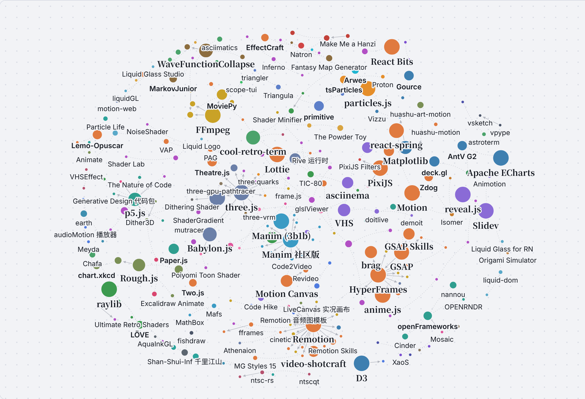](assets/graph.png)

箭头从源头指向从它演化出来的项目，点线是同类、常搭配和同一作者。想拖动、缩放、切换「演化树」卡片视图、点项目看完整演化链：下载仓库里的 [docs/index.html](docs/index.html)，用浏览器打开即可（需要联网加载图形库）。

共 200 条关系。想换工具时先看「同类可替换」，想扩展功能时看「插件 / 扩展」和「基于」。

### 分叉自

从另一个项目分出来独立发展

| 项目 | 关系 | 项目 | 说明 |
| --- | :---: | --- | --- |
| [Manim 社区版](https://github.com/ManimCommunity/manim) | 分叉自 | [Manim (3b1b)](https://github.com/3b1b/manim) | 社区版从 3b1b 的 ManimGL 分出，文档更全，API 有差异 |
| [Revideo](https://github.com/midrender/revideo) | 分叉自 | [Motion Canvas](https://github.com/motion-canvas/motion-canvas) | 去掉编辑器依赖，主打无界面批量渲染 |

### 基于

建立在另一个项目之上，离开它不能用

| 项目 | 关系 | 项目 | 说明 |
| --- | :---: | --- | --- |
| [React Three Fiber](https://github.com/pmndrs/react-three-fiber) | 基于 | [three.js](https://github.com/mrdoob/three.js) | 用 React 写 three.js 场景 |
| [Vanta.js](https://github.com/tengbao/vanta) | 基于 | [three.js](https://github.com/mrdoob/three.js) | 多数动态背景用 three.js 绘制 |
| [ShaderGradient](https://github.com/ruucm/shadergradient) | 基于 | [React Three Fiber](https://github.com/pmndrs/react-three-fiber) | 用 React Three Fiber 渲染渐变 |
| [Dithering Shader](https://github.com/niccolofanton/dithering-shader) | 基于 | [React Three Fiber](https://github.com/pmndrs/react-three-fiber) | 作为 R3F 的后期效果使用 |
| [Generative Design 代码包](https://github.com/generative-design/Code-Package-p5.js) | 基于 | [p5.js](https://github.com/processing/p5.js) | 《Generative Design》书中示例用 p5.js 写成 |
| [The Nature of Code](https://github.com/nature-of-code/noc-book-2) | 基于 | [p5.js](https://github.com/processing/p5.js) | 《代码本色》新版示例用 p5.js 写成 |
| [git-sim](https://github.com/initialcommit-com/git-sim) | 基于 | [Manim 社区版](https://github.com/ManimCommunity/manim) | 用 Manim 把 Git 操作画成动画 |
| [roughViz](https://github.com/jwilber/roughViz) | 基于 | [Rough.js](https://github.com/rough-stuff/rough) | 手绘线条来自 Rough.js |
| [vsketch](https://github.com/abey79/vsketch) | 基于 | [vpype](https://github.com/abey79/vpype) | 同一作者；vsketch 输出直接交给 vpype 处理 |
| [WFC 无限城市](https://github.com/marian42/wavefunctioncollapse) | 基于 | [WaveFunctionCollapse](https://github.com/mxgmn/WaveFunctionCollapse) | 用 WFC 算法生成 3D 城市 |
| [bar_chart_race](https://github.com/dexplo/bar_chart_race) | 基于 | [Matplotlib](https://github.com/matplotlib/matplotlib) | 用 Matplotlib 画每一帧 |
| [party-mode](https://github.com/preziotte/party-mode) | 基于 | [D3](https://github.com/d3/d3) | 用 D3 画可视化 |
| [Mosaic](https://github.com/d3cod3/Mosaic) | 基于 | [openFrameworks](https://github.com/openframeworks/openFrameworks) | 基于 openFrameworks |
| [Claude Animation Base](https://github.com/JohnHeibel/ClaudeAnimationBase) | 基于 | [p5.js](https://github.com/processing/p5.js) |  |

### 插件 / 扩展

给另一个项目加功能

| 项目 | 关系 | 项目 | 说明 |
| --- | :---: | --- | --- |
| [three-vrm](https://github.com/pixiv/three-vrm) | 插件 / 扩展 | [three.js](https://github.com/mrdoob/three.js) | 让 three.js 加载 VRM 虚拟形象 |
| [postprocessing](https://github.com/pmndrs/postprocessing) | 插件 / 扩展 | [three.js](https://github.com/mrdoob/three.js) | three.js 后期效果 |
| [three.quarks](https://github.com/Alchemist0823/three.quarks) | 插件 / 扩展 | [three.js](https://github.com/mrdoob/three.js) | three.js 粒子特效 |
| [three-nebula](https://github.com/creativelifeform/three-nebula) | 插件 / 扩展 | [three.js](https://github.com/mrdoob/three.js) | three.js 粒子系统 |
| [babylon-mmd](https://github.com/noname0310/babylon-mmd) | 插件 / 扩展 | [Babylon.js](https://github.com/BabylonJS/Babylon.js) | 在 Babylon.js 里播放 MMD 模型和动作 |
| [pixi-live2d-display](https://github.com/guansss/pixi-live2d-display) | 插件 / 扩展 | [PixiJS](https://github.com/pixijs/pixijs) | 在 PixiJS 里显示 Live2D 模型 |
| [PixiJS Filters](https://github.com/pixijs/filters) | 插件 / 扩展 | [PixiJS](https://github.com/pixijs/pixijs) | PixiJS 官方社区滤镜 |
| [p5.brush](https://github.com/acamposuribe/p5.brush) | 插件 / 扩展 | [p5.js](https://github.com/processing/p5.js) | 给 p5.js 加自然笔刷和水彩 |
| [p5.riso](https://github.com/antiboredom/p5.riso) | 插件 / 扩展 | [p5.js](https://github.com/processing/p5.js) | 给 p5.js 加 Riso 分色印刷 |
| [p5.plotSvg](https://github.com/golanlevin/p5.plotSvg) | 插件 / 扩展 | [p5.js](https://github.com/processing/p5.js) | 把 p5.js 作品导出成绘图仪 SVG |
| [Manim Slides](https://github.com/jeertmans/manim-slides) | 插件 / 扩展 | [Manim 社区版](https://github.com/ManimCommunity/manim) | 把 Manim 动画做成可逐页播放的幻灯片 |
| [manim-voiceover](https://github.com/ManimCommunity/manim-voiceover) | 插件 / 扩展 | [Manim 社区版](https://github.com/ManimCommunity/manim) | 社区官方的配音插件 |
| [ManimML](https://github.com/helblazer811/ManimML) | 插件 / 扩展 | [Manim 社区版](https://github.com/ManimCommunity/manim) | 机器学习概念动画组件 |
| [manim-physics](https://github.com/Matheart/manim-physics) | 插件 / 扩展 | [Manim 社区版](https://github.com/ManimCommunity/manim) | 物理模拟扩展 |
| [remocn](https://github.com/Remocn/remocn) | 插件 / 扩展 | [Remotion](https://github.com/remotion-dev/remotion) | 社区动画和转场组件库 |
| [THREE.Terrain](https://github.com/IceCreamYou/THREE.Terrain) | 插件 / 扩展 | [three.js](https://github.com/mrdoob/three.js) | three.js 程序化地形 |
| [three-gpu-pathtracer](https://github.com/gkjohnson/three-gpu-pathtracer) | 插件 / 扩展 | [three.js](https://github.com/mrdoob/three.js) | three.js 的路径追踪渲染器 |

### 官方模板 / 技能

同一团队出的模板或 AI 技能

| 项目 | 关系 | 项目 | 说明 |
| --- | :---: | --- | --- |
| [Remotion TikTok 模板](https://github.com/remotion-dev/template-tiktok) | 官方模板 / 技能 | [Remotion](https://github.com/remotion-dev/remotion) | 官方字幕短视频模板 |
| [Remotion 音频图模板](https://github.com/remotion-dev/template-audiogram) | 官方模板 / 技能 | [Remotion](https://github.com/remotion-dev/remotion) | 官方播客音频图模板 |
| [Remotion Skills](https://github.com/remotion-dev/skills) | 官方模板 / 技能 | [Remotion](https://github.com/remotion-dev/remotion) | 官方 AI 编程助手技能 |
| [GSAP Skills](https://github.com/greensock/gsap-skills) | 官方模板 / 技能 | [GSAP](https://github.com/greensock/GSAP) | 官方 AI 技能 |

### 用它渲染

默认用另一个项目做渲染或底层处理

| 项目 | 关系 | 项目 | 说明 |
| --- | :---: | --- | --- |
| [Code2Video](https://github.com/showlab/Code2Video) | 用它渲染 | [Manim 社区版](https://github.com/ManimCommunity/manim) | 大模型写 Manim 代码生成教学视频 |
| [Generative Manim](https://github.com/marcelo-earth/generative-manim) | 用它渲染 | [Manim 社区版](https://github.com/ManimCommunity/manim) | 大模型写 Manim 代码 |
| [MathLens](https://github.com/shuyicc/MathLens) | 用它渲染 | [Manim 社区版](https://github.com/ManimCommunity/manim) | 数学题讲解视频用 Manim 渲染 |
| [manim-skill](https://github.com/Yusuke710/manim-skill) | 用它渲染 | [Manim 社区版](https://github.com/ManimCommunity/manim) | 教 AI 助手写 Manim |
| [Manim Agent Skills](https://github.com/adithya-s-k/manim_skill) | 用它渲染 | [Manim 社区版](https://github.com/ManimCommunity/manim) | 教 AI 助手写 Manim |
| [video-shotcraft](https://github.com/Vincentwei1021/video-shotcraft) | 用它渲染 | [Remotion](https://github.com/remotion-dev/remotion) |  |
| [video-talkcraft](https://github.com/Vincentwei1021/video-talkcraft) | 用它渲染 | [Remotion](https://github.com/remotion-dev/remotion) |  |
| [anything2explainer](https://github.com/Vincentwei1021/anything2explainer) | 用它渲染 | [Remotion](https://github.com/remotion-dev/remotion) |  |
| [Claude Remotion Skill](https://github.com/haidrrrry/claude-remotion-skill) | 用它渲染 | [Remotion](https://github.com/remotion-dev/remotion) |  |
| [weilanx Claude Videos](https://github.com/Azure12355/weilanx-claude-videos) | 用它渲染 | [Remotion](https://github.com/remotion-dev/remotion) |  |
| [Papercut Explainer](https://github.com/0xS4N4TG/papercut-explainer) | 用它渲染 | [Remotion](https://github.com/remotion-dev/remotion) |  |
| [cinetic](https://github.com/Leonxlnx/cinetic) | 用它渲染 | [Remotion](https://github.com/remotion-dev/remotion) | 默认引擎是 Remotion，也支持 HyperFrames |
| [FredTalk](https://github.com/njrhts2kvv-star/FredTalk) | 用它渲染 | [Remotion](https://github.com/remotion-dev/remotion) |  |
| [RuiC Motion Reel](https://github.com/HRuiCcc/RuiC-motion-reel) | 用它渲染 | [Remotion](https://github.com/remotion-dev/remotion) | 常规宣传片走 Remotion 模板 |
| [Knowledge Explainer](https://github.com/znyupup/knowledge-explainer-skill) | 用它渲染 | [Remotion](https://github.com/remotion-dev/remotion) |  |
| [DeepSeek Opus Motion](https://github.com/8533502-dev/deepseek-opus-motion-skill) | 用它渲染 | [Remotion](https://github.com/remotion-dev/remotion) |  |
| [What If Animation](https://github.com/kelano86/what-if-animation) | 用它渲染 | [Remotion](https://github.com/remotion-dev/remotion) |  |
| [fy-code-animation](https://github.com/Akillll-DuoHe/fy-code-animation) | 用它渲染 | [Remotion](https://github.com/remotion-dev/remotion) | 也支持 Canvas / HTML |
| [HyperFrames](https://github.com/heygen-com/hyperframes) | 用它渲染 | [GSAP](https://github.com/greensock/GSAP) | 画面动画默认用 GSAP |
| [html-video](https://github.com/nexu-io/html-video) | 用它渲染 | [HyperFrames](https://github.com/heygen-com/hyperframes) | 也支持 Remotion |
| [brag](https://github.com/latent-spaces/brag) | 用它渲染 | [HyperFrames](https://github.com/heygen-com/hyperframes) |  |
| [Creator Style Kit](https://github.com/threeaus/creator-style-kit) | 用它渲染 | [HyperFrames](https://github.com/heygen-com/hyperframes) |  |
| [MotionClone](https://github.com/blixvip/MotionClone) | 用它渲染 | [HyperFrames](https://github.com/heygen-com/hyperframes) | 把参考视频重建成 HyperFrames 项目 |
| [html-anime](https://github.com/blixvip/html-anime) | 用它渲染 | [HyperFrames](https://github.com/heygen-com/hyperframes) |  |
| [Claude Animation Skills](https://github.com/artemnovitckii/claude-animation-skills) | 用它渲染 | [HyperFrames](https://github.com/heygen-com/hyperframes) | 2D 技能用 HyperFrames，3D 用 three.js |
| [motion2code](https://github.com/lovisdotio/motion2code) | 用它渲染 | [GSAP](https://github.com/greensock/GSAP) | 复刻结果是 SVG + GSAP 代码 |
| [editly](https://github.com/mifi/editly) | 用它渲染 | [FFmpeg](https://github.com/FFmpeg/FFmpeg) |  |
| [editly](https://github.com/mifi/editly) | 用它渲染 | [GL Transitions](https://github.com/gl-transitions/gl-transitions) | 转场效果来自 GL Transitions |
| [MoviePy](https://github.com/Zulko/moviepy) | 用它渲染 | [FFmpeg](https://github.com/FFmpeg/FFmpeg) |  |
| [FFCreator](https://github.com/tnfe/FFCreator) | 用它渲染 | [FFmpeg](https://github.com/FFmpeg/FFmpeg) |  |
| [ffmpeg-skill](https://github.com/kajisho5/ffmpeg-skill) | 用它渲染 | [FFmpeg](https://github.com/FFmpeg/FFmpeg) | 把 FFmpeg 包装成 AI 助手能调用的工具 |
| [ShaderGlass](https://github.com/mausimus/ShaderGlass) | 用它渲染 | [libretro GLSL Shaders](https://github.com/libretro/glsl-shaders) | 内置 RetroArch 的复古着色器 |
| [ff-tracking](https://github.com/mrsarac/ff-tracking) | 用它渲染 | [fframes](https://github.com/dmtrKovalenko/fframes) | 用 fframes 渲染 |
| [HyperFrames Motion Director](https://github.com/geekjourneyx/hyperframes-motion-director) | 用它渲染 | [HyperFrames](https://github.com/heygen-com/hyperframes) |  |
| [video-spec-builder](https://github.com/feicaiclub/video-spec-builder) | 用它渲染 | [HyperFrames](https://github.com/heygen-com/hyperframes) | 分镜脚本交给 HyperFrames 渲染 |
| [ReelMimic](https://github.com/edenfunf/reelmimic) | 用它渲染 | [HyperFrames](https://github.com/heygen-com/hyperframes) |  |
| [LiveCanvas 实况画布](https://github.com/pengchujin/livecanvas) | 用它渲染 | [Remotion](https://github.com/remotion-dev/remotion) |  |
| [Agentic Product Demo](https://github.com/Alexwtlf/agentic-product-demo) | 用它渲染 | [Remotion](https://github.com/remotion-dev/remotion) |  |
| [NTSCRT](https://github.com/finnmckenty/NTSCRT) | 用它渲染 | [ntsc-rs](https://github.com/ntsc-rs/ntsc-rs) | 信号模拟用 ntsc-rs |
| [国风纸片动画](https://github.com/AllenAI2014/remotion-guofeng-starter) | 用它渲染 | [Remotion](https://github.com/remotion-dev/remotion) |  |
| [Claude Animation Base](https://github.com/JohnHeibel/ClaudeAnimationBase) | 用它渲染 | [p5.brush](https://github.com/acamposuribe/p5.brush) | 手绘笔触用 p5.brush |

### 数据来源

用另一个项目提供的数据

| 项目 | 关系 | 项目 | 说明 |
| --- | :---: | --- | --- |
| [Hanzi Writer](https://github.com/chanind/hanzi-writer) | 数据来源 | [Make Me a Hanzi](https://github.com/skishore/makemeahanzi) | 笔画数据来自 Make Me a Hanzi |

### 同类可替换

做的事情相近，可以互相替换

| 项目 | 关系 | 项目 | 说明 |
| --- | :---: | --- | --- |
| [tsParticles](https://github.com/tsparticles/tsparticles) | 同类可替换 | [particles.js](https://github.com/VincentGarreau/particles.js) | tsParticles 兼容 particles.js 的配置，可以直接替换 |
| [Babylon.js](https://github.com/BabylonJS/Babylon.js) | 同类可替换 | [three.js](https://github.com/mrdoob/three.js) | 网页 3D 引擎，功能更全、自带编辑工具 |
| [PlayCanvas](https://github.com/playcanvas/engine) | 同类可替换 | [three.js](https://github.com/mrdoob/three.js) | 网页 3D 引擎，偏游戏和高斯泼溅 |
| [Konva](https://github.com/konvajs/konva) | 同类可替换 | [PixiJS](https://github.com/pixijs/pixijs) | 都是 2D Canvas 渲染；Konva 偏交互编辑，PixiJS 偏性能 |
| [Two.js](https://github.com/jonobr1/two.js) | 同类可替换 | [Paper.js](https://github.com/paperjs/paper.js) | 都是 2D 矢量绘图 API |
| [DOjS](https://github.com/SuperIlu/DOjS) | 同类可替换 | [p5.js](https://github.com/processing/p5.js) | API 仿照 p5.js，但跑在 MS-DOS 上 |
| [canvas-sketch](https://github.com/mattdesl/canvas-sketch) | 同类可替换 | [Fragment](https://github.com/raphaelameaume/fragment) | 都是生成艺术的工作流工具 |
| [nannou](https://github.com/nannou-org/nannou) | 同类可替换 | [openFrameworks](https://github.com/openframeworks/openFrameworks) | 创意编程框架：Rust 版和 C++ 版 |
| [Cinder](https://github.com/cinder/Cinder) | 同类可替换 | [openFrameworks](https://github.com/openframeworks/openFrameworks) | 都是 C++ 创意编程框架 |
| [OPENRNDR](https://github.com/openrndr/openrndr) | 同类可替换 | [openFrameworks](https://github.com/openframeworks/openFrameworks) | 创意编程框架：Kotlin 版 |
| [Motion Canvas](https://github.com/motion-canvas/motion-canvas) | 同类可替换 | [Manim 社区版](https://github.com/ManimCommunity/manim) | 都适合讲解动画；Motion Canvas 用 TypeScript、带时间轴编辑器 |
| [Mafs](https://github.com/stevenpetryk/mafs) | 同类可替换 | [MathBox](https://github.com/unconed/mathbox) | 都做网页数学可视化；Mafs 偏 2D 交互，MathBox 偏 3D |
| [HyperFrames](https://github.com/heygen-com/hyperframes) | 同类可替换 | [Remotion](https://github.com/remotion-dev/remotion) | 都把网页渲染成视频；HyperFrames 写 HTML/CSS，Remotion 写 React |
| [Motion Canvas](https://github.com/motion-canvas/motion-canvas) | 同类可替换 | [Remotion](https://github.com/remotion-dev/remotion) | 都用 TypeScript 写视频 |
| [fframes](https://github.com/dmtrKovalenko/fframes) | 同类可替换 | [Remotion](https://github.com/remotion-dev/remotion) | 都用代码写视频；fframes 用 Rust + SVG，主打速度 |
| [anime.js](https://github.com/juliangarnier/anime) | 同类可替换 | [GSAP](https://github.com/greensock/GSAP) | JS 动画引擎，更轻量 |
| [Motion](https://github.com/motiondivision/motion) | 同类可替换 | [GSAP](https://github.com/greensock/GSAP) | JS / React 动画库 |
| [react-spring](https://github.com/pmndrs/react-spring) | 同类可替换 | [Motion](https://github.com/motiondivision/motion) | 都是 React 动画库；react-spring 以弹簧物理为主 |
| [dotLottie Web](https://github.com/LottieFiles/dotlottie-web) | 同类可替换 | [Lottie](https://github.com/airbnb/lottie-web) | LottieFiles 官方播放器，性能更好 |
| [PAG](https://github.com/Tencent/libpag) | 同类可替换 | [Lottie](https://github.com/airbnb/lottie-web) | 腾讯的 AE 动画方案，支持更多 AE 特性 |
| [Rive 运行时](https://github.com/rive-app/rive-wasm) | 同类可替换 | [Lottie](https://github.com/airbnb/lottie-web) | 带状态机的交互动画格式 |
| [MoviePy](https://github.com/Zulko/moviepy) | 同类可替换 | [editly](https://github.com/mifi/editly) | 都用代码剪辑；MoviePy 写 Python，editly 写 JSON |
| [Butterchurn](https://github.com/jberg/butterchurn) | 同类可替换 | [projectM](https://github.com/projectM-visualizer/projectm) | 都兼容 MilkDrop 预设；Butterchurn 跑在浏览器里 |
| [MilkDrop 3](https://github.com/milkdrop2077/MilkDrop3) | 同类可替换 | [projectM](https://github.com/projectM-visualizer/projectm) | MilkDrop 原版的延续 |
| [cool-retro-term](https://github.com/Swordfish90/cool-retro-term) | 同类可替换 | [ShaderGlass](https://github.com/mausimus/ShaderGlass) | 都能做出 CRT 显示器质感 |
| [Hydra](https://github.com/hydra-synth/hydra) | 同类可替换 | [cables](https://github.com/cables-gl/cables) | 都做实时视觉；Hydra 写代码，cables 连节点 |
| [TiXL](https://github.com/tixl3d/tixl) | 同类可替换 | [cables](https://github.com/cables-gl/cables) | 节点式实时动态图形，TiXL 偏桌面端 |
| [Dither3D](https://github.com/runevision/Dither3D) | 同类可替换 | [Dithering Shader](https://github.com/niccolofanton/dithering-shader) | 都做 3D 抖动；Dither3D 用于 Unity，另一个用于 R3F |
| [chart.xkcd](https://github.com/timqian/chart.xkcd) | 同类可替换 | [roughViz](https://github.com/jwilber/roughViz) | 都是手绘风图表 |
| [Tegaki](https://github.com/gkurt/tegaki) | 同类可替换 | [Hanzi Writer](https://github.com/chanind/hanzi-writer) | 都是书写动画；Tegaki 支持任意字体 |
| [osci-render](https://github.com/jameshball/osci-render) | 同类可替换 | [scope-tui](https://github.com/alemidev/scope-tui) | 都和示波器画面有关；osci-render 负责画，scope-tui 负责看 |
| [Particle Life App](https://github.com/tom-mohr/particle-life-app) | 同类可替换 | [Particle Life](https://github.com/hunar4321/particle-life) | 都是粒子生命；particle-life-app 带图形界面 |
| [ALIEN](https://github.com/chrxh/alien) | 同类可替换 | [Lenia](https://github.com/Chakazul/Lenia) | 都是人工生命模拟 |
| [Mandelbulber](https://github.com/buddhi1980/mandelbulber2) | 同类可替换 | [XaoS](https://github.com/xaos-project/XaoS) | 都做分形动画；Mandelbulber 做 3D，XaoS 做 2D 缩放 |
| [Zdog](https://github.com/metafizzy/zdog) | 同类可替换 | [Isomer](https://github.com/jdan/isomer) | 都是轻量伪 3D 图形库 |
| [obelisk.js](https://github.com/nosir/obelisk.js) | 同类可替换 | [Isomer](https://github.com/jdan/isomer) | 都画等距图形；obelisk.js 偏像素风 |
| [Arwes](https://github.com/arwes/arwes) | 同类可替换 | [Cosmic UI](https://github.com/rizznme/cosmic-ui) | 都是科幻风界面组件 |
| [augmented-ui](https://github.com/propjockey/augmented-ui) | 同类可替换 | [Arwes](https://github.com/arwes/arwes) | 纯 CSS 的赛博朋克边框 |
| [AntV L7](https://github.com/antvis/L7) | 同类可替换 | [deck.gl](https://github.com/visgl/deck.gl) | 都做大规模地图可视化和轨迹动画 |
| [AntV G2](https://github.com/antvis/G2) | 同类可替换 | [Apache ECharts](https://github.com/apache/echarts) | 国内常用的两个图表库 |
| [Vizzu](https://github.com/vizzuhq/vizzu-lib) | 同类可替换 | [bar_chart_race](https://github.com/dexplo/bar_chart_race) | 都做数据动画；Vizzu 擅长图表间变形过渡 |
| [Pyxel](https://github.com/kitao/pyxel) | 同类可替换 | [TIC-80](https://github.com/nesbox/TIC-80) | 都是复古游戏引擎 / 幻想主机 |
| [WASM-4](https://github.com/aduros/wasm4) | 同类可替换 | [TIC-80](https://github.com/nesbox/TIC-80) | 都是幻想主机 |
| [LÖVE](https://github.com/love2d/love) | 同类可替换 | [raylib](https://github.com/raysan5/raylib) | 都是轻量 2D/3D 编程库；LÖVE 写 Lua，raylib 写 C |
| [Proton](https://github.com/drawcall/Proton) | 同类可替换 | [tsParticles](https://github.com/tsparticles/tsparticles) | 都是网页粒子库 |
| [three.quarks](https://github.com/Alchemist0823/three.quarks) | 同类可替换 | [three-nebula](https://github.com/creativelifeform/three-nebula) | 都是 three.js 粒子系统 |
| [VHS](https://github.com/charmbracelet/vhs) | 同类可替换 | [asciinema](https://github.com/asciinema/asciinema) | 都做终端演示；VHS 按脚本自动录制，asciinema 录真实操作 |
| [Terminalizer](https://github.com/faressoft/terminalizer) | 同类可替换 | [asciinema](https://github.com/asciinema/asciinema) | 录终端并渲染成 GIF |
| [TerminalTextEffects](https://github.com/ChrisBuilds/terminaltexteffects) | 同类可替换 | [asciimatics](https://github.com/peterbrittain/asciimatics) | 都是 Python 终端动画库 |
| [ascii-image-converter](https://github.com/TheZoraiz/ascii-image-converter) | 同类可替换 | [Chafa](https://github.com/hpjansson/chafa) | 都把图片转成终端字符画 |
| [Slidev](https://github.com/slidevjs/slidev) | 同类可替换 | [reveal.js](https://github.com/hakimel/reveal.js) | 都用代码写演示；Slidev 写 Markdown + Vue |
| [Animotion](https://github.com/animotionjs/animotion) | 同类可替换 | [Slidev](https://github.com/slidevjs/slidev) | 用 Svelte 写带动画的演示 |
| [EffectCraft](https://github.com/storytold/effectcraft) | 同类可替换 | [Natron](https://github.com/NatronGitHub/Natron) | 都是开源合成软件 |
| [Animate](https://github.com/cth9191/animate) | 同类可替换 | [Lemo-Opuscar](https://github.com/lemomo-ai/lemo-opuscar) | 都是让 Claude 按画风写代码出片的工具箱 |
| [Claude Drawing Skill](https://github.com/cloveric/claude-drawing-skill) | 同类可替换 | [huashu-art-motion](https://github.com/alchaincyf/huashu-art-motion) | 都是多画风的代码绘画技能 |
| [reanimate](https://github.com/NiazMorshed2007/reanimate) | 同类可替换 | [motion2code](https://github.com/lovisdotio/motion2code) | 都是用代码逐帧复刻现成动画 |
| [MotionClone](https://github.com/blixvip/MotionClone) | 同类可替换 | [reanimate](https://github.com/NiazMorshed2007/reanimate) | 都是复刻参考视频 |
| [ranim](https://github.com/AzurIce/ranim) | 同类可替换 | [Manim 社区版](https://github.com/ManimCommunity/manim) | 受 Manim 启发的 Rust 动画引擎 |
| [animCJK](https://github.com/parsimonhi/animCJK) | 同类可替换 | [Hanzi Writer](https://github.com/chanind/hanzi-writer) | 都是汉字笔顺动画；animCJK 直接给出 SVG 动画 |
| [heerich](https://github.com/meodai/heerich) | 同类可替换 | [Isomer](https://github.com/jdan/isomer) | 都画等距 / 体素图形；heerich 输出 SVG |
| [mapgen4](https://github.com/redblobgames/mapgen4) | 同类可替换 | [Fantasy Map Generator](https://github.com/Azgaar/Fantasy-Map-Generator) | 都是程序化地图生成 |
| [demoit](https://github.com/dgageot/demoit) | 同类可替换 | [doitlive](https://github.com/sloria/doitlive) | 都用来做现场代码演示 |
| [doitlive](https://github.com/sloria/doitlive) | 同类可替换 | [VHS](https://github.com/charmbracelet/vhs) | 都用来录终端演示；doitlive 现场敲，VHS 按脚本自动录 |
| [timg](https://github.com/hzeller/timg) | 同类可替换 | [video-to-ascii](https://github.com/joelibaceta/video-to-ascii) | 都在终端里播放视频 |
| [Realtime PyAudio FFT](https://github.com/aiXander/Realtime_PyAudio_FFT) | 同类可替换 | [Meyda](https://github.com/meyda/meyda) | 都做音频特征提取；一个 Python，一个 JavaScript |
| [ManimCat](https://github.com/Wing900/ManimCat) | 同类可替换 | [Generative Manim](https://github.com/marcelo-earth/generative-manim) | 都是一句话让 AI 写 Manim 动画 |
| [Shader Editor](https://github.com/markusfisch/ShaderEditor) | 同类可替换 | [Shader Toy for VS Code](https://github.com/stevensona/shader-toy) | 都能实时预览 GLSL；一个在安卓手机上，一个在 VS Code 里 |
| [Sandboxels](https://github.com/R74nCom/sandboxels) | 同类可替换 | [Sandspiel](https://github.com/MaxBittker/sandspiel) | 都是网页落沙沙盒 |
| [The Powder Toy](https://github.com/The-Powder-Toy/The-Powder-Toy) | 同类可替换 | [Sandspiel](https://github.com/MaxBittker/sandspiel) | 落沙游戏的老前辈，元素和物理更复杂 |
| [TermiSand](https://github.com/BobdaProgrammer/TermiSand) | 同类可替换 | [termsand](https://github.com/cgsdev0/termsand) | 都是终端里的落沙模拟 |
| [webgl-wind](https://github.com/mapbox/webgl-wind) | 同类可替换 | [earth](https://github.com/cambecc/earth) | 都做风场粒子动画 |
| [ntscqt](https://github.com/JargeZ/ntscqt) | 同类可替换 | [ntsc-rs](https://github.com/ntsc-rs/ntsc-rs) | 都做 VHS 效果；ntsc-rs 更新更勤 |
| [Retro Crisis 着色器](https://github.com/RetroCrisis/Retro-Crisis-GDV-NTSC) | 同类可替换 | [libretro GLSL Shaders](https://github.com/libretro/glsl-shaders) | 都是 RetroArch 的复古着色器 |
| [VhsFx](https://github.com/NullTale/VhsFx) | 同类可替换 | [VHSEffect](https://github.com/zulubo/VHSEffect) | 都是 Unity 的 VHS 后期 |
| [Oriedita](https://github.com/oriedita/oriedita) | 同类可替换 | [ORIPA](https://github.com/oripa/oripa) | 都是折痕图编辑器 |
| [OriSim3D](https://github.com/RemiKoutcherawy/OriSim3D-Android) | 同类可替换 | [Origami Simulator](https://github.com/amandaghassaei/OrigamiSimulator) | 都做折纸折叠模拟；OriSim3D 在安卓上 |
| [Geometrize](https://github.com/Tw1ddle/geometrize) | 同类可替换 | [primitive](https://github.com/fogleman/primitive) | Geometrize 是 primitive 思路的移植版 |
| [Triangula](https://github.com/rh12503/triangula) | 同类可替换 | [primitive](https://github.com/fogleman/primitive) | 都用几何图形重构图片 |
| [triangler](https://github.com/tdh8316/triangler) | 同类可替换 | [Triangula](https://github.com/rh12503/triangula) | 都把图片转成低多边形 |
| [mutracer](https://github.com/pissang/mutracer) | 同类可替换 | [three-gpu-pathtracer](https://github.com/gkjohnson/three-gpu-pathtracer) | 都在网页里做路径追踪 |
| [GLSL-PathTracer](https://github.com/knightcrawler25/GLSL-PathTracer) | 同类可替换 | [ToyPathTracer](https://github.com/aras-p/ToyPathTracer) | 都是学习用的路径追踪器 |
| [Strange Attractor Renderer](https://github.com/Icelk/strange-attractor-renderer) | 同类可替换 | [attractors](https://github.com/vdesmond/attractors) | 都画奇异吸引子 |
| [P(doom) MV（mexicat 版）](https://github.com/mexicat/pdoom-video) | 同类可替换 | [P(doom) MV](https://github.com/JohnHeibel/PDoomVideo) | 同一首歌，两位作者各自用代码做的 MV |
| [Stellarium Web](https://github.com/Stellarium/stellarium-web-engine) | 同类可替换 | [遨游太阳系](https://github.com/hyqzz/Solar-Wanderer) | 都在浏览器里渲染天体 |
| [linecast](https://github.com/ashuttl/linecast) | 同类可替换 | [astroterm](https://github.com/da-luce/astroterm) | 都在终端里画星空 |
| [AquaInkGL](https://github.com/WishMelz/AquaInkGL) | 同类可替换 | [Shan-Shui-Inf 千里江山](https://github.com/LingDong-/shan-shui-inf) | 都是网页里的程序化水墨 |

### 常搭配

经常一起使用

| 项目 | 关系 | 项目 | 说明 |
| --- | :---: | --- | --- |
| [Theatre.js](https://github.com/theatre-js/theatre) | 常搭配 | [three.js](https://github.com/mrdoob/three.js) | 给 three.js 场景做可视化时间轴和镜头动画 |
| [Code Hike](https://github.com/code-hike/codehike) | 常搭配 | [Remotion](https://github.com/remotion-dev/remotion) | 代码讲解组件，可在 Remotion 里渲染成视频 |
| [Lottie Skill](https://github.com/diffusionstudio/lottie) | 常搭配 | [Lottie](https://github.com/airbnb/lottie-web) | 让 AI 写出 Lottie 文件，再用 Lottie 播放 |
| [Bonzomatic](https://github.com/Gargaj/Bonzomatic) | 常搭配 | [TIC-80](https://github.com/nesbox/TIC-80) | Demoscene 现场写码比赛常用的两个工具 |
| [Excalidraw Animate](https://github.com/dai-shi/excalidraw-animate) | 常搭配 | [Rough.js](https://github.com/rough-stuff/rough) | Excalidraw 的手绘线条由 Rough.js 绘制 |
| [Kalidokit](https://github.com/yeemachine/kalidokit) | 常搭配 | [three-vrm](https://github.com/pixiv/three-vrm) | 用摄像头动作驱动 VRM 角色 |
| [Kalidokit](https://github.com/yeemachine/kalidokit) | 常搭配 | [pixi-live2d-display](https://github.com/guansss/pixi-live2d-display) | 用摄像头动作驱动 Live2D 角色 |
| [代码动画画风提示词](https://github.com/XiaoyeCodes/code-animation-prompts) | 常搭配 | [Lemo-Opuscar](https://github.com/lemomo-ai/lemo-opuscar) | 画风提示词库，可以配合画风工具箱使用 |
| [Shader Minifier](https://github.com/laurentlb/shader-minifier) | 常搭配 | [Bonzomatic](https://github.com/Gargaj/Bonzomatic) | Demoscene 着色器常用工具 |
| [FastNoiseLite](https://github.com/Auburn/FastNoiseLite) | 常搭配 | [WaveFunctionCollapse](https://github.com/mxgmn/WaveFunctionCollapse) | 都是程序化生成的基础工具 |

### 同一作者

同一个人或团队的作品

| 项目 | 关系 | 项目 | 说明 |
| --- | :---: | --- | --- |
| [frame.js](https://github.com/mrdoob/frame.js) | 同一作者 | [three.js](https://github.com/mrdoob/three.js) | three.js 作者 mrdoob 写的时间轴编辑器 |
| [p5.js](https://github.com/processing/p5.js) | 同一作者 | [Processing](https://github.com/processing/processing4) | 都由 Processing 基金会维护，p5.js 是网页版 |
| [VAP](https://github.com/Tencent/vap) | 同一作者 | [PAG](https://github.com/Tencent/libpag) | 都是腾讯开源的动画特效方案 |
| [Motion Design Skill](https://github.com/LottieFiles/motion-design-skill) | 同一作者 | [dotLottie Web](https://github.com/LottieFiles/dotlottie-web) | LottieFiles 团队出品 |
| [Lottie Skill](https://github.com/diffusionstudio/lottie) | 同一作者 | [Diffusion Studio Core](https://github.com/diffusionstudio/core) | Diffusion Studio 团队出品 |
| [LYGIA](https://github.com/patriciogonzalezvivo/lygia) | 同一作者 | [glslViewer](https://github.com/patriciogonzalezvivo/glslViewer) | Patricio Gonzalez Vivo 的着色器工具链 |
| [glslCanvas](https://github.com/patriciogonzalezvivo/glslCanvas) | 同一作者 | [The Book of Shaders](https://github.com/patriciogonzalezvivo/thebookofshaders) | 《The Book of Shaders》网页示例用 glslCanvas 运行 |
| [glslViewer](https://github.com/patriciogonzalezvivo/glslViewer) | 同一作者 | [The Book of Shaders](https://github.com/patriciogonzalezvivo/thebookofshaders) | 同一作者 |
| [Rough Notation](https://github.com/rough-stuff/rough-notation) | 同一作者 | [Rough.js](https://github.com/rough-stuff/rough) | Rough.js 作者的手绘标注库 |
| [fishdraw](https://github.com/LingDong-/fishdraw) | 同一作者 | [Shan-Shui-Inf 千里江山](https://github.com/LingDong-/shan-shui-inf) | 黄令东（LingDong）的程序化绘画作品 |
| [MarkovJunior](https://github.com/mxgmn/MarkovJunior) | 同一作者 | [WaveFunctionCollapse](https://github.com/mxgmn/WaveFunctionCollapse) | 同一作者的两个程序化生成项目 |
| [AntV L7](https://github.com/antvis/L7) | 同一作者 | [AntV G2](https://github.com/antvis/G2) | 蚂蚁 AntV 团队出品 |
| [Logstalgia](https://github.com/acaudwell/Logstalgia) | 同一作者 | [Gource](https://github.com/acaudwell/Gource) | 同一作者 |
| [video-talkcraft](https://github.com/Vincentwei1021/video-talkcraft) | 同一作者 | [video-shotcraft](https://github.com/Vincentwei1021/video-shotcraft) | shotcraft 系列：宣传片、口播、讲解、画风样片 |
| [anything2explainer](https://github.com/Vincentwei1021/anything2explainer) | 同一作者 | [video-shotcraft](https://github.com/Vincentwei1021/video-shotcraft) |  |
| [MG Styles 15](https://github.com/Vincentwei1021/mg-styles-15) | 同一作者 | [video-shotcraft](https://github.com/Vincentwei1021/video-shotcraft) |  |
| [huashu-art-motion](https://github.com/alchaincyf/huashu-art-motion) | 同一作者 | [huashu-motion](https://github.com/alchaincyf/huashu-motion) | 花叔的动画技能系列 |
| [motion-web](https://github.com/feitangyuan/motion-web) | 同一作者 | [onetake](https://github.com/feitangyuan/onetake) | 同一作者 |
| [Athenaion](https://github.com/Leonxlnx/athenaion) | 同一作者 | [cinetic](https://github.com/Leonxlnx/cinetic) | 同一作者 |
| [MotionClone](https://github.com/blixvip/MotionClone) | 同一作者 | [html-anime](https://github.com/blixvip/html-anime) | 同一作者 |
| [Canvas UI](https://github.com/DavidHDev/canvas-ui) | 同一作者 | [React Bits](https://github.com/DavidHDev/react-bits) | React Bits 作者的 WebGL 特效组件 |
| [audioMotion 播放器](https://github.com/hvianna/audioMotion.js) | 同一作者 | [audioMotion](https://github.com/hvianna/audioMotion-analyzer) | 同一作者：播放器和频谱分析库 |
| [Kinetograph](https://github.com/0xS4N4TG/kinetograph) | 同一作者 | [Papercut Explainer](https://github.com/0xS4N4TG/papercut-explainer) | 同一作者 |
| [L-System Explorer](https://github.com/anvaka/lsystem) | 同一作者 | [FieldPlay](https://github.com/anvaka/fieldplay) | 同一作者 anvaka |
| [Claude Animation Base](https://github.com/JohnHeibel/ClaudeAnimationBase) | 同一作者 | [P(doom) MV](https://github.com/JohnHeibel/PDoomVideo) | 同一作者 |

## 全部项目

展开全部 380 个项目（按星数排序）

| 项目 | 星数 | 画风 | 状态 |
| --- | ---: | --- | :---: |
| [three.js](https://github.com/mrdoob/three.js) | 118k | [3D 渲染](#3d)、[粒子 · 流体 · 物理](#particle)、[着色器 · 迷幻光影](#shader) | 🟢 |
| [D3](https://github.com/d3/d3) | 114k | [数据可视化动画](#data) | 🟢 |
| [Manim (3b1b)](https://github.com/3b1b/manim) | 96.1k | [数学讲解风](#math)、[数据可视化动画](#data) | 🟢 |
| [HyperFrames](https://github.com/heygen-com/hyperframes) | 78.8k | [扁平 MG 动效](#mg)、[动态文字 · 歌词](#type)、[短视频 · 字幕 · 快剪](#short) | 🟢 |
| [anime.js](https://github.com/juliangarnier/anime) | 74.3k | [扁平 MG 动效](#mg)、[动态文字 · 歌词](#type) | 🟢 |
| [reveal.js](https://github.com/hakimel/reveal.js) | 72.5k | [代码演示风](#code)、[扁平 MG 动效](#mg) | 🟢 |
| [Remotion](https://github.com/remotion-dev/remotion) | 70.7k | [扁平 MG 动效](#mg)、[短视频 · 字幕 · 快剪](#short)、[动态文字 · 歌词](#type)、[3D 渲染](#3d) | 🟢 |
| [Apache ECharts](https://github.com/apache/echarts) | 67.7k | [数据可视化动画](#data) | 🟢 |
| [FFmpeg](https://github.com/FFmpeg/FFmpeg) | 66.5k | [短视频 · 字幕 · 快剪](#short)、[故障 · 后期特效](#glitch) | 🟢 |
| [React Bits](https://github.com/DavidHDev/react-bits) | 51.2k | [扁平 MG 动效](#mg)、[动态文字 · 歌词](#type)、[着色器 · 迷幻光影](#shader) | 🟢 |
| [Algorithm Visualizer](https://github.com/algorithm-visualizer/algorithm-visualizer) | 49.4k | [代码演示风](#code)、[数据可视化动画](#data) | ⚪ |
| [Slidev](https://github.com/slidevjs/slidev) | 49.4k | [代码演示风](#code) | 🟢 |
| [PixiJS](https://github.com/pixijs/pixijs) | 48.6k | [扁平 MG 动效](#mg)、[粒子 · 流体 · 物理](#particle)、[生成艺术 · 几何](#gen) | 🟢 |
| [Manim 社区版](https://github.com/ManimCommunity/manim) | 42.2k | [数学讲解风](#math)、[数据可视化动画](#data)、[代码演示风](#code) | 🟢 |
| [raylib](https://github.com/raysan5/raylib) | 35.6k | [像素 · 复古](#pixel)、[3D 渲染](#3d)、[生成艺术 · 几何](#gen) | 🟢 |
| [Motion](https://github.com/motiondivision/motion) | 34.9k | [扁平 MG 动效](#mg) | 🟢 |
| [React Three Fiber](https://github.com/pmndrs/react-three-fiber) | 33.5k | [3D 渲染](#3d) | 🟢 |
| [Lottie](https://github.com/airbnb/lottie-web) | 32.4k | [扁平 MG 动效](#mg) | 🟡 |
| [particles.js](https://github.com/VincentGarreau/particles.js) | 30.2k | [粒子 · 流体 · 物理](#particle) | ⚪ |
| [GSAP](https://github.com/greensock/GSAP) | 30.2k | [扁平 MG 动效](#mg)、[动态文字 · 歌词](#type) | 🟢 |
| [react-spring](https://github.com/pmndrs/react-spring) | 29.3k | [扁平 MG 动效](#mg) | 🟢 |
| [Taichi](https://github.com/taichi-dev/taichi) | 28.5k | [粒子 · 流体 · 物理](#particle)、[3D 渲染](#3d) | 🟢 |
| [cool-retro-term](https://github.com/Swordfish90/cool-retro-term) | 26.6k | [ASCII · 终端](#ascii)、[像素 · 复古](#pixel)、[VHS · 模拟信号](#vhs) | 🟢 |
| [Babylon.js](https://github.com/BabylonJS/Babylon.js) | 26.3k | [3D 渲染](#3d) | 🟢 |
| [WaveFunctionCollapse](https://github.com/mxgmn/WaveFunctionCollapse) | 25.5k | [程序化生成 · 波函数坍缩](#procgen)、[像素 · 复古](#pixel) | 🟢 |
| [p5.js](https://github.com/processing/p5.js) | 24.3k | [生成艺术 · 几何](#gen)、[粒子 · 流体 · 物理](#particle)、[音乐可视化](#audio) | 🟢 |
| [Matplotlib](https://github.com/matplotlib/matplotlib) | 23.4k | [数据可视化动画](#data) | 🟢 |
| [Magic UI](https://github.com/magicuidesign/magicui) | 23.1k | [扁平 MG 动效](#mg)、[动态文字 · 歌词](#type) | 🟢 |
| [Rough.js](https://github.com/rough-stuff/rough) | 21.3k | [手绘 · 白板 · 水彩](#hand) | ⚪ |
| [VHS](https://github.com/charmbracelet/vhs) | 21.3k | [代码演示风](#code)、[ASCII · 终端](#ascii) | 🟢 |
| [brag](https://github.com/latent-spaces/brag) | 20.3k | [扁平 MG 动效](#mg) | 🟢 |
| [img2threejs](https://github.com/img2threejs/img2threejs) | 20.3k | [3D 渲染](#3d) | 🟢 |
| [Motion Canvas](https://github.com/motion-canvas/motion-canvas) | 19.7k | [扁平 MG 动效](#mg)、[代码演示风](#code)、[数学讲解风](#math) | 🟢 |
| [mo.js](https://github.com/mojs/mojs) | 18.9k | [扁平 MG 动效](#mg) | 🟢 |
| [Plotly](https://github.com/plotly/plotly.py) | 18.9k | [数据可视化动画](#data) | 🟢 |
| [Matter.js](https://github.com/liabru/matter-js) | 18.6k | [粒子 · 流体 · 物理](#particle) | 🟢 |
| [Pyxel](https://github.com/kitao/pyxel) | 18.5k | [像素 · 复古](#pixel) | 🟢 |
| [asciinema](https://github.com/asciinema/asciinema) | 17.9k | [代码演示风](#code)、[ASCII · 终端](#ascii) | 🟢 |
| [GSAP Skills](https://github.com/greensock/gsap-skills) | 17.9k | [扁平 MG 动效](#mg) | 🟢 |
| [PlayCanvas](https://github.com/playcanvas/engine) | 17.2k | [3D 渲染](#3d) | 🟢 |
| [video-shotcraft](https://github.com/Vincentwei1021/video-shotcraft) | 16.9k | [扁平 MG 动效](#mg)、[短视频 · 字幕 · 快剪](#short) | 🟢 |
| [WebGL Fluid](https://github.com/PavelDoGreat/WebGL-Fluid-Simulation) | 16.8k | [粒子 · 流体 · 物理](#particle)、[着色器 · 迷幻光影](#shader) | 🟡 |
| [Typed.js](https://github.com/mattboldt/typed.js) | 16.3k | [动态文字 · 歌词](#type) | 🟡 |
| [Terminalizer](https://github.com/faressoft/terminalizer) | 16.2k | [代码演示风](#code)、[ASCII · 终端](#ascii) | ⚪ |
| [Vivus](https://github.com/maxwellito/vivus) | 15.5k | [手绘 · 白板 · 水彩](#hand) | ⚪ |
| [Paper.js](https://github.com/paperjs/paper.js) | 15.2k | [生成艺术 · 几何](#gen)、[扁平 MG 动效](#mg) | 🟢 |
| [MoviePy](https://github.com/Zulko/moviepy) | 15.1k | [短视频 · 字幕 · 快剪](#short) | 🟢 |
| [Konva](https://github.com/konvajs/konva) | 14.9k | [扁平 MG 动效](#mg) | 🟢 |
| [deck.gl](https://github.com/visgl/deck.gl) | 14.7k | [数据可视化动画](#data)、[3D 渲染](#3d)、[地图 · 路线动画](#map) | 🟢 |
| [primitive](https://github.com/fogleman/primitive) | 13.6k | [几何重构 · 低多边形](#geo)、[生成艺术 · 几何](#gen) | ⚪ |
| [Gource](https://github.com/acaudwell/Gource) | 13.2k | [数据可视化动画](#data)、[代码演示风](#code) | 🟡 |
| [Theatre.js](https://github.com/theatre-js/theatre) | 12.9k | [扁平 MG 动效](#mg)、[3D 渲染](#3d) | ⚪ |
| [canvas-confetti](https://github.com/catdad/canvas-confetti) | 12.8k | [粒子 · 流体 · 物理](#particle) | 🟡 |
| [AntV G2](https://github.com/antvis/G2) | 12.7k | [数据可视化动画](#data) | 🟢 |
| [Lemo-Opuscar](https://github.com/lemomo-ai/lemo-opuscar) | 12.2k | [扁平 MG 动效](#mg)、[手绘 · 白板 · 水彩](#hand)、[像素 · 复古](#pixel) | 🟢 |
| [SVG.js](https://github.com/svgdotjs/svg.js) | 11.9k | [扁平 MG 动效](#mg) | 🟢 |
| [Zdog](https://github.com/metafizzy/zdog) | 10.7k | [扁平 MG 动效](#mg)、[3D 渲染](#3d)、[等距 · 体素](#iso) | ⚪ |
| [wavesurfer.js](https://github.com/katspaugh/wavesurfer.js) | 10.5k | [音乐可视化](#audio) | 🟢 |
| [openFrameworks](https://github.com/openframeworks/openFrameworks) | 10.5k | [生成艺术 · 几何](#gen)、[音乐可视化](#audio)、[3D 渲染](#3d) | 🟢 |
| [Rough Notation](https://github.com/rough-stuff/rough-notation) | 9.7k | [手绘 · 白板 · 水彩](#hand)、[动态文字 · 歌词](#type) | ⚪ |
| [MapSCII](https://github.com/rastapasta/mapscii) | 9.3k | [地图 · 路线动画](#map)、[ASCII · 终端](#ascii) | 🟡 |
| [tsParticles](https://github.com/tsparticles/tsparticles) | 9.1k | [粒子 · 流体 · 物理](#particle) | 🟢 |
| [LÖVE](https://github.com/love2d/love) | 8.9k | [像素 · 复古](#pixel) | 🟢 |
| [Two.js](https://github.com/jonobr1/two.js) | 8.7k | [扁平 MG 动效](#mg)、[生成艺术 · 几何](#gen) | 🟢 |
| [MarkovJunior](https://github.com/mxgmn/MarkovJunior) | 8.5k | [程序化生成 · 波函数坍缩](#procgen)、[像素 · 复古](#pixel)、[等距 · 体素](#iso) | 🟡 |
| [EffectCraft](https://github.com/storytold/effectcraft) | 8.4k | [扁平 MG 动效](#mg)、[故障 · 后期特效](#glitch) | 🟢 |
| [chart.xkcd](https://github.com/timqian/chart.xkcd) | 7.9k | [手绘 · 白板 · 水彩](#hand)、[数据可视化动画](#data) | 🟢 |
| [Arwes](https://github.com/arwes/arwes) | 7.6k | [科幻 HUD · 赛博界面](#scifi)、[扁平 MG 动效](#mg) | 🟢 |
| [Vanta.js](https://github.com/tengbao/vanta) | 7.3k | [3D 渲染](#3d)、[生成艺术 · 几何](#gen) | ⚪ |
| [roughViz](https://github.com/jwilber/roughViz) | 7.2k | [手绘 · 白板 · 水彩](#hand)、[数据可视化动画](#data) | ⚪ |
| [ThreeUI](https://github.com/MengTo/threeui) | 7.1k | [3D 渲染](#3d) | 🟢 |
| [The Book of Shaders](https://github.com/patriciogonzalezvivo/thebookofshaders) | 7.1k | [着色器 · 迷幻光影](#shader) | 🟡 |
| [VoxelSpace](https://github.com/s-macke/VoxelSpace) | 6.8k | [等距 · 体素](#iso)、[像素 · 复古](#pixel)、[3D 渲染](#3d) | ⚪ |
| [nannou](https://github.com/nannou-org/nannou) | 6.8k | [生成艺术 · 几何](#gen)、[音乐可视化](#audio) | 🟢 |
| [earth](https://github.com/cambecc/earth) | 6.6k | [流场 · 风场](#flow)、[地图 · 路线动画](#map)、[数据可视化动画](#data) | ⚪ |
| [CAVA](https://github.com/karlstav/cava) | 6.5k | [音乐可视化](#audio)、[ASCII · 终端](#ascii) | 🟢 |
| [Shan-Shui-Inf 千里江山](https://github.com/LingDong-/shan-shui-inf) | 6.4k | [水墨 · 水彩](#ink)、[生成艺术 · 几何](#gen) | ⚪ |
| [Remotion Skills](https://github.com/remotion-dev/skills) | 6.3k | [扁平 MG 动效](#mg) | 🟢 |
| [huashu-art-motion](https://github.com/alchaincyf/huashu-art-motion) | 6.2k | [手绘 · 白板 · 水彩](#hand)、[水墨 · 水彩](#ink) | 🟢 |
| [TIC-80](https://github.com/nesbox/TIC-80) | 6.2k | [像素 · 复古](#pixel)、[Live Coding · VJ](#live)、[Demoscene 演示场景](#demoscene) | 🟢 |
| [Fantasy Map Generator](https://github.com/Azgaar/Fantasy-Map-Generator) | 6.2k | [程序化生成 · 波函数坍缩](#procgen)、[地图 · 路线动画](#map) | 🟢 |
| [css-doodle](https://github.com/css-doodle/css-doodle) | 6.1k | [生成艺术 · 几何](#gen) | 🟢 |
| [Galacean Engine](https://github.com/galacean/engine) | 5.9k | [3D 渲染](#3d)、[粒子 · 流体 · 物理](#particle) | 🟢 |
| [Shaders](https://github.com/shader-effects-inc/shaders) | 5.8k | [着色器 · 迷幻光影](#shader) | 🟢 |
| [PAG](https://github.com/Tencent/libpag) | 5.8k | [扁平 MG 动效](#mg) | 🟢 |
| [Kalidokit](https://github.com/yeemachine/kalidokit) | 5.7k | [二次元 · MMD · VRM](#anime) | 🟡 |
| [Lottie Skill](https://github.com/diffusionstudio/lottie) | 5.7k | [扁平 MG 动效](#mg) | 🟢 |
| [Natron](https://github.com/NatronGitHub/Natron) | 5.6k | [故障 · 后期特效](#glitch) | 🟢 |
| [editly](https://github.com/mifi/editly) | 5.6k | [短视频 · 字幕 · 快剪](#short)、[动态文字 · 歌词](#type) | 🟡 |
| [ALIEN](https://github.com/chrxh/alien) | 5.6k | [人工生命 · 生长形态](#alife)、[粒子 · 流体 · 物理](#particle) | 🟢 |
| [Cinder](https://github.com/cinder/Cinder) | 5.5k | [生成艺术 · 几何](#gen)、[3D 渲染](#3d) | 🟡 |
| [Code Hike](https://github.com/code-hike/codehike) | 5.4k | [代码演示风](#code) | 🟡 |
| [The Powder Toy](https://github.com/The-Powder-Toy/The-Powder-Toy) | 5.4k | [落沙 · 像素物理](#sand)、[粒子 · 流体 · 物理](#particle) | 🟢 |
| [Chafa](https://github.com/hpjansson/chafa) | 5.4k | [ASCII · 终端](#ascii) | 🟢 |
| [Pts](https://github.com/williamngan/pts) | 5.4k | [生成艺术 · 几何](#gen)、[数据可视化动画](#data) | 🟢 |
| [glslViewer](https://github.com/patriciogonzalezvivo/glslViewer) | 5.4k | [着色器 · 迷幻光影](#shader) | 🟢 |
| [Canvas UI](https://github.com/DavidHDev/canvas-ui) | 5.3k | [着色器 · 迷幻光影](#shader)、[粒子 · 流体 · 物理](#particle) | 🟢 |
| [canvas-sketch](https://github.com/mattdesl/canvas-sketch) | 5.3k | [生成艺术 · 几何](#gen) | 🟢 |
| [CMatrix](https://github.com/abishekvashok/cmatrix) | 5.3k | [ASCII · 终端](#ascii) | ⚪ |
| [TiXL](https://github.com/tixl3d/tixl) | 5.2k | [Live Coding · VJ](#live)、[着色器 · 迷幻光影](#shader)、[3D 渲染](#3d) | 🟢 |
| [Hanzi Writer](https://github.com/chanind/hanzi-writer) | 5.1k | [汉字 · 手写笔画](#hanzi)、[动态文字 · 歌词](#type) | 🟡 |
| [WFC 无限城市](https://github.com/marian42/wavefunctioncollapse) | 4.9k | [程序化生成 · 波函数坍缩](#procgen)、[3D 渲染](#3d) | ⚪ |
| [SHADERed](https://github.com/dfranx/SHADERed) | 4.8k | [着色器 · 迷幻光影](#shader) | ⚪ |
| [html-video](https://github.com/nexu-io/html-video) | 4.8k | [扁平 MG 动效](#mg)、[动态文字 · 歌词](#type) | 🟢 |
| [git-sim](https://github.com/initialcommit-com/git-sim) | 4.7k | [代码演示风](#code)、[数据可视化动画](#data) | 🟢 |
| [pixelfx](https://github.com/patch-gg/pixelfx) | 4.7k | [像素 · 复古](#pixel) | 🟢 |
| [Tweakpane](https://github.com/cocopon/tweakpane) | 4.6k | [生成艺术 · 几何](#gen) | 🟡 |
| [projectM](https://github.com/projectM-visualizer/projectm) | 4.6k | [音乐可视化](#audio)、[着色器 · 迷幻光影](#shader) | 🟢 |
| [ffmpeg-skill](https://github.com/kajisho5/ffmpeg-skill) | 4.5k | [短视频 · 字幕 · 快剪](#short) | 🟢 |
| [ShaderGlass](https://github.com/mausimus/ShaderGlass) | 4.4k | [像素 · 复古](#pixel)、[故障 · 后期特效](#glitch)、[VHS · 模拟信号](#vhs) | 🟢 |
| [asciimatics](https://github.com/peterbrittain/asciimatics) | 4.3k | [ASCII · 终端](#ascii) | 🟢 |
| [TerminalTextEffects](https://github.com/ChrisBuilds/terminaltexteffects) | 4.3k | [ASCII · 终端](#ascii)、[动态文字 · 歌词](#type) | 🟢 |
| [pywonderland](https://github.com/neozhaoliang/pywonderland) | 4.2k | [分形 · 混沌 · 数学艺术](#fractal)、[数学讲解风](#math) | 🟡 |
| [VAP](https://github.com/Tencent/vap) | 4.2k | [扁平 MG 动效](#mg) | 🟢 |
| [Revideo](https://github.com/midrender/revideo) | 4.2k | [扁平 MG 动效](#mg)、[短视频 · 字幕 · 快剪](#short) | 🟢 |
| [AntV L7](https://github.com/antvis/L7) | 4.1k | [地图 · 路线动画](#map)、[数据可视化动画](#data) | 🟢 |
| [Paper Shaders](https://github.com/paper-design/shaders) | 3.9k | [着色器 · 迷幻光影](#shader) | 🟢 |
| [Lenia](https://github.com/Chakazul/Lenia) | 3.9k | [人工生命 · 生长形态](#alife)、[数学讲解风](#math) | ⚪ |
| [Triangula](https://github.com/rh12503/triangula) | 3.9k | [几何重构 · 低多边形](#geo) | 🟡 |
| [thi.ng/umbrella](https://github.com/thi-ng/umbrella) | 3.8k | [生成艺术 · 几何](#gen)、[数据可视化动画](#data) | 🟢 |
| [farbrausch 工具集](https://github.com/farbrausch/fr_public) | 3.8k | [Demoscene 演示场景](#demoscene)、[3D 渲染](#3d) | ⚪ |
| [P(doom) MV（mexicat 版）](https://github.com/mexicat/pdoom-video) | 3.8k | [动态文字 · 歌词](#type)、[扁平 MG 动效](#mg) | 🟢 |
| [onetake](https://github.com/feitangyuan/onetake) | 3.7k | [扁平 MG 动效](#mg) | 🟢 |
| [doitlive](https://github.com/sloria/doitlive) | 3.6k | [代码演示风](#code)、[ASCII · 终端](#ascii) | 🟢 |
| [ascii-image-converter](https://github.com/TheZoraiz/ascii-image-converter) | 3.6k | [ASCII · 终端](#ascii) | ⚪ |
| [FastNoiseLite](https://github.com/Auburn/FastNoiseLite) | 3.5k | [程序化生成 · 波函数坍缩](#procgen)、[生成艺术 · 几何](#gen) | 🟢 |
| [ManimML](https://github.com/helblazer811/ManimML) | 3.5k | [数学讲解风](#math)、[数据可视化动画](#data) | ⚪ |
| [LYGIA](https://github.com/patriciogonzalezvivo/lygia) | 3.5k | [着色器 · 迷幻光影](#shader) | 🟢 |
| [Mafs](https://github.com/stevenpetryk/mafs) | 3.4k | [数学讲解风](#math) | 🟢 |
| [hairline](https://github.com/lucasmarkes/hairline) | 3.4k | [等距 · 体素](#iso)、[扁平 MG 动效](#mg) | 🟢 |
| [Particle Life](https://github.com/hunar4321/particle-life) | 3.4k | [人工生命 · 生长形态](#alife)、[粒子 · 流体 · 物理](#particle) | ⚪ |
| [Tegaki](https://github.com/gkurt/tegaki) | 3.3k | [汉字 · 手写笔画](#hanzi)、[动态文字 · 歌词](#type)、[手绘 · 白板 · 水彩](#hand) | 🟢 |
| [Sandspiel](https://github.com/MaxBittker/sandspiel) | 3.2k | [落沙 · 像素物理](#sand)、[像素 · 复古](#pixel) | 🟢 |
| [fframes](https://github.com/dmtrKovalenko/fframes) | 3.2k | [扁平 MG 动效](#mg)、[短视频 · 字幕 · 快剪](#short) | 🟢 |
| [FFCreator](https://github.com/tnfe/FFCreator) | 3.2k | [短视频 · 字幕 · 快剪](#short) | 🟡 |
| [MG Styles 15](https://github.com/Vincentwei1021/mg-styles-15) | 3.1k | [扁平 MG 动效](#mg)、[3D 渲染](#3d)、[手绘 · 白板 · 水彩](#hand) | 🟢 |
| [ShaderGradient](https://github.com/ruucm/shadergradient) | 3.1k | [着色器 · 迷幻光影](#shader) | 🟢 |
| [anything2explainer](https://github.com/Vincentwei1021/anything2explainer) | 3k | [数据可视化动画](#data)、[扁平 MG 动效](#mg) | 🟢 |
| [gl-react](https://github.com/gre/gl-react) | 3k | [着色器 · 迷幻光影](#shader) | 🟢 |
| [Mitsuba 3](https://github.com/mitsuba-renderer/mitsuba3) | 3k | [写实光追](#raytrace)、[3D 渲染](#3d) | 🟢 |
| [postprocessing](https://github.com/pmndrs/postprocessing) | 3k | [故障 · 后期特效](#glitch)、[3D 渲染](#3d) | 🟢 |
| [Yocto/GL](https://github.com/xelatihy/yocto-gl) | 2.9k | [写实光追](#raytrace)、[3D 渲染](#3d) | ⚪ |
| [Isomer](https://github.com/jdan/isomer) | 2.9k | [等距 · 体素](#iso) | ⚪ |
| [P(doom) MV](https://github.com/JohnHeibel/PDoomVideo) | 2.8k | [动态文字 · 歌词](#type)、[扁平 MG 动效](#mg) | 🟢 |
| [timg](https://github.com/hzeller/timg) | 2.8k | [ASCII · 终端](#ascii)、[像素 · 复古](#pixel) | 🟢 |
| [Motion Design Skill](https://github.com/LottieFiles/motion-design-skill) | 2.8k | [扁平 MG 动效](#mg) | 🟢 |
| [Make Me a Hanzi](https://github.com/skishore/makemeahanzi) | 2.7k | [汉字 · 手写笔画](#hanzi) | 🟡 |
| [Hydra](https://github.com/hydra-synth/hydra) | 2.7k | [Live Coding · VJ](#live)、[故障 · 后期特效](#glitch)、[着色器 · 迷幻光影](#shader) | 🟡 |
| [ntsc-rs](https://github.com/ntsc-rs/ntsc-rs) | 2.7k | [VHS · 模拟信号](#vhs)、[故障 · 后期特效](#glitch) | 🟢 |
| [Pixel2Motion](https://github.com/nolangz/pixel2motion) | 2.6k | [扁平 MG 动效](#mg) | 🟢 |
| [Claude Animation Base](https://github.com/JohnHeibel/ClaudeAnimationBase) | 2.6k | [手绘 · 白板 · 水彩](#hand)、[二次元 · MMD · VRM](#anime) | 🟢 |
| [Herk Edit Kit](https://github.com/nateherkai/herk-edit-kit) | 2.6k | [短视频 · 字幕 · 快剪](#short) | 🟢 |
| [fishdraw](https://github.com/LingDong-/fishdraw) | 2.5k | [绘图仪 · 单线画](#plotter)、[生成艺术 · 几何](#gen) | ⚪ |
| [astroterm](https://github.com/da-luce/astroterm) | 2.5k | [ASCII · 终端](#ascii)、[星空 · 宇宙](#space) | 🟢 |
| [Proton](https://github.com/drawcall/Proton) | 2.5k | [粒子 · 流体 · 物理](#particle) | 🟡 |
| [zero](https://github.com/sinclairzx81/zero) | 2.5k | [ASCII · 终端](#ascii)、[3D 渲染](#3d) | 🟢 |
| [huashu-motion](https://github.com/alchaincyf/huashu-motion) | 2.3k | [扁平 MG 动效](#mg)、[3D 渲染](#3d) | 🟢 |
| [obelisk.js](https://github.com/nosir/obelisk.js) | 2.3k | [等距 · 体素](#iso)、[像素 · 复古](#pixel) | ⚪ |
| [14 天入门 Demoscene](https://github.com/psenough/teach_yourself_demoscene_in_14_days) | 2.3k | [Demoscene 演示场景](#demoscene) | ⚪ |
| [glslCanvas](https://github.com/patriciogonzalezvivo/glslCanvas) | 2.3k | [着色器 · 迷幻光影](#shader) | ⚪ |
| [three-vrm](https://github.com/pixiv/three-vrm) | 2.3k | [二次元 · MMD · VRM](#anime)、[3D 渲染](#3d) | 🟢 |
| [Code2Video](https://github.com/showlab/Code2Video) | 2.2k | [数学讲解风](#math) | 🟢 |
| [GL Transitions](https://github.com/gl-transitions/gl-transitions) | 2.2k | [短视频 · 字幕 · 快剪](#short)、[故障 · 后期特效](#glitch) | 🟢 |
| [AMLL](https://github.com/amll-dev/applemusic-like-lyrics) | 2.2k | [动态文字 · 歌词](#type)、[音乐可视化](#audio) | 🟢 |
| [Geometrize](https://github.com/Tw1ddle/geometrize) | 2.2k | [几何重构 · 低多边形](#geo) | ⚪ |
| [Excalidraw Animate](https://github.com/dai-shi/excalidraw-animate) | 2.1k | [手绘 · 白板 · 水彩](#hand) | 🟢 |
| [ossia score](https://github.com/ossia/score) | 2.1k | [Live Coding · VJ](#live) | 🟢 |
| [video-talkcraft](https://github.com/Vincentwei1021/video-talkcraft) | 2.1k | [短视频 · 字幕 · 快剪](#short)、[动态文字 · 歌词](#type) | 🟢 |
| [GLSL-PathTracer](https://github.com/knightcrawler25/GLSL-PathTracer) | 2.1k | [写实光追](#raytrace)、[着色器 · 迷幻光影](#shader) | ⚪ |
| [Vizzu](https://github.com/vizzuhq/vizzu-lib) | 2k | [数据可视化动画](#data) | 🟡 |
| [three-gpu-pathtracer](https://github.com/gkjohnson/three-gpu-pathtracer) | 2k | [写实光追](#raytrace)、[3D 渲染](#3d) | 🟢 |
| [Astrofox](https://github.com/astrofox-io/astrofox) | 2k | [音乐可视化](#audio)、[扁平 MG 动效](#mg) | 🟢 |
| [gganimate](https://github.com/thomasp85/gganimate) | 2k | [数据可视化动画](#data) | 🟡 |
| [Butterchurn](https://github.com/jberg/butterchurn) | 2k | [音乐可视化](#audio)、[着色器 · 迷幻光影](#shader) | 🟡 |
| [The Nature of Code](https://github.com/nature-of-code/noc-book-2) | 2k | [生成艺术 · 几何](#gen)、[粒子 · 流体 · 物理](#particle)、[人工生命 · 生长形态](#alife) | 🟢 |
| [video-to-ascii](https://github.com/joelibaceta/video-to-ascii) | 1.9k | [ASCII · 终端](#ascii) | 🟡 |
| [Durdraw](https://github.com/durdraw/durdraw) | 1.9k | [ASCII · 终端](#ascii) | 🟢 |
| [Logstalgia](https://github.com/acaudwell/Logstalgia) | 1.8k | [数据可视化动画](#data) | 🟡 |
| [glitch-this](https://github.com/TotallyNotChase/glitch-this) | 1.8k | [故障 · 后期特效](#glitch) | ⚪ |
| [ReelMimic](https://github.com/edenfunf/reelmimic) | 1.8k | [短视频 · 字幕 · 快剪](#short) | 🟢 |
| [Animotion](https://github.com/animotionjs/animotion) | 1.8k | [代码演示风](#code)、[扁平 MG 动效](#mg) | 🟢 |
| [Splitting](https://github.com/shshaw/Splitting) | 1.8k | [动态文字 · 歌词](#type) | ⚪ |
| [Meyda](https://github.com/meyda/meyda) | 1.7k | [音乐可视化](#audio) | ⚪ |
| [remocn](https://github.com/Remocn/remocn) | 1.7k | [扁平 MG 动效](#mg)、[短视频 · 字幕 · 快剪](#short) | 🟢 |
| [Dither3D](https://github.com/runevision/Dither3D) | 1.6k | [抖动 · 1-bit](#dither)、[着色器 · 迷幻光影](#shader)、[3D 渲染](#3d) | 🟡 |
| [WASM-4](https://github.com/aduros/wasm4) | 1.5k | [像素 · 复古](#pixel) | 🟢 |
| [MilkDrop 3](https://github.com/milkdrop2077/MilkDrop3) | 1.5k | [音乐可视化](#audio)、[着色器 · 迷幻光影](#shader) | 🟢 |
| [Animate](https://github.com/cth9191/animate) | 1.5k | [手绘 · 白板 · 水彩](#hand)、[像素 · 复古](#pixel)、[数学讲解风](#math)、[Riso · 剪纸拼贴](#riso) | 🟢 |
| [pixi-live2d-display](https://github.com/guansss/pixi-live2d-display) | 1.5k | [二次元 · MMD · VRM](#anime) | ⚪ |
| [MathBox](https://github.com/unconed/mathbox) | 1.5k | [数学讲解风](#math)、[3D 渲染](#3d) | ⚪ |
| [Bonzomatic](https://github.com/Gargaj/Bonzomatic) | 1.5k | [着色器 · 迷幻光影](#shader)、[Live Coding · VJ](#live)、[Demoscene 演示场景](#demoscene) | 🟡 |
| [Musializer](https://github.com/tsoding/musializer) | 1.5k | [音乐可视化](#audio) | 🟢 |
| [Bonsai](https://github.com/scallyw4g/bonsai) | 1.5k | [程序化生成 · 波函数坍缩](#procgen)、[等距 · 体素](#iso)、[3D 渲染](#3d) | 🟢 |
| [bar_chart_race](https://github.com/dexplo/bar_chart_race) | 1.5k | [数据可视化动画](#data) | ⚪ |
| [augmented-ui](https://github.com/propjockey/augmented-ui) | 1.4k | [科幻 HUD · 赛博界面](#scifi) | ⚪ |
| [Origami Simulator](https://github.com/amandaghassaei/OrigamiSimulator) | 1.4k | [折纸 · 纸艺](#origami)、[3D 渲染](#3d) | 🟢 |
| [FieldPlay](https://github.com/anvaka/fieldplay) | 1.3k | [流场 · 风场](#flow)、[数学讲解风](#math) | 🟢 |
| [anidoodle](https://github.com/alexgreensh/anidoodle) | 1.3k | [手绘 · 白板 · 水彩](#hand)、[生成艺术 · 几何](#gen) | 🟢 |
| [spectral.js](https://github.com/rvanwijnen/spectral.js) | 1.3k | [手绘 · 白板 · 水彩](#hand) | 🟡 |
| [libretro GLSL Shaders](https://github.com/libretro/glsl-shaders) | 1.3k | [像素 · 复古](#pixel)、[着色器 · 迷幻光影](#shader)、[VHS · 模拟信号](#vhs) | 🟢 |
| [p5.brush](https://github.com/acamposuribe/p5.brush) | 1.3k | [手绘 · 白板 · 水彩](#hand)、[生成艺术 · 几何](#gen) | 🟢 |
| [Manim Agent Skills](https://github.com/adithya-s-k/manim_skill) | 1.3k | [数学讲解风](#math) | 🟡 |
| [TerraForge3D](https://github.com/Jaysmito101/TerraForge3D) | 1.3k | [程序化生成 · 波函数坍缩](#procgen)、[3D 渲染](#3d) | 🟢 |
| [Diffusion Studio Core](https://github.com/diffusionstudio/core) | 1.3k | [短视频 · 字幕 · 快剪](#short) | 🟡 |
| [Fractal Sound Explorer](https://github.com/HackerPoet/FractalSoundExplorer) | 1.3k | [分形 · 混沌 · 数学艺术](#fractal)、[音乐可视化](#audio) | ⚪ |
| [three-nebula](https://github.com/creativelifeform/three-nebula) | 1.2k | [粒子 · 流体 · 物理](#particle)、[3D 渲染](#3d) | 🟢 |
| [Reanimate](https://github.com/reanimate/reanimate) | 1.2k | [数学讲解风](#math)、[扁平 MG 动效](#mg) | 🟡 |
| [motion-skills](https://github.com/iart-ai/motion-skills) | 1.2k | [扁平 MG 动效](#mg) | 🟢 |
| [frame.js](https://github.com/mrdoob/frame.js) | 1.2k | [Demoscene 演示场景](#demoscene)、[扁平 MG 动效](#mg) | 🟡 |
| [three.quarks](https://github.com/Alchemist0823/three.quarks) | 1.2k | [粒子 · 流体 · 物理](#particle)、[3D 渲染](#3d) | 🟢 |
| [reanimate](https://github.com/NiazMorshed2007/reanimate) | 1.2k | [扁平 MG 动效](#mg) | 🟢 |
| [Polyvia](https://github.com/Ovilia/Polyvia) | 1.2k | [几何重构 · 低多边形](#geo) | ⚪ |
| [VFX-JS](https://github.com/fand/vfx-js) | 1.2k | [故障 · 后期特效](#glitch)、[动态文字 · 歌词](#type) | 🟢 |
| [ntscqt](https://github.com/JargeZ/ntscqt) | 1.2k | [VHS · 模拟信号](#vhs)、[故障 · 后期特效](#glitch) | ⚪ |
| [Etro](https://github.com/etro-js/etro) | 1.2k | [短视频 · 字幕 · 快剪](#short) | 🟢 |
| [PixiJS Filters](https://github.com/pixijs/filters) | 1.1k | [故障 · 后期特效](#glitch)、[着色器 · 迷幻光影](#shader) | 🟡 |
| [ToyPathTracer](https://github.com/aras-p/ToyPathTracer) | 1.1k | [写实光追](#raytrace) | 🟡 |
| [webgl-wind](https://github.com/mapbox/webgl-wind) | 1.1k | [流场 · 风场](#flow)、[地图 · 路线动画](#map) | 🟢 |
| [Shader Editor](https://github.com/markusfisch/ShaderEditor) | 1.1k | [着色器 · 迷幻光影](#shader) | 🟢 |
| [twigl](https://github.com/doxas/twigl) | 1.1k | [着色器 · 迷幻光影](#shader)、[Live Coding · VJ](#live) | 🟡 |
| [Realtime PyAudio FFT](https://github.com/aiXander/Realtime_PyAudio_FFT) | 1.1k | [音乐可视化](#audio) | 🟢 |
| [Mandelbulber](https://github.com/buddhi1980/mandelbulber2) | 1.1k | [分形 · 混沌 · 数学艺术](#fractal)、[3D 渲染](#3d) | 🟢 |
| [video-spec-builder](https://github.com/feicaiclub/video-spec-builder) | 1.1k | [短视频 · 字幕 · 快剪](#short) | 🟢 |
| [Bang Motion](https://github.com/bangtutorial/bang-motion) | 1.1k | [扁平 MG 动效](#mg)、[动态文字 · 歌词](#type) | 🟢 |
| [Motion Graphics Skills](https://github.com/Barty-Bart/motion-graphics) | 1.1k | [扁平 MG 动效](#mg) | 🟢 |
| [Particle Life App](https://github.com/tom-mohr/particle-life-app) | 1k | [人工生命 · 生长形态](#alife)、[粒子 · 流体 · 物理](#particle) | 🟡 |
| [motion-anything](https://github.com/nexu-io/motion-anything) | 1k | [扁平 MG 动效](#mg)、[着色器 · 迷幻光影](#shader) | 🟢 |
| [Generative Design 代码包](https://github.com/generative-design/Code-Package-p5.js) | 1k | [生成艺术 · 几何](#gen) | 🟢 |
| [Rive 运行时](https://github.com/rive-app/rive-wasm) | 1k | [扁平 MG 动效](#mg) | 🟢 |
| [cinetic](https://github.com/Leonxlnx/cinetic) | 991 | [扁平 MG 动效](#mg) | 🟢 |
| [OPENRNDR](https://github.com/openrndr/openrndr) | 985 | [生成艺术 · 几何](#gen) | 🟢 |
| [vpype](https://github.com/abey79/vpype) | 981 | [绘图仪 · 单线画](#plotter) | 🟢 |
| [Manim Slides](https://github.com/jeertmans/manim-slides) | 975 | [数学讲解风](#math)、[代码演示风](#code) | 🟢 |
| [audioMotion](https://github.com/hvianna/audioMotion-analyzer) | 969 | [音乐可视化](#audio)、[数据可视化动画](#data) | 🟢 |
| [DOjS](https://github.com/SuperIlu/DOjS) | 963 | [像素 · 复古](#pixel)、[生成艺术 · 几何](#gen) | 🟡 |
| [Fragment](https://github.com/raphaelameaume/fragment) | 949 | [生成艺术 · 几何](#gen)、[着色器 · 迷幻光影](#shader) | 🟢 |
| [mapgen4](https://github.com/redblobgames/mapgen4) | 948 | [程序化生成 · 波函数坍缩](#procgen)、[地图 · 路线动画](#map) | 🟡 |
| [dotLottie Web](https://github.com/LottieFiles/dotlottie-web) | 938 | [扁平 MG 动效](#mg) | 🟢 |
| [Generative Manim](https://github.com/marcelo-earth/generative-manim) | 937 | [数学讲解风](#math) | 🟢 |
| [THREE.Terrain](https://github.com/IceCreamYou/THREE.Terrain) | 919 | [程序化生成 · 波函数坍缩](#procgen)、[3D 渲染](#3d) | 🟢 |
| [归藏产品宣传片](https://github.com/op7418/guizang-product-video-skill) | 903 | [扁平 MG 动效](#mg) | 🟢 |
| [pixelsort](https://github.com/satyarth/pixelsort) | 875 | [故障 · 后期特效](#glitch) | 🟢 |
| [SeeCode](https://github.com/Aryanutkarsh/SeeCode) | 872 | [代码演示风](#code)、[等距 · 体素](#iso) | 🟢 |
| [Pintr](https://github.com/javierbyte/pintr) | 837 | [绘图仪 · 单线画](#plotter)、[手绘 · 白板 · 水彩](#hand) | 🟢 |
| [motion-web](https://github.com/feitangyuan/motion-web) | 836 | [3D 渲染](#3d)、[扁平 MG 动效](#mg) | 🟢 |
| [Shader Park](https://github.com/shader-park/shader-park-core) | 831 | [着色器 · 迷幻光影](#shader)、[3D 渲染](#3d) | 🟢 |
| [Claude Remotion Skill](https://github.com/haidrrrry/claude-remotion-skill) | 828 | [扁平 MG 动效](#mg) | 🟢 |
| [party-mode](https://github.com/preziotte/party-mode) | 807 | [音乐可视化](#audio)、[数据可视化动画](#data) | 🟢 |
| [demoit](https://github.com/dgageot/demoit) | 780 | [代码演示风](#code) | 🟢 |
| [Claude Motion Design](https://github.com/howseen-ai/claude-motion-design) | 766 | [扁平 MG 动效](#mg) | 🟢 |
| [遨游太阳系](https://github.com/hyqzz/Solar-Wanderer) | 764 | [星空 · 宇宙](#space)、[3D 渲染](#3d) | 🟢 |
| [Cosmic UI](https://github.com/rizznme/cosmic-ui) | 762 | [科幻 HUD · 赛博界面](#scifi) | 🟢 |
| [scope-tui](https://github.com/alemidev/scope-tui) | 753 | [示波器 · 矢量光线](#scope)、[ASCII · 终端](#ascii)、[音乐可视化](#audio) | 🟢 |
| [genjutsu](https://github.com/AThevon/genjutsu) | 745 | [生成艺术 · 几何](#gen)、[扁平 MG 动效](#mg) | 🟢 |
| [osci-render](https://github.com/jameshball/osci-render) | 738 | [示波器 · 矢量光线](#scope)、[音乐可视化](#audio) | 🟢 |
| [adu-motion-video](https://github.com/adunext/adu-motion-video) | 722 | [短视频 · 字幕 · 快剪](#short) | 🟢 |
| [Shader Toy for VS Code](https://github.com/stevensona/shader-toy) | 721 | [着色器 · 迷幻光影](#shader) | 🟢 |
| [Waveform for OBS](https://github.com/phandasm/waveform) | 712 | [音乐可视化](#audio) | 🟢 |
| [Rossark Motion](https://github.com/rossark0/rossark-motion-skill) | 698 | [扁平 MG 动效](#mg) | 🟢 |
| [drawsvg](https://github.com/cduck/drawsvg) | 696 | [扁平 MG 动效](#mg)、[数据可视化动画](#data) | 🟢 |
| [Athenaion](https://github.com/Leonxlnx/athenaion) | 680 | [3D 渲染](#3d) | 🟢 |
| [linecast](https://github.com/ashuttl/linecast) | 667 | [星空 · 宇宙](#space)、[ASCII · 终端](#ascii) | 🟢 |
| [ranim](https://github.com/AzurIce/ranim) | 662 | [数学讲解风](#math) | 🟢 |
| [Stellarium Web](https://github.com/Stellarium/stellarium-web-engine) | 660 | [星空 · 宇宙](#space) | 🟢 |
| [Rabbit Ear](https://github.com/rabbit-ear/rabbit-ear) | 655 | [折纸 · 纸艺](#origami) | 🟢 |
| [audioMotion 播放器](https://github.com/hvianna/audioMotion.js) | 643 | [音乐可视化](#audio) | 🟢 |
| [heerich](https://github.com/meodai/heerich) | 630 | [等距 · 体素](#iso)、[3D 渲染](#3d) | 🟢 |
| [XaoS](https://github.com/xaos-project/XaoS) | 627 | [分形 · 混沌 · 数学艺术](#fractal) | 🟢 |
| [Aora Bot](https://github.com/sam70361/aora-bot) | 619 | [扁平 MG 动效](#mg)、[二次元 · MMD · VRM](#anime) | 🟢 |
| [vsketch](https://github.com/abey79/vsketch) | 610 | [绘图仪 · 单线画](#plotter)、[生成艺术 · 几何](#gen) | 🟢 |
| [ff-tracking](https://github.com/mrsarac/ff-tracking) | 592 | [扁平 MG 动效](#mg)、[故障 · 后期特效](#glitch) | 🟢 |
| [MotionClone](https://github.com/blixvip/MotionClone) | 588 | [扁平 MG 动效](#mg) | 🟢 |
| [Shader Minifier](https://github.com/laurentlb/shader-minifier) | 583 | [Demoscene 演示场景](#demoscene)、[着色器 · 迷幻光影](#shader) | 🟢 |
| [Machine Skill](https://github.com/AirsupHQ/machine-skill) | 579 | [3D 渲染](#3d) | 🟢 |
| [NTSC-CRT](https://github.com/LMP88959/NTSC-CRT) | 577 | [VHS · 模拟信号](#vhs)、[像素 · 复古](#pixel) | 🟢 |
| [cables](https://github.com/cables-gl/cables) | 572 | [Live Coding · VJ](#live)、[着色器 · 迷幻光影](#shader)、[3D 渲染](#3d) | 🟢 |
| [Launch Motion Skills](https://github.com/charlie947/motion-graphics-skills) | 551 | [扁平 MG 动效](#mg) | 🟢 |
| [play.core](https://github.com/ertdfgcvb/play.core) | 544 | [ASCII · 终端](#ascii)、[生成艺术 · 几何](#gen) | 🟡 |
| [LiveCanvas 实况画布](https://github.com/pengchujin/livecanvas) | 544 | [短视频 · 字幕 · 快剪](#short) | 🟢 |
| [Processing](https://github.com/processing/processing4) | 535 | [生成艺术 · 几何](#gen) | 🟢 |
| [代码动画画风提示词](https://github.com/XiaoyeCodes/code-animation-prompts) | 522 | [扁平 MG 动效](#mg) | 🟢 |
| [Mosaic](https://github.com/d3cod3/Mosaic) | 518 | [Live Coding · VJ](#live)、[生成艺术 · 几何](#gen) | 🟢 |
| [Trail](https://github.com/amalChandran/trail-android) | 516 | [地图 · 路线动画](#map) | 🟢 |
| [world.execute(me) 歌词 MV](https://github.com/Nyankomintsu/world-execute-me-lyric-mv) | 511 | [动态文字 · 歌词](#type)、[二次元 · MMD · VRM](#anime) | 🟢 |
| [白板老师视频](https://github.com/liangdabiao/whiteboard-teacher-video) | 497 | [手绘 · 白板 · 水彩](#hand) | 🟢 |
| [modV](https://github.com/vcync/modV) | 497 | [音乐可视化](#audio)、[Live Coding · VJ](#live) | 🟡 |
| [ManimCat](https://github.com/Wing900/ManimCat) | 494 | [数学讲解风](#math) | 🟢 |
| [Agentic Product Demo](https://github.com/Alexwtlf/agentic-product-demo) | 482 | [短视频 · 字幕 · 快剪](#short) | 🟢 |
| [Retro Crisis 着色器](https://github.com/RetroCrisis/Retro-Crisis-GDV-NTSC) | 480 | [VHS · 模拟信号](#vhs)、[像素 · 复古](#pixel)、[着色器 · 迷幻光影](#shader) | 🟢 |
| [HyperFrames Motion Director](https://github.com/geekjourneyx/hyperframes-motion-director) | 477 | [短视频 · 字幕 · 快剪](#short)、[动态文字 · 歌词](#type) | 🟢 |
| [Sandboxels](https://github.com/R74nCom/sandboxels) | 477 | [落沙 · 像素物理](#sand)、[像素 · 复古](#pixel) | 🟢 |
| [animCJK](https://github.com/parsimonhi/animCJK) | 474 | [汉字 · 手写笔画](#hanzi)、[动态文字 · 歌词](#type) | 🟢 |
| [Kinetograph](https://github.com/0xS4N4TG/kinetograph) | 460 | [短视频 · 字幕 · 快剪](#short)、[扁平 MG 动效](#mg) | 🟢 |
| [DrawBot](https://github.com/typemytype/drawbot) | 455 | [动态文字 · 歌词](#type)、[生成艺术 · 几何](#gen) | 🟢 |
| [Open Cubic Player](https://github.com/mywave82/opencubicplayer) | 451 | [音乐可视化](#audio)、[Demoscene 演示场景](#demoscene)、[ASCII · 终端](#ascii) | 🟢 |
| [Opus Video Skills](https://github.com/tuzhechen2005/opus-video-skills) | 438 | [扁平 MG 动效](#mg)、[音乐可视化](#audio) | 🟢 |
| [HaloFlux](https://github.com/Ryder191/haloflux) | 423 | [科幻 HUD · 赛博界面](#scifi)、[音乐可视化](#audio) | 🟢 |
| [Product Launch Motion](https://github.com/AbubakrChan/product-launch-motion) | 421 | [扁平 MG 动效](#mg) | 🟢 |
| [Shader Skills](https://github.com/gokayfem/shader-skills) | 418 | [着色器 · 迷幻光影](#shader) | 🟢 |
| [manim-physics](https://github.com/Matheart/manim-physics) | 412 | [数学讲解风](#math)、[粒子 · 流体 · 物理](#particle) | 🟢 |
| [水墨 UI](https://github.com/shuimo-design/shuimo-ui) | 399 | [水墨 · 水彩](#ink) | 🟢 |
| [algovivo](https://github.com/juniorrojas/algovivo) | 388 | [人工生命 · 生长形态](#alife) | 🟢 |
| [AquaInkGL](https://github.com/WishMelz/AquaInkGL) | 383 | [水墨 · 水彩](#ink)、[着色器 · 迷幻光影](#shader) | 🟡 |
| [shipvideo](https://github.com/diggerhq/shipvideo) | 378 | [扁平 MG 动效](#mg) | 🟢 |
| [p5.riso](https://github.com/antiboredom/p5.riso) | 373 | [Riso · 剪纸拼贴](#riso)、[生成艺术 · 几何](#gen) | 🟢 |
| [Claude Animation Skills](https://github.com/artemnovitckii/claude-animation-skills) | 372 | [3D 渲染](#3d)、[地图 · 路线动画](#map) | 🟢 |
| [xilo-opus-video](https://github.com/Kianzzz/xilo-opus-video) | 369 | [扁平 MG 动效](#mg)、[3D 渲染](#3d) | 🟢 |
| [MathLens](https://github.com/shuyicc/MathLens) | 352 | [数学讲解风](#math) | 🟡 |
| [SwiftUI Shaders](https://github.com/krispuckett/SwiftUIShaders) | 347 | [着色器 · 迷幻光影](#shader)、[故障 · 后期特效](#glitch) | 🟢 |
| [Ultimate Retro Shaders](https://github.com/Zorochase/ultimate-retro-shader-collection) | 343 | [像素 · 复古](#pixel)、[3D 渲染](#3d)、[着色器 · 迷幻光影](#shader) | 🟢 |
| [Coldtype](https://github.com/coldtype/coldtype) | 341 | [动态文字 · 歌词](#type)、[生成艺术 · 几何](#gen) | 🟢 |
| [ORIPA](https://github.com/oripa/oripa) | 334 | [折纸 · 纸艺](#origami) | 🟢 |
| [motion2code](https://github.com/lovisdotio/motion2code) | 330 | [扁平 MG 动效](#mg) | 🟢 |
| [manim-voiceover](https://github.com/ManimCommunity/manim-voiceover) | 326 | [数学讲解风](#math) | 🟢 |
| [Code Video Showcase](https://github.com/Moessif/code-video-showcase) | 322 | [扁平 MG 动效](#mg)、[3D 渲染](#3d) | 🟢 |
| [video-director](https://github.com/win4r/video-director) | 320 | [扁平 MG 动效](#mg) | 🟢 |
| [termsand](https://github.com/cgsdev0/termsand) | 317 | [落沙 · 像素物理](#sand)、[ASCII · 终端](#ascii) | 🟢 |
| [flow-fields](https://github.com/romellogoodman/flow-fields) | 311 | [流场 · 风场](#flow)、[生成艺术 · 几何](#gen) | 🟢 |
| [Riso Window Seat](https://github.com/sevenevesai/riso-windowseat) | 308 | [Riso · 剪纸拼贴](#riso) | 🟢 |
| [OriSim3D](https://github.com/RemiKoutcherawy/OriSim3D-Android) | 304 | [折纸 · 纸艺](#origami)、[3D 渲染](#3d) | 🟢 |
| [Remotion TikTok 模板](https://github.com/remotion-dev/template-tiktok) | 301 | [短视频 · 字幕 · 快剪](#short)、[动态文字 · 歌词](#type) | 🟢 |
| [Dithering Shader](https://github.com/niccolofanton/dithering-shader) | 294 | [抖动 · 1-bit](#dither)、[3D 渲染](#3d)、[着色器 · 迷幻光影](#shader) | 🟢 |
| [Papercraft](https://github.com/rodrigorc/papercraft) | 289 | [折纸 · 纸艺](#origami)、[3D 渲染](#3d) | 🟢 |
| [cbirds](https://github.com/clainstone/cbirds) | 286 | [ASCII · 终端](#ascii)、[粒子 · 流体 · 物理](#particle) | 🟢 |
| [Remotion 音频图模板](https://github.com/remotion-dev/template-audiogram) | 275 | [音乐可视化](#audio)、[短视频 · 字幕 · 快剪](#short) | 🟢 |
| [babylon-mmd](https://github.com/noname0310/babylon-mmd) | 261 | [二次元 · MMD · VRM](#anime)、[3D 渲染](#3d) | 🟢 |
| [hitherdither](https://github.com/hbldh/hitherdither) | 260 | [抖动 · 1-bit](#dither)、[像素 · 复古](#pixel) | 🟢 |
| [FredTalk](https://github.com/njrhts2kvv-star/FredTalk) | 249 | [短视频 · 字幕 · 快剪](#short)、[动态文字 · 歌词](#type) | 🟢 |
| [Krbn](https://github.com/vpalos/Krbn) | 248 | [绘图仪 · 单线画](#plotter)、[3D 渲染](#3d) | 🟢 |
| [html-anime](https://github.com/blixvip/html-anime) | 246 | [二次元 · MMD · VRM](#anime)、[扁平 MG 动效](#mg) | 🟢 |
| [weilanx Claude Videos](https://github.com/Azure12355/weilanx-claude-videos) | 237 | [手绘 · 白板 · 水彩](#hand)、[像素 · 复古](#pixel) | 🟢 |
| [空间殖民实验](https://github.com/jasonwebb/2d-space-colonization-experiments) | 227 | [人工生命 · 生长形态](#alife)、[生成艺术 · 几何](#gen) | 🟡 |
| [What If Animation](https://github.com/kelano86/what-if-animation) | 226 | [扁平 MG 动效](#mg) | 🟢 |
| [p5.plotSvg](https://github.com/golanlevin/p5.plotSvg) | 217 | [绘图仪 · 单线画](#plotter) | 🟢 |
| [Papercraft World](https://github.com/andrewwoan/aimee-xus-papercraft-world) | 197 | [折纸 · 纸艺](#origami)、[3D 渲染](#3d) | 🟢 |
| [fy-code-animation](https://github.com/Akillll-DuoHe/fy-code-animation) | 194 | [扁平 MG 动效](#mg) | 🟢 |
| [manim-skill](https://github.com/Yusuke710/manim-skill) | 193 | [数学讲解风](#math) | 🟢 |
| [NTSCRT](https://github.com/finnmckenty/NTSCRT) | 187 | [VHS · 模拟信号](#vhs) | 🟢 |
| [RuiC Motion Reel](https://github.com/HRuiCcc/RuiC-motion-reel) | 182 | [扁平 MG 动效](#mg) | 🟢 |
| [dashi 画风讲解](https://github.com/chuspeeism/dashi-animationstyle) | 178 | [手绘 · 白板 · 水彩](#hand) | 🟢 |
| [Claude MV Skill](https://github.com/Joker-chichi/claude-mv-skill) | 178 | [手绘 · 白板 · 水彩](#hand)、[动态文字 · 歌词](#type) | 🟢 |
| [mutracer](https://github.com/pissang/mutracer) | 173 | [写实光追](#raytrace)、[3D 渲染](#3d) | 🟢 |
| [Vibe 知识短片](https://github.com/xiazhuo123456789/vibe-knowledge-video) | 166 | [动态文字 · 歌词](#type)、[扁平 MG 动效](#mg) | 🟢 |
| [I, Voyager Planetarium](https://github.com/ivoyager/planetarium) | 162 | [星空 · 宇宙](#space)、[3D 渲染](#3d) | 🟢 |
| [YouTube Motion Graphics](https://github.com/sirioberati/YouTube-AI-Motion-Graphics) | 150 | [数据可视化动画](#data)、[扁平 MG 动效](#mg) | 🟢 |
| [Sand Slide](https://github.com/kiwijuice56/sand-slide) | 143 | [落沙 · 像素物理](#sand)、[像素 · 复古](#pixel) | 🟢 |
| [NTSCplayer](https://github.com/ferropop/NTSCplayer) | 141 | [VHS · 模拟信号](#vhs) | 🟢 |
| [Oriedita](https://github.com/oriedita/oriedita) | 134 | [折纸 · 纸艺](#origami) | 🟢 |
| [kami](https://github.com/maxwase/kami) | 134 | [折纸 · 纸艺](#origami) | 🟢 |
| [BB-Video](https://github.com/BubbleBrainBB/BB-Video) | 133 | [扁平 MG 动效](#mg)、[3D 渲染](#3d) | 🟢 |
| [Papercut Explainer](https://github.com/0xS4N4TG/papercut-explainer) | 119 | [Riso · 剪纸拼贴](#riso)、[短视频 · 字幕 · 快剪](#short) | 🟢 |
| [Black Hole](https://github.com/ibra-kdbra/black-hole) | 112 | [星空 · 宇宙](#space)、[着色器 · 迷幻光影](#shader) | 🟢 |
| [map-motion](https://github.com/SpaceZephyr/map-motion) | 110 | [地图 · 路线动画](#map) | 🟢 |
| [Claude Drawing Skill](https://github.com/cloveric/claude-drawing-skill) | 101 | [水墨 · 水彩](#ink)、[手绘 · 白板 · 水彩](#hand) | 🟢 |
| [Watercolor Playground](https://github.com/msurguy/watercolor-playground) | 101 | [水墨 · 水彩](#ink)、[手绘 · 白板 · 水彩](#hand) | 🟢 |
| [L-System Explorer](https://github.com/anvaka/lsystem) | 100 | [人工生命 · 生长形态](#alife)、[生成艺术 · 几何](#gen) | 🟢 |
| [triangler](https://github.com/tdh8316/triangler) | 99 | [几何重构 · 低多边形](#geo) | 🟢 |
| [VhsFx](https://github.com/NullTale/VhsFx) | 89 | [VHS · 模拟信号](#vhs)、[故障 · 后期特效](#glitch) | 🟡 |
| [ditherwave](https://github.com/sahilsaini5/ditherwave) | 88 | [抖动 · 1-bit](#dither)、[着色器 · 迷幻光影](#shader) | 🟡 |
| [Strange Attractor Renderer](https://github.com/Icelk/strange-attractor-renderer) | 88 | [分形 · 混沌 · 数学艺术](#fractal) | 🟡 |
| [lowpoly](https://github.com/tasercake/lowpoly) | 87 | [几何重构 · 低多边形](#geo) | 🟡 |
| [Cyber Ocean](https://github.com/SahilK-027/Cyber-Ocean) | 80 | [流场 · 风场](#flow)、[3D 渲染](#3d)、[粒子 · 流体 · 物理](#particle) | 🟢 |
| [FallingSandEngine](https://github.com/PieKing1215/FallingSandEngine) | 76 | [落沙 · 像素物理](#sand)、[像素 · 复古](#pixel) | 🟡 |
| [Galaxy Shader](https://github.com/AmitDigga/threejs-galaxy-shader) | 73 | [星空 · 宇宙](#space)、[着色器 · 迷幻光影](#shader)、[粒子 · 流体 · 物理](#particle) | 🟡 |
| [Delaunay Stippler](https://github.com/NHasan143/delaunay-stippler) | 68 | [几何重构 · 低多边形](#geo)、[绘图仪 · 单线画](#plotter) | 🟢 |
| [wet-paint-flow](https://github.com/simonxxooxxoo/wet-paint-flow) | 66 | [流场 · 风场](#flow)、[手绘 · 白板 · 水彩](#hand) | 🟢 |
| [sy-style-100](https://github.com/xiaoxiong20xx-code/sy-style-100) | 65 | [扁平 MG 动效](#mg) | 🟢 |
| [code-poem-film](https://github.com/bangbuilds/code-poem-film) | 63 | [水墨 · 水彩](#ink) | 🟢 |
| [DeepSeek Opus Motion](https://github.com/8533502-dev/deepseek-opus-motion-skill) | 57 | [扁平 MG 动效](#mg) | 🟢 |
| [Knowledge Explainer](https://github.com/znyupup/knowledge-explainer-skill) | 57 | [扁平 MG 动效](#mg) | 🟡 |
| [Creator Style Kit](https://github.com/threeaus/creator-style-kit) | 54 | [短视频 · 字幕 · 快剪](#short) | 🟢 |
| [gbro 拼贴信息动画](https://github.com/pyang5166/gbro-collage-info) | 54 | [Riso · 剪纸拼贴](#riso)、[抖动 · 1-bit](#dither) | 🟢 |
| [neon](https://github.com/Stanko/neon) | 44 | [流场 · 风场](#flow)、[生成艺术 · 几何](#gen) | 🟡 |
| [Hopalong Attractor](https://github.com/ratwolfzero/hopalong_python) | 38 | [分形 · 混沌 · 数学艺术](#fractal) | 🟢 |
| [国风纸片动画](https://github.com/AllenAI2014/remotion-guofeng-starter) | 34 | [水墨 · 水彩](#ink)、[Riso · 剪纸拼贴](#riso) | 🟢 |
| [VHSEffect](https://github.com/zulubo/VHSEffect) | 33 | [VHS · 模拟信号](#vhs) | 🟡 |
| [proof-engine](https://github.com/Mattbusel/proof-engine) | 32 | [分形 · 混沌 · 数学艺术](#fractal)、[ASCII · 终端](#ascii) | 🟢 |
| [VSand](https://github.com/Ealrann/VSand) | 31 | [落沙 · 像素物理](#sand) | 🟢 |
| [attractors](https://github.com/vdesmond/attractors) | 23 | [分形 · 混沌 · 数学艺术](#fractal) | 🟡 |
| [TermiSand](https://github.com/BobdaProgrammer/TermiSand) | 22 | [落沙 · 像素物理](#sand)、[ASCII · 终端](#ascii) | 🟡 |

## 相关合集

**创意编程**

- [awesome-creative-coding](https://github.com/terkelg/awesome-creative-coding)：创意编程资源大全，覆盖教程、书籍和工具（英文）。
- [awesome-plotters](https://github.com/beardicus/awesome-plotters)：绘图仪相关的代码和资源。
- [morphogenesis-resources](https://github.com/jasonwebb/morphogenesis-resources)：用代码「长出」形态的资料大全：反应扩散、差异生长、黏菌、L 系统。
- [awesome-demoscene](https://github.com/psykon/awesome-demoscene)：Demoscene 的工具、代码和资料。

**Claude / Opus 作品合集**：这些合集收的是网友用 Claude 做出的视频和提示词，可以当灵感来源。其中少数作品调用了 Blender 或视频生成模型，合集里通常有标注，请自行甄别。

- [awesome-opus5-5-videos](https://github.com/yihui-dev/awesome-opus5-5-videos)：用 Claude Opus 5.5 做出的视频和背后的提示词。
- [opus-video-prompts](https://github.com/joeseesun/opus-video-prompts)：中文整理的 Opus 5.5 代码视频案例和可复制的提示词。
- [awesome-claude-5-5-videos](https://github.com/athemeroy/awesome-claude-5-5-videos)：标注了来源和模型的 Claude 5.5 视频工作流。
- [awesome-opus-5.5-video](https://github.com/zhuyansen/awesome-opus-5.5-video)：Opus 5.5 做的视频、动态图形、3D 场景和游戏。
- [awesome-claude-video](https://github.com/opusvideo/awesome-claude-video)：Claude Opus 5.5 视频和动画合集。

**AI 做视频的技能**

- [awesome-claude-video-skills](https://github.com/zhuyansen/awesome-claude-video-skills)：让编程助手做视频的技能合集，其中部分项目会调用生成模型，和本仓库的收录标准不同。
- [awesome-motion-design-agent-skills](https://github.com/frankxai/awesome-motion-design-agent-skills)：动效设计方向的 AI 技能合集。

## 参与贡献

发现好项目？欢迎[提 Issue 推荐](https://github.com/syydaniel/awesome-code-animation/issues/new/choose)，或者直接修改 [`data/projects.json`](data/projects.json) 提 Pull Request，详见 [CONTRIBUTING.md](CONTRIBUTING.md)。
每周一会自动在 GitHub 上搜一遍新项目，把候选整理成一个 Issue，欢迎在里面帮忙判断哪些值得收录。
README 和网页版都由 `python scripts/build.py` 从数据文件自动生成，请不要直接改 README。

如果这份合集帮到了你，点个 ⭐ Star 能让更多人找到它。

## Star History

## 许可

本仓库的整理内容以 [CC0 1.0](LICENSE) 发布，可以自由使用。各项目的许可证以其仓库为准，商用前请自行核对。
